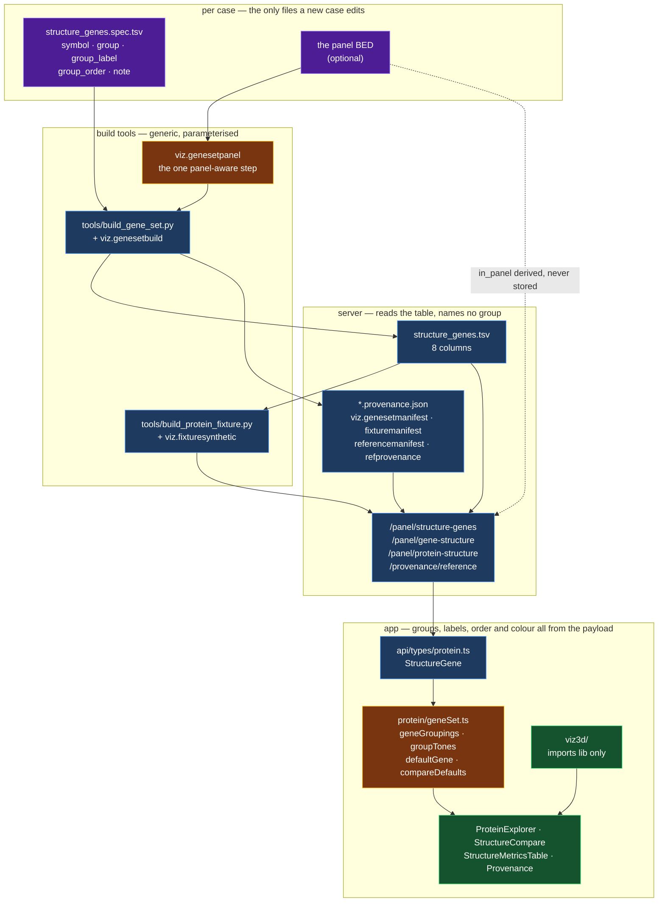

# The structure toolkit, reused on another case

**Standing:** 2026-09-03 — every claim below was checked against this repo on that date.
`tools/check-python.sh` (six gates, 1,580 tests) and `pnpm run check` / `lint:strict` /
`build` / `bundle-budget` are green with the generalisation this note describes. The
extensibility claim is not prose: [`tests/test_viz_genesetbuild.py`](../../tests/test_viz_genesetbuild.py)
builds a **foreign two-gene spec** with invented group ids over a mocked Ensembl, and
[`app/src/pages/panel/protein/geneSet.test.ts`](../../app/src/pages/panel/protein/geneSet.test.ts)
renders the picker, the badges and the legend from invented groups. Both fail if any layer
re-learns this case's gene or group names. Method: [`methodology/064`](../step-0/methodology/064-reusable-structure-toolkit.md).

`CLAUDE.md` asks for two deliverables at once: a solution to *this* case, and a toolkit that
transfers. This note is the second deliverable's map for the **structure** half — the 3D
protein exhibits, the gene set behind them, and the provenance machinery under both. It
says what moves as-is, what one file per new case has to change, and the recipe for each
extension point.

For the *why* of the 3D wrapper itself, read
[three.js behind one wrapper](../step-0/notes/three-js-behind-one-wrapper.md) and
[`app/src/viz3d/README.md`](../../app/src/viz3d/README.md). This note is the reuse map, not
the design argument.

## The shape of it



> **Legend:** purple = the raw input a new case writes by hand (one spec TSV, and a panel
> BED if the case has one), blue = neutral machinery that transfers unchanged, yellow = the
> two decision points where a case's *shape* enters the code (does an annotated panel exist;
> how do groups become headings and colours), green = what a reader ends up with. Solid
> arrows are data flow; the dotted arrow is `in_panel`, derived from the BED at request time
> rather than stored in the table.

## What transfers as-is

| Piece | Path | Why it moves |
|---|---|---|
| The 3D wrapper | [`app/src/viz3d/`](../../app/src/viz3d/) | Imports `lib` **only** — enforced by `eslint-plugin-boundaries`, so it is a failed build, not a review note. It never learns what a `StructureGene` is; the page maps rows to a `Scene3D`. Copy the folder. |
| The gene-set reader | [`src/mva/viz/geneset.py`](../../src/mva/viz/geneset.py) | Reads its TSV **by column name**, treats `group` as an opaque id, and derives `in_panel` from a BED path that is a parameter. |
| The gene-set build | [`src/mva/viz/genesetbuild.py`](../../src/mva/viz/genesetbuild.py) + [`tools/build_gene_set.py`](../../tools/build_gene_set.py) | Case-agnostic by construction: the input is *which symbols, in which group, with which label, rank and note*. The tool is the command line and nothing else. |
| The protein route + mmCIF parser | [`proteinstructure.py`](../../src/mva/viz/proteinstructure.py), [`mmcif.py`](../../src/mva/viz/mmcif.py), [`mmcif_tokens.py`](../../src/mva/viz/mmcif_tokens.py) | Take a gene symbol and a UniProt accession. No panel, no warehouse table, no patient record; a Cα trace is the same for every human. |
| The manifest writers and reader | [`genesetmanifest.py`](../../src/mva/viz/genesetmanifest.py), [`fixturemanifest.py`](../../src/mva/viz/fixturemanifest.py), [`referencemanifest.py`](../../src/mva/viz/referencemanifest.py), [`refprovenance.py`](../../src/mva/viz/refprovenance.py) | One row shape for every manifest family; digest and commit have exactly one definition, shared by writer and reader. Paths are repo-layout constants, not case facts. |
| The provenance route and page | `/api/provenance/reference` in [`routes_warehouse.py`](../../src/mva/viz/routes_warehouse.py), [`app/src/pages/Provenance.tsx`](../../app/src/pages/Provenance.tsx) | Discovers manifests by filename suffix (`*provenance.json`, `_provenance.json`) rather than by a list of known datasets. A new dataset appears by being built. |
| The fixture builder | [`tools/build_protein_fixture.py`](../../tools/build_protein_fixture.py) + [`fixturesynthetic.py`](../../src/mva/viz/fixturesynthetic.py) | Iterates whatever the gene set holds. `--index-only` and `--manifest-only` rewrite the offline index and the digests with no network. |
| The browser drivers | [`app/tools/verify-protein-explorer.mjs`](../../app/tools/verify-protein-explorer.mjs), [`verify-explorer-gating.mjs`](../../app/tools/verify-explorer-gating.mjs), [`verify-provenance.mjs`](../../app/tools/verify-provenance.mjs), [`viz3d-measure.mjs`](../../app/tools/viz3d-measure.mjs) | Drive routes and roles, not gene names. They read what the app offers. |

## What is case-specific, and what to change

| Piece | Path | What a new case does |
|---|---|---|
| The gene list, groups, labels, ranks, notes | `ressources/reference/structure_genes.spec.tsv` | **Rewrite it.** This is the one file that must change. Only `symbol` and `group` are required. |
| The annotated panel | `ressources/data-profile/*.bed` + `viz.panelbed.DEFAULT_BED` | Point `--bed` at your own, or pass a path that does not exist and `--panel-group ''`: nothing is asserted and `in_panel` is `False` everywhere, which reads as "no annotated panel here". |
| The verified aliases | `geneset.ALIASES` (mirrored in `geneSet.ts` and `fixtures/shape/structure-genes.ts`) | Three hand-kept copies of one map, because no layer may import the others. Replace all three, or empty all three. **Never add an entry Ensembl has not confirmed** — `tools/build_gene_set.py --alias A=B` is the check. |
| The two genes the comparison opens on | `COMPARE_A` / `COMPARE_B` in `geneSet.ts` | Leave them: `compareDefaults` prefers them *if the set holds them* and otherwise falls back to the first two `in_panel` rows. Change them only to name a preference. |
| The page's opening gene | `DEFAULT_GENE` in `app/src/pages/panel/LocusExplorer.tsx` | Still a literal, because that exhibit's vocabulary is the warehouse's panel gene list, not the structure set. `ProteinExplorer` passes it through `defaultGene(genes, DEFAULT_GENE)`, so a foreign set degrades to its own first `in_panel` row rather than 404ing. |
| The prose in the exhibits | `ProteinNotes.tsx`, the `Legend`s, methodology entries | Written about this case. Reads correctly for another one only where it says `in_panel` rather than naming a group. |

## The two rules that make it transfer

1. **`in_panel` is the only semantic flag.** It means *this gene carries the proband's
   annotated alleles*. It is derived from the BED at request time, never stored in the
   reference table, and it is the only field an exhibit may branch on to decide what it
   claims about the patient. Every "fold only", every `n/a — fold only` cell and every
   unpainted allele reads this flag.
2. **A group id carries no claim.** `group` is a free-form string; `group_label` is the
   sentence a reader sees and `group_order` is the group's rank. Colour is assigned by
   **rank**, never by id, so renaming a group keeps its colour and a fourth group gets a
   fourth tone instead of falling through to grey. No module in `src/mva/viz/` or `app/src/`
   contains the string `panel` as a group *test*.

## Extension recipes

### A new gene group

1. Add rows to `structure_genes.spec.tsv` with a new `group`, its `group_label` and its
   `group_order`. Every row of one group must state the same label and the same order — the
   build refuses otherwise, because the frontend groups by id and would render one of two
   labels arbitrarily.
2. `uv run python tools/build_gene_set.py --spec … --reuse` if you added no new *symbol*
   (curation-only: it rewrites the group columns, carries every Ensembl-derived column over
   and calls nothing), otherwise run it without `--reuse` to resolve the new symbols live.
3. `uv run python tools/build_protein_fixture.py --index-only` then `--manifest-only`.
   Add `--gene NEWSYM` (no flags) first if a new symbol needs its own fold fixture.
4. `cd app && pnpm run test` — the fixture-hash test tells you which offline payload moved,
   and you re-bless it on purpose.

Nothing in the app changes. The picker, the badges, the legend and the bar colours pick the
new group up from the payload.

### A new 3D scene kind

Follow [`app/src/viz3d/README.md`](../../app/src/viz3d/README.md#recipe-add-a-new-scene-kind): add
the adapter in `viz3d/adapters/`, keep it pure (rows in, `GeometryBuffers` out), and do the
row → `Scene3D` mapping in the *page*, never in `viz3d`. The boundary lint fails if the
adapter reaches for `api`.

### A new 3D exhibit on an existing scene kind

Build the `Scene3D` in a `pages/**/buildScene.ts`-style pure module, unit-test it there, and
mount `Viz3dCanvas` in the exhibit. jsdom has no WebGL, so a component test exercises
`SceneFallback` — which is the accessible twin, and the thing worth asserting anyway.

### A new reference manifest

Write the manifest from the tool that produced the file, never by hand, and name it
`<dataset>_provenance.json` (or `_provenance.json` inside a fixture directory). Use
`refprovenance.digest`, `refprovenance.now` and `refprovenance.code_version` so a digest
recorded at build time and one computed later cannot differ. `/api/provenance/reference` and
the Provenance page then list it with no code change.

### A whole new case

```bash
# 1. write ressources/reference/structure_genes.spec.tsv for the new case
uv run python tools/build_gene_set.py \
    --spec ressources/reference/structure_genes.spec.tsv \
    --bed path/to/your_panel.bed --panel-group panel \
    --alias OLDSYM=NEWSYM            # each alias is verified against Ensembl, not assumed

# 2. one real fold + gene-structure fixture per gene (network, ~3 calls per gene)
uv run python tools/build_protein_fixture.py
uv run python tools/build_protein_fixture.py --manifest-only

# 3. gates
tools/check-python.sh --fix
cd app && pnpm run check && pnpm run lint:strict && pnpm run build
```

Then re-bless the fixture hashes in `app/src/test/fixtureHashes.json`, and rewrite the
case-specific prose in the exhibits. No TypeScript type, no route and no component needs an
edit for the gene set itself.

## Known limits

- **`geneset.ALIASES` is three hand-kept copies** (server, app, fixture). One map, one entry
  today; a generated map would be a build step for six characters. Listed here so the next
  case knows to replace all three.
- **`tools/build_gene_set.py` assumes human Ensembl** — `/lookup/symbol/homo_sapiens/…`. A
  non-human case needs the species in the path parameterised.
- **`proteinstructure.py` prefers AlphaFold** and treats an experimental PDB entry as the
  exception. A structural-biology case wanting PDB-first would invert that preference.
- **The exhibits' prose is written about this case.** The mechanics transfer; the sentences
  in `ProteinNotes.tsx` and the exhibit legends are about MVA and need rewriting.
