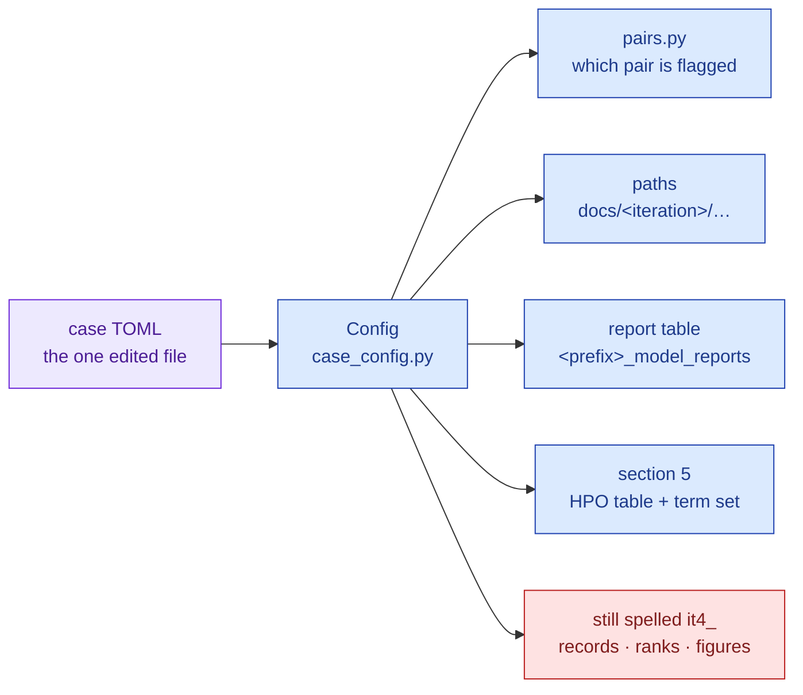

# One config block, not a constant: pointing the zoo at another illness

**Standing:** decided and implemented 2026-09-19 (commit `6bc57ac`, iteration 4 wave 3).
Holds. The inventory at the bottom is the part that dates: it is true as of that commit and
must be re-checked whenever a zoo writer is touched.

## The decision

Everything that makes a zoo run *about this child* lives in one `[case]` block of the run
TOML (`src/mva/zoo/zoo.example.toml`, copied into `src/mva/zoo/cases/<name>.toml`):

| key | what it decides | empty / default |
|---|---|---|
| `label` | the human name printed in every report header and manifest | `""` → the header prints `—` |
| `iteration` | the docs folder the answers land in (`docs/<iteration>/…`) | `iteration4` |
| `table_prefix` | the result-table prefix and the run-id prefix (`it4-<digest>`) | `it4` |
| `confirmed_gene` | the gene whose biallelic pair is the answer, **by symbol** | `""` → nothing is flagged and every report says *no confirmed pair declared* |
| `confirmed_pair_rule` | which pair of that gene carries the flag: `lof+missense` or `all` | `lof+missense` |
| `phenotype_term_set` | which HPO ranking section 5 of every report quotes | `with-parental` |
| `hpo_table` | the warehouse table that ranking is read from | `hpo_gene_scores` |

`[paths]` derive from `iteration` and `table_prefix` when absent. `mva-zoo run --case-gene X
--iteration Y` overrides the block for one invocation and re-derives every default path.

Running a second case is therefore: copy the file, edit seven keys, run six commands. The
walkthrough is [`../iteration4/reusability.md`](../iteration4/reusability.md); the proof it
works is `tests/test_zoo_case_config.py`, which runs the whole eight-stage workflow on a
second case and asserts nothing of iteration 4's leaks into it.

> **Legend** — purple = the one file a new case edits; blue = machinery that reads the case
> and needs no change; red = what the case block does *not* reach yet (the inventory below).
> An arrow means "is decided by".

## Alternatives rejected

| alternative | why not |
|---|---|
| **Environment variables** (`MVA_CONFIRMED_GENE=…`) | A run's identity is the sha256 of its config file. A value that reaches the run without being in that file breaks the "same config = same run id" property, which is what makes every stage safe to re-run. |
| **A `cases/` Python module per case** | Makes a case a code change, which is exactly what this note removes. It also invites a case to carry logic, and then two cases quietly diverge. |
| **A CLI flag per case value, no file** | Eleven flags a caller must remember and no digest to hash. Flags remain, but only as *overrides* of a file. |
| **Keep `[run] hpo_term_set` where it was** | The phenotype term set is a property of the case (this child's terms), not of how the run is scored. It is read from `[case] phenotype_term_set`, and the old `[run]` key is still accepted so an older config still parses. |
| **Rename the tables of the existing run** | The R1 results (`it4_model_ranks`, 402 rows; `it4_allele_records`, 39,286 rows) are already written, cited by entries 114–130 and read by the API. Renaming them would rewrite history for no gain. The prefix is configurable *forward*; iteration 4 keeps `it4`. |

## Still fixed — the honest inventory

These spell `it4` (or this case) themselves. A second case with a different `table_prefix`
would have its ranks and records land in iteration 4's tables. None of it is hidden; it is
listed so that a reader knows what "reusable" currently buys.

| what | where | note |
|---|---|---|
| `it4_allele_records` | `src/mva/zoo/types.py` `RECORDS_TABLE`, used by `record_write.py` | the step-1 table name |
| `it4-allele-records` (lineage transform) | `src/mva/zoo/record_write.py` `TRANSFORM` | the edge label for step 1 |
| `it4_model_ranks` | `src/mva/zoo/rank.py` `MODEL_RANKS_TABLE` | the step-4 table name; `write_ranks` takes no table argument |
| `it4-score:<model>` (lineage transform) | `src/mva/zoo/cache.py` | the edge label per scored lane |
| `build/it4/...` defaults | `record_write.DEFAULT_OUT_DIR`, `adapters/__init__.DEFAULT_RECORDS`, `adapters/duckdb_lookup.TABLES`, `adapters/protein_table.TABLES`, `adapters/vep_rest.CHECKPOINT_ROOT`, `record_hgvs.DEFAULT_CHECKPOINT`, `models.d/esm1b.toml` | overridable by argument or `--config`, but the *default* is iteration 4's |
| `figures/it4/score-histogram-<key>.svg` | `src/mva/zoo/report_stats.py` `histogram_path`, `REPORT_TO_ROOT` | the figure link a report prints |
| `HPO_TERM_COUNT = 8` | `src/mva/zoo/report_stats.py` | **this child's** term count, printed in section 5 of every report |
| `docs/iteration4/cards` | `src/mva/zoo/registry.py` (the how-to string in the module docstring) | `write_cards` itself takes the directory |
| `tools/render_it4_figures.py` | the whole script | reads `build/it4/`, writes `figures/it4/` |

Two of these are one-line changes the moment a second case needs them (`RECORDS_TABLE` and
`MODEL_RANKS_TABLE` would take a `table` argument exactly as
`mva.zoo.report.write_reports` now does). They were left alone in this pass because the
files belong to another agent's ownership boundary in wave 3, and an edit there would have
been a merge conflict, not a feature.

`allele_scores` is **deliberately** unprefixed: the score cache is keyed on
`(model, version, allele_id)`, and an `allele_id` is a hash of a normalized change against a
pinned reference. Two cases that contain the same change should share the cached score —
that is the cache paying for itself, not a leak. What must not be shared is anything
*ranked*, because a ranking is relative to one callset.

## What would prompt a rethink

- A second case actually being run end to end: whatever it forces is the next revision of
  this note, and the inventory above shrinks by whatever it touched.
- A case needing more than one confirmed gene (a digenic hypothesis). `confirmed_gene` is a
  single symbol today; that would become a list, and the pair-flagging rule would need to say
  what "the confirmed pair" means across two genes.
