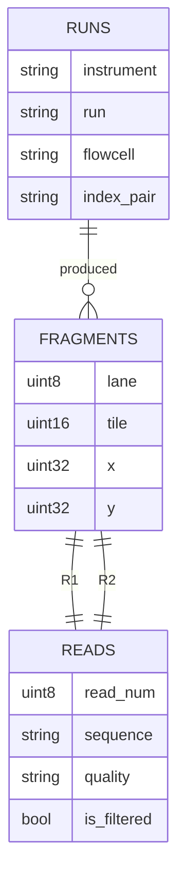
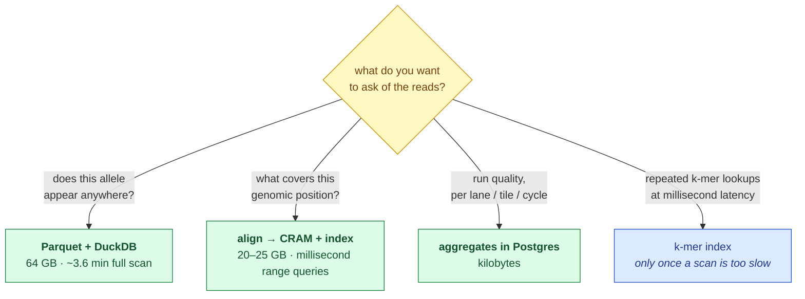

# Making the raw reads queryable

How to normalise 1,079,858,785 sequencing reads into something you can query, and which
database to put them in. Every number below is measured on this dataset unless labelled an
estimate.

## The short answer

**DuckDB over Parquet — not PostgreSQL.** Measured, for all 1.08 billion reads:

| Store | Size | Note |
|---|---|---|
| Source `.fastq.gz` | 82 GB | as delivered |
| **Normalised Parquet + zstd** | **64 GB** | *smaller than the source*, and queryable |
| PostgreSQL | ~378 GB (estimated) | row store, no column compression, 24 B/row header |

Parquet beats gzip here because it splits sequence from quality before compressing, and the
two have very different entropy. Postgres is the wrong shape for this data by roughly 6×.

**But first check whether you need the reads at all** — see [the limit](#the-limit-no-amount-of-normalising-gives-you-coordinates).

## What "normalising" a FASTQ actually means

A FASTQ record is four lines, and the first is a composite key with eight fields crammed
into it:

```
@A01973:164:HGWCNDSX7:1:1101:11957:1000 1:N:0:GTGACGGAGC+NGGACCGCCA
 │       │   │         │ │    │     │    │ │ │ │
 │       │   │         │ │    │     │    │ │ │ └─ index (i7+i5 barcode)
 │       │   │         │ │    │     │    │ │ └─── control number
 │       │   │         │ │    │     │    │ └───── filtered Y/N
 │       │   │         │ │    │     │    └─────── read number (1 or 2)
 │       │   │         │ │    │     └──────────── y position on the tile
 │       │   │         │ │    └────────────────── x position on the tile
 │       │   │         │ └─────────────────────── tile
 │       │   │         └───────────────────────── lane
 │       │   └─────────────────────────────────── flowcell
 │       └─────────────────────────────────────── run
 └─────────────────────────────────────────────── instrument
```

Proper normalisation splits that into a dimension table and a fact table:



> **Legend** — `RUNS` is constant per file (**one row**, not 1.08 billion).
> `FRAGMENTS` is the flowcell coordinate `(lane, tile, x, y)`, which is the natural key
> **shared by a read and its mate** — that is what pairs R1 with R2, and it removes the
> duplicated read name across the two files. `READS` carries the payload.

### The catch: normalising saves almost nothing

Measured per-column storage over 1,000,000 reads:

| Column | Compressed | Share | Compression |
|---|---|---|---|
| `sequence` | 42.7 MB | **71.8%** | 3.6× |
| `quality` | 15.0 MB | **25.2%** | 10.2× |
| `x` | 1.6 MB | 2.7% | 1.0× |
| everything else | 0.2 MB | 0.3% | — |

**Sequence and quality are 97% of the bytes.** Every field the read name unpacks into —
lane, tile, coordinates, barcode, filter flag — costs 3% combined. So normalise for
*clarity and correct joins*, not to save space; there is no space to save.

Two reasons the payload cannot shrink much further:

* **Sequence is near-incompressible.** Real DNA carries close to 2 bits per base, and zstd
  already reaches 42.7 bytes for a 149 bp read — about what a 2-bit packing would give
  (37 bytes) before compression. Bit-packing buys perhaps 15%, at the cost of every query
  needing to decode.
* **Quality already compresses 10×** because this NovaSeq run uses **4-level quality
  binning**: only `#`(Q2), `,`(Q11), `:`(Q25), `F`(Q37) appear, and 92.8% of all bases are
  `F`. Nothing more to win.

## What you can actually query, and how fast

Measured on 1,000,000 reads, extrapolated linearly to all 1.08 billion:

| Query | 1M reads | All 1.08B |
|---|---|---|
| Exact 31-mer substring scan | 143 ms | **~2.6 min** |
| 31-mer + reverse complement | 200 ms | **~3.6 min** |
| Aggregate QC grouped by tile | 90 ms | ~1.6 min |

A **~3.6 minute full scan for a specific 31-mer, both strands** is the mapping-free
allele check the strategy brief calls the "k-mer strike" — as a SQL query, with no aligner
and no index build. That is the case for putting reads in DuckDB.

If you need that in milliseconds rather than minutes, build a k-mer index (a
`kmer -> read_id` table) — but only once a scan proves too slow, because the index is far
larger than the reads.

## The limit: no amount of normalising gives you coordinates

This is the part no database choice can fix. **A raw read has no genomic position.** The
FASTQ says a 149-base string came off tile 1101 at (11957, 1000); it does not say it came
from chromosome 15. So these questions are unanswerable from normalised reads, at any cost:

* "Which reads cover *BUB1B* exon 3?"
* "What is the depth at chr15:40,161,000?"
* "Is this variant supported by reads on both strands?"

Answering them requires **alignment** — placing each read on the reference — which produces
a BAM or CRAM. That file, coordinate-sorted with an index, *is* the queryable read database,
and `samtools view chr15:40161000-40162000` is the range query. It is a domain-specific
database rather than a SQL one, and no relational schema replaces it.

CRAM is the compact form: reference-compressed, storing only differences from the
reference, typically **20–25 GB** for a genome at this depth — smaller than both the FASTQ
and the Parquet, *and* coordinate-indexed.

## Recommendation, by what you actually want



> **Legend** — **yellow = the question that decides everything**; **green = a recommended
> store**; **blue = a later optimisation, not a starting point.** All four can coexist:
> they are derived from the same FASTQ, which stays untouched.

**Postgres is not on this diagram for the reads themselves**, and that is the one firm
conclusion: ~378 GB with no column compression, versus 64 GB in Parquet, for a workload
that is pure sequential scan — exactly what a row store is worst at. Read *aggregates*
belong in Postgres; read *payloads* do not.

## Proposed schema, if you go the Parquet route

Partitioned by lane so a per-lane query touches one directory:

```
reads/lane=1/part-*.parquet
```

| Column | Type | Bytes/read (measured) |
|---|---|---|
| `tile` | USMALLINT | ~0 |
| `x`, `y` | UINTEGER | 1.7 |
| `read_num` | UTINYINT | ~0 |
| `is_filtered` | BOOLEAN | ~0 |
| `sequence` | VARCHAR | 42.7 |
| `quality` | VARCHAR | 15.0 |

`instrument`, `run`, `flowcell`, `index_pair` and `lane` go to a one-row `runs` table —
they are constant within a file. `(lane, tile, x, y)` joins a read to its mate.

**Cost to build:** parsing ran at ~100,000 reads/second single-threaded, so ~3 hours for
all 1.08 billion, or well under an hour across the 8 files in parallel.

## Data handling

Reads are patient data, and the `index_pair` barcode is library identity — the committed
profile redacts it deliberately. Whatever store is built must live outside the repository,
on access-controlled infrastructure, and be deleted within 30 days of close along with
everything else derived from the delivery.
