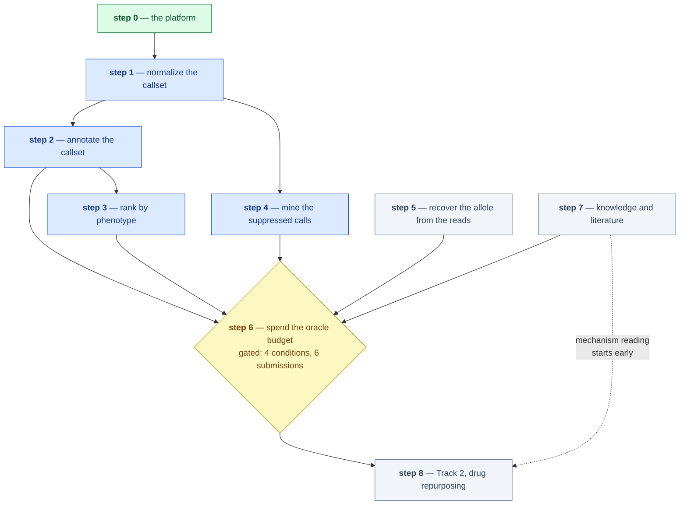

# Roadmap — the solving phase

**Standing:** the sequencing plan for steps 1–8, re-checked 2026-09-04.

This page owns the order the steps run in and what each step must finish, produce and
build. It owns nothing else: what exists today is [`current-state.md`](current-state.md);
every measured number [`../ideation/data-findings.md`](../ideation/data-findings.md); why
a choice was made [`decisions.md`](decisions.md); the six-route portfolio
[`../ideation/solution-paths.md`](../ideation/solution-paths.md); scorer mechanics and
biology priors [`../ideation/hackathon-intel.md`](../ideation/hackathon-intel.md); how a
claim becomes a verdict [`method.md`](method.md).

Each step is a **research step with one goal**, declared in
[`../src/mva/science/steps.py`](../src/mva/science/steps.py) (`uv run mva-science steps`)
and quoted verbatim below. A step is finished when its **hypotheses have verdicts**, not
when its code runs. Three rules fixed 2026-09-04:

- **Step 0 is closed** at [entry 068](step-0/methodology/068-step-0-close-out.md). Next research entry: **069**. Numbers stay
  global and monotonic across step folders.
- Tooling a research step needs (app page, API route, module) is recorded in **that step's**
  methodology. Cross-step platform fixes still go to step-0, naming the step that needed them.
- A hypothesis filed after its test already ran is labelled `retrospective` — how the panel
  results measured under step-0 enter steps 2 and 4.

## Where we stand

- **Leading candidate:** a BUB1B pair — one `stop_gained`, one `missense_variant`, both
  het, both PASS ([§6.1](../ideation/data-findings.md)). **Phase is unknown**: two `0/1`
  calls are equally consistent with *cis*, so this is an observation, not a verdict.
- **Four independent checks converge** on it: VEP rarity, ClinVar site-first, suppressed
  calls, phenotype ranking ([§6.2](../ideation/data-findings.md)).
- **Unbuilt:** the normalization seam (1); layer 2 and a genome-wide annotator (2);
  alignment and SV calling (5, funded only as the k-mer strike); all Track 2 code (8).
- **Oracle budget: 0 of 6 spent.** One registered member, so 6 is the ceiling; ≥ 1 is held
  in reserve to the freeze.

## The dependency graph



> **Legend** — **green = done** (step 0, closed at entry 068); **blue = open** (started,
> hypotheses not yet all resolved); **grey = planned** (not opened); **yellow = the
> decision point** (the probe gate). Solid arrows are hard dependencies; the dotted arrow
> is work that may start before its dependency lands.

## Step 1 — Normalize the callset

**Goal:** *Does every variant in the callset have exactly one spelling, so that an
exact-string-matching scorer can be trusted with an indel?*
Step page: [`step-1/README.md`](step-1/README.md).

- **Status:** open, nothing run.
- **Already done:** nothing. No hypothesis filed.
- **Remaining:** fetch the no-chr GRCh38 analysis-set FASTA (~3 GB, local, fine); run the
  command below; make normalization a **tested pipeline seam**, so "was this normalized?"
  is answerable in code rather than by remembering a shell command; re-run the ClinVar
  exact-string join, a lower bound until indels are normalized
  ([§6.2](../ideation/data-findings.md)).

```bash
# Reference = the no-chr analysis set, matching the VCF's contigs. <scratch>/ is a
# gitignored dir materialized from the warehouse via the reads/viz API — bcftools needs
# real file bytes regardless of the backing store.
bcftools norm -m -both -f GRCh38_no_chr.fa <scratch>/proband.vcf.gz \
  -Oz -o <scratch>/proband.norm.vcf.gz
bcftools index -t <scratch>/proband.norm.vcf.gz
```

- **Exit criterion:** a verdict on the spelling hypothesis — records split, indels
  left-aligned, a round-trip test proving the seam is applied.
- **Report artifact:** before/after site and allele counts; one indel in both spellings.
- **Tooling:** a `normalize` stage in `mva.pipeline`, plus a table for the normalized
  callset.

## Step 2 — Annotate the callset

**Goal:** *Which variants are rare enough and damaging enough to cause an ultra-rare
recessive disease, and in which gene?* Step page: [`step-2/README.md`](step-2/README.md).

- **Status:** open — the panel is annotated, the genome is not.
- **Already done:** VEP REST over the eight-gene panel
  ([031](step-0/methodology/031-vep-rest-panel-annotation.md)) collapses it to the two
  BUB1B alleles ([§6.1](../ideation/data-findings.md)); ClinVar presence measured
  site-first ([051](step-0/methodology/051-clinvar-presence.md)).
- **Remaining:**
  - file the panel result as a `retrospective` hypothesis with its refutation condition;
  - build **layer 2** (`variants`, `genotypes`, `variant_info`) so the annotation join has
    somewhere to land ([design](step-0/data-layers.md));
  - a genome-wide backend behind the [annotation port](notes/annotation-as-a-port.md) —
    offline VEP cache plus gnomAD; the choice is open in [`decisions.md`](decisions.md);
  - required fields: gene symbol, consequence, gnomAD popmax AF. Valuable: CADD, REVEL,
    AlphaMissense, ClinVar significance, and SpliceAI — a deep intronic splice change is a
    strong shape for the missing allele.
- **Exit criterion:** the genome-wide rare protein-altering set exists, and "no pair
  outside the panel beats the BUB1B pair" has a verdict.
- **Report artifact:** the filtering funnel — every filter with its removal count.
- **Tooling:** layer-2 tables, the VEP-cache backend, a funnel page — under step 2.

## Step 3 — Rank by phenotype

**Goal:** *Does an unbiased genome-wide ranking driven by the child's HPO terms agree with
the panel-first candidate list?*
Step page: [`step-3/README.md`](step-3/README.md).

- **Status:** open — the ranking is built and has run; the confirmatory join has not.
- **Already done:** Exomiser's human-only phenotype path reimplemented in Python
  ([`src/mva/phenotype/`](../src/mva/phenotype/README.md),
  [067](step-3/methodology/067-phenotype-ranking-without-java.md); results and limits in
  [§6.2](../ideation/data-findings.md)). It needed neither step 1 nor step 2 — ranking
  genes by symptoms reads no callset — so the dependency this page assumed did not exist.
- **Remaining:** the cross-check the step was written for — **join the ranking to the
  callset's rare protein-altering alleles** and see whether the top-ranked genes carrying a
  candidate pair are the ones the panel-first route produced. Needs step 2's genome-wide set.
- **Exit criterion:** a verdict on the corroboration claim — refuted if a better-ranked
  gene carries a stronger pair.
- **Report artifact:** rank-vs-candidate scatter over curated genes, panel genes labelled.
- **Tooling:** the ranking↔callset join as a `Derivation`, and the app view — under step 3.

## Step 4 — Mine the suppressed calls

**Goal:** *Is one of the two alleles hiding in a call the quality filters discarded, rather
than absent from the sample?* Step page: [`step-4/README.md`](step-4/README.md).

- **Status:** open. Closed for the panel, untested genome-wide.
- **Already done:** the panel's non-PASS records annotated and screened — **none rare and
  protein-altering**; TRIP13's cluster is a paralogous-read pileup
  ([049](step-0/methodology/049-suppressed-calls.md), [§6.2](../ideation/data-findings.md)).
- **Remaining:**
  - file the panel result as a `retrospective` hypothesis;
  - the genome-wide pass over the non-PASS calls, dominated by `MQ40` and `QD2`
    ([§3](../ideation/data-findings.md)) — hours of SQL against a day of re-calling, so it
    runs before any FASTQ work;
  - a rescue score re-weighting filter reasons by mappability rather than trusting them.
- **Exit criterion:** a verdict on whether any suppressed call is a credible second allele.
- **Report artifact:** filter-reason × gene heat map; before/after rescue funnel.
- **Tooling:** rescue views as `Derivation` records in `src/mva/warehouse/analysis.py`.

## Step 5 — Recover the second allele from the reads

**Goal:** *Is the missing allele a variant the caller could not emit at all — a structural
variant, a deep intronic call, or a low-fraction mosaic?*
Step page: [`step-5/README.md`](step-5/README.md).

- **Status:** planned, conditional on steps 2–4 leaving a gap.
- **Already done:** the k-mer strike over the Parquet read store works and is timed
  ([024](step-0/methodology/024-the-kmer-strike-works.md)); the BAF karyogram bounds
  mosaicism at VCF level only ([037](step-0/methodology/037-baf-karyogram.md)).
- **Remaining, staged:**
  - **A — the k-mer strike (funded, local, first).** Stream the reads once against panel
    gene k-mers ±50 kb, recover the matching pairs, align that small set to the *full*
    GRCh38 so reads belonging elsewhere map elsewhere, then `mosdepth` per-exon coverage,
    Manta/Delly breakpoints, IGV evidence shots.
  - **B — full re-alignment and re-call. Conditional and unfunded.** No Modal budget is
    confirmed, and locally it is ~1.5 days of alignment on 12 cores with 15 GB of RAM
    ruling out `bwa-mem2`. Never a prerequisite; open it only if A leaves a real question
    and money appears. If it runs: per-lane read groups and checkpoints, CRAM against the
    same no-chr reference, wall-clock and cost per stage (methods form Q17).
  - Develop against the 200k-read smoke sample first (seconds per run; all tile 1101, so
    it exercises a pipeline, not quality).
- **Exit criterion:** a verdict on whether a read-level allele exists in the candidate gene,
  or an explicit statement that only A ran and what it could not see.
- **Report artifact:** per-exon coverage plot; IGV shots of any breakpoint — **aggregates
  and renders only, no raw patient reads in the repo**.
- **Tooling:** the k-mer filter as a case-agnostic "targeted read recovery without
  alignment" tool, plus the coverage plot.

## Step 6 — Spend the oracle budget

**Goal:** *Which candidate pair does the scorer confirm, and what does each reply tell us
that the next submission should exploit?* Step page: [`step-6/README.md`](step-6/README.md).

- **Status:** planned, gated. **0 of 6 submissions spent.**
- **Already done:** the [local scorer replica](notes/local-scorer-replica.md)
  (`src/mva/pipeline/scorer.py`), the payload builder
  ([046](step-0/methodology/046-probe-builder.md), `src/mva/viz/probebuild.py`), the ledger.
- **The gate — no upload until all four hold** (timing decided when the step opens):
  (a) the callset is normalized (step 1); (b) hypotheses filed, each with a prediction and
  a refutation condition; (c) the CSV rehearsed byte-for-byte on the local scorer replica
  via the payload builder; (d) **≥ 2 independent methods agree** on the candidate.
- **Reserve rule:** at least **1 of the 6** is held to the 2026-10-24 freeze, for an
  indel-representation retry or a leaderboard defence. An alternate indel spelling costs a
  *row*, not a submission — exhaust rows first.
- **Remaining:** the probe designer (bitmask hypothesis space, simulate every probe against
  the replica, submit the highest expected information gain), then decode per
  [intel §9](../ideation/hackathon-intel.md) and log every spend.

```bash
uv run mva-warehouse probe-budget      # how many of the 6 are left
uv run mva-warehouse probe-log --by <member> --type S --payload-file build/probe_s1.csv \
    --response '<what the scorer replied>' --rationale 'singles scan, intel §9.1'
```

- **Exit criterion:** a confirmed pair at rank 1 in the final submission, every reply
  logged as evidence against the hypothesis it tested.
- **Report artifact:** the verified decode table and a per-probe entropy-reduction chart.
- **Tooling:** the information-gain probe designer and the decode-table verifier.

## Step 7 — Knowledge and literature

**Goal:** *Does public knowledge — published MVA cases, ClinVar, protein-model scores —
name an allele or a pair the data-driven steps missed, or independently corroborate the one
they found?* Step page: [`step-7/README.md`](step-7/README.md).

- **Status:** planned. This step is
  [solution paths 5 and 6](../ideation/solution-paths.md) — desk and API work with no
  shared bottleneck, so it runs beside steps 1–5.
- **Already done:** nothing beyond the ClinVar presence join counted under step 2.
- **Remaining:**
  - **reported-allele catalogue** — PubTator3/LitVar2 + ClinVar mined for every published
    MVA/SAC-gene allele, joined against the callset;
  - **protein-model scores** — ESM/AlphaMissense zero-shot on missense candidates, plus  domain
    mapping (a kinase-domain hit outranks a linker hit);
  - **LLM evidence tournament** — pairwise judged matches between candidate pairs, every
    judgment carrying a PMID or discarded, fused with the mechanical rank by RRF;
  - **case-report hunt** — the MVA literature against the child's phenotype vector; a
    matching published compound-het case *is* the answer key;
  - **trap-first conditional partner search** — for each strong single allele, search
    *conditionally* for its partner (SpliceAI across the gene's introns, step 5's
    breakpoints, step 4's suppressed calls) rather than ranking pairs symmetrically;
  - **spike-in harness** — known MVA pairs injected into GIAB-based callsets and reads,
    each method checked for recovery. The only honest pre-oracle calibration.
- **Exit criterion:** verdicts on two claims — no published allele beats the current
  candidate, and the spike-in recovery rate is measured rather than assumed.
- **Report artifact:** the tournament bracket with cited judgments; the catalogue-overlap
  table; the per-method spike-in recovery table (the honesty proof).
- **Tooling:** a case-agnostic allele-catalogue fetcher/joiner, the audited tournament
  re-ranker, a conditional-partner mode in `pipeline/ranking.py`, the spike-in harness.

## Step 8 — Track 2, drug repurposing

**Goal:** *Which market-approved drugs act on the mechanism the confirmed alleles imply,
and how strong is the evidence for each?* Step page: [`step-8/README.md`](step-8/README.md).

- **Status:** planned. **Nothing executed.**
- **Timing:** desk research and case-agnostic drug-source tooling start **week 2**.
  Ranking and verdicts wait for the pair step 6 confirms — a mechanism argued from an
  unconfirmed allele is a guess dressed as rigour. Submit **~2026-10-20**, one shot.
- **Remaining:**
  - mechanism characterisation in **methods-form Q14 structure** — loss- vs gain-of-function,
    pathway, downstream consequence. Here: SAC weakening → missegregation → aneuploidy and
    tumorigenesis;
  - directions named in the brief, none investigated: agents reinforcing the spindle
    assembly checkpoint, aneuploidy-selective stressors exploiting proteotoxic and
    metabolic stress, proteostasis strategies if the allele is a hypomorph,
    cancer-prevention framing for the child's actual malignancy;
  - sources, per the form: **DrugBank, ChEMBL, ClinicalTrials.gov, OMIM, PubMed**.
    **Market-approved drugs only.** LLM-assisted search is legitimate (Q9). Scored
    35% rigor / 25% impact / 25% innovation / 15% scalability.
- **Deliverables:** report, public repo, 3-minute pitch video, one designated submitter.
- **Exit criterion:** a ranked list where every drug carries a cited mechanistic link to
  the confirmed alleles, each verdict registered.
- **Report artifact:** the drug × mechanism evidence table; a pathway diagram from allele
  to each intervention point.
- **Tooling:** a case-agnostic drug-source fetcher (one adapter per source) and the
  evidence-table renderer.

## Still open

Re-checked 2026-09-04. Three former rows are gone because they were **answered** (all in
[§6.2](../ideation/data-findings.md)): `HP:0200067` should be excluded
([067](step-3/methodology/067-phenotype-ranking-without-java.md) §5); the candidate is
already in ClinVar ([051](step-0/methodology/051-clinvar-presence.md)); the aneuploid
fraction sits below the VCF-level floor, every autosome flat
([037](step-0/methodology/037-baf-karyogram.md)).

| Unknown | How to resolve | Blocks what |
|---|---|---|
| Consequence and frequency of the **genome-wide** callset | offline VEP cache + gnomAD + dbNSFP join | step 2's exit; the unbiased ranking the methods form rewards |
| Coverage of BUB1B / TRIP13 / CEP57 exons and splice sites | `mosdepth` on the candidate loci — needs aligned reads, so gated on step 5 | whether "absent" means absent, especially for telomere-proximal *TRIP13* |
| Whether an SV is one of the two alleles | align, then Manta / Delly / smoove consensus + gCNV | the largest blind spot — an SV allele *cannot* be in the delivered VCF |
| Whether the pair is in *trans* | read-backed phasing, or the oracle | the pair claim itself; two `0/1` calls are also consistent with *cis* |
| Whether nephrocalcinosis belongs to the MVA picture | literature check against reported MVA cases (step 7) | differential lead or footnote |
| **Layer-2 schema** — multiallelic splitting, INFO as columns vs MAP | decide while building it in step 2 | [`data-layers.md`](step-0/data-layers.md); [`decisions.md`](decisions.md) |
| **Annotation backend** — REST vs offline cache genome-wide | staged is the lean; settle in step 2 | [`decisions.md`](decisions.md) |

## The week plan

Today is 2026-09-04; the leaderboard freezes **2026-10-24 23:59 UTC** — seven weeks.
Qualitative review runs to 2026-11-24 and is the tiebreaker, so **analysis and the report
outrank oracle tactics.**

| Week | Dates | Steps running | Also |
|---|---|---|---|
| 1 | Sep 04–10 | 1 (normalize + seam), 4 (genome-wide non-PASS) | step 0 closed at entry 068 |
| 2 | Sep 11–17 | 2 (layer 2 + genome-wide annotator), 7 (catalogue, case-report hunt) | **Track 2 desk research and drug-source tooling start** |
| 3 | Sep 18–24 | 2 finishes, 3 (ranking↔callset join), 7 (PLM scores, spike-ins) | first genuine genome-wide candidate table |
| 4 | Sep 25–Oct 01 | 5A (k-mer strike), 7 (tournament), gate review for step 6 | 5B stays closed unless funded |
| 5 | Oct 02–08 | 6 opens if the four gate conditions hold | **report writing starts** — figures as each step lands |
| 6 | Oct 09–15 | 6 (decode and follow-up probes), 8 (ranking once the pair is confirmed) | methods form filled honestly, Q10–Q18 |
| 7 | Oct 16–24 | 6 final strike, ≥ 1 submission still in reserve | Track 2 submitted ~Oct 20; freeze Oct 24 23:59 UTC |

After the freeze: review to Nov 24, then the **deletion obligation**. Everything derived
lands in the warehouse on the VPS, so dropping its schema plus `rm -rf ~/ubuntu/data` and
any cloud volumes covers it and the confirmation email can be sent honestly. Anything
written outside the warehouse — a stray BAM, a notebook checkpoint, a forgotten volume —
is a compliance liability.
