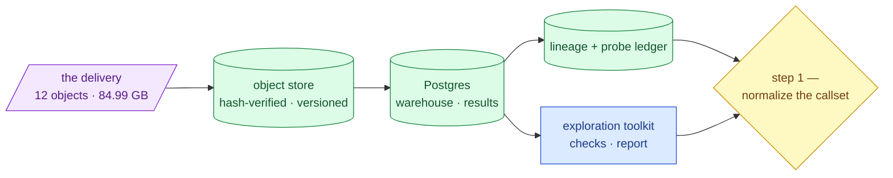

# Step 0 — the platform

**Standing:** the index for step 0. Every page here describes machinery that **exists and
runs**; nothing in this folder is a plan. Direction lives in
[`../roadmap.md`](../roadmap.md), current numbers in
[`../current-state.md`](../current-state.md). Last checked 2026-08-29.

## What step 0 is

Everything done *before* the first unstarted roadmap step (normalize the callset). It is
the platform the causal-variant search runs on top of:

- the delivery fetched, hash-verified and pinned in an object store,
- ingested into Postgres as a lossless anchor table,
- derived tables written back, with lineage and an oracle probe ledger,
- an exploration toolkit that renders the committed data profile.

It contains **no candidate variants and no ranking**. Step 0 answers "can we trust and
query the bytes?", not "which pair is causal?".

### Step 0 takes no hypotheses

Step 0 is *machinery*, and that makes it a different kind of step from every one after it.
"PostgreSQL is the right database" is a decision with alternatives, judged by whether it
works — not a claim about the patient that evidence could refute. So:

* its reasoning lives in [`notes/`](notes/) as **decisions**, not as hypotheses;
* its [`methodology/001–016`](methodology/) are **platform records** — what was built and
  what was measured, ending in *Conclusions*;
* the register in `mva-science` **refuses** a hypothesis filed under `step-0`.

From [step 1](../step-1/README.md) on it is the other way round: each step declares one
research goal, every claim under it states what would refute it before it is tested, and
every methodology entry is a test bound to a claim. That loop is
[`../method.md`](../method.md).

> **Legend** — **purple = raw input** as delivered; **green = built and verified**;
> **blue = neutral machinery** that holds no unique state; **yellow = the decision point**
> where step 0 hands off.

## Pages

| Document | Answers |
|---|---|
| [`architecture.md`](architecture.md) | How do the pieces fit? Data flow, seams, sharp edges, extension points. |
| [`infrastructure.md`](infrastructure.md) | How do I operate Postgres and the object store? Setup, verbs, tunnels, credentials. |
| [`data-layers.md`](data-layers.md) | What shape does the data take on the way in? Layer 0 bytes → layer 1 anchor → layer 2 typed tables. |
| [`exploration.md`](exploration.md) | How do I actually *look* at the data? Exhibits, graded checks, one interactive page. |
| [`reads-storage.md`](reads-storage.md) | Where do the raw reads go, and what can you ask of them? **Built** — 1,071,835,104 reads as queryable Parquet. |
| [`reads-api.md`](reads-api.md) | How do I query the store without a shell on the server? Every `mva-reads` verb over HTTP, long jobs handled. |

## Decisions

| Note | Standing |
|---|---|
| [Delivery is immutable](notes/delivery-is-immutable.md) | firm — verified 12/12 hashes |
| [Postgres for shared state](notes/postgres-for-shared-state.md) | firm; Path A deleted 2026-08-29 |
| [The chr-prefix bridge](notes/chr-prefix-bridge.md) | firm — one function, enforced by test |
| [Toolchain choice](notes/toolchain-choice.md) | provisional |

Cross-step decisions — [no patient data](../notes/no-patient-data-in-the-repository.md),
[synthetic fixtures](../notes/synthetic-fixtures.md) — stay in
[`../notes/`](../notes/); they govern every step, not this one.

## Evidence

[`methodology/`](methodology/) — entries 001–016, append-only, one per executed run. 001–006
are first contact with the delivery; 007–016 are the platform itself.
