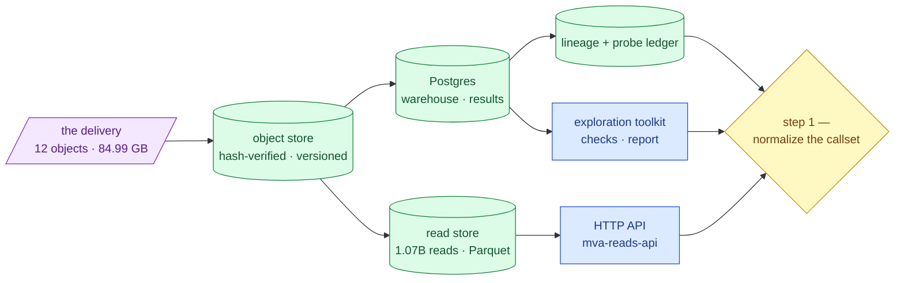

# Step 0 — the platform

**Standing:** **closed 2026-09-04 at methodology entry [068](methodology/068-step-0-close-out.md).**
Every page here describes machinery that **exists and runs**; nothing in this folder is a
plan. Direction lives in [`../roadmap.md`](../roadmap.md), the tool map in
[`../toolset.md`](../toolset.md), current numbers in
[`../current-state.md`](../current-state.md). Last checked 2026-09-04.

## What step 0 is

Everything done *before* the first unstarted roadmap step (normalize the callset). It is
the platform the causal-variant search runs on top of:

- the delivery fetched, hash-verified and pinned in an object store,
- ingested into Postgres as a lossless anchor table,
- derived tables written back, with lineage and an oracle probe ledger,
- the raw reads converted to a queryable Parquet store, served over HTTP,
- an exploration toolkit that renders the committed data profile.

Step 0 answers "can we trust and query the bytes?", not "which pair is causal?". Its
exploration nonetheless ran ahead of the research steps — see *What step 0 already answered*
below.

> **Legend** — **purple = raw input** as delivered; **green = built and verified**;
> **blue = neutral machinery** that holds no unique state; **yellow = the decision point**
> where step 0 hands off.

## What step 0 already answered about the case

Exploration inside step 0 executed tests that belong to research steps, before the register
existed. They are platform entries in shape (no pre-registered hypothesis), and they enter
the register as `retrospective:` claims under the step they answer
([`../method.md`](../method.md)). Numbers live in
[`data-findings.md` §6](../../ideation/data-findings.md).

| Question | Entry | Now belongs to |
|---|---|---|
| Which panel alleles are rare and protein-altering? | [031](methodology/031-vep-rest-panel-annotation.md) | step 2 |
| Is the sample mosaic-aneuploid at the allele-balance floor? | [037](methodology/037-baf-karyogram.md) | step 5 |
| Do the panel's non-PASS calls hide a rare damaging allele? | [049](methodology/049-suppressed-calls.md) | step 4 |
| Is either candidate allele already in ClinVar? | [051](methodology/051-clinvar-presence.md) | step 2 / step 7 |
| Does a panel-blind phenotype ranking agree? | [step-3/067](../step-3/methodology/067-phenotype-ranking-without-java.md) | step 3 |

## Tooling after the close

A tool built because a research step needs it — an app page, an API route, a module — is
recorded in **that step's** `methodology/`, not here. Only a cross-step platform fix still
lands in this folder, and its entry names the step that needed it. Numbering stays global:
the next entry is **069**.

## What was built

One row per component. Numbers live in [`../current-state.md`](../current-state.md) and
[`../../ideation/data-findings.md`](../../ideation/data-findings.md); this table only names
the pieces.

| Component | What it does | Code | CLI |
|---|---|---|---|
| Delivery + object store | 12 delivery objects uploaded to MinIO, every hash verified, recorded in the append-only `warehouse.source_files` ledger | `src/mva/warehouse/source.py`, `objects.py`, `integrity.py` | `mva-warehouse source-*`, `s3-*` |
| Profile staging | Committed data profile (`ressources/data-profile/`) parsed from disk and normalised to typed Parquet in `build/warehouse/` (gitignored, regenerable) | `src/mva/io/readers.py`, `src/mva/warehouse/catalog.py`, `stage.py` | `mva-warehouse stage` |
| Postgres warehouse | Staged Parquet ingested into schema `warehouse`; five derivations written to schema `results`; all SQL runs through DuckDB's `postgres` extension, tables addressed `pg.warehouse.<table>` / `pg.results.<table>` | `src/mva/warehouse/postgres.py`, `analysis.py`, `settings.py` | `mva-warehouse pg-check`, `pg-ingest`, `pg-derive`, `pg-list`, `pg-query` |
| Raw VCF layer | The callset staged losslessly (all columns text, round-trip verified) into `warehouse.variants_raw` — run on the server, since gzip cannot be range-requested | `src/mva/warehouse/vcfstage.py` | `mva-warehouse vcf-shape`, `vcf-verify`, `vcf-stage`, `vcf-ingest` |
| Lineage + probe ledger | `warehouse.object_inventory`, `warehouse.data_lineage` (append-only edges), `warehouse.probe_ledger` (oracle budget) | `src/mva/warehouse/lineage.py`, `probes.py` | `mva-warehouse lineage-*`, `probe-*` |
| Read store | All FASTQ reads converted to Parquet shards at `s3://mva/reads/lane=<n>/read=<1|2>/`, verified against the source; k-mer probe scans answered in minutes via Aho-Corasick | `src/mva/reads/` (`convert.py`, `engines.py`, `scan.py`, `verify.py`) | `mva-reads convert`, `verify`, `scan`, `count`, `qc`, `sql`, `status`, `bench` |
| HTTP API | Every `mva-reads` verb over HTTP; long verbs return `202` + a job id, jobs persisted and cancellable; `X-API-Key` auth | `src/mva/reads/api/` (`app.py`, `jobs.py`, `models.py`, `runners.py`) | `mva-reads-api --host 0.0.0.0 --port 8765` |
| Viz API | Warehouse + results tables, parsed `bcftools stats`, read-store aggregates and a reads-API proxy served as JSON for the browser; CORS, disk cache, `{data, cached_at, source}` envelope | `src/mva/viz/` | `mva-viz-api` (port 8900) |
| Viz app | React app over the warehouse — 16 routes in five groups (learn, data, case, decide, platform), honest 3D only where the data is spatial; falls back to labelled fixtures when the API is down | `app/` | `cd app && pnpm run dev` (port 5173) |

Three ways to read the data, one contract:

1. **Local disk** — `ressources/data-profile/` parsed by `src/mva/io/readers.py`
   (missing value is `None`, nothing coerced on read).
2. **Postgres** — `mva-warehouse pg-query` for warehouse tables; `mva-reads --source <dir>`
   for a local delivery mirror.
3. **HTTP** — `mva-reads-api` for the read store from any machine, no shell on the server.

### Step 0 takes no hypotheses

Step 0 is *machinery*, and that makes it a different kind of step from every one after it.
"PostgreSQL is the right database" is a decision with alternatives, judged by whether it
works — not a claim about the patient that evidence could refute. So:

* its reasoning lives in [`notes/`](notes/) as **decisions**, not as hypotheses;
* its [`methodology/001–068`](methodology/) are **platform records** — what was built and
  what was measured, ending in *Conclusions*;
* the register in `mva-science` **refuses** a hypothesis filed under `step-0`.

From [step 1](../step-1/README.md) on it is the other way round: each step declares one
research goal, every claim under it states what would refute it before it is tested, and
every methodology entry is a test bound to a claim. That loop is
[`../method.md`](../method.md).

## Pages

| Document | Answers |
|---|---|
| [`architecture.md`](architecture.md) | How do the pieces fit? Data flow, seams, sharp edges, extension points. |
| [`infrastructure.md`](infrastructure.md) | How do I operate Postgres and the object store? Setup, verbs, tunnels, credentials. |
| [`data-layers.md`](data-layers.md) | What shape does the data take on the way in? Layer 0 bytes → layer 1 anchor → layer 2 typed tables. |
| [`exploration.md`](exploration.md) | How do I actually *look* at the data? Exhibits, graded checks, one interactive page. |
| [`reads-storage.md`](reads-storage.md) | Where do the raw reads go, and what can you ask of them? **Built** — 1,071,835,104 reads as queryable Parquet. |
| [`reads-api.md`](reads-api.md) | How do I query the store without a shell on the server? Every `mva-reads` verb over HTTP, long jobs handled. |
| [`viz-api.md`](viz-api.md) | How does the browser read the warehouse? Every table and read-store aggregate as JSON — `mva-viz-api`, one origin, disk-cached. |
| [`viz-app.md`](viz-app.md) | How do I *see* the data? The React app — 16 routes, 2D + 3D, runs on fixtures when the API is down. |

## Decisions

| Note | Standing |
|---|---|
| [Delivery is immutable](notes/delivery-is-immutable.md) | firm — verified 12/12 hashes |
| [Postgres for shared state](notes/postgres-for-shared-state.md) | firm; Path A deleted 2026-08-29 |
| [The chr-prefix bridge](notes/chr-prefix-bridge.md) | firm — one function, enforced by test |
| [Toolchain choice](notes/toolchain-choice.md) | provisional |
| [Colour is generated](notes/colour-is-generated.md) | firm — one generator, four gates |
| [three.js behind one wrapper](notes/three-js-behind-one-wrapper.md) | built 2026-09-03 — one module, one exhibit |
| [The dictionary is generated into the app](notes/dictionary-is-generated-into-the-app.md) | firm — one generator, `dictionary:check` in the gate |

Cross-step decisions — [no patient data](../notes/no-patient-data-in-the-repository.md),
[synthetic fixtures](../notes/synthetic-fixtures.md), [the structure toolkit's reuse
seams](../notes/reusable-structure-toolkit.md) — stay in
[`../notes/`](../notes/); they govern every step, not this one.

## Evidence

[`methodology/`](methodology/) — entries 001–068, append-only, one per executed run. 001–006
first contact with the delivery; 007–017 the warehouse platform and the research record;
018–027 the read store, k-mer strike and its API; 028–029 the viz API and the React app;
030–032 public reference data, the VEP annotator and comparison tables; 033–051 app exhibits
(catalog, karyogram, pair matrix, funnel, suppressed calls, ClinVar presence); 052–055
quality gates and design tokens; 056–060 protein structure and 3D; 061–064 reference
provenance and the reusable structure toolkit; 065–066 health controls and the Learn page;
067 is filed under step 3; 068 is the close-out.
