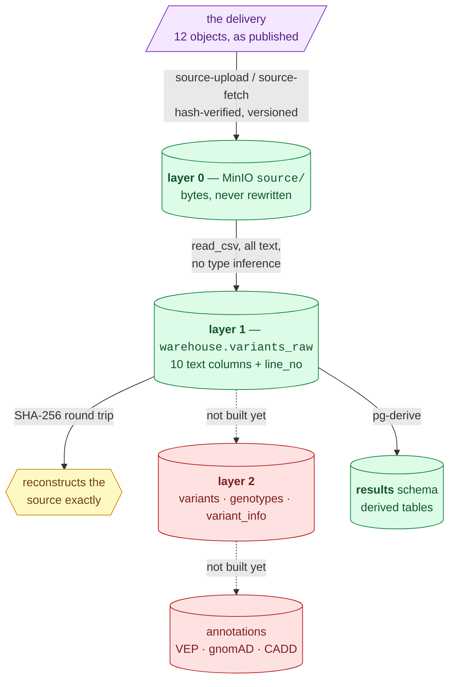

# Data layers — from delivered bytes to queryable tables

**Standing:** layer 0 and layer 1 are **built and live** (verified 2026-08-29, see
[`current-state.md`](../current-state.md)). Layer 2 is **designed, not built** — the schema
below is the plan, and nothing has been written to it.

Extracted 2026-08-29 from `docs/ingestion-plan.md` (now in [`archive/`](../../archive/),
where its "awaiting review, nothing ingested" framing is preserved as history).

Measured numbers about the dataset are owned by
[`ideation/data-findings.md`](../../ideation/data-findings.md); this page owns the *shape* of
each layer.

## The layers

> **Legend** — **purple = the raw input** as the publisher shipped it; **green = built and
> verified today**; **yellow = the verification gate**; **red = designed but not built**.
> Dotted arrows are unbuilt steps. Every arrow out of layer 1 is re-derivable, so a mistake
> downstream is never a data loss.

## Layer 1 — `variants_raw`: the lossless anchor

One row per VCF data line. **Every field stored as text**, nothing parsed, nothing
normalised, nothing filtered — non-PASS records included, because a suppressed allele is
precisely what this case may turn on.

| Column | Type | Note |
|---|---|---|
| `line_no` | BIGINT | position in the file — our bookkeeping, not VCF data |
| `chrom, pos, id, ref, alt, qual, filter, info, format, sample_call` | VARCHAR | exactly as delivered |

Typing is the largest source of silent loss, so this layer does none. Its whole job is to
be provably identical to the source. Fidelity evidence and the one real DuckDB loss mode
(empty string → NULL) are in
[`methodology/011`](methodology/011-duckdb-fidelity-and-ingestion-gates.md).

## Layer 2 — typed and queryable, derived from layer 1

**Partially built, 2026-09-05 — for the coding fraction only.** `results.coding_alleles`
(one row per gene × ALT allele inside a coding interval, genotype fields parsed, every
FILTER kept), `results.coding_candidates` (annotation joined) and `results.gene_biallelic`
(one row per gene) implement the `variants` + `genotypes` grain below for the 1.4 % of the
genome that can change a protein: [step-2 methodology 069](../iteration1/step-2/methodology/069-layer-2-coding-scan.md).
The genome-wide typed layer and the INFO explosion remain unbuilt. The original design:

| Table | Grain | Why separate |
|---|---|---|
| `variants` | one row per **ALT allele** | A `1/2` record carries two alternate alleles and biologically *is* a compound heterozygote; it must reach the pair finder as two rows |
| `genotypes` | one row per variant × sample | GT, AD, DP, GQ, PL parsed out of `FORMAT`/`sample_call` |
| `variant_info` | INFO exploded | The header declares 31 fields — they are in `warehouse.vcf_fields` |

Each carries `line_no`, so any row traces back to its raw record and to the original file
line.

### Open design questions, unresolved

1. **Multi-allelic splitting.** One row per ALT allele matches the scorer and the biology,
   but `variants` then has more rows than the VCF has lines. `line_no` preserves the
   mapping.
2. **INFO as columns or a MAP.** Wide columns are faster and clearer; a `MAP` survives a
   header change without a migration. Leaning: wide columns for the ~11 fields actually
   populated, plus the raw `info` string retained in layer 1.
3. **Reconciliation gate.** `variants` row count must equal the number of ALT alleles in
   layer 1, and every `line_no` must appear. Not built.

## What deliberately stays out of a database

The FASTQ. Reads are aligned or scanned for k-mers; neither is `SELECT`, and the VCF
already *is* the analytical summary of those reads. They stay as objects in layer 0,
byte-for-byte, and remain the source of truth for any realignment. Sizing and the
Parquet-vs-Postgres measurement: [`reads-storage.md`](reads-storage.md).

## Verification gates

Each runs before the next step and fails loudly:

| # | Gate | Status |
|---|---|---|
| 1 | `mva-warehouse vcf-shape` — header declares 10 columns, single sample | passed |
| 2 | `mva-warehouse vcf-verify` — SHA-256 round trip over all records | passed |
| 3 | `vcf-stage` writes the raw layer, then re-verifies against the Parquet | passed at full scale — `variants_raw` is loaded |
| 4 | `fingerprint` + `compare` at every hop — row counts, per-column checksums, NULL and empty-string accounting | demonstrated over 1,000,000 records |
| 5 | Layer 2 reconciliation | **not built** genome-wide; the coding layer's allele count is asserted against the panel result in [069](../iteration1/step-2/methodology/069-layer-2-coding-scan.md) (BUB1B: 2 alleles, as entry 031 found) |

Evidence: [`methodology/011`](methodology/011-duckdb-fidelity-and-ingestion-gates.md)
and [`methodology/014`](methodology/014-source-of-truth-and-lineage.md).
