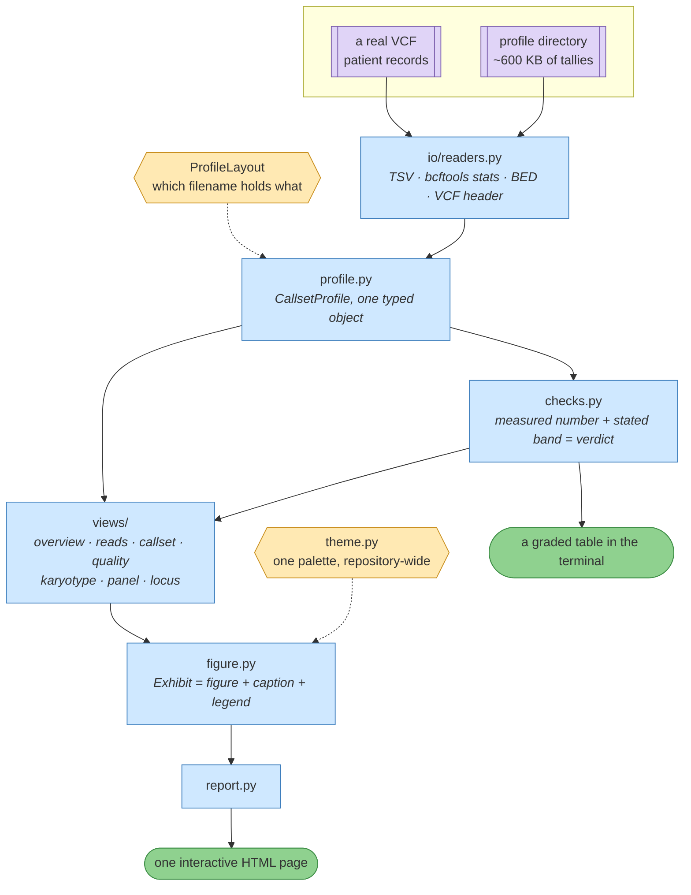

# The exploration toolkit

**Standing:** module names and section list checked against `src/mva/explore/` on
2026-08-29. Test and exhibit counts live in [`current-state.md`](../current-state.md).

A genomic dataset arrives as tens of gigabytes of compressed text and one question: *is
there anything here?* Answering it normally means running four or five command-line tools,
reading their output tables by eye, remembering which numbers are acceptable, and writing
the interesting ones down before they scroll away.

`mva.explore` turns that loop into a library and a single interactive page. It reads the
committable summaries produced by
[`tools/profile-genomic-data.sh`](../../tools/profile-genomic-data.sh), grades every number
against a stated expectation, and renders twenty exhibits — each one carrying the words
that make it readable.

```bash
uv run mva-explore checks ressources/data-profile      # seconds, terminal, no files
uv run mva-explore report ressources/data-profile      # figures/explore-report.html
```

---

## What it produces

| Verb | Output | When to reach for it |
|---|---|---|
| `checks` | a graded table in the terminal | while a pipeline is being debugged |
| `report` | one self-contained interactive HTML page | to actually look at the data |
| `locus` | the same page for one region of a real VCF | when a candidate gene needs opening |
| `export` | every exhibit as its own file | pasting one figure into a document |

The report opens from the filesystem with no server and no build step. Only Plotly's
runtime is fetched from a CDN; everything else — styles, behaviour, every data point — is
inlined, so the file survives being emailed, committed or opened on a plane.

---

## The shape of it



> **Legend** — purple: the raw input · blue: neutral machinery, one module per bounded
> concern · yellow: a configuration seam you are meant to change · green: the artifacts you
> read · dotted arrows: configuration rather than data flow.

Each layer is usable without the ones above it. `io/readers` parses file shapes and knows
nothing about this case; `profile` assembles a directory into one object and knows nothing
about charts; `views` build figures and know nothing about HTML.

---

## The exhibits, and what each one answers

One section per module in `views/`. The heading names below are what a reader sees; the
module name is in brackets, because the two are deliberately allowed to differ — a section
can be retitled without renaming a module.

### Overview  *(`overview.py`)*

| Exhibit | The question |
|---|---|
| The dataset in six numbers | How much data is there, and how much of it survived? |
| Quality checks | Is any of it outside what a healthy genome looks like? |
| Where this file came from | Which reference genome, which caller, which chromosome naming? |

### Sequencing — the raw reads  *(`reads.py`)*

| Exhibit | The question |
|---|---|
| Sequencing yield by lane | Did every physical run of the machine behave the same? |
| Library quality against expected bands | Q30, GC, duplication, insert size — each against its band |
| What read filtering removed | What did quality filtering cost, and what did it buy? |

### Callset — what the variant caller produced  *(`callset.py`)*

| Exhibit | The question |
|---|---|
| What the callset contains | Substitutions, indels, and the multiallelic backlog |
| Substitution spectrum | Does the chemistry look like real variation or like error? |
| Indel length spectrum | How long are the insertions and deletions? |
| Depth distribution | How many reads sit under a typical call? |

### Filters & phase — what was held back  *(`quality.py`)*

| Exhibit | The question |
|---|---|
| The filtering funnel | How large is the suppressed search space? |
| Why records were held back | Which heuristic is doing the suppressing? |
| Genotype composition | How many heterozygous calls could form half a pair? |
| How much of the callset is phased | Can variants be placed onto a specific chromosome copy? |

### Chromosomes — the aneuploidy question  *(`karyotype.py`)*

| Exhibit | The question |
|---|---|
| Allele balance by chromosome | **Is any chromosome present in the wrong number of copies?** |
| Read depth by chromosome | Does the coverage agree with what the allele balance says? |
| Variant density by chromosome | Is any chromosome contributing a suspicious excess of calls? |

### Candidate genes — where the search starts  *(`panel.py`)*

| Exhibit | The question |
|---|---|
| Where the candidate genes sit | How small a fraction of the genome is being searched first? |
| Calls in each candidate gene | Which gene has an unusual share of suppressed calls? |
| The pair search space | How many hypotheses are there, against ten submission rows? |

### Locus — over a real VCF, not a summary  *(`locus.py`)*

| Exhibit | The question |
|---|---|
| Variant track | Where in this gene are the variants, and how well supported? |
| Phase groups | Which variants sit on which copy of the chromosome? |
| Pair phase matrix | Which pairs are confirmed, refuted, or undecided? |

The locus views are the only ones that read patient records. They write wherever they are
told to — keep that outside the repository.

---

## Three design decisions

### A verdict states its own reasoning

Every graded number carries the band it was judged against *and* why that band is the right
one. A `WARN` on the transition/transversion ratio comes with the sentence explaining that
transitions are chemically easier than transversions, so real variation runs about 2:1
while random error has no such bias.

The bands are community conventions, not measurements, and they live in one file
([`checks.py`](../../src/mva/explore/checks.py)) precisely so they can be argued with. The
alternative — thresholds scattered through drawing code — produces a report that must be
trusted rather than read.

### A figure never travels without its legend

The repository rule is that every visual decodes its own colours immediately beneath
itself. Here that is structural: an `Exhibit` is a figure *and* a caption *and* a legend,
and a view cannot emit one without the others. The legend line is generated from the same
palette objects the figure was coloured with, so the two cannot drift apart, and a test
asserts it for every exhibit in the suite.

### The filename mapping is a parameter

`ProfileLayout` holds which filename carries which artifact. Reading a differently-named
profile directory is a layout swap, not a new reader and not a new view:

```python
from mva.explore import CallsetProfile, ProfileLayout, write_report

layout = ProfileLayout(callset_stats="bcftools_stats.txt")
profile = CallsetProfile.load("other-case/profile", layout)
write_report(profile, "out/report.html", "Another case")
```

Every section is independently optional. A profile with no FASTQ files renders fewer
exhibits; an empty directory renders none. Nothing raises, because the most common moment
to want a profile is while the script producing it is still being written.

---

## Adding a view

One module, one entry:

```python
# src/mva/explore/views/coverage.py
def exhibits(profile: CallsetProfile) -> list[Exhibit]:
    if not profile.contigs:
        return []
    return [Exhibit(slug="...", title="...", caption="...",
                    legend=legend_line(GOOD, BAD), figure=...)]

# src/mva/explore/views/__init__.py
SECTIONS.append(ViewSpec("coverage", "Coverage", "…", coverage.exhibits))
```

The report, the sidebar, the filter, the per-exhibit export and the standalone HTML all
pick it up. The test suite asserts that every registered section produces exhibits against
the synthetic fixture profile, so a view that quietly stops working fails the suite instead
of rendering an empty section.

---

## Why Plotly

Interactive HTML with no server, no build step and no notebook is the deciding property:
the report is something to open *during* analysis, not a deliverable produced once at the
end. Zooming into the indel tail, hovering a chromosome for its exact allele balance, and
filtering twenty exhibits by keyword are all things a static image cannot do and a
dashboard server is too heavy to justify for one proband.

Plotly is also what the field converged on — MultiQC, the report every sequencing facility
ships, renders its charts the same way — so the output looks like something a
bioinformatician already knows how to read. The figure objects serialise to JSON, which
means an exhibit can be regenerated, diffed and version-controlled rather than screenshotted.

Static image export via `kaleido` is optional and never required: `export --images` writes
PNGs when the engine is installed and says so when it is not.

---

## Testing

The toolkit's tests run against a synthetic profile directory in
[`tests/fixtures/profile/`](../../tests/fixtures/profile/) with no dataset present — the suite
total is in [`current-state.md`](../current-state.md). They cover the parsers' handling of real file quirks (rollup lines glued under a table, quoted
descriptions containing commas), graceful degradation on missing artifacts, the layout
swap, the check bands, chromosome ordering, and the report shell.

Two of them exist because they caught real bugs: the Plotly runtime was being attached to
the first exhibit rather than the first exhibit *carrying a figure*, which left every chart
on the page blank with no error anywhere; and an empty profile was rendering an empty tile
row and a headerless check table, which reads as "nothing is wrong" when it means "nothing
was measured".
