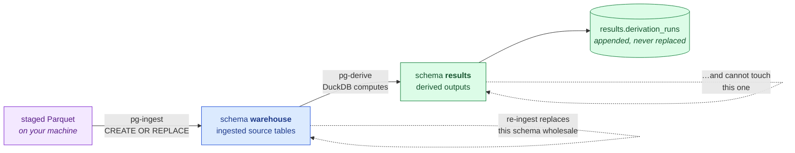
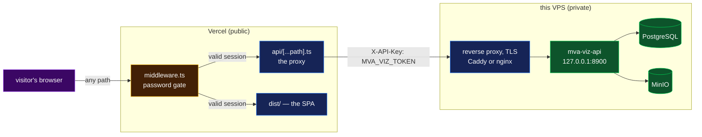

# Infrastructure — the live runbook

**Verified:** 2026-08-29 for sections 1–2 and 4–5; section 3 (the hosted dashboard) was
written 2026-09-06 alongside methodology 080 and its code paths are tested, but **no
deployment has been made from it yet** — it is a runbook, not a report. `pg-check` and
`s3-check` both connect; what is provisioned and how much is in it is in
[`current-state.md`](../current-state.md). This page is *how to operate it*, not what it
currently holds.

Three services on one remote VPS, plus one hosted front end:

| | What | Holds |
|---|---|---|
| **PostgreSQL** | client–server database, reached over the network | tables people query and edit — ingested source tables, derived results, the source-file ledger |
| **MinIO** | S3-compatible object store | bulk immutable files — the delivery itself, staged Parquet, anything measured in gigabytes |
| **`mva-viz-api`** | FastAPI service, loopback + TLS reverse proxy | nothing of its own — it reads the two above and answers JSON |
| **the dashboard** | the React app on Vercel, behind a password | nothing of its own — it proxies to `mva-viz-api` |

DuckDB is the **engine** in both cases and runs inside your own process on your laptop.
Nothing is installed on the server beyond the two services. Why this split rather than a
DuckDB file on a box: [postgres for shared state](notes/postgres-for-shared-state.md).

---

## 1. PostgreSQL

### On the server, once

```bash
./tools/setup-warehouse-server.sh --db mva --user mva
```

Creates the role, the database and two schemas, and prints the `.env` block to paste on
your machine. Idempotent, and pins no version — it reports whatever `SHOW server_version`
says and works with it.

**It finds the database itself.** Three arrangements exist in the wild and guessing wrong
is the difference between "it just worked" and a confusing auth error, so the script tries
each in turn:

| Arrangement | How it connects |
|---|---|
| You said how | `MVA_PSQL_SUPER` is set — always wins |
| **Postgres in a container** | discovers the running container, goes in via `docker exec` / `podman exec` |
| Packaged Postgres | `sudo -u postgres psql`, the Debian/Ubuntu default |

The container case matters because the superuser lives *inside* the container — there is
no local `postgres` OS user to `sudo` to. With several Postgres containers running, name
one: `--docker <container-name>`.

**The port it reports is the published one, not `SHOW port`.** Inside a container Postgres
always answers 5432 regardless of what is mapped on the host, so a `.env` built from that
looks correct and cannot connect. If the container publishes nothing, the script says so
rather than handing you a broken `.env`.

Anything unusual works by naming the connection yourself:

```bash
MVA_PSQL_SUPER="psql 'postgresql://admin:pw@host:5432/postgres'" ./tools/setup-warehouse-server.sh
```

`--no-duckdb` skips installing the DuckDB CLI on the box; it is a convenience for querying
while logged in, not a requirement.

### On your machine

```bash
cp .env.example .env      # then fill in PGPASSWORD

uv run mva-warehouse pg-check     # resolved settings + a live probe
uv run mva-warehouse stage        # profile dir -> typed Parquet
uv run mva-warehouse pg-ingest    # Parquet -> the `warehouse` schema
uv run mva-warehouse pg-derive    # analyses -> the `results` schema
uv run mva-warehouse pg-list      # what is in both schemas
uv run mva-warehouse pg-query 'SELECT * FROM pg.results.panel_gene_density'
```

Then browse it in pgAdmin like any other database.

> **Sharp edge — `pg-query` table names.** The query runs in DuckDB, which reaches Postgres
> through `ATTACH … AS pg`. Tables are therefore addressed **`pg.warehouse.<table>`** and
> **`pg.results.<table>`**, never `warehouse.<table>`. A bare schema name is a "table does
> not exist" error, not a permissions problem.

### Two schemas, and why it matters



> **Legend** — **purple = the raw input**; **blue = machinery rebuilt wholesale on every
> ingest**; **green = results worth keeping**, including the provenance log. The dashed
> self-loops are the safety property: `pg-ingest` replaces everything in `warehouse` and
> by construction cannot reach into `results`. Verified — after a re-ingest, every result
> table survived.

`pg-ingest` is a pure function of the Parquet; `pg-derive` is a pure function of the
ingested tables. Nothing is ever edited in place, so a wrong number is fixed by fixing the
input and running again.

Worked example with real output:
[`methodology/010`](methodology/010-postgres-ingest-and-derivations.md).

### Adding an analysis

Derivations are **data, not code** — a record in `src/mva/warehouse/analysis.py`:

```python
Derivation(
    name="panel_gene_density",
    question="Which candidate gene carries the most variation per base sequenced?",
    depends_on=("panel_variant_counts", "mva_panel_grch38"),
    sql=f'''SELECT p.gene, round(p.n_all * 1e6 / (b."end" - b.start), 1) AS variants_per_mb
            FROM {SOURCE}.panel_variant_counts p
            JOIN {SOURCE}.mva_panel_grch38 b ON p.gene = b.name''',
)
```

Append one and the runner, the CLI's `--only` choices, the provenance stamp and the tests
all pick it up unchanged. The SQL runs in **DuckDB**, so it can join, window and aggregate
freely; only the finished table lands in Postgres. Tests assert that every declared
dependency is really selected from and is really a table staging produces, so a typo fails
in a second rather than after a round trip.

---

## 2. The object store — bulk files, queried in place

PostgreSQL holds the tables people query and edit. The **bulk** files go into MinIO on the
same box and are queried *where they sit*: DuckDB's `httpfs` extension fetches byte ranges
over HTTP, and Parquet's footer tells it which ranges it needs, so a `count(*)` over a
5-million-row Parquet downloads under 1% of the file. Nothing is cached locally, nothing is
downloaded whole, and no SSH session is involved. Measurements:
[`methodology/013`](methodology/013-remote-object-store.md).

### On the server, once

```bash
./tools/setup-object-store.sh --bucket mva
```

Publishes the **API on 9012** and the **console on 9013**, data under `~/mva-objects`.
Both defaults exist because of failures worth knowing about:

* **Ports.** MinIO's own defaults 9000/9001 — and 9002/9003 on this box — were already
  taken. Podman reports a port clash only at container *start*, so a collision leaves a
  container stuck in `Created` with an **empty log** and no error anywhere. The script
  checks both ports first and names the process holding one.
* **Data directory.** Rootless podman runs the container as *you*, so a path outside your
  home is a common cause of a container that starts and immediately dies on a write.

Override with `--port` / `--console-port` / `--data-dir`. **A container keeps the ports it
was created with** — re-running with a different `--port` does not change them, and the
script warns rather than printing a `.env` block for a port that was never published.

**Dashboard:** `http://<server>:9013` — always a different port from the API. Its login is
the same credential pair the script prints: MinIO's root user serves both the S3 API and
the console, so `S3_ACCESS_KEY` / `S3_SECRET_KEY` in your `.env` *are* the dashboard
username and password.

If the generated password is lost it is still in the container's environment:

```bash
podman inspect mva-minio --format '{{range .Config.Env}}{{println .}}{{end}}' | grep MINIO_ROOT
```

Or set your own and recreate the container — objects live in `~/mva-objects` on the host,
so they survive:

```bash
podman rm -f mva-minio
./tools/setup-object-store.sh --password 'your-password'
```

### On your machine

```bash
uv run mva-warehouse s3-check          # settings, a live probe, and the console URL
uv run mva-warehouse s3-put <file.parquet> --key raw/variants_raw.parquet
uv run mva-warehouse s3-ls
uv run mva-warehouse s3-query "SELECT count(*) FROM 's3://mva/raw/variants_raw.parquet'"
```

### The delivery itself

The gated delivery lives in the bucket under `source/`, hash-verified and versioned — that
is the project's source of truth, and the rule is
[delivery is immutable](notes/delivery-is-immutable.md). The verbs:

```bash
uv run mva-warehouse source-scan       # inventory the delivery, upload nothing
uv run mva-warehouse source-fetch      # RUN ON THE SERVER: publisher -> bucket, streaming
uv run mva-warehouse source-upload     # hash, upload unchanged, verify, record in the ledger
uv run mva-warehouse source-status     # delivery on disk vs. the ledger
uv run mva-warehouse source-check      # survey the bucket, verify hashes, refresh inventory
```

`source-fetch` streams from the publisher straight into the bucket; `--tee` also writes a
local copy and `--verify` checks each object against the publisher's SHA-256. Evidence:
[`methodology/014`](methodology/014-source-of-truth-and-lineage.md).

### The two append-only ledgers

`warehouse.data_lineage` answers "which bytes produced this table"; `warehouse.probe_ledger`
answers "which of our 6 oracle submissions is spent, by whom, with what content and what
reply". Neither is ever updated or deleted — a correction is a newer row saying what it
supersedes.

```bash
uv run mva-warehouse lineage-list --current    # newest edge per target table
uv run mva-warehouse lineage-repair            # repoint local-path edges at the verified object
uv run mva-warehouse lineage-backfill          # one edge per already-logged derivation run
uv run mva-warehouse probe-budget              # "n/6 spent, m remaining"
uv run mva-warehouse probe-log --by <member> --type S --payload-file <submission.csv> \
    --response '<scorer reply>' --rationale '<what this probe decides>'
uv run mva-warehouse probe-list
```

`pg-derive` records its own lineage edge on every run, so `lineage-backfill` exists only for
runs that predate that; both repair verbs are idempotent and safe to re-run. Evidence:
[`methodology/016`](methodology/016-lineage-backfill-and-probe-ledger.md).

### Sorting is what makes remote queries cheap

Row-group statistics can only skip a group when the filter column is **clustered**. Same
gene lookup, same data: an unsorted file downloaded 4.40 MB in 1.03 s, sorted by symbol
0.07 MB in 0.03 s — 40× less data, 33× faster. So rewrite anything filtered repeatedly:

```bash
uv run mva-warehouse s3-sort raw/variants.parquet --key raw/variants_by_gene.parquet --by symbol
```

---

## 3. `mva-viz-api` and the hosted dashboard

**Standing:** written 2026-09-06 (methodology 080). Untested against a live deployment.

The dashboard is on Vercel; the API stays here, next to the data it reads. The browser
never learns where the API is, and no page loads before a password.



> **Legend** — purple = the untrusted visitor; yellow = the decision point (valid session?);
> blue = neutral machinery; green = the private services holding patient-derived data.

### On the server, once

```bash
# 1. a token. The API refuses a non-loopback bind without one, and this is also the
#    value Vercel sends as X-API-Key.
uv run python -c "import secrets; print(secrets.token_urlsafe(32))"   # -> .env MVA_VIZ_TOKEN

# 2. the service
./tools/setup-viz-api-service.sh --domain viz.example.org
```

The script syncs dependencies, writes `/etc/systemd/system/mva-viz-api.service`, starts it,
checks `/health`, and prints the Caddy and nginx blocks to put in front. It reads
`MVA_VIZ_TOKEN` from the environment or `.env` and **refuses to install without one**.

The unit binds `127.0.0.1` deliberately. TLS, the public hostname and the certificate belong
to the reverse proxy; the API process should never hold a public port itself.

```bash
sudo systemctl status mva-viz-api      # is it up
sudo journalctl -u mva-viz-api -f      # what is it doing
sudo systemctl restart mva-viz-api     # after editing .env — settings are read at start
```

### The two tokens are different secrets

| Token | Guards | Sent by |
|---|---|---|
| `MVA_API_TOKEN` | `mva-reads-api` (the read store) | `mva-viz-api`, on its `/api/probe/*` and `/api/jobs/*` proxy routes |
| `MVA_VIZ_TOKEN` | `mva-viz-api` (everything else) | Vercel's proxy function, as `MVA_VIZ_API_TOKEN` |

Both travel as `X-API-Key`, on different hops. Neither is ever in the browser.

### On Vercel

Root Directory `app`, then five environment variables and a deploy. The table, the
generator commands and `vercel dev` are in [`app/README.md` § Hosting](../../app/README.md#hosting);
this page does not restate them.

### Verify it end to end

From a laptop, not from the server — the point is what an outsider can reach:

```bash
curl -fsS https://viz.example.org/health                                   # {"ok":true,...}
curl -so /dev/null -w '%{http_code}\n' https://viz.example.org/api/overview   # 401
curl -so /dev/null -w '%{http_code}\n' https://<the-dashboard>/            # 401 + password page
curl -so /dev/null -w '%{http_code}\n' https://<the-dashboard>/api/overview  # 401, no data
```

Four `401`s and one `{"ok":true}` is the correct result. Anything that returns rows without a
password is a misconfiguration — stop and fix it before sharing the link.

---

## 3b. `mva-reads-api` — redeploying it when a verb is added

**Named to `step-2` (iteration 2):** the bait pass is a step-2 tool, recorded in
[entry 085](../iteration2/step-2/methodology/085-the-bait-and-where-it-runs.md); the
redeploy procedure is platform machinery and lives here, where every other service's does.

The read store, PostgreSQL and `mva-reads-api` all resolve to the same host. That is not a
detail — it is the reason a full-store pass takes minutes there and **4.2 hours** from a
laptop over the object-store link (measured 2026-09-11: 55.8 s per shard, whether one
shard streams or eight in parallel; the link saturates and parallelism buys nothing). Any
verb that must touch all 1.07 billion reads belongs on this box.

```bash
ssh -p 3333 <user>@<server>
cd <repo> && git pull && uv sync --all-groups
sudo systemctl restart mva-reads-api
curl -s localhost:8765/health                     # {"status":"ok"} — no auth on this route
curl -s localhost:8765/openapi.json | grep -o '"/bait"'   # the new verb is registered
```

Settings are read at start, so a `.env` edit needs the same restart. The job registry
lives in memory and its history on disk: jobs that were running when the process stopped
come back as `lost`, never silently re-run — so a restart during a pass means resubmitting
it, not wondering whether it finished.

`/bait` is the first verb here that **writes**. It publishes the reads it recovered as one
Parquet object at the key the caller names, because ~12 million reads are not an HTTP
response. It touches nothing under `reads/`, and its keys are validated at the edge: no
`s3://`, no `..`, no empty string.

## 4. Credentials and exposure

`.env` is gitignored; `.env.example` is the committed template, and it declares
`PGHOST PGPORT PGDATABASE PGUSER PGPASSWORD PGSCHEMA PGRESULTSCHEMA MVA_SOURCE_DIR
MVA_STAGING_DIR MVA_HF_REPO` plus the `S3_*` block and the two service tokens
(`MVA_API_TOKEN`, `MVA_VIZ_TOKEN`). Anything exported in the real
environment beats the file, so CI can inject `PGPASSWORD` without a stale `.env`
overriding it. Settings print redacted — `password: set`, never the value — so a settings
object is safe in a log or a traceback.

`S3_ENDPOINT` takes the **published host port** (9012), never MinIO's internal 9000, and
the **server's hostname**. `localhost` is correct only while an SSH tunnel is open *on your
machine*:

```bash
ssh -N -L 9012:localhost:9012 <user>@<server>    # object store, run on YOUR laptop
ssh -N -L 5432:localhost:5432 <user>@<server>    # Postgres, if it should not listen publicly
```

> `s3-check` warns whenever `S3_USE_SSL=false`. For encrypted transport, use the SSH
> tunnel above or put a TLS reverse proxy in front and set `S3_USE_SSL=true`.

### What Vercel holds

Four secrets live in the Vercel project and nowhere else in this repository:
`MVA_VIZ_API_URL`, `MVA_VIZ_API_TOKEN`, `DASHBOARD_PASSWORD`, `DASHBOARD_SESSION_SECRET`.
None is `VITE_`-prefixed, so Vite cannot inline any of them into the bundle — that prefix
rule is the mechanism, not a convention. `vercel env pull` writes them to `app/.env.local`
for `vercel dev`; that file is gitignored and must stay so.

The dashboard's password is not a credential for anything else: it buys a session, and the
session buys proxied reads. Rotating it in the Vercel project signs everyone out
immediately, because the cookie is signed with a key that includes the password itself.

## 5. Data handling

Everything on this infrastructure is derived from, or is, the gated delivery. The rule and
its reasoning are in
[no patient data in the repository](../notes/no-patient-data-in-the-repository.md); the
locations are tabulated in the [root README](../../README.md). The server-side consequence:
it must be access-controlled, never public, and wiped on the same 30-day schedule as
everything else.
