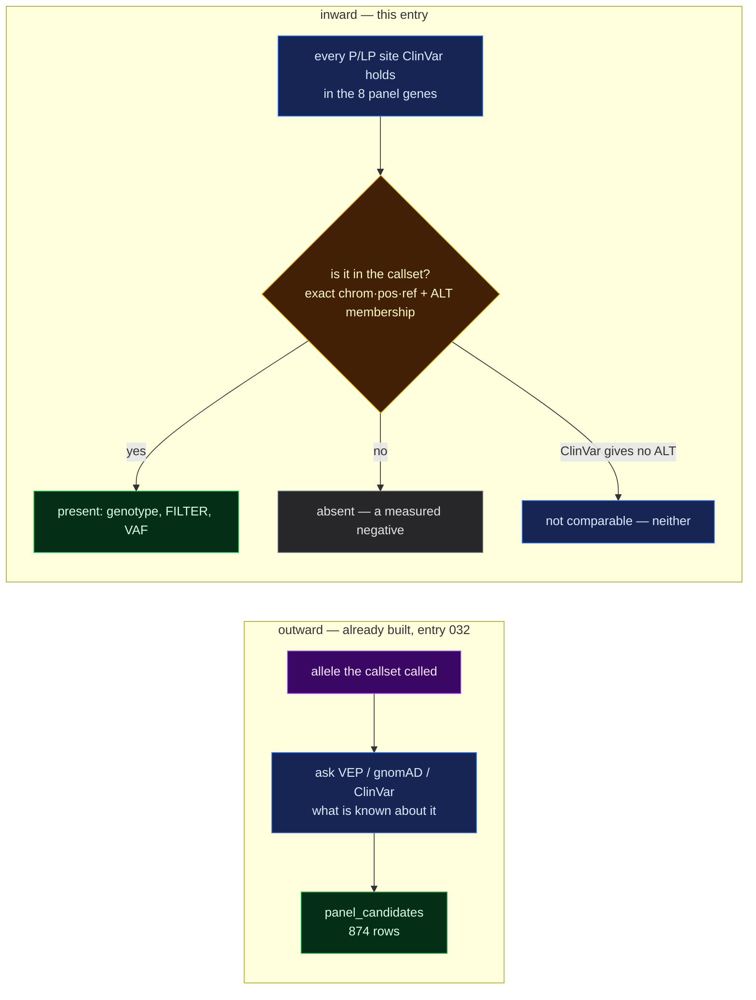

# 051 — Running the ClinVar join backwards: is a known pathogenic site present here?

**A step-0 platform entry, so it carries no hypothesis.** It records a derivation, an
endpoint and an exhibit, the numbers they produced on the real warehouse, and two
limitations that travel with those numbers. The biological readings at the end are stated
as observations; the register owns verdicts.

**Verified:** 2026-09-01, against the live warehouse.

## Question

[032](032-reference-comparison-tables.md) joined the delivery *outward*: take an allele the
callset has, ask gnomAD and ClinVar what they know about it. That direction can only ever
see alleles the callset already produced.

The opposite direction has never been run. ClinVar holds **2,129 pathogenic /
likely-pathogenic (P/LP) records inside the eight candidate genes**
([030](030-population-reference-data.md)). For each of them: *is that exact site present in
this callset, and if so at what genotype and FILTER?*

Both answers are results, and that is the point of asking:

- a P/LP site called **heterozygous and PASS** is a direct lead — a clinical lab has
  already argued that allele causes disease, and the child carries a copy;
- a gene whose known P/LP records are **all absent** is an informative negative: the case
  is not a re-run of a previously reported family in that gene.



> **Legend** — purple: the raw input the callset supplies · blue: neutral machinery and the
> public reference · yellow: the decision the join makes · green: a hit worth following ·
> grey: a measured absence, which is a result and not a gap.

## Inputs

| Input | Version / shape |
|---|---|
| `pg.warehouse.clinvar_panel` | 17,832 rows, bare contigs, ClinVar release `##fileDate=2026-08-29` ([030](030-population-reference-data.md)) |
| `pg.warehouse.variants_raw` | 5,012,204 rows, every column TEXT, no index |
| `pg.warehouse.mva_panel_grch38` | the 8-gene panel BED, `chr`-prefixed, ±20 kb padding |
| P/LP predicate | `mva.warehouse.analysis_reference.PLP_PREDICATE`, reused verbatim — not re-spelt |
| Server | PostgreSQL 18.4 (Debian), hosted |
| Date of run | 2026-09-01 |

## What was built

**`src/mva/warehouse/analysis_clinvar.py`** — one derivation, `clinvar_presence`, one row
per P/LP ClinVar record in a panel gene, present or not. Five decisions in it are
load-bearing.

1. **The significance predicate is imported, never re-spelt.** `PLP_PREDICATE` has one
   owner (`analysis_reference`) and a test asserts the string appears verbatim in this
   derivation's SQL. A second spelling of "pathogenic but not conflicting" would drift.
2. **The panel is named from the BED, not listed.** The 20 kb padding leaks ~10 flanking
   genes into the ClinVar extract; joining against `mva_panel_grch38` keeps them out and
   keeps the derivation case-agnostic.
3. **ALT is matched by list membership.** `variants_raw` keeps a multi-allelic site
   comma-packed (`G -> A,C` in one row) while ClinVar is one row per allele, so the join
   tests element membership — a substring test would match `A` against `AT`.
4. **A record listing an ALT is not a genotype carrying it.** A `0/1` call on a `G -> A,C`
   record carries `A` and not `C`. `present` says the callset has a record for the allele;
   `carries_alt` says the genotype contains it; `is_het` says it holds exactly one copy.
   Conflating the three would invent a carrier.
5. **`present` is NULL, never false, where the row could never match.** ClinVar writes `.`
   for "no alternate allele given". Such a row is `comparable = false` and is counted as
   neither present nor absent.

Review status is turned into NCBI's gold-star tier (`review_stars`, 4→0) in SQL rather than
in the browser, so the number is a column with lineage. `NULL` where ClinVar states no
status — which is a different claim from zero stars.

**`GET /api/panel/clinvar-presence?gene=`** returns `{summary, sites}`. `summary` counts
off the panel BED with a LEFT join, so a gene ClinVar has classified nothing in still
appears with `n_plp = 0` instead of vanishing. `sites` carries only the **present** and
**uncomparable** rows; the measured absences are counts, because two thousand rows of
"nothing called here" say nothing the counts do not.

**`app/src/pages/compare/ClinvarPresence.tsx`** — one track per gene whose full width is
that gene's P/LP record count, segmented green (present + PASS) / yellow (present,
suppressed) / blue (not comparable) / grey (absent), with a floor on any non-zero segment
so one hit among a thousand absences is still visible. Below it a filterable table of the
present and uncomparable sites, and two explainers: what ClinVar's review tiers actually
measure, and the exact-match lower bound.

## Commands run

```bash
time uv run mva-warehouse pg-derive --only clinvar_presence
#   results.clinvar_presence  2,129 rows          36.7 s

uv run mva-viz-api --port 8965
curl -s "http://127.0.0.1:8965/api/panel/clinvar-presence"              # 200, 1.04 s
curl -s "http://127.0.0.1:8965/api/panel/clinvar-presence?gene=BUB1B"   # 200, 1.22 s
curl -s "http://127.0.0.1:8965/api/panel/clinvar-presence?gene=CEP192"  # 200, 0.74 s
curl -s "http://127.0.0.1:8965/api/panel/clinvar-presence?gene=NOTAGENE" # 404

uv run pytest -q     # 1226 passed, 11 failed (all pre-existing, tests/test_reads_api.py)
cd app && npm run typecheck && npm run build   # both clean
```

## Observed output

### The row count reproduces a number computed by a different tool

The derivation emits **2,129** rows. [030](030-population-reference-data.md) counted 2,129
P/LP records across the eight panel genes by summing a per-gene table built with `awk` over
the raw TSV. The two agree exactly, which is the check that the predicate, the panel join
and the flanking-gene exclusion are all doing what they claim.

### `results.clinvar_presence` — the per-gene summary

| gene | ClinVar P/LP | comparable | uncomparable | **present** | present + PASS | present + het | absent |
|---|---|---|---|---|---|---|---|
| BUB1B | 84 | 84 | 0 | **1** | 1 | 1 | 83 |
| TP53 | 1,147 | 1,147 | 0 | 0 | 0 | 0 | 1,147 |
| DICER1 | 860 | 860 | 0 | 0 | 0 | 0 | 860 |
| CEP57 | 19 | 19 | 0 | 0 | 0 | 0 | 19 |
| TRIP13 | 9 | 9 | 0 | 0 | 0 | 0 | 9 |
| CENPE | 5 | 5 | 0 | 0 | 0 | 0 | 5 |
| SMC5 | 5 | 5 | 0 | 0 | 0 | 0 | 5 |
| CEP192 | 0 | 0 | 0 | 0 | 0 | 0 | 0 |
| **total** | **2,129** | **2,129** | **0** | **1** | **1** | **1** | **2,128** |

### The one hit is the allele entry 031 already found, reached by a different route

| gene | consequence | ClinVar classification | review | GT | FILTER | QUAL | DP | VAF |
|---|---|---|---|---|---|---|---|---|
| BUB1B | `stop_gained` | `Pathogenic/Likely_pathogenic` | ★★ `criteria_provided,_multiple_submitters,_no_conflicts` | `0/1` | PASS | 708.77 | 46 | 0.5435 |

Its ClinVar `condition` field names **`Mosaic_variegated_aneuploidy_syndrome_1`** alongside
`not_provided`.

This is the cross-confirmation the exhibit was built to make possible.
[031](031-vep-rest-panel-annotation.md) found this allele by asking **VEP** what a called
allele means and getting back `stop_gained` with `clin_sig = pathogenic;likely_pathogenic`.
This entry found it by asking **ClinVar** which sites to look for and then going looking in
the callset. The two paths share no code, no table and no direction of travel, and they land
on the same allele. A join verified against a different tool's answer is worth more than a
join verified against itself.

### The `alt = '.'` hazard exists in the extract but does not touch the P/LP set

[030](030-population-reference-data.md) recorded 3 rows with `alt = '.'` in
`clinvar_panel`. Measured here:

```
total rows 17,832 · alt = '.' 3 · of those, P/LP 0
   the three are:  MTMR2 Uncertain_significance · BUB1B Benign · TP53 Benign
```

So `n_uncomparable = 0` across the whole table. The column and the NULL convention are kept
anyway, because the hazard is a property of ClinVar, not of this release: the next ClinVar
build can put a `.` on a P/LP row, and the derivation must not then read it as absent.

### Review-status distribution over the 2,129 P/LP sites

| gold stars | review status | rows |
|---|---|---|
| ★★★★ | `practice_guideline` | 0 |
| ★★★ | `reviewed_by_expert_panel` | 111 |
| ★★ | `criteria_provided,_multiple_submitters,_no_conflicts` | 664 |
| ★ | `criteria_provided,_single_submitter` | 1,265 |
| ☆☆☆☆ | `no_assertion_criteria_provided` / `no_classification_provided` | 89 |
| — | no status stated | 0 |

Nearly six in ten P/LP assertions in this panel rest on a **single submitter**. That is not
a reason to discount them; it is a reason not to treat "ClinVar says pathogenic" as one
uniform grade of evidence.

## Two limitations that must travel with the number

**1. Presence is a lower bound, not a count.** The match is exact on `(chrom, pos, ref)`
plus ALT list membership, with **no left-alignment on either side**. The same one-base
insertion written `T → TA` by ClinVar and `TA → TAA` by the caller does not join and reads
as absent. Measured exposure in this table: of the 2,129 P/LP sites, **823 are single-base
substitutions** (where the comparison is exact) and **1,306 are indel-shaped** — a
reference or alternate allele longer than one base, and therefore subject to the
representation problem. The true presence count can only be **higher** than 1, never lower.

Fixing this properly means normalising both sides (`bcftools norm -f <reference> -m -any`,
left-aligned and split) before the join. That was not done here and is the obvious next
increment; the number above is honest about being a floor rather than being quietly wrong.

**2. Absence is a statement about the callset, not about the child.** A P/LP site can be
absent because the child does not carry it, or because the caller never emitted a record
there — no coverage, a filtered region, or a variant class this short-variant VCF does not
represent. The table cannot tell those apart, and 2,128 absences are not 2,128 negative
findings about the patient.

## Conclusion

1. **The inward join runs, and it is cheap.** 36.7 s to derive, against 3 m 52 s for
   `panel_candidates`, because the contig list is pushed down to the eight contigs the
   panel occupies rather than scanning all 25. The endpoint answers in ~1 s.
2. **One of the 2,129 known pathogenic panel sites is present in this callset**, and it is
   the BUB1B `stop_gained` — heterozygous, PASS, VAF 0.54, ClinVar
   `Pathogenic/Likely_pathogenic` at two stars, annotated to
   `Mosaic_variegated_aneuploidy_syndrome_1`. Recorded as an **observation**: it is one
   copy, and a recessive disease needs two.
3. **The other 2,128 are absent, and that is reportable.** In particular the remaining 83
   BUB1B P/LP records are not carried, so the case is not a repeat of a previously
   published BUB1B family — the partner allele, if there is one, has not been classified
   by anyone.
4. **CEP192's zero is preserved rather than dropped.** The summary counts off the panel
   BED, so a gene ClinVar has classified nothing in appears with `n_plp = 0`. Absence of a
   prior in a candidate gene is expected and must not be scored as evidence against it —
   the same trap [030](030-population-reference-data.md) recorded.
5. **The lower bound is stated everywhere the number is.** In the derivation's own
   `question`, in the column meaning, in the OpenAPI description, and in the exhibit — each
   asserted by a test, so the caveat cannot be dropped while the number survives.

## Cost, for whoever runs this next

`pg-derive --only clinvar_presence` is **36.7 s** and scans `variants_raw` on eight
contigs. It is paid once and must not be moved into a request. The endpoint reads the
derived table only: 1.04 s for the whole panel, 0.74–1.22 s for one gene.
