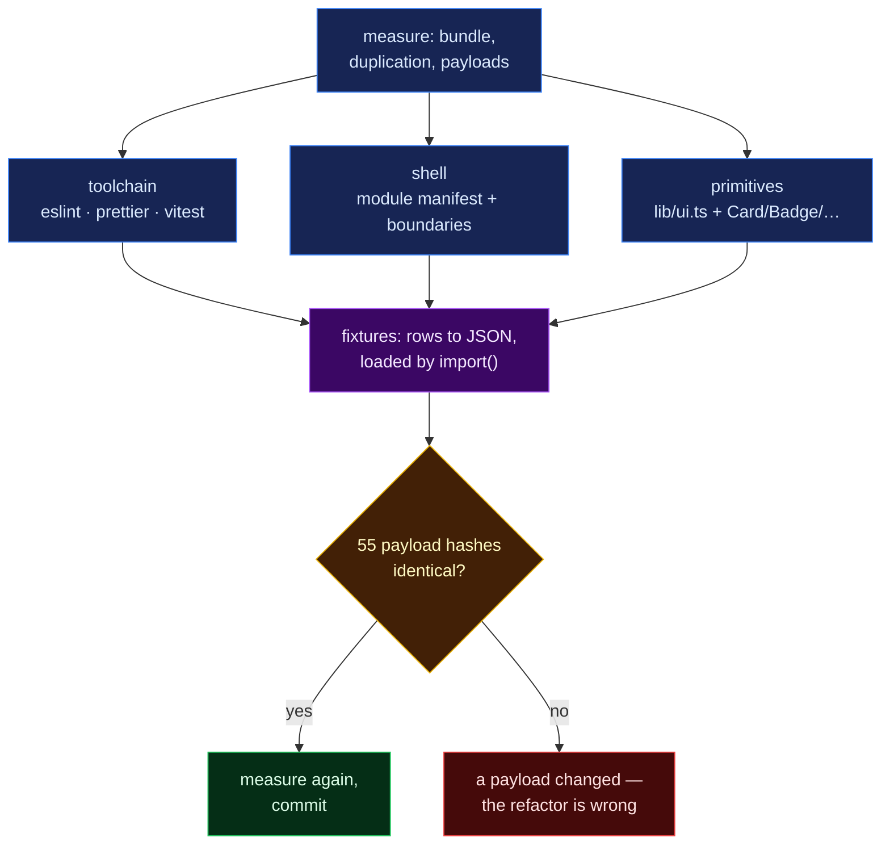

# 052 — Making the app maintainable: a toolchain, module boundaries, shared primitives, and data out of the code

**A step-0 platform entry, so it carries no hypothesis.** It records four refactors of
`app/`, the measurements taken before and after, and the equivalence check that proves the
rendered app did not change.

**Verified:** 2026-09-01, against the build in this commit.

## Question

The app ([029](029-viz-app.md), grown by every page entry since) had no lint, no formatter
and no test runner; its router and nav bar each carried a hand-written page list; page files
retyped the same Tailwind recipes; and every offline fixture was a TypeScript module compiled
into the entry chunk, so each visitor downloaded the whole offline dataset even when the API
was healthy.

Four questions, each answerable by measurement:

1. Can a lint/format/test toolchain be added on `typescript@7`?
2. Can routes and nav be derived from one declaration, with a failing page contained?
3. What is actually duplicated across `src/pages/**`, and what does extracting it cost?
4. Can fixture rows move out of code into JSON without changing a single payload — and what
   does that do to first paint?

## Inputs

| Input | Version / shape |
|---|---|
| `app/` at `c652265` | 18,470 lines over 133 files, 11 pages, 21 fixture modules (3,257 lines) |
| Node toolchain | Vite 8, TypeScript 7.0.2, React 18.3, Vitest 3.2.7 |
| Baseline bundle | `npx vite build`, chunk sizes as reported by Vite |
| Baseline payloads | 55 requests (every registered path, plus each param that changes a payload) dumped through the pre-refactor `fixtureFor` |
| Date of run | 2026-09-01 |

## Method

Five waves, each verified before the next started. Wave 1 ran three agents in parallel over
disjoint file sets; wave 4 ran four, one per fixture domain.



> **Legend** — purple: the extracted data · blue: neutral machinery · yellow: the gate every
> wave had to pass · green: the accepted outcome · red: the rejected one.

### Commands

```bash
cd app
npx vite build                          # baseline chunk sizes
npx vitest run <dump>                   # baseline: 55 payloads -> scratchpad/baseline.json
                                        # then hashed with the same JSON.stringify the test uses
npx eslint . --fix && npx prettier --write .
npm run check                           # typecheck + lint + format:check + test
npx vite build                          # post-refactor chunk sizes
```

## Observed

### 1. Toolchain

ESLint 9 flat config with `react-hooks`, `react-refresh`, `jsx-a11y`, `simple-import-sort`,
`eslint-config-prettier`; Prettier; Vitest + testing-library + jsdom.

**`typescript-eslint` cannot run here.** Every published 8.x release (checked to 8.69.0)
throws at import time against `typescript@7`: `@typescript-eslint/typescript-estree` reads
`ts.Extension.Cjs`, which the Go-ported compiler does not expose
([typescript-eslint#10940](https://github.com/typescript-eslint/typescript-eslint/issues/10940)).
Forcing a nested TS 6 through npm `overrides` did not work — the peer resolved back to the
root TS 7. TS/TSX are therefore parsed by `@babel/eslint-parser` + `@babel/preset-typescript`,
which never loads the `typescript` package. Cost: no type-aware rules. `tsc` keeps owning
unused-code detection (`noUnusedLocals`, `noUnusedParameters` are already `true`).

First sweep: **99 auto-fixable errors** (93 import-order, 6 export-order) across the repo,
all resolved by `eslint --fix`; **16 warnings remain** — 12 `react-refresh/only-export-components`,
3 `react-hooks/exhaustive-deps`, 1 `jsx-a11y/no-autofocus`.

### 2. Shell

11 pages became descriptors in one manifest (`src/app/modules`); `AppShell` derives both the
`<Route>` list and the nav items from it. Each module mounts in its own error boundary +
Suspense boundary, with a Retry that re-issues `import()` rather than re-rendering a cached
rejection. Nav links preload their chunk on `pointerenter`/`focus`.

Routes, labels, order, layout and footer text were diffed before and after: **byte-identical**.
All 11 page chunks and the 4 MB Plotly chunk still split exactly as before.

### 3. Duplication survey

Measured across `src/pages/**` before extracting anything:

| Pattern | Occurrences | Files |
|---|---|---|
| card wrapper `rounded-xl border border-zinc-800 bg-zinc-900/40 p-4` | 8 | 6 |
| four-tone alert box (good / broken / decision / neutral) | 12+ | 8 |
| small pill badge (verdict / flag) | 14 | 9 |
| dashed empty state | 5 | 5 |
| key-value `<dl>` list | 3 | 3 |
| `useUrlState` + `known()` glue for an async vocabulary | 4 | 4 |

Number formatting, Plotly layout and the Toggle/Select/Section controls were **already**
centralised — no extraction needed, and none was invented. Extracted: `lib/ui.ts` (the class
recipes plus `cx()`), `Card`, `Badge`/`Flag`, `EmptyState`, `FieldList`, and
`lib/hooks/useUrlKnownOption`. `Exhibit`, `Callout` and `NormChip` now read their classes from
`lib/ui.ts`; their rendered class strings are unchanged.

### 4. Fixtures: data out of the code

Rows moved to **39 `data/*.json` files**; the param-driven synthesis stayed as **18
`shape/*.ts`** modules; **4 `registry/*.ts`** fragments map a path to its `source` string and
loader. `index.ts` holds only a static path→fragment table, so nothing loads until a request
actually falls back. Fixture TypeScript fell from **3,257 to 1,837 lines**.

Equivalence: all **55 requests** in the matrix hash identically to the pre-refactor payloads
(`app/src/test/fixtures.test.ts`, 57 assertions, plus a coverage assertion that no registered
path escapes the matrix). No `NaN`, `Infinity`, `undefined` or `Date` was found in any fixture,
so nothing was lost to JSON's type set.

Entry chunk, measured by `vite build`:

| Build | raw | gzip |
|---|---|---|
| before | 296.89 kB | 96.87 kB |
| fixtures stubbed out entirely (the floor) | 230.69 kB | 75.72 kB |
| after: JSON, lazily imported | 236.44 kB | 77.19 kB |

**−60.45 kB raw / −19.68 kB gzip on first paint**, within 5.75 kB of the floor — what remains
is the path table itself. The 4 MB Plotly chunk and all 11 page chunks are unchanged.

Final gate: `npm run check` — typecheck clean, 0 lint errors, format clean, **59 tests pass**.

## Conclusion

- A lint/format/test toolchain runs on this repo today, with one documented gap: no type-aware
  linting until `typescript-eslint` supports TypeScript 7.
- Routes and nav now have a single declaration; a module that fails to load no longer blanks
  the app.
- Duplication was measured before it was extracted, so the shared layer holds only patterns
  that actually repeated three or more times.
- Fixture data is now data. It is editable, generatable, and no longer shipped to visitors who
  never use it — and the app it feeds is provably unchanged, payload for payload.

Not done, and deliberately left: pages still import their own primitives rather than the
barrel, and the 16 lint warnings are unaddressed. Both are page-file work, not layer work.
