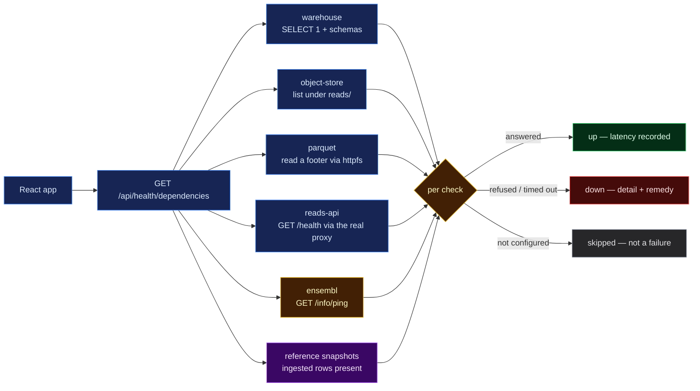

# 053 — Which backend is actually broken? Seven probes behind one endpoint

**A step-0 platform entry, so it carries no hypothesis.** It records an endpoint, the seven
probes behind it, and the two runs — everything up, everything pointed at dead ports — that
show what it reports in each state.

**Verified:** 2026-09-02, against the live warehouse, object store and reads API.

## Question

The app had exactly one way to describe a backend problem: "api down". That single message
covers at least six unrelated failures, each needing a different fix — Postgres refusing
connections, MinIO unreachable, MinIO reachable but the parquet read path broken (wrong
credentials, missing httpfs), the reads API not started, Ensembl rate-limiting, or the viz
API itself not running. A reader could not tell them apart, and neither could the app.

`/health` cannot answer this. It is a liveness probe: it touches nothing and answers in
microseconds, which is correct for "should this process be restarted" and useless for "is
anything it depends on working".

So: **can one endpoint probe every dependency, report each one's real state with actionable
advice, and never itself become another thing that breaks?**



> **Legend** — blue: our own machinery · yellow: a third party we do not control, and the
> per-check decision · purple: ingested reference data, not a live service · green: the
> dependency answered · red: it did not, and the response says what to do · grey: not
> configured, which is a state and not a fault.

## Inputs

| Input | Version / shape |
|---|---|
| Contract | fixed before either side was written; the React app was built against the same file |
| `mva.warehouse.settings.Postgres` | `describe()` redacts the password; used for the warehouse endpoint string |
| `mva.warehouse.objects` | `listing()` for reachability, `diagnose()` for the remedy text, `query()` for the parquet read |
| `mva.viz.proxy` | `base_url()` + `Upstream`, so the reads-API probe uses the real proxy path |
| Ensembl REST | `https://rest.ensembl.org/info/ping`, 2 s timeout |
| Live services | warehouse `vmi2938918.contaboserver.net:5432/mva`, MinIO, `mva-reads-api` |
| Date of run | 2026-09-02 |

## Method

Three modules, split by concern under the 400-line cap: `health.py` (the route, the
concurrency, the TTL cache, the `overall` rule), `health_probes.py` (one probe per
dependency), `health_results.py` (the check registry and the result vocabulary).

Four design rules, each chosen against a failure mode:

- **Concurrent, 2 s per check.** Seven dead dependencies must cost one 2 s wait, not seven.
- **Cannot 5xx.** Every probe catches its own failure; `run_check` adds a timeout and a
  catch-all on top. A broken dependency is a `down` row, never an exception.
- **Cached ~10 s in memory.** A liveness answer's only value is "right now", so it is not
  written to the disk cache; the TTL only stops a refreshing page from hammering Postgres.
- **`skipped` is not `down`.** No S3 credentials configured is a state, not a fault, and it
  never degrades `overall`.

gnomAD and ClinVar are deliberately **not** probed as live services. They were ingested; a
health check that hits NCBI on every page load would be slow, rude, and would answer a
question nobody asked. The check reports the ingested tables instead.

### Commands

```bash
uv run pytest tests/test_viz_health.py -q
tools/check-python.sh
uv run mva-viz-api --port 8912
curl -s localhost:8912/api/health/dependencies | python3 -m json.tool

# and again with three dependencies pointed at dead ports
MVA_READS_API_URL=http://127.0.0.1:9 PGHOST=127.0.0.1 PGPORT=59999 \
  S3_ENDPOINT=127.0.0.1:59998 uv run mva-viz-api --port 8913
curl -s localhost:8913/api/health/dependencies | python3 -m json.tool
```

## Observed

**Everything up** — `http 200`, whole response in **1.60 s**, `overall: "up"`:

| check | status | latency | detail |
|---|---|---|---|
| `viz-api` | up | 92 ms | `mva-viz-api v1.0.0 answered this request` |
| `warehouse` | up | 891 ms | `SELECT 1 answered; schemas warehouse + results present` |
| `object-store` | up | 847 ms | `274 object(s) listed under reads/` |
| `parquet` | up | 180 ms | `read 8 row(s) from reads/runs.parquet through httpfs` |
| `reads-api` | up | 167 ms | `GET /health -> 200 {'ok': True, 'service': 'mva-reads-api'}` |
| `ensembl` | up | 190 ms | `GET /info/ping -> 200 {"ping":1}` |
| `reference-snapshots` | up | 1489 ms | `gnomad_constraint 18,314 rows (gnomAD v4.1 constraint metrics)` |

**Three dependencies pointed at dead ports** — still `http 200`, in **1.05 s**,
`overall: "down"`:

| check | status | detail |
|---|---|---|
| `viz-api` | up | answered |
| `warehouse` | down | `IO Error: Unable to connect to Postgres at "host=127.0.0.1 port=59999 …` |
| `object-store` | down | `cannot reach the object store at 127.0.0.1:59998` |
| `parquet` | down | `cannot reach the object store at 127.0.0.1:59998` |
| `reads-api` | down | `reads API unreachable at http://127.0.0.1:9` |
| `ensembl` | up | answered — a real third party, genuinely unaffected |
| `reference-snapshots` | down | same Postgres failure |

The object-store remedy is `mva.warehouse.objects.diagnose()`'s existing output, reused
rather than rewritten, and it names the actual cause:

```
S3_ENDPOINT points at localhost — that is THIS machine, not the server.
That value is only correct while an SSH tunnel is open. Either:

  open the tunnel:  ssh -N -L 59998:localhost:59998 <user>@<server>
  or point straight at the server:  S3_ENDPOINT=<server-hostname>:59998
```

**Secrets:** the response body was searched for `PGPASSWORD` — absent. The S3 bucket name
inside a driver's own error text came back `[redacted]` by `health_results.redact`.

**Gates:** `tests/test_viz_health.py` 27 passed; `tools/check-python.sh` green (ruff format,
ruff lint, module size, import layering, mypy, pytest — **1289 tests**).

## Conclusion

- One request now distinguishes six failures the app previously reported as a single
  "api down", and each `down` row carries the command that fixes it.
- The endpoint stays a health check rather than a new liability: concurrent, capped at
  ~3 s worst case, answering 200 with a `down` payload when everything it probes is dead.
- A dependency being unconfigured is reported as `skipped`, so an optional service missing
  never reads as a broken one.
- The remedy text is not new prose: the object-store diagnosis that already existed for the
  CLI now reaches the browser, so both surfaces give the same advice.

Not done: the probes report the state of the machine that runs the API, so a developer
reading the page over someone else's tunnel sees that host's view, not their own.
