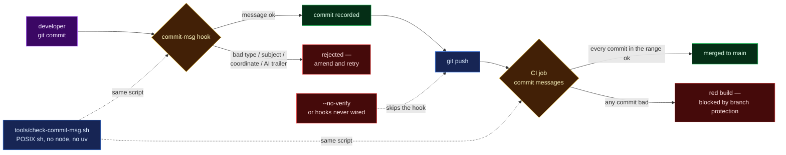

# 054 — Can the commit history be held to its own convention by a gate rather than by memory?

**A step-0 platform entry, so it carries no hypothesis.** It records a gate, its self-test, and
the measurement of this repository's real history against it.

**Verified:** 2026-09-02, against this repo's 152 commits.

## Question

`CONTRIBUTING.md` described a commit convention and then said, in the same paragraph, that
nothing enforced it: *"No hard enforcement (no commitlint) — this is observed convention, kept by
review."* Two things follow from that.

1. A convention kept by review decays exactly as fast as review attention does. The history is
   the repo's primary narrative for a qualitative judging round; a decayed prologue costs points
   that no amount of later tidying recovers, because published history cannot be rewritten
   without invalidating every clone and every SHA cited in `docs/*/methodology/`.
2. More seriously: `mva-science export` refuses to write a genomic position into a docs file, but
   **nothing at all stopped one being written into a commit message** — which is more permanent
   than the file, since `git commit --amend` only helps before the push, and a rewrite after it
   breaks every clone. The data transfer agreement does not distinguish the two.

So: **can one gate check the convention and the coordinate rule, in both places a commit is
written (locally, and on the way into `main`), without either toolchain being required?**



> **Legend** — purple = the raw input (a message a human wrote); blue = neutral machinery;
> yellow = a decision point; green = the commit lands; red = rejected, or the bypass that makes
> the second gate necessary. Dotted = "is the same script", not a data flow.

## Inputs

| Input                             | Value                                                                              |
| --------------------------------- | ---------------------------------------------------------------------------------- |
| Repository                        | `agharsallah/mva-hackathon` at `973229c`, 152 commits, 0 merge commits              |
| Gate                              | `tools/check-commit-msg.sh` (POSIX `sh`; `grep`, `sed`, `awk` only)                 |
| Callers                           | `.husky/commit-msg`; `.github/workflows/ci.yml` job `commits`                       |
| Coordinate regex                  | Ported from `mva.science.export.COORDINATE`, plus the `g.<pos><ref>><alt>` spelling |
| Subject limits                    | warn > 72 chars, fail > 90 (the repo's own p95 subject is 89)                        |
| Types accepted                    | `feat fix docs style refactor perf test build ci chore revert`                       |

Why POSIX `sh` and not commitlint or a Python module: this repo has two toolchains, and a
contributor working on only one half has only that half installed. A gate written in node is
skipped by every `uv`-only clone and vice versa; `grep` is present in both.

## Commands run

```sh
sh tools/check-commit-msg.sh --self-test
sh tools/check-commit-msg.sh --range <root-commit>..HEAD   # all 152
sh tools/check-commit-msg.sh --range 9e39cd4..HEAD         # the newest 63
sh tools/setup-git.sh
```

## Observed output

**Self-test — 13 cases, 13 passed, 0 failed.** Four must pass (conventional with body, no scope,
a `Merge` subject, a proper noun such as `ClinVar` mid-subject) and nine must fail (no type,
capitalised non-conventional subject, capitalised summary, trailing period, missing blank line,
`chr…:…` coordinate, `g.…A>G` coordinate, AI trailer, subject over 90).

**Against all 152 commits — 39 commits fail, 40 errors:**

| Error class                                   | Count |
| --------------------------------------------- | ----- |
| Subject is not `<type>(<scope>): <summary>`   | 26    |
| AI attribution trailer in the body            | 7     |
| Subject over the 90-character hard limit      | 5     |
| Capitalised summary after a valid type        | 1     |
| Genomic position in the message               | 1     |

**Against the newest 63 commits (`9295687` onward) — 0 errors, 26 warnings.** Every warning is
the soft 72-character subject advisory; none is a body or convention failure. So the convention
the repo has actually followed since `9295687` passes the gate unchanged: the gate was fitted to
observed practice, not imposed over it. That is also the boundary recorded in `CONTRIBUTING.md`.

**The one coordinate hit is `8a851d6`** — an illustrative example inside the commit body that
introduced the science register, not patient data. The gate cannot tell an example from a real
position and should not try: the false positive costs a rewording, a false negative costs the
DTA. That is the same trade-off `export.COORDINATE` documents.

## Conclusion

- The convention is now enforced in both places a commit can enter history, by **one** script —
  local and CI cannot drift apart, and the CI job exists precisely because `--no-verify` and an
  unwired clone can both skip the hook.
- A genomic position can no longer be written into a commit message from a wired clone. Making
  that unbypassable needs branch protection, which this repository **cannot have today**:
  `gh api repos/agharsallah/mva-hackathon/branches/main/protection` answers
  `403 — Upgrade to GitHub Pro or make this repository public` (checked 2026-09-02, private repo
  on the free tier). Until then the hook is the enforcement and CI is a visible backstop: a red
  `commit messages` job on `main` means something got in around the hook.
- The pre-`9295687` prologue (89 commits) stays as it is. Rewriting published history to tidy
  subject lines would invalidate every clone and every SHA cited in this folder — a larger loss
  than an untidy prologue, which `CONTRIBUTING.md` now explains instead of hiding.
- `tools/setup-git.sh` makes the remaining "did you configure your clone" failure modes
  self-healing: hooks path, commit template, blame-ignore file, rebase-pull and fetch-prune, all
  idempotent, all repo-local, and run automatically by `app/`'s `prepare` script.
