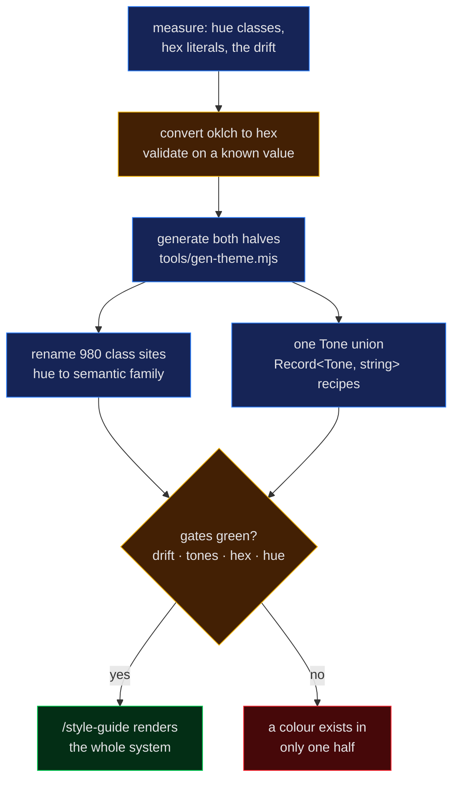

# 055 — One generated colour source for both the DOM and the charts, and a page that renders it

**A step-0 platform entry, so it carries no hypothesis.** It records a measured drift between
the app's two colour systems, the generator that removed it, the four gates that keep it
removed, and the `/style-guide` page that renders the result.

**Verified:** 2026-09-02, against `app/` in this commit.

## Question

`app/` had two colour systems that meant the same things and were never compared:

- `src/lib/palette.ts` — hand-typed hex, handed to Plotly, to SVG attributes and to inline
  `style`.
- `src/lib/ui.ts` — Tailwind class recipes naming Tailwind's **built-in** hues
  (`emerald`, `amber`, `zinc`), resolved by Tailwind v4 at build time.

Four questions, each answerable by measurement:

1. Had the two halves actually drifted, and by how much?
2. Can one source feed both, given that Plotly cannot read a CSS variable and Tailwind cannot
   read a runtime value?
3. Can "adding a meaning" be made a compile error at every site instead of a silent gap?
4. What does the token system look like as a report exhibit?

## Inputs

| Input | Version / shape |
|---|---|
| `app/` at `a754a88` | 980 built-in-hue class occurrences over 74 files; 51 hex literals, all in `src/lib/palette.ts` |
| `tailwindcss` | 4.3.3, `node_modules/tailwindcss/theme.css` — the default palette, in `oklch()` |
| Toolchain | Node 24.14.0, Vite 8, TypeScript 7.0.2, Vitest 3.2.7, ESLint 9.39.5 |
| Date of run | 2026-09-02 |

## Method

> **Legend** — blue = machinery (a step that only moves values around), yellow = a decision
> point, green = the outcome we wanted, red = the failure the gates exist to catch.

### 1. Measuring the drift

`palette.ts`'s `C.good` was `#22c55e` — Tailwind **v3**'s `green-500`. The installed
`tailwindcss@4.3.3` declares `--color-green-500: oklch(72.3% 0.219 149.579)`, which converts
to `#00c950`; and `lib/ui.ts` did not name `green` at all, it named `emerald-400`. So "good
green" was three different values depending on whether it was painted by Plotly, by a class,
or read from the note that said colour lived in one place.

The oklch → sRGB converter was validated before generating anything: Tailwind's
`--color-zinc-800: oklch(27.4% 0.006 286.033)` converts to `#27272a`, byte-identical to the
hand-written `C.grid` in the file being replaced. Two other stops confirmed the *palette*
changed between Tailwind versions rather than the arithmetic being wrong
(`red-500`: `#ef4444` → `#fb2c36`, `yellow-500`: `#eab308` → `#f0b100`).

### 2. One generator, two artifacts

`app/tools/gen-theme.mjs` reads the installed theme, keeps seven families, converts once, and
writes both halves — `src/lib/palette/ramps.generated.ts` (hex, 7 × 11 = 77 values) and
`src/theme.generated.css` (the same 77 as `--color-*` custom properties). `--check` re-derives
and diffs instead of writing; that is the CI step and the first assertion of the new test.

Hex is emitted on the DOM half too, rather than aliasing `var(--color-green-500)`: Plotly
parses colours in JavaScript and understands neither a CSS variable nor `oklch()`, so the
canvas half needs concrete hex, and emitting the same hex for the DOM makes the two halves
byte-identical rather than "the same colour in two colour spaces".

Family names are semantic, and the Tailwind hue they are cut from appears only in the
generator: `good`←green, `broken`←red, `decision`←yellow, `machinery`←blue, `raw`←purple,
`chrome`←zinc, `severity`←orange.

### 3. Tones, and why the recipes are literal

`lib/palette/tones.ts` exports one `Tone` union — `neutral · good · broken · decision ·
machinery · raw` — plus `TONE_FAMILY` (which hue renders it) and `TONE_MARK` (the hex a chart
draws it with). Every recipe in `lib/ui.ts` is a `Record<Tone, string>` over that union, so a
seventh meaning fails to compile until every recipe answers for it.

The recipes hold **literal** class strings rather than being generated by a loop over `TONES`.
That is deliberate: Tailwind discovers utilities by scanning source text, so a class assembled
from a template string is never emitted and the style silently disappears. The loop would have
looked more elegant and shipped an invisible bug.

`machinery` was added as a sixth tone in the same pass, which removed the last structural
piece painting itself outside the system (`Explainer`'s hand-typed blue panel).

### 4. Gates

| Gate | Catches | Where |
|---|---|---|
| `pnpm theme:check` | either artifact drifting from the generator, including after a `tailwindcss` upgrade | CI step, `package.json` script |
| `src/test/theme-tokens.test.ts` | a tone missing from a recipe, a recipe tinting a tone in the wrong family, a shade that does not exist, a scale stop that is not a ramp entry, a scale not ordered 0→1 | 10 tests |
| `local/no-raw-hex-color` | a hex literal in `src/` outside the generated ramps — string, template literal, or inline `style` | `eslint-rules/` |
| `local/no-builtin-tailwind-color` | `bg-emerald-400` and every other bare Tailwind hue in a class string | `eslint-rules/` |

Both rules moved out of `eslint.config.js` into `eslint-rules/`, each with `RuleTester` cases
in `eslint-rules/rules.test.js` (20 cases). The negative cases are the reason: the previous
inline rule inspected only `Literal` nodes, so `` `bg-[#22c55e]` `` — a `TemplateElement` —
passed it. That gap is now a failing test, and the rule handles both node types.

## Result

| Measure | Before (`a754a88`) | After |
|---|---|---|
| Tailwind built-in hue classes in `src/` | 980 over 74 files | **0** (2 remaining mentions are prose in a comment and in page copy) |
| Semantic family classes in `src/` | 0 | 1,032 |
| Hex literals in `src/` | 51, hand-written in `palette.ts` | 77, all in `ramps.generated.ts` |
| Files allowed to contain a colour value | 1, by convention | 1, by lint |
| Tone unions declared | 6 separate inline unions, 2–5 members each (`StatTile`, `Callout`, `EmptyState`, `BOX`, `BADGE`, `EMPTY_DASHED`) | 1, imported everywhere |
| Verdict→colour encoders | hex-returning only | tone-returning, with a `*Color` twin only where a canvas draws that vocabulary |
| Tests | 105 | 137 — 10 token tests, 20 `RuleTester` cases, 2 for the new page |
| DOM text/pills painted by an inline hex | 8 verdict sites (impact, probe verdict, observed-vs-expected, job state) | 0 — each takes a `Tone` and a class recipe |
| Modules axe-clean | 12 | 13 (the new page included) |

The 52 remaining inline `style` colours are legend chips and SVG marks — canvas-side by
design, all reading `RAMP`/`C`/`TONE_MARK`.

Built CSS carries 49 `--color-*` custom properties — Tailwind emits only the shades actually
used, out of the 77 declared. `pnpm check` (typecheck · lint · format · theme:check · test)
and `pnpm build` are green; bundle budget reports the entry at 247.56 kB raw / 79.69 kB gzip
against a 260 kB / 84 kB budget, with the new page's own chunk at 17.04 kB raw / 5.65 kB gzip.
The pre-change bundle was **not** re-measured, so no before/after byte delta is claimed here.

### The visible change

The DOM's hues moved onto the chart's hues: `emerald` → `green`, `amber` → `yellow`, `zinc` →
the `chrome` ramp. The app is slightly more saturated than before, because Tailwind v4's
palette is more vivid than the v3 values `palette.ts` had been holding — the charts now match
the DOM instead of sitting a hue family away from it. Verified by screenshot on `/style-guide`,
`/overview`, `/genome` and `/compare` in Chrome at 1440 px, with an empty console.

## `/style-guide`

The system renders itself as a page, registered like any other module (so the offline-render
and axe tests cover it):

| Exhibit | What it shows |
|---|---|
| the token pipeline | source → generator → two artifacts → four gates, drawn with the app's own `BOX` recipes |
| the generated ramps | 7 families × 11 shades, each swatch labelled with its shade and hex |
| the six tones | one row per `Tone`: family, mark hex, and the live `TEXT`/`BADGE`/`BOX`/`EMPTY_DASHED` recipes |
| colour scales | every Plotly colourscale as the gradient it paints, each stop named `family-shade` |
| the primitives | every `src/components/index.ts` export, rendered with throwaway data |

Nothing on it is hand-listed — the grids iterate `RAMP` and `TONES` — so a new tone or a
changed number appears without an edit, which also makes it the screenshot to diff after any
styling change.

## Conclusion

The two halves of the app's colour are now one generated source with four gates over it, and
the DOM/canvas split is the *only* reason two artifacts exist. The decision and its rule are
owned by [colour is generated](../notes/colour-is-generated.md); this entry is the measurement
behind it.

What this does **not** do: `index.css` is still unlinted (no Stylelint), and no visual
regression is automated — `/style-guide` makes a diff cheap for a human but nothing fails on
one. Both were left out deliberately: the stylesheet is 40 lines with one documented
`!important`, and a screenshot harness costs more than it protects at this size.
