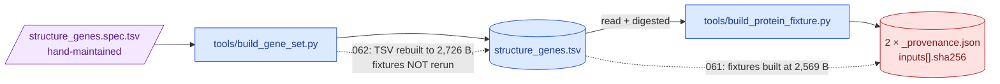

# 063 — Two fixture manifests were naming bytes that no longer existed, and the test that should have caught it was blind to them

**Date:** 2026-09-03
**Question:** [062](062-reference-manifests-and-bed-notes.md) rebuilt
`ressources/reference/structure_genes.tsv` *after* [061](061-reference-data-provenance.md)
had built the fixtures from it. Both fixture manifests record that TSV as an **input**, so
did they go stale — and if they did, why did the drift test that exists precisely to catch
that not fail?

_(step-0 platform machinery: this entry records decisions and measurements, not a
hypothesis. Per [`docs/method.md`](../../method.md), step 0 takes no hypotheses.)_

**Supersedes** two items of [062 §5 "Still open"](062-reference-manifests-and-bed-notes.md):
both named app fixtures are current in this tree and were re-measured here (below). The
other three items of that list — the empty `source_sha256` on the `clinvar_panel` lineage
row, `figures/explore-report.html`, and `qc_norms.tsv` having no generator — stand.

## Inputs

| | |
|---|---|
| Code at build time | `cb066b8` |
| Gene set TSV, as committed | `ressources/reference/structure_genes.tsv`, **2,726 B**, sha256 `7461a74cf8a6ce06457bbc50a7f342301ab2e14753b81f0e34089053658605b7` (the 062 rebuild) |
| Same TSV, as recorded by both fixture manifests | **2,569 B**, sha256 `1124e6c04a5c3f588dbaf26c469cec2eee7c3dc33a3bf3a7f195d62ae94d33cf` (the 061 build) |
| Manifests under test | `app/src/fixtures/data/protein/_provenance.json`, `app/src/fixtures/data/gene-structure/_provenance.json` |
| Live upstreams | Ensembl REST release **116**, AlphaFold DB (`/api/prediction`, model mmCIF) |
| Blind test | `tests/test_viz_referencemanifest.py::test_every_input_a_committed_manifest_names_inside_the_tree_still_hashes_the_same` |

## The defect

Two files, one digest each, and a two-word cause: **run order**.



> **Legend** — **purple = the hand-maintained raw input**; **blue = regenerable
> machinery**; **red = the file left lying**. Solid arrows are one run's data flow; dotted
> arrows are the two runs, in the order they happened.

The manifests were not wrong when written. They went wrong when the file underneath them
was rewritten and nothing re-ran. `GET /api/provenance/reference` therefore served — and
the Provenance page rendered — a digest that named no bytes in the repository, which is the
one failure mode a build-time manifest has.

**Why the drift test missed it.** It iterated
`refprovenance.rows(fixture_dirs=())`, which excludes the fixture directories: the only two
manifests that were actually stale were the only two it did not look at. Its own docstring
claimed it was "what caught the panel BED going stale".

## Commands run

```bash
# 1 — the blind test, made sighted, run before anything was rebuilt
uv run pytest tests/test_viz_referencemanifest.py -k still_hashes_the_same -q

# 2 — are the fixture *payloads* stale too, or only the manifest input digest?
#     a full --force refetch from live Ensembl + AlphaFold, digests compared before/after
shasum -a 256 app/src/fixtures/data/{gene-structure,protein}/*.json > before.sha
uv run python tools/build_protein_fixture.py --force        # interrupted at 12 of 23 genes
shasum -a 256 app/src/fixtures/data/{gene-structure,protein}/*.json > mid.sha
diff <(sort before.sha) <(sort mid.sha)

# 3 — the synthetic allele label convention, then the eight panel genes rebuilt
uv run python tools/build_protein_fixture.py --force \
  --gene CEP57 DICER1 BUB1B TP53 CEP192 CENPE TRIP13 SMC5

# 4 — the new offline pass: re-digest and rewrite both manifests, no network
uv run python tools/build_protein_fixture.py --manifest-only

# 5 — the route's own reply, re-transcribed into the offline fixture
uv run python -c "import json; from mva.viz import refprovenance; ..."

# 6 — gates
tools/check-python.sh --fix
```

## Observed output

### 1 — the test fails the moment it is allowed to see the fixture manifests

```
E               AssertionError: ressources/reference/structure_genes.tsv has changed since app/src/fixtures/data/protein/_provenance.json was written
E               assert '1124e6c04a5c...5d62ae94d33cf' == '7461a74cf8a6...89053658605b7'
E                 - 7461a74cf8a6ce06457bbc50a7f342301ab2e14753b81f0e34089053658605b7
E                 + 1124e6c04a5c3f588dbaf26c469cec2eee7c3dc33a3bf3a7f195d62ae94d33cf
FAILED tests/test_viz_referencemanifest.py::test_every_input_a_committed_manifest_names_inside_the_tree_still_hashes_the_same
1 failed, 24 deselected
```

Red before the fix, on the pre-existing bytes. That is the whole point of recording it: the
gate did not exist, and its absence is measurable.

### 2 — the fixture payloads were never stale. Only the input digest was

A `--force` run refetches every gene from live Ensembl and AlphaFold. It was interrupted at
**12 of 23 genes** — 24 files, including **all eight** panel genes, the only ones that carry
`candidates[]`. Every one came back **byte-identical**:

```
$ diff <(sort before.sha) <(sort mid.sha) && echo IDENTICAL
IDENTICAL: all 47 files unchanged by the partial --force rerun
```

That is the honest answer to "does the TSV rebuild change the fixtures": **no**, and the
reason is structural rather than lucky. 062 changed exactly one TSV column — `note` — and
`note` is not a field of either payload. `mva.viz.geneset` hands the builder `symbol`,
`ensembl_id`, `group`, `biotype`, `coding`; the anatomy payload is built from Ensembl's
reply, not from the TSV row. So a note correction can move the TSV's digest without moving
a single fixture byte, which is precisely the case a manifest-only rewrite exists for.

### 3 — `rs000000001` was a bad label, and it was on screen

`tools/build_protein_fixture.py` wrote every synthetic allele's `rsid` as `rs00000000n` and
built the rendered label from it, so the lollipop tooltip, the distance table and the
unplaced list all read `stop gained · rs000000001` verbatim. `rs000000001` is not an issued
dbSNP accession, and the manifest said so — but nothing next to the label did, and a reader
who knows what an [rsID](../../dictionary.md) is reads that string as one. The convention is
now `synthetic-n`, which cannot be mistaken for a dbSNP accession by a reader or by a grep:

| | before | after |
|---|---|---|
| `rsid` | `rs000000001` | `synthetic-1` |
| `label` | `stop gained · rs000000001` | `stop gained · synthetic-1` |
| manifest `fields.candidates` | "rsid rs00000000n which is not a real dbSNP accession" | "rsid synthetic-n, which is not the shape of a dbSNP accession and renders inside the label as its own disclaimer" |

Eight gene-structure fixtures carry `candidates[]` and only those eight changed. Their new
digests are listed in §5.

### 4 — the two closed items from 062 §5, re-measured

| 062 §5 said | measured here |
|---|---|
| `provenance-reference.json` stale, transcribed from a 4-row reply | **7 rows**, and byte-for-byte equal to `refprovenance.rows()` on this tree, field by field, before the rebuild |
| `panel-structure-genes.json` stale by two note strings | **23 genes, 0 note mismatches** against `structure_genes.tsv` |

Both were brought current by work 062 did not do and did not record; this entry records the
measurement rather than the fix.

`provenance-reference.json` *was* carrying the stale TSV digest, because it is a faithful
transcription of the route's reply and the route reads the manifests. It is re-transcribed
here from the same `refprovenance.rows()` call the route makes.

## What changed

| File | Change |
|---|---|
| `tests/test_viz_referencemanifest.py` | the drift test walks **every** manifest family (`refprovenance.rows()`, no `fixture_dirs=()`), and asserts it saw an input from both `reference` and `fixture` rows so the loop cannot go vacuous. Docstring names the real defect instead of claiming a catch it never made. |
| `tools/build_gene_set.py` | docstring states the run order and that a rerun here ends with `build_protein_fixture.py --manifest-only` |
| `tools/build_protein_fixture.py` | same run-order statement from the other side; new `--manifest-only`; `SYNTHETIC_ID = "synthetic-{index}"` |
| `src/mva/viz/fixturemanifest.py` | `redigested()` and `recorded_release()` — the offline pass; `SYNTHETIC_CANDIDATES` wording |
| `tests/test_warehouse_reference.py` | `NOT_STAGED` was defined twice and subtracted twice; one of each now |
| `docs/dictionary.md` | the **rsID** entry says the fixtures' invented alleles are deliberately not rs-shaped |

**`--manifest-only` is the fix for the defect class, not just this instance.** A stale input
digest with unchanged outputs should not cost 23 genes and ~70 upstream calls to correct.
The pass re-digests the committed fixtures, keeps every upstream fact the run that *fetched*
each gene recorded, and reuses the Ensembl release those runs recorded rather than asking
`/info/data` again — asking would attribute today's release to records fetched under
whatever release was live then. It returns `None` unless every block that names a release
names the same one.

## 5 — exactly what changed on disk

11 of the 48 files under `app/src/fixtures/data/` moved; 37 are byte-identical.

| Path | sha256, after |
|---|---|
| `gene-structure/BUB1B.json` | `560f3262817b500ba6abf934133ae6039649c3467829a327e74c6db4168f559c` |
| `gene-structure/CENPE.json` | `9e177fd0b830417753214cd78a4a8d7f8b5ba52c700cef25bc35f25f47120ec9` |
| `gene-structure/CEP192.json` | `b52c68538daade3f5014f04be3f13700da12c0686b0fd2e003819761a5c4de74` |
| `gene-structure/CEP57.json` | `af90b833e7c6014e9fb2d8000b5bf3a1af53d6e8d73d1377e3f2a99905693c7b` |
| `gene-structure/DICER1.json` | `eb929e1e0a4df9477a404d1a6cb0ca2b9e471d356f0073c8793fda896099ac43` |
| `gene-structure/SMC5.json` | `3dcd36db51d4adb2b84c600b04921a0b2f21e9e5c62476fd1cec08c00d77cade` |
| `gene-structure/TP53.json` | `fcee91d41045f6bc423dc872bd3b986a02d6f68e224326d5d0212d4f99115883` |
| `gene-structure/TRIP13.json` | `e03b4469c2c11837e903a31f5377ee51c882719e64409841b87ee5e89b335c20` |
| `gene-structure/_provenance.json` | `4b405b9adbbf16afeaf0dfe977f4eb7f36df8999c26801c9b78d62291df2991e` |
| `protein/_provenance.json` | `d80fbde049edecd4000870852f8a232e1e0f0ed81ce176441de9eb7b012f284e` |
| `provenance-reference.json` | `a738b3cf2f1ed4f2e59b9b48119d8ca2103df9de94a7487e3dc3434d8461736f` |

The eight are exactly the eight `in_panel` genes — the only ones that carry `candidates[]`
— and the only field of theirs that moved is `candidates[].rsid`/`.label`. All 21 protein
fixtures, all 15 non-panel gene-structure fixtures and `panel-structure-genes.json` are
unchanged. `provenance-reference.json` is re-transcribed from `refprovenance.rows()`, the
same call the route makes, so the Provenance page shows the corrected input digest.

The build run that produced them:

```
$ uv run python tools/build_protein_fixture.py --force \
    --gene CEP57 DICER1 BUB1B TP53 CEP192 CENPE TRIP13 SMC5
ensembl release 116 (GET https://rest.ensembl.org/info/data)
CEP57        panel     gene-structure    2.0 kB (11 exons, 3 domains, 3 synthetic candidates) | protein   28.9 kB (ENSP00000317902 / Q86XR8 alphafold v6, 500 of 500 residues, covered [[1, 500]])
DICER1       panel     gene-structure    8.1 kB (27 exons, 42 domains, 3 synthetic candidates) | protein  105.9 kB (ENSP00000343745 / Q9UPY3 alphafold v6, 1922 of 1922 residues, covered [[1, 1922]])
BUB1B        panel     gene-structure    3.2 kB (23 exons, 7 domains, 3 synthetic candidates) | protein   56.6 kB (ENSP00000287598 / O60566 alphafold v6, 1050 of 1050 residues, covered [[1, 1050]])
TP53         panel     gene-structure    3.9 kB (11 exons, 17 domains, 3 synthetic candidates) | protein   23.1 kB (ENSP00000269305 / P04637 alphafold v6, 393 of 393 residues, covered [[1, 393]])
CEP192       panel     gene-structure    5.5 kB (45 exons, 14 domains, 3 synthetic candidates) | protein  138.6 kB (ENSP00000427550 / Q8TEP8 alphafold v6, 2537 of 2537 residues, covered [[1, 2537]])
CENPE        panel     gene-structure    5.6 kB (49 exons, 12 domains, 3 synthetic candidates) | protein  138.7 kB (ENSP00000265148 / Q02224 alphafold v6, 2580 of 2701 residues, covered [[1, 2580]])
TRIP13       panel     gene-structure    2.9 kB (13 exons, 10 domains, 3 synthetic candidates) | protein   25.6 kB (ENSP00000166345 / Q15645 alphafold v6, 432 of 432 residues, covered [[1, 432]])
SMC5         panel     gene-structure    3.1 kB (25 exons, 4 domains, 3 synthetic candidates) | protein   59.9 kB (ENSP00000354957 / Q8IY18 alphafold v6, 1101 of 1101 residues, covered [[1, 1101]])
app/src/fixtures/data/gene-structure/_provenance.json — 23 genes
app/src/fixtures/data/protein/_provenance.json — 21 genes

8 genes — 626,185 bytes total (611.5 kB)
```

Then the offline pass, which asked nothing and changed only the digests and `built_at`:

```
$ uv run python tools/build_protein_fixture.py --manifest-only
app/src/fixtures/data/gene-structure/_provenance.json — 23 genes
app/src/fixtures/data/protein/_provenance.json — 21 genes

$ # both manifests, inputs[] for the gene set TSV
protein         2026-09-03T13:46:57+00:00  7461a74c…605b7  2726 B   release 116, 21 genes
gene-structure  2026-09-03T13:46:57+00:00  7461a74c…605b7  2726 B   release 116, 23 genes
```

The release is **116** in both, read back off the per-gene blocks rather than re-asked, and
all 21 / 23 blocks survived the rewrite.

## Gates

```
$ tools/check-python.sh --fix
==> ruff format
238 files left unchanged
==> ruff check --fix
All checks passed!
==> ruff format --check
238 files already formatted
==> ruff check
All checks passed!
==> module size
ok: every module within its limit (src: 400, tests: 600, tools: 400); 10 in the warning band.
==> import layering
Analyzed 160 files, 460 dependencies.
Contracts: 3 kept, 0 broken.
==> mypy
Success: no issues found in 167 source files
==> pytest
1562 passed, 1 warning in 26.11s
python gate: green
```

Test count unchanged at **1,562**: the drift gate was widened, not added, which is the
honest shape of this change — the test existed, it was simply pointed away from the two
manifests that could go stale without anyone noticing.

## Conclusion

1. **The two fixture manifests were stale, and only in `inputs[]`.** They recorded
   `structure_genes.tsv` at 2,569 B / `1124e6c0…` while the committed file is 2,726 B /
   `7461a74c…`, because 062 rebuilt the TSV after 061 had built the fixtures from it. Every
   *output* digest in both manifests was correct throughout.
2. **The gate that should have caught it was scoped past it.** `fixture_dirs=()` excluded
   the fixture manifests from the input-drift loop; the two families are now both walked and
   the test asserts it saw an input from each, so the loop cannot silently go vacuous again.
3. **The fixtures themselves were never wrong, and that is structural.** A `note`-column
   correction cannot move a fixture byte — `note` is not a field of either payload — and a
   12-of-23-gene live refetch confirmed it rather than assuming it.
4. **Run order is now written down on both sides**, and `--manifest-only` makes obeying it
   cheap: an input digest can be corrected without 23 genes of upstream calls, and without
   claiming a release or a model version that this pass did not measure.
5. **`rs000000001` is gone.** Synthetic alleles are `synthetic-1`…`synthetic-3`, so the one
   invented field in the committed fixtures announces itself in every place its label is
   rendered, not only in the manifest and the `source` chip.
6. **Still open.** `app/src/fixtures/data/panel-clinvar-sites.json` — a different,
   hand-maintained fixture with no generator — still uses the old `rs00000000n` convention
   for four synthetic ClinVar sites (and `variation_id` 900001+). Same objection, different
   file; changing it is an app-owned edit this entry did not make.
