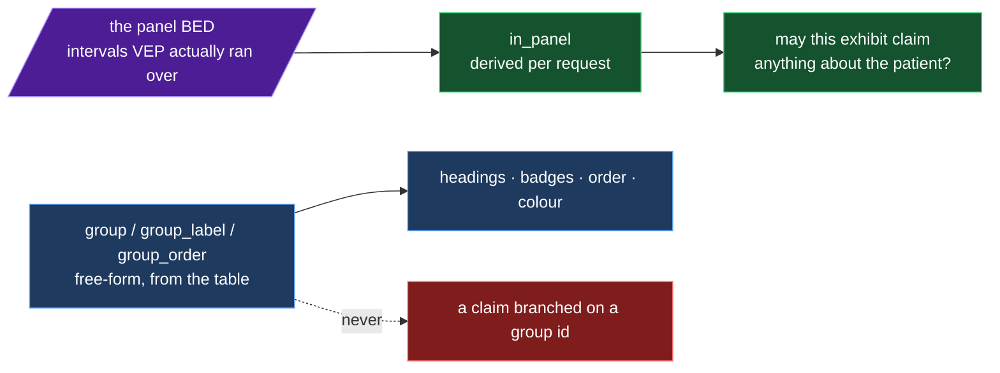

# 064 — Generalising the structure toolkit: a display group becomes data, and the reuse claim becomes a test

**Date:** 2026-09-03
**Question:** `CLAUDE.md`'s second deliverable is a toolkit that transfers to another
N-of-1 case. The structure half — `viz3d`, the gene set, the protein route, the manifests,
the exhibits — was written for *this* case. **Where exactly does this case leak into it,
and can the reuse claim be turned into something that fails when a layer re-learns a gene
or a group name?**

_(step-0 platform machinery: this entry records decisions and measurements, not a
hypothesis. Per [`docs/method.md`](../../method.md), step 0 takes no hypotheses.)_

**Supersedes** the group vocabulary stated in
[060 §"Groups"](060-structure-gene-set.md): `StructureGene.group` was the union
`'panel' | 'mva-sac' | 'extended'` and the app held two hardcoded label maps and a
hardcoded tone-per-id map. It is now a free-form id and the labels, the order and the
colour assignment come from the payload. The three ids this case uses are unchanged, and
every Ensembl-derived value in `structure_genes.tsv` is byte-identical to 060/062's.

## Inputs

| | |
|---|---|
| Code at build time | `5236c53` |
| Spec, edited | `ressources/reference/structure_genes.spec.tsv` — header now `symbol group group_label group_order note` |
| Table, rebuilt | `ressources/reference/structure_genes.tsv` — **3,518 B**, sha256 `2e31d1e1…3932774e`, 23 rows, 8 columns |
| Same table, before | **2,726 B**, sha256 `7461a74c…658605b7` (the [062](062-reference-manifests-and-bed-notes.md) build) |
| Offline index, rebuilt | `app/src/fixtures/data/panel-structure-genes.json` — 6,095 B, 23 genes |
| Ensembl | **not called by this rebuild** — see "The relabel path" below |
| Gates | `tools/check-python.sh` (six gates, 1,580 tests), `pnpm run check` (24 files, 368 tests), `lint:strict --max-warnings 0`, `build`, `bundle-budget --skip-build` |

## 1. Where this case leaked in — the audit

Grepped `app/src/viz3d/`, the protein pipeline (`proteinstructure.py`, `mmcif*.py`,
`genestructure.py`), `geneset*.py`, the manifest tooling and the provenance route for gene
names, `MVA`, group ids, panel-BED path assumptions and fixed-8-gene assumptions.

**Clean, measured, nothing to fix:**

- **`app/src/viz3d/`** — 4 hits, all of them prose in comments citing BUB1B as a worked
  example ("~1,050 residues for BUB1B"). No gene name, no group id and no case fact in any
  code path. The `eslint-plugin-boundaries` edge (`viz3d` → `lib` only) is what makes that
  structural rather than lucky.
- **`refprovenance.py`** — discovers manifests by filename *suffix*, so a new dataset
  appears by being built. Its paths (`ressources/reference`, the two fixture dirs) are
  repo-layout constants, not case facts.
- **The two structure routes** — both require an explicit `gene=` query parameter. There
  was no server-side default gene to leak.

**Fixed here:**

| Leak | Was | Now |
|---|---|---|
| `StructureGene.group` | union `'panel' \| 'mva-sac' \| 'extended'` | `string`, plus `group_label: string` and `group_order: number` on every row |
| Group headings | `GROUP_LABEL` / `GROUP_SHORT` maps in `geneSet.ts` | derived by `geneGroupings()` from the payload; the badge is the set's own short id, the label its tooltip |
| Group colours | `GROUP_TONE = { panel: good, 'mva-sac': machinery, extended: neutral }` | `groupTones()` assigns a tone by the group's **rank**, from a 6-tone cycle. Renaming a group keeps its colour; a fourth group gets a fourth tone instead of grey |
| Metrics table group column | sorted alphabetically on the id, badge tone branched on `row.group === 'mva-sac'` | sorts on `groupOrder`, tone from the rank map |
| Legend | three sentences naming the three groups | iterates the groups it was given, in their order, in their words |
| `structureMetrics` fallback with no set entry | `group: 'extended'` — an id it invented | `group: ''`, `groupLabel: 'group not stated'`. The conservative reading is carried by `in_panel` alone |
| Offline fixture default gene | `const DEFAULT_GENE = 'BUB1B'` | the set's first `in_panel` row, read off the fixture |
| `ProteinExplorer`'s opening gene | the page's `DEFAULT_GENE` literal | `defaultGene(genes, DEFAULT_GENE)` — the literal is a *preference*, the fallback is the set's first `in_panel` row |
| Comparison's two sides | `COMPARE_A` / `COMPARE_B` literals | `compareDefaults(genes)` — those two if the set holds them, else the first two `in_panel` rows |
| Panel BED in `geneset` | `panelbed.annotations()` at the default path, inside a cached loader | `bed` parameter on `genes` / `lookup` / `resolve`, cache keyed on `(tsv, bed)` |
| Panel BED in a manifest string | `"REAL — derived from ressources/data-profile/mva_panel_grch38.bed"` | interpolated from `panelbed.DEFAULT_BED` |
| The panel assertion | `check_panel` always ran against a hardcoded group name `panel` | `--panel-group ''` (or a group no row uses) asserts nothing, for a case with no annotated panel |

**Remaining, deliberately** — recorded in
[`docs/notes/reusable-structure-toolkit.md`](../../notes/reusable-structure-toolkit.md#known-limits):
`geneset.ALIASES` is three hand-kept copies of a one-entry map (no layer may import the
others); `tools/build_gene_set.py` hardcodes `homo_sapiens` in the Ensembl path;
`proteinstructure.py` prefers AlphaFold over an experimental PDB entry; `LocusExplorer`'s
`DEFAULT_GENE` stays a literal because that exhibit's vocabulary is the warehouse's panel
gene list, not the structure set; and the exhibits' prose is written about MVA.

## 2. The one semantic flag

The rule the whole generalisation rests on, now stated in the type, the TSV header comment,
the spec file and the route docstring:



> **Legend:** purple = the raw input, green = the semantic path an exhibit may branch on,
> blue = the display path that carries no claim, red = the forbidden edge (a claim about the
> patient taken from a display group id). Dotted = never.

`grep -rn "=== 'panel'"` over `src/mva/` and `app/src/` returns **0** hits in the structure
toolkit after this change (3 hits remain in `pages/compare/CandidateFunnel.tsx`, which tests
a warehouse `scope` column — an unrelated field).

## 3. The relabel path — and why the rebuild called nothing

Renaming a group is *curation*. Re-resolving 23 symbols to rewrite a label would spend the
upstream and, worse, silently swap in whatever the current release says about genes the
recorded build measured — a second change nobody asked for.

Two live attempts at a full rebuild were made first, and both failed on Ensembl, which is
what made the argument concrete rather than theoretical:

```
GET https://rest.ensembl.org/lookup/symbol/homo_sapiens/CENATAC?expand=1 -> 500 (after 4 attempts)
GET https://rest.ensembl.org/lookup/symbol/homo_sapiens/SLF2?expand=1: ReadTimeout (after 4 attempts)
```

So `tools/build_gene_set.py --reuse` was added: it takes the curation columns from the spec,
carries every Ensembl-derived column over from the committed TSV verbatim, and calls nothing.

```
$ uv run python tools/build_gene_set.py --spec ressources/reference/structure_genes.spec.tsv --reuse
23 symbols in 3 groups
  group 0 'panel' — annotated panel (alleles painted)
  group 1 'mva-sac' — MVA / SAC genes (fold only)
  group 2 'extended' — extended reference (fold only)
--reuse ressources/reference/structure_genes.tsv: 23 rows carried over, release 116

21 of 23 genes have a translating canonical transcript
non-coding: ['DICER1-AS1', 'MAMDC2-AS1']
ressources/reference/structure_genes.tsv — 3,518 bytes, 23 rows
ressources/reference/structure_genes.provenance.json — sha256 2e31d1e1…, 9 genes with a cited OMIM/PMID
```

**Asserted, not assumed** — every measured column is byte-identical to the previous build:

```
$ git show HEAD:ressources/reference/structure_genes.tsv | python3 - …
measured columns identical for all 23 rows
```

The manifest says so in its own words rather than leaving a reader to infer it. The Ensembl
input row's `role`:

> the gene id, the biotype and whether the canonical transcript translates — **NOT called by
> this run**: carried over verbatim from the previous build of this file, whose release is
> the one named here. This run rewrote only the curation columns (group id, label, rank, note).

and `endpoints: []`, because none were called. `tools/build_protein_fixture.py --index-only`
was added for the same reason: a curation-only gene-set change moves the offline index and
no per-gene fold, so it must not cost ~70 upstream calls.

## 4. Module splits

Three files were at or over the 400-line limit after the change. Split by concern, not by
raising the limit:

| Was | Now |
|---|---|
| `tools/build_gene_set.py`, 400 lines | `tools/build_gene_set.py` (139, the command line) + `src/mva/viz/genesetbuild.py` (351, the spec/Ensembl/render/reuse) + `src/mva/viz/genesetpanel.py` (69, the two panel-BED-aware steps) |
| `StructureMetricsTable.tsx`, 408 lines | `StructureMetricsTable.tsx` (224, the fan-out gate and the rows) + `metricsColumns.tsx` (203, how one row reads) |
| `tools/build_protein_fixture.py`, 404 lines | `tools/build_protein_fixture.py` (350) + `src/mva/viz/fixturesynthetic.py` (70, the three invented alleles) |

The `genesetbuild` / `genesetpanel` split is the load-bearing one: it is what lets a case
with no annotated panel import the build and not the panel assertion.

## 5. The extensibility proof

Two test modules, both of which fail if any layer re-learns this case's names.

**Python — [`tests/test_viz_genesetbuild.py`](../../../tests/test_viz_genesetbuild.py), 14 tests.**
A foreign two-gene spec (`ZZTOP1` coding, `QQBAR2` lncRNA) in groups `kinases` and
`regulators`, over an `httpx.MockTransport`. The group ranked **0** is written **last**, so
anything reading display order off row order fails. Asserts: the 8-column TSV; `coding` from
the translation and not the biotype string; `geneset.genes()` — what the route returns —
carrying the foreign labels and ranks; `in_panel` derived from a two-line BED written in
`tmp_path`; the two-column spec falling back (id → label, first appearance → rank); a
six-column table still serving correctly; the panel assertion refusing a stale id and
asserting nothing when `--panel-group` is empty; and `reuse` carrying the measured columns
while rewriting the curation ones.

**App — [`app/src/pages/panel/protein/geneSet.test.ts`](../../../app/src/pages/panel/protein/geneSet.test.ts), 17 tests**, plus two new rendered
assertions in `StructureCompare.test.tsx`. Groups `alpha` / `beta` / `gamma` with labels
`Alpha set (the annotated ones)` and so on; the rank-0 group again written last. Asserts the
`<optgroup>` labels and order, the badge text and its tooltip, the legend's order, tone
assignment by rank (and that a *renamed* group keeps its tone, and a fourth group gets a
fourth), and the defaults degrading to the first `in_panel` row.

The rendered picker test's helper now keys `group_label` off the group id with **invented**
words (`group zero — alleles painted`), so a component that still held this case's three
labels would pass with the real payload and fail here.

## 6. Gates

```
$ tools/check-python.sh --fix
==> ruff format      241 files left unchanged
==> ruff check       All checks passed!
==> module size      no module over the line limit
==> import layering  Contracts: 3 kept, 0 broken.
==> mypy             Success: no issues found in 170 source files
==> pytest           1580 passed
python gate: green

$ cd app && pnpm run check          # typecheck · eslint · prettier · theme:check · vitest
Test Files  24 passed (24)
      Tests  368 passed (368)
$ pnpm run lint:strict              # --max-warnings 0, clean
$ pnpm run build                    # ✓ built in 1.45s
$ pnpm run bundle-budget --skip-build
Bundle budget OK. First paint downloads 3 JS file(s): 257.13 kB raw / 82.61 kB gzip (budget 260.00 kB / 84.00 kB).
```

Three fixture hashes moved and were re-blessed on purpose in
`app/src/test/fixtureHashes.json`:

| Request | Before | After | Why |
|---|---|---|---|
| `/api/panel/structure-genes` | `a312081668461dca` | `2a56ffa8bc95aa3d` | two new fields per row |
| `/api/panel/gene-structure` (no `gene=`) | `f8459166deb88ecf` | `af59979e20eac1df` | the offline default gene is now the set's first `in_panel` row (CEP57), not the `BUB1B` literal |
| `/api/panel/protein-structure` (no `gene=`) | `2f8ade20b6c9976b` | `c6c7e2ddb0bf9e61` | same |

The app itself never requests either route without a gene, so no exhibit changed: only the
fixture matrix exercises the no-argument case.

## 7. Conclusion

A new case is **one file**: `ressources/reference/structure_genes.spec.tsv`, plus a panel
BED if the case has one. No TypeScript type, no route, no component and no adapter changes
for the gene set. The reuse map, the layer edges, the extension recipes and the honest
limits are owned by
[`docs/notes/reusable-structure-toolkit.md`](../../notes/reusable-structure-toolkit.md).

Two things are worth stating as the residue of this entry:

1. **A union type was the leak.** `group: 'panel' | 'mva-sac' | 'extended'` looked like type
   safety and was in fact this case's vocabulary compiled into the app, forcing two label
   maps and a colour map to be maintained beside it. Making the id opaque and moving the
   label, the rank and the colour rule onto the data deleted all three maps.
2. **Colour by rank, not by id** is what keeps a rename cheap. It also removes the failure
   mode where a fourth group silently draws grey because no one added it to a map.
