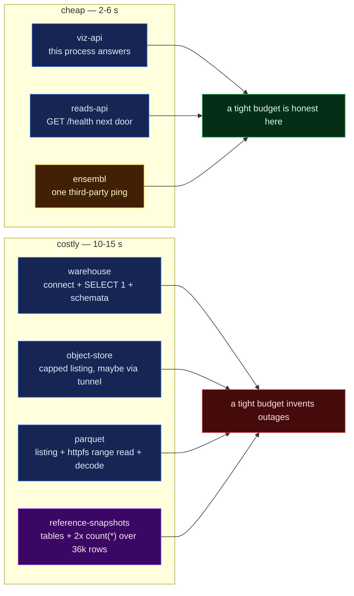
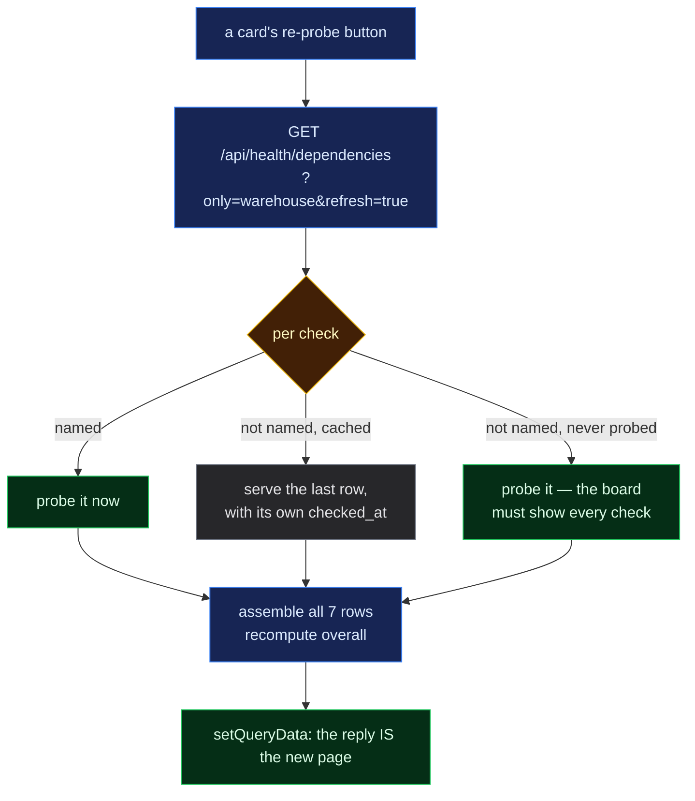

# 065 — The Status board becomes drivable: per-check budgets, one-service re-probe, masked addresses

**Date:** 2026-09-03
**Question:** The dependency board reports seven backends but can only be read, not driven.
Three things were wrong with that in practice: **one 2-second timeout for seven probes that
cost wildly different amounts** (so a slow-but-alive dependency reads as an outage), **one
button that re-probes all seven** (so checking the one service you just restarted costs six
round trips nobody asked for), and **every host and port rendered in plain text** on the one
page that gets screenshotted into a report. Can each be fixed without weakening the
guarantee that this endpoint never fails?

_(step-0 platform machinery: this entry records decisions and measurements, not a
hypothesis. Per [`docs/method.md`](../../method.md), step 0 takes no hypotheses.)_

**Supersedes two claims in [053](053-dependency-health.md):**

- `CHECK_TIMEOUT = 2.0` shared by all seven checks — now one budget per check
  ([`health_budget.py`](../../../src/mva/viz/health_budget.py)), environment-configurable.
- "the payload carries its own `checked_at`" as the *only* staleness field — each **row**
  now carries its own `checked_at`, because a partial re-probe must not restamp the six rows
  it did not measure. The payload's `checked_at` remains, meaning "when this payload was
  assembled".

The cache changed shape for the same reason: `TTLCache` (one payload) → `CheckCache` (one
row per check, each with its own instant).

## Why the shared 2 s budget was wrong — measured, not argued

The old code was still running on `:8900` while this was written, so both regimes were
observed against the same live warehouse, object store and reads API.

| check | old budget | latency, old server | new budget | latency, new server | later browser runs |
|---|---|---|---|---|---|
| viz-api | 2 s | 15 ms | 2 s | 187 ms | 167 ms |
| warehouse | 2 s | 1,086 ms | 12 s | 1,173 ms | 1.9 s / 771 ms |
| object-store | 2 s | 182 ms | 10 s | 916 ms | 1.3 s |
| parquet | 2 s | 120 ms | 15 s | 260 ms | 353 / 508 ms |
| reads-api | 2 s | 103 ms | 4 s | 231 ms | 53 / 198 ms |
| ensembl | 2 s | 166 ms | 6 s | 157 ms | 214 / 244 ms |
| **reference-snapshots** | **2 s** | **1,934 ms** | 15 s | **2,134 ms** | **3.1 s / 3.6 s** |

`reference-snapshots` is the case that makes the point: it reads two `information_schema`
rows and then `count(*)` over 18,314 + 17,832 ingested rows on a hosted Postgres. It landed
**66 ms inside** the old 2 s cliff on one run and **2,134 ms — past it — on the next**. Under
the old code that is a red card reading `timed out after 2s`, on a dependency that was
answering correctly the whole time. A false outage sends a developer to fix a service that
was never broken, which is worse than a slow page.

The budgets are per check because the probes are not comparable work:



> **Legend** — blue: our own machinery · yellow: a third party we do not control · purple:
> ingested reference data, not a live service · green: the budget matches the work · red: the
> budget is shorter than the work, so the card lies.

Two environment knobs, resolved by `mva.warehouse.settings.setting` (real environment, then
the nearest `.env`), documented in `.env.example`:

- `MVA_HEALTH_TIMEOUT` — a **floor** applied to every check. One knob for "this deployment
  is behind a slow tunnel, give everything at least N seconds". It only raises budgets.
- `MVA_HEALTH_TIMEOUTS` — exact per-check values, `id=seconds,…`, winning over both the
  default and the floor in either direction.

A malformed value **raises** at app construction rather than being ignored: a typo that
silently changed nothing would resurface weeks later as a flapping card. `parse_overrides`
refuses a non-number, a missing `=`, an unknown id, `0` and anything over 60 s.

The two probes that speak HTTP now receive their own client timeout (`budget − 0.25 s`), so
raising a budget actually gives the request longer, and so the probe's *specific* remedy
("Start `mva-reads-api`") wins the race against the orchestrator's generic
`timed out after Ns`. The thread-backed probes have no timeout knob to hand them —
`asyncio.wait_for` stops waiting but cannot cancel the thread — which is exactly why their
budgets are generous rather than tight.

## `only=<id>`: re-probe one service, get the whole board back



> **Legend** — blue: machinery · yellow: the per-check decision · green: measured on this
> request · grey: served from cache, and stamped with when it was actually measured.

Three design points worth stating because each had a wrong-looking alternative:

- **The reply is the whole board, not one row.** `overall` is a function of all seven checks,
  so a partial re-probe still has to recompute it — and the app can then write the reply
  straight into its query cache (`setQueryData`) instead of invalidating, which would throw
  away six good rows and re-probe all seven: the exact cost the button exists to avoid.
- **An unknown id is a 400** naming the valid ids. That is the endpoint's only 4xx and does
  not weaken 053's never-5xx rule: a dependency failure is still a `down` row, while a bad
  request is the caller being wrong.
- **A first-ever request naming `only` still probes the rest**, because a board that silently
  omitted six checks would break the one guarantee this page has.

## Masked addresses

Hosts and ports render as `••••` until revealed, per card or for the whole board
([`redact.ts`](../../../app/src/pages/status/redact.ts)). This page is entirely
infrastructure addresses and it is screenshotted into the report; masking is the default so
that is a decision, not a habit. The mask covers the `endpoint` field, the `detail` line and
the `remedy` — a remedy whose `ssh -L 9012:host:9012` half stayed readable would publish the
port the mask exists to hide, which is why the tunnel triple is its own rule, applied first.

**It is presentation hygiene, not a security boundary**, and the page's own term list says
so: the API already guarantees no credential reaches these strings
(`health_results.redact`), and the values are in the response either way. It stops an
address being *shown* by accident; it does not stop it being fetched.

## Inputs

| | |
|---|---|
| Code at build time | `a99bbb6` (branch `feat/app-design-tokens`) |
| New modules | `src/mva/viz/health_budget.py`, `app/src/pages/status/redact.ts`, `app/src/pages/status/DependencyCard.tsx` |
| Changed | `src/mva/viz/health.py` (per-check cache, `only`, budgets), `health_probes.py` (both HTTP probes take their budget), `warehouse/settings.py` (two defaults), `.env.example`, `app/src/api/hooks.ts` (`useReprobeCheck`), `app/src/pages/status/{DependencyBoard,verdict}.*`, `app/src/pages/Status.tsx`, `app/src/api/types/health.ts`, `app/src/components/Explainer.tsx` (`Callout` gains an `action` slot) |
| Fixture | `app/src/fixtures/data/health-dependencies.json` — `timeout_ms` + per-row `checked_at` added; hash re-blessed in `app/src/test/fixtureHashes.json` (`6d03c14e9a664775` → `90f2369de3010813`) |
| Live services | warehouse, MinIO and `mva-reads-api` as configured in the repo-root `.env`; Ensembl REST |
| Servers used | the user's own API on `:8900` (pre-change code), a second instance on `:8901` (post-change), a second Vite dev server on `:5174` pointed at it. Both temporary servers stopped afterwards. |

## Commands run

```bash
# the pre-change server, for the "old budget" column
curl -s "http://127.0.0.1:8900/api/health/dependencies"

# a second API instance on the new code
uv run mva-viz-api --port 8901
curl -s "http://127.0.0.1:8901/api/health/dependencies"
time curl -s "http://127.0.0.1:8901/api/health/dependencies?only=warehouse&refresh=true"
curl -s -w "HTTP %{http_code}\n" "http://127.0.0.1:8901/api/health/dependencies?only=warehosue"

# the board itself, driven in a real browser against that instance
MVA_VIZ_CORS=http://127.0.0.1:5174,http://localhost:5174 uv run mva-viz-api --port 8901
cd app && VITE_API_URL=http://127.0.0.1:8901 pnpm exec vite --port 5174 --strictPort false

# gates
tools/check-python.sh          # ruff format, ruff lint, module size, import layering, mypy, pytest
pnpm --dir app run check       # typecheck, eslint, prettier, theme drift, vitest
```

## Observed output

**Per-service re-probe, over HTTP.** `?only=warehouse&refresh=true` returned all seven rows
in **0.707 s** (a full board costs ~2.2 s+ because it waits on the slowest probe), and
exactly one row's timestamp moved:

```
warehouse              up   691 ms  2026-09-03T16:20:58+00:00   <- re-probed
viz-api                up   187 ms  2026-09-03T16:20:48+00:00
object-store           up   916 ms  2026-09-03T16:20:49+00:00
parquet                up   260 ms  2026-09-03T16:20:48+00:00
reads-api              up   231 ms  2026-09-03T16:20:48+00:00
ensembl                up   157 ms  2026-09-03T16:20:48+00:00
reference-snapshots    up  2134 ms  2026-09-03T16:20:50+00:00
```

**The bad request.** `?only=warehosue` → `HTTP 400`,
`{"detail":"unknown check id(s): warehosue — valid ids: viz-api, warehouse, object-store, parquet, reads-api, ensembl, reference-snapshots"}`.

**In the browser.** Clicking the Postgres card's own `re-probe` issued exactly one request —
`GET …/api/health/dependencies?only=warehouse&refresh=true` (200) — and afterwards the seven
`probed` lines read `just now` for the warehouse and `11 s ago … 14 s ago` for the other six.
Toggling `reveal addresses` replaced every `••••` with the real host and removed the per-card
`show` buttons; toggling it back left `masked: true` and zero occurrences of the configured
hostnames, IP or ports (`5432`, `9012`, `8765`) anywhere in `document.body.innerText`.

**Screenshot:** [`figures/exhibits/status-board-masked.png`](../../../figures/exhibits/status-board-masked.png)
— the live board, addresses masked, showing per-card `re-probe`, `latency · budget` and
`probed … ago` on all seven cards.

**Gates.** `tools/check-python.sh` green, **1,601 tests**. `pnpm --dir app run check` green,
**25 files / 387 tests** — 17 in `status-board.test.ts` (masking, ages) and 8 new in
`status-card.test.tsx` (masked by default, reveal/hide, one id per re-probe, disabled while
in flight, disabled in fixture mode, budget shown, age shown), plus 19 new Python tests in
`tests/test_viz_health_controls.py`.

## Conclusions

1. **A shared 2 s budget was manufacturing outages.** `reference-snapshots` measured
   1,934 ms then 2,134 ms then 3.1 s on the same healthy database. Per-check budgets, with a
   floor and per-check overrides in the environment, replace a number that was never about
   the work with numbers that are.
2. **Re-probing one service is now one probe**, 0.707 s versus a full board's ~2.2 s, and the
   six untouched rows say out loud how old they are rather than being restamped. That is why
   the cache is per check and `checked_at` moved onto the row.
3. **The page is safe to screenshot by default.** Masking is on until asked otherwise, and
   the term list states plainly that it is presentation hygiene, not a secret — the honest
   claim, since the values are in the response either way.
4. **Follow-up, not done here:** the thread-backed probes (warehouse, object store, parquet,
   reference snapshots) cannot be cancelled at their budget, only abandoned. A probe that
   hangs for minutes still ties up a thread from the default executor. Passing a real
   statement timeout down into `queries.access.fetch` would fix it properly.
