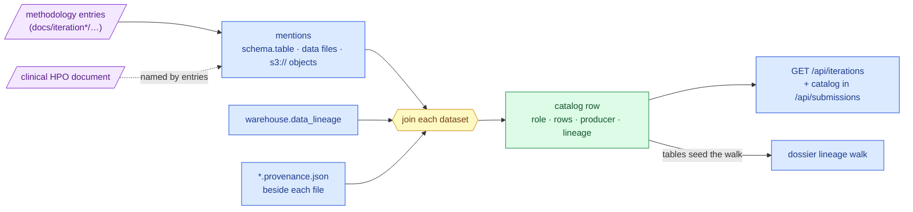

# 157 — A data catalog per iteration, and both iteration axes on one page

**Date:** 2026-09-25
**Question:** The user asked that every iteration of both tracks have good data lineage and a
data catalog, with a clear overview of each iteration on the dashboard. How much of each
iteration could the record trace to its data, and where did the trail break?

_(step-0 platform machinery: a delivery-surface change, not a hypothesis. Per
[`docs/method.md`](../../method.md) step 0 takes no hypotheses. Filed here because it serves
every research iteration (1–4) and every submission folder of both tracks.)_

## What was measured before any change

Inputs: `warehouse.data_lineage` read whole (hosted PostgreSQL, 2026-09-25), the five
`submissions/*/iteration-*/README.md` contributions tables, the committed
`app/src/fixtures/data/submissions.json` (captured before this entry).

| Fact | Value | How |
|---|---|---|
| Lineage edges | 730 over 164 target tables | `mva-warehouse pg-query` grouped by `target_schema` (results 333, track2 346, warehouse 43, submissions 8) |
| Edges naming the entry that produced them | 204 (12 cite entry 084, the rest entries 149–156) | regex over `notes`: `methodology/NNN-` or `entry NNN` |
| Submission folders whose contributing entries recorded any edge | 1 of 5 (Track 2 iteration 4: 8 of its 15 entries) | same regex, per README-linked entry |
| Lineage edges each dossier reached | Track 1 it-1 13 · it-2 10 · Track 2 it-1 4 · it-2 4 · it-4 277 | `lineage.edges` in the old fixture |
| Folders with a `submissions.*` edge | 2 (Track 1 iterations 1 and 2, from `resolve_submission_spec --record-lineage`) | `target_schema = 'submissions'` |

**Where it broke.** The dossier walked the ledger from two seeds: the selector tables (Track 1
only) and tables whose edges cite a contributing entry. Before entry 084 no recorder wrote the
entry into `notes`, so Track 2's panel-judged iterations 1 and 2, which have no selectors,
reached only the two tables every walk starts from. The data was recorded; the join from an
iteration to it was not.

A second defect surfaced on the way: `submissions_audit.probes_for` matched a probe by the
words "iteration 1" alone, so Track 2's never-uploaded iteration-1 folder displayed Track 1's
oracle reply.

## What was built



> **Legend** — purple = the raw inputs (the entries' own text, and the clinical document they
> name); blue = neutral machinery; yellow = the join, where a dataset's role and lineage status
> are decided; green = the catalog row, the goal.

**The catalog is derived, never typed** (`src/mva/viz/iteration_catalog.py`). For a set of
methodology entries it reads every `schema.table`, every repository data file
(`ressources/`, `build/`, `data/`) and every `s3://` reference, then joins:

- a **table** to its ledger edges (rows, tool, instant, inputs of the newest run);
- a **file** to its provenance manifest (`src/mva/viz/iteration_manifest.py` reads every
  shape the repo's tools wrote: per-file names, a directory manifest whose `outputs` list or
  map names the file, and a JSON file that stamps its own provenance — a `_standing` line, or
  `code_version` plus a build instant), else to a ledger edge that records it as an input;
- an **object prefix** to the ledger edges whose `source_ref` sits under it.

Rules that keep it honest:

| Rule | Why |
|---|---|
| `role: produced` only when an edge or manifest cites one of the entries, or the entry names the recorded producer (edge `tool`, manifest `built_by`) | naming a dataset proves use, not production |
| A bare table name counts only in backticks and only when one schema has it | prose words are not tables; `gamma` in two schemas is not guessed |
| Globs (`results.it2_*`), file extensions (`x/results.tsv`), manifests and the bookkeeping tables (ledger, probe ledger, register) are not datasets | they describe data or are not a name at all |
| A manifest that lists a file among its **inputs** does not describe it | the shortlist's manifest names the mechanism card; it is not the card's provenance |
| With no database the catalog still lists what the entries name, tables at lineage `none`, and says why in `note` | "no lineage" and "could not read the lineage" are different sentences |

**Both axes on one route** (`src/mva/viz/iterations.py`, `GET /api/iterations`): research
iterations (declared or plan-only) with steps per track, claims by latest status, entry range,
the folders citing them and the full catalog; submission folders with state, reply, judge,
the research iterations their README cites, lineage size and catalog coverage; and the
ledger's attribution count. It reuses the `/api/submissions` builder, which now carries the
catalog per folder and seeds its walk with the catalog's tables. `probes_for` takes the track.

## Commands

```bash
uv run mva-warehouse pg-query "select target_schema, count(*) as n_edges, count(distinct target_table) as n_tables from pg.warehouse.data_lineage group by 1 order by 1"
uv run mva-viz-api --port 8931 &
curl -s -H "X-API-Key: $MVA_VIZ_TOKEN" "localhost:8931/api/iterations?refresh=true"   # → app/src/fixtures/data/iterations.json (envelope .data)
curl -s -H "X-API-Key: $MVA_VIZ_TOKEN" "localhost:8931/api/submissions?refresh=true"  # → app/src/fixtures/data/submissions.json
uv run pytest -q tests/test_viz_iteration_catalog.py tests/test_viz_submissions.py
```

## Observed output (live warehouse, 2026-09-25)

| Research iteration | Entries | Datasets | Produced | With lineage | Claims (latest status) |
|---|---|---|---|---|---|
| iteration1 | 11 (067–083) | 19 | 12 | 16 | 9 supported · 2 proposed |
| iteration2 | 40 (084–138) | 76 | 37 | 66 | 30 supported · 17 refuted · 2 superseded |
| iteration3 | 0 (plan only) | 0 | 0 | 0 | — |
| iteration4 | 28 (114–156) | 54 | 14 | 39 | 19 supported · 7 refuted · 8 testing · 1 proposed · 1 superseded |
| iteration5 | 0 (opened in `2f51d21`, one declared step) | 0 | 0 | 0 | — |

| Submission folder | State | Cites research | Lineage edges (before → after) | Catalog: datasets / with lineage |
|---|---|---|---|---|
| track1/iteration-1 | frozen | 1 | 13 → 30 | 25 / 20 |
| track1/iteration-2 | ready | 1, 2 | 10 → 192 | 54 / 47 |
| track2/iteration-1 | draft | 1, 2 | 4 → 149 | 38 / 33 |
| track2/iteration-2 | draft | 1, 2 | 4 → 232 | 65 / 59 |
| track2/iteration-4 | ready | 1, 4 | 277 → 327 | 45 / 35 |

Every **committed** data file named by any iteration resolves to lineage (edge, manifest or
self-stamped card). What stays at `none`, by kind:

- **Gitignored `build/` intermediates with no manifest** (e.g. `build/it4/merged.json`,
  `build/it2/step-6/fused-ranking.tsv`) — scratch outputs of runs whose committed products do
  carry manifests. Visible on the page as red rows, not hidden.
- **`s3://mva/reads`** — the Parquet read store records its lineage in its own
  `manifest.parquet` in the object store, not in the ledger.
- **`track2.decoys`** — named by entry 142 as a concept; no such table exists (`exists: false`).

Tests: 12 new in `tests/test_viz_iteration_catalog.py`; the full Python gate passed on commit
`496825d` (3,505 passed, 5 skipped).

## Dashboard

Built by a subagent against the pinned contract `app/src/api/types/iterations.ts`; reviewed and
screenshotted (Playwright, fixture mode) in this session.

| Where | What changed |
|---|---|
| **`/iterations`** (new, Decide group, before Track 1) | headline counted from the payload; a **matrix** — research iterations down, Track 1 / Track 2 across — each cell linking the iteration's page on that track, the folders *built from* it (the newest research iteration a folder cites) with state and reply, and those that only *cite* it; a claims bar per iteration; a **flow diagram** research → folder (solid = built from, dashed = only cites); a **folder table**; **lineage health** (ledger attribution, one coverage bar per catalog split edge / manifest / none); a **catalog explorer** over both axes, addressable as `?cat=iteration2` or `?cat=track2/iteration-4` |
| `/submissions` | the `<select>` became one chip row per track with state badges (`?it=` unchanged); links to `/iterations` and to the research iterations the folder is built from or cites; a new section **"What data it rests on"** with the folder's catalog; the lineage graph **folds roots** above 12 into one box per kind (Track 2 iteration 4's `it4` chain: ~35 stacked roots → 19 nodes, 40 edges), with a `lin.roots` toggle and every root still listed below |
| `/track1`, `/track2`, `/trackN/iterationM` | a link row to `/iterations` and to that iteration's catalog |

Gates (from `app/`): `typecheck`, `lint`, `format:check`, `theme:check`, `dictionary:check`
(712 entries), `steps-nav:check` clean; `vitest` **736 passed** after two fixes in this
session — the new dictionary entries' `source` had to be a bare repo path, and an entry
committed earlier (*Benjamini-Hochberg (BH) correction*) listed itself as `related`, which
`dictionary-metadata.test.ts` rejects; it now names *Multiple testing* and *Negative-control
band*. Fixture hashes re-blessed: `/api/submissions` `a77d34051e3152e8`, `/api/iterations`
`c9aa1a42f803a9bc` (re-captured after iteration 5 was opened in `2f51d21`, which added one declared step and no entries).

**Not done:** the long-running `mva-viz-api` started outside this session (serving `:8000`)
predates the route and answers 404 for `/api/iterations` until restarted; the app falls back to
the captured fixture meanwhile.

## Conclusion

The record could always trace iterations 1 and 2 to their data: the edges and manifests
existed. What was missing was the join from an iteration to them, because early recorders did
not cite their entry. Deriving the catalog from the entries' own text restores that join for
every iteration without rewriting the append-only ledger, and states for each dataset whether
its role rests on a recorded producer or only on a mention.

**Limitations.** A mention is not a read: `cited` rows may include tables an entry discusses
without using. The producer rule can over-attribute a generic command (`mva-warehouse
pg-derive`) named in many entries. `ledger.attributed` rises only if recorders keep writing
`notes: entry <path>`, which iteration 4's do.
