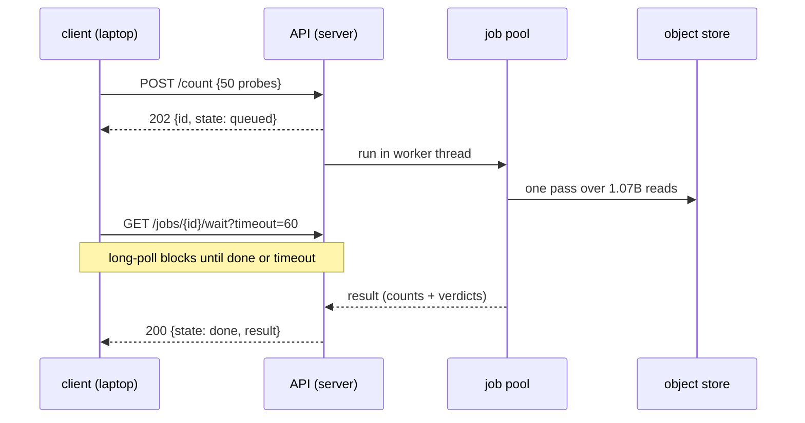

# The reads API — the read store over HTTP

**Standing:** built 2026-08-31; all endpoints covered by `tests/test_reads_api.py`
(runs mocked below the API — no live-store run recorded yet). The store it queries is
[`reads-storage.md`](reads-storage.md).

Every `mva-reads` verb, callable from anywhere instead of a shell on the server.
Code: `src/mva/reads/api/`. Entry point: `mva-reads-api`.

```bash
# on the server (one process on purpose — the job registry lives in memory)
MVA_API_TOKEN=<secret> uv run mva-reads-api --host 0.0.0.0 --port 8765
```

Interactive docs are generated from the code: **`/docs`** (Swagger UI — try requests in
the browser), `/redoc`, and `/openapi.json` for generating typed clients.

## The one design decision: jobs, not blocking requests

A k-mer scan decompresses ~46 GiB of sequence and takes minutes; a convert takes an
hour. Holding an HTTP connection open that long dies at every proxy and timeout in
between. So every verb that touches the reads returns **202 Accepted with a job**, and
the answer is fetched by id:



> **Legend** — blue participants are neutral machinery; the client polls (yellow
> decision loop) while the pool does the one expensive pass (purple raw input read).

Properties that matter:

- **Long-poll, capped.** `GET /jobs/{id}/wait?timeout=60` blocks until the job finishes
  or the timeout passes, capped at 290 s to stay under common 300 s proxy limits. On
  timeout you get the job still `running` — call wait again. No connection is ever held
  for the length of the query.
- **Cancel is real.** `POST /jobs/{id}/cancel` pulls DuckDB's `interrupt()` on the
  running query — a mistaken full scan stops burning the machine.
- **Results survive restarts.** Every state change is written as JSON under
  `MVA_STAGING_DIR/api-jobs/`. After a restart, finished jobs are still listed with
  their results; jobs that were in flight are marked `lost`, never silently re-run
  (a convert is not idempotent).
- **Validation at the edge.** A non-DNA probe or a write statement is a 422 before any
  job exists — the expensive way to learn a typo is a failed pass over a billion reads.

## Endpoints

| Endpoint | Verb it wraps | Cost |
|---|---|---|
| `GET /health` | — | liveness only |
| `GET /store/status` | `mva-reads status` | seconds (reads the manifest) |
| `GET /store/qc` | `mva-reads qc` | minutes (full scan) |
| `POST /scan` | `mva-reads scan` | minutes — batch every probe into one request |
| `POST /count` | `mva-reads count` | minutes — same pass, returns verdicts |
| `POST /sql` | `mva-reads sql` | depends; read-only, one statement, rows capped |
| `POST /verify` | `mva-reads verify` | hours when deep (round-trips the FASTQ) |
| `POST /bench` | `mva-reads bench` | minutes |
| `POST /convert` | `mva-reads convert` | ~1 hour — rebuilds and republishes the store |
| `GET /jobs`, `GET /jobs/{id}` | — | job listing / one job |
| `GET /jobs/{id}/wait?timeout=` | — | long-poll until terminal |
| `POST /jobs/{id}/cancel` | — | interrupt the query |
| `DELETE /jobs/{id}` | — | drop a finished job from history |

Job states: `queued → running → done | failed | cancelled` (+ `lost` after a restart).

## Worked example

```bash
API=http://server:8765; KEY="X-API-Key: $MVA_API_TOKEN"

# ask fifty candidates in one pass (the pass costs the same for 1 or 500 probes)
ID=$(curl -s -H "$KEY" -X POST $API/count \
     -d '{"probes":[{"name":"allele1","sequence":"ACGT...31-mer"}]}' \
     -H 'Content-Type: application/json' | jq -r .id)

# block until done (re-run on timeout), then read the verdicts
curl -s -H "$KEY" "$API/jobs/$ID/wait?timeout=120" | jq .result.counts

# escape hatch: the whole store as a SQL view named `reads`
curl -s -H "$KEY" -X POST $API/sql -H 'Content-Type: application/json' \
     -d '{"query":"SELECT lane, count(*) FROM reads GROUP BY lane"}'
```

## Auth and knobs

| Setting | Meaning | Default |
|---|---|---|
| `MVA_API_TOKEN` | shared token, sent as `X-API-Key`; empty = open (localhost only) | empty |
| `MVA_API_JOB_WORKERS` | store queries running at once (a scan saturates I/O) | 2 |
| `--host` / `--port` | bind address | `127.0.0.1:8765` |

Settings resolve like everything else: environment first, then the nearest `.env`
(`src/mva/warehouse/settings.py`).

## Extending it

One new verb = one runner + one route; the job machinery is generic:

1. **Runner** in `api/runners.py`: open the store with `_open(job, root)` (this makes
   cancel work), call the module that does the work, return a JSON-safe dict.
2. **Model** in `api/models.py`: a pydantic request with validation at the edge.
3. **Route** in `api/app.py`: `return submitted("verb", request.model_dump(), runner)`.

The docstrings become the `/docs` page; nothing else to update.
