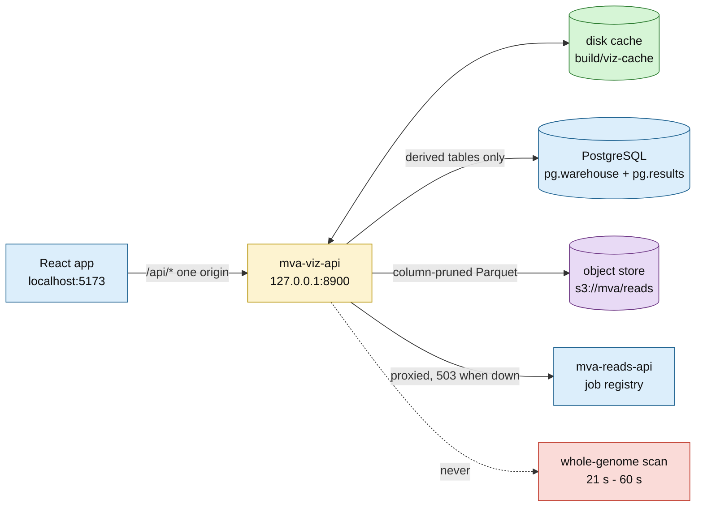

# The viz API — the warehouse and the read store as JSON

**Standing:** built 2026-08-31 and verified live against the hosted PostgreSQL and the
object store the same day ([`methodology/028`](methodology/028-viz-api.md) has the
measurements). Re-verified 2026-08-31 when the three reference-comparison endpoints
(`/api/panel/constraint`, `/api/panel/annotations`, `/api/callset/observed-expected`) were
added and measured live against the hosted database
([`methodology/032`](methodology/032-reference-comparison-tables.md)). Re-verified
2026-08-31 when the two data-catalogue endpoints (`/api/catalog/objects`,
`/api/catalog/tables`) were added and measured live
([`methodology/034`](methodology/034-data-catalog-endpoints.md)). Covered by
`tests/test_viz_api.py`, `tests/test_viz_units.py` and `tests/test_viz_catalog.py`, mocked
below the API. The reads-API
proxy routes were verified only on their **503** path, because
[`mva-reads-api`](reads-api.md) is not running anywhere yet.

One HTTP origin for the React app. Code: `src/mva/viz/`. Entry point: `mva-viz-api`.

```bash
# from the repository root — the cache path and the panel BED are relative to it
uv run mva-viz-api                 # 127.0.0.1:8900
uv run mva-viz-api --reload        # development
```

Interactive docs are generated from the code: **`/docs`** (Swagger UI), `/redoc`,
`/openapi.json`.

## Why a service and not a static export

Three back ends, two of which hold a credential the browser must never see, and one of
which is 1.07 billion reads.



> **Legend** — green is the cache (the thing that keeps the page fast), yellow is the
> service making the routing decision, blue is neutral machinery, purple is the raw read
> store, red dashed is the scan no request is allowed to trigger.

## The one design decision: precompute, then serve

`variants_raw` is 5,012,204 rows with **every column TEXT and no index**. A full aggregate
over it is ~21 s and a position-bin aggregate ~59 s. An HTTP request must never pay that,
so every chart reads a derived table instead:

| Chart needs | Reads | Rows |
|---|---|---|
| density along a chromosome | `results.variant_density_bins` | 2,961 |
| depth distribution | `results.stats_dp` | 55 |
| substitution spectrum | `results.stats_st` | 12 |
| indel length spectrum | `results.stats_idd` | 120 |
| headline counts | `results.stats_sn`, `results.stats_tstv` | 9 + 1 |
| gene constraint + ClinVar verdicts | `results.panel_gene_constraint` | 8 |
| annotated panel alleles with genotypes | `results.panel_candidates` | 874 |
| QC observed against published norms | `results.qc_observed_expected` | 12 |

Those six tables are new derivations in `src/mva/warehouse/analysis.py`, built by
`uv run mva-warehouse pg-derive`, each with a lineage edge. The five `stats_*` tables parse
the 200 raw `bcftools stats` lines **once, in SQL, with provenance** — rather than running a
regex inside a web request where no one can audit it.

The single exception is `/api/panel/locus`, which has to read the callset. It always
constrains `chrom`, which PostgreSQL pushes down (8.4 s including connect, against ~21 s
unconstrained), and it is cached: 0.09 s on every later request.

## Endpoints

Every `/api/*` response is `{data, cached_at, source}`. `source` names where the numbers
came from; `cached_at` is non-null exactly when the payload came off disk.

| Endpoint | Source | Cost |
|---|---|---|
| `GET /health` | — | liveness, no envelope |
| `GET /api/overview` | 8 tables + `runs.parquet` | 1.3 s, cached |
| `GET /api/genome/allele-balance` | `pg.results.allele_balance_flags` | live |
| `GET /api/genome/contig-density` | `pg.results.contig_density` | live |
| `GET /api/genome/density-bins?chrom=` | `pg.results.variant_density_bins` | live |
| `GET /api/callset/filters` | `pg.results.filter_impact` | live |
| `GET /api/callset/genotypes` | `pg.warehouse.filter_gt_counts` | live |
| `GET /api/callset/depth-distribution` | `pg.results.stats_dp` | live |
| `GET /api/callset/substitutions` | `pg.results.stats_st` | live |
| `GET /api/callset/tstv` | `pg.results.stats_tstv` | live, one object |
| `GET /api/callset/indel-lengths` | `pg.results.stats_idd` | live |
| `GET /api/callset/observed-expected` | `pg.results.qc_observed_expected` | live, 0.51 s, 12 rows |
| `GET /api/panel/genes` | 2 tables + the panel BED | live |
| `GET /api/panel/constraint` | `pg.results.panel_gene_constraint` + the panel BED | live, 0.54 s, 8 rows |
| `GET /api/panel/annotations?gene=` | `pg.results.panel_candidates` | live, 0.57 s, 874 rows |
| `GET /api/panel/locus?gene=` | `pg.warehouse.variants_raw` | 8.4 s → cached |
| `GET /api/reads/runs` | `s3://mva/reads/runs.parquet` | live |
| `GET /api/reads/partitions` | `s3://mva/reads/manifest.parquet` | live |
| `GET /api/reads/flowcell?lane=&read=&shard=` | one shard, 3 columns | 2.4 s → cached |
| `GET /api/reads/cycle-quality` | 100k reads × 8 partitions | 36 s → cached |
| `GET /api/reads/quality-levels` | 100k reads × 8 partitions | 41 s → cached |
| `GET /api/provenance/lineage` | `pg.warehouse.data_lineage` | live |
| `GET /api/provenance/derivations` | `pg.results.derivation_runs` | live |
| `GET /api/provenance/sources` | `pg.warehouse.source_objects` | live |
| `GET /api/probe/ledger` | `pg.warehouse.probe_ledger` | live (0 rows today) |
| `GET /api/catalog/objects` | `pg.warehouse.source_objects` + `source_files` | live, 0.5 s, 12 rows |
| `GET /api/catalog/tables` | `pg.information_schema` + `warehouse_catalog` + `data_lineage` + `pg.results.derivation_runs` | 1.6–4.0 s → cached, 38 rows |

Add `?refresh=true` to any cached endpoint to rebuild it.

### Proxied to `mva-reads-api`

A pass over 1.07 billion reads already has a service with a job registry, cancellation and
restart-safe history. These forward to it rather than reimplement it:

| Endpoint | Upstream |
|---|---|
| `POST /api/probe/count` | `POST /count` |
| `POST /api/probe/scan` | `POST /scan` |
| `GET /api/jobs?state=&verb=` | `GET /jobs` |
| `GET /api/jobs/{id}` | `GET /jobs/{id}` |
| `GET /api/jobs/{id}/wait?timeout=` | `GET /jobs/{id}/wait` (cap 290 s) |
| `POST /api/jobs/{id}/cancel` | `POST /jobs/{id}/cancel` |

`MVA_API_TOKEN` is attached here as `X-API-Key`, so the token never reaches the browser.
When the upstream is unreachable the answer is `503 {"detail": "reads API unreachable at
<url>"}` — the current state, and the state the tests assert.

### The three reference-comparison endpoints

They answer "is this number normal?", against the committed public tables in
[`ressources/reference/`](../../ressources/reference/README.md). Three contract facts a
chart has to respect:

- **`/api/panel/constraint`** — a gene with no gnomAD row returns `loeuf`, `pli`, `mis_z`,
  `oe_lof`, `lof_obs`, `lof_exp` as **null, never 0**. gnomAD v4.1 constraint covers
  autosomes only, so an absent gene is unmeasured, not tolerant. Render a blank, not a bar
  at zero. `chrom` is `chr`-prefixed, matching `/api/panel/genes`.
- **`/api/panel/annotations`** — `vaf` is **null** at a `1/2` multi-allelic site, same
  convention as `/api/panel/locus`. `is_rare_recessive` uses **AF < 0.01**, the recessive
  cutoff from `qc_norms.rare_af_threshold_recessive`; 1e-3 is the *dominant* cutoff and
  filtering a compound-het search at it can drop a real allele. An unknown `gene` is a
  **404**; omitting `gene` is not, and an empty panel is `[]`. The 874 rows cover **18**
  gene symbols — the 8 panel genes plus 10 flanking ones VEP found inside the BED's 20 kb
  padding — and **145 rows carry `gene: null`** (intergenic). Filtering by gene therefore
  never reaches those 145; a gene facet has to offer an "unassigned" bucket or say so.
- **`/api/callset/observed-expected`** — only metrics with **both** a published range and a
  measurable observation appear (12 of the 20 norms). A metric is absent rather than
  guessed. `source` is the norm's citation; `observed_from` names the table we measured.

### The two catalogue endpoints

They answer "what data is there at all", which no chart covers
([`methodology/034`](methodology/034-data-catalog-endpoints.md) has the measurements).
Four contract facts:

- **`/api/catalog/objects`** — one row per object in the store's `source/` prefix.
  `location` is `s3://<bucket>/<object_key>`, built server-side so the store's layout stays
  out of the browser; `object_key` and the bucket-less name are still there.
  `description` is a sentence about what the file *contains*, synthesized in
  `src/mva/viz/catalog.py` from `role` plus the lane/mate/sample/flowcell the file name
  carried — the store records none of it. `first_uploaded_at` is `MIN(uploaded_at)` from
  the upload ledger and is **null** for an object the ledger never saw (fetched straight
  from the publisher, or predating the ledger). All 12 objects match today, so no null is
  currently served — the field is still nullable and a UI must render the blank.
- **`/api/catalog/tables`** — one row per table in both managed schemas, enumerated live
  from `information_schema`, so a catalogue row naming a table that was never ingested
  (`warehouse_catalog` still lists `hf_lfs_sha256`) does not appear.
- **`rows` is exact, not an estimate.** Measured: one `UNION ALL` of `count(*)` pushed
  down through `postgres_query` costs **2.7 s** for all 38 tables, against 25.7 s as one
  round trip per table. `pg_class.reltuples` costs 0.2 s and is unusable — 22 of the 38
  tables have never been analysed and report **-1**, and `variants_raw` is off by 2,172.
  Exact counts are why the endpoint is cached.
- **`produced_at`, `source_kind`, `source_ref`, `tool` are null for a table with no
  lineage edge** — 19 of the 38 today, the ledgers and the staged profile tables. Every
  table does carry a `description`: the staged catalogue for a staged table, the latest
  `derivation_runs.question` for a derived one, and an in-code one-liner
  (`catalog.UNCATALOGUED`) for the raw layer, the ledgers and the catalogue table itself.

## Two things that are easy to get wrong

**Chromosome naming.** The callset says `15`, the panel BED says `chr15`, and the scorer
compares verbatim. `/api/genome/density-bins?chrom=` accepts either spelling and normalises
through `to_vcf_contig()` — the single owner of that bridge
([`notes/chr-prefix-bridge.md`](notes/chr-prefix-bridge.md)). `/api/panel/genes` returns
`chrom` **chr-prefixed**, exactly as the panel delivers it.

**Multiallelic sites.** 66,860 records are `1/2` — two different ALT alleles in one row, so
`ALT` is comma-packed and `AD` carries three depths. `/api/panel/locus` returns `alt`
verbatim and sets `ad_alt` and `vaf` to **null** at those sites rather than picking one
alternate. A blank in a chart is a question; a halved VAF is a wrong answer.

## Config

| Setting | Meaning | Default |
|---|---|---|
| `MVA_VIZ_CORS` | browser origins allowed, comma-separated | `http://localhost:5173,http://127.0.0.1:5173` |
| `MVA_VIZ_CACHE` | where response JSON is cached | `build/viz-cache` |
| `MVA_READS_API_URL` | upstream reads API | `http://127.0.0.1:8765` |
| `MVA_API_TOKEN` | forwarded upstream as `X-API-Key` | empty |
| `PG*`, `S3_*` | database and object store | see `.env.example` |
| `--host` / `--port` | bind address | `127.0.0.1:8900` |

Settings resolve like everything else: environment first, then the nearest `.env`
(`src/mva/warehouse/settings.py`).

`localhost` and `127.0.0.1` are **different origins** to a browser, which is why both are
in the CORS default.

**The cache holds patient data.** `build/viz-cache/locus-*.json` contains real positions.
`build/` is gitignored and `MVA_VIZ_CACHE` must never be pointed inside the tracked tree.
There is no authentication, so `--host 0.0.0.0` publishes those positions to anyone who can
reach the port; it warns, and it should not be used.

## Extending it

One new chart = one line, when the table already exists:

1. **Derivation** in `src/mva/warehouse/analysis.py` if the numbers are not yet a table,
   then `uv run mva-warehouse pg-derive --only <name>`.
2. **Query** in `src/mva/viz/queries.py` (or nothing, for a plain table read).
3. **Route** — for a plain table read, one entry in the `TABLES` map in
   `src/mva/viz/routes_warehouse.py`; the envelope, the tag and the `/docs` entry follow.

| Module | Concern |
|---|---|
| `app.py` | CORS, cache, router assembly, `/health` |
| `routes_warehouse.py` | callset, panel, provenance routes |
| `routes_reads.py` | read-store routes and the proxy routes |
| `queries.py` | every warehouse SQL statement |
| `catalog.py` | the data catalogue: object descriptions, table descriptions, row counts |
| `readstore.py` | every object-store SQL statement |
| `overview.py` | the headline object, one connection |
| `genotype.py` | decoding `format` + `sample_call` |
| `panelbed.py` | the two panel columns only the BED has |
| `cache.py` | the disk cache |
| `proxy.py` | forwarding to `mva-reads-api` |
| `response.py` | the `{data, cached_at, source}` envelope |
| `serve.py` | uvicorn entry point |
