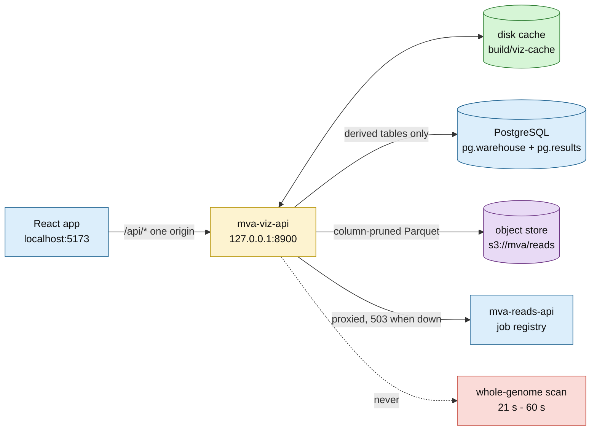

# The viz API — the warehouse and the read store as JSON

**Standing:** built 2026-08-31 and verified live against the hosted PostgreSQL and the
object store the same day ([`methodology/028`](methodology/028-viz-api.md) has the
measurements). Re-verified 2026-08-31 when the three reference-comparison endpoints
(`/api/panel/constraint`, `/api/panel/annotations`, `/api/callset/observed-expected`) were
added and measured live against the hosted database
([`methodology/032`](methodology/032-reference-comparison-tables.md)). Re-verified
2026-08-31 when the two data-catalogue endpoints (`/api/catalog/objects`,
`/api/catalog/tables`) were added and measured live
([`methodology/034`](methodology/034-data-catalog-endpoints.md)). Re-verified 2026-08-31
when `/api/catalog/columns` was added and `/api/catalog/tables` gained `created_by` and
`why`, measured live against the hosted database
([`methodology/036`](methodology/036-table-semantics-registry.md)). Re-verified 2026-08-31
when `/api/callset/funnel` was added and measured live against the hosted database
([`methodology/039`](methodology/039-candidate-funnel.md)). Covered by
`tests/test_viz_api.py`, `tests/test_viz_units.py`, `tests/test_viz_catalog.py`,
`tests/test_viz_funnel.py` and
`tests/test_catalog_semantics.py`, mocked
below the API. Re-verified 2026-09-01 when `/api/search` and `/api/callset/region` were
added and measured live against the hosted database and Ensembl REST
([`methodology/042`](methodology/042-universal-search.md), covered by
`tests/test_viz_search.py`). The reads-API
proxy routes were verified only on their **503** path, because
[`mva-reads-api`](reads-api.md) is not running anywhere yet. Re-verified 2026-09-03 when
`/api/provenance/reference` was added and the three structure routes' `source` lines
became per-reply — both exercised by `tests/test_viz_refprovenance.py` and by a live
`GET /info/data` and a full fixture rebuild
([`methodology/061`](methodology/061-reference-data-provenance.md)).

One HTTP origin for the React app. Code: `src/mva/viz/`. Entry point: `mva-viz-api`.

```bash
# from the repository root — the cache path and the panel BED are relative to it
uv run mva-viz-api                 # 127.0.0.1:8900
uv run mva-viz-api --reload        # development
```

Interactive docs are generated from the code: **`/docs`** (Swagger UI), `/redoc`,
`/openapi.json`.

Amended 2026-09-06 (not re-measured): the service gained an opt-in shared token and now
refuses a non-loopback bind without one ([`methodology/080`](methodology/080-hosted-dashboard.md)).
Every route and every measurement below is unchanged — an open deployment behaves exactly as
it did.

## Why a service and not a static export

Three back ends, two of which hold a credential the browser must never see, and one of
which is 1.07 billion reads.



> **Legend** — green is the cache (the thing that keeps the page fast), yellow is the
> service making the routing decision, blue is neutral machinery, purple is the raw read
> store, red dashed is the scan no request is allowed to trigger.

## The one design decision: precompute, then serve

`variants_raw` is 5,012,204 rows with **every column TEXT and no index**. A full aggregate
over it is ~21 s and a position-bin aggregate ~59 s. An HTTP request must never pay that,
so every chart reads a derived table instead:

| Chart needs | Reads | Rows |
|---|---|---|
| density along a chromosome | `results.variant_density_bins` | 2,961 |
| depth distribution | `results.stats_dp` | 55 |
| substitution spectrum | `results.stats_st` | 12 |
| indel length spectrum | `results.stats_idd` | 120 |
| headline counts | `results.stats_sn`, `results.stats_tstv` | 9 + 1 |
| gene constraint + ClinVar verdicts | `results.panel_gene_constraint` | 8 |
| annotated panel alleles with genotypes | `results.panel_candidates` | 874 |
| QC observed against published norms | `results.qc_observed_expected` | 12 |
| the candidate waterfall, stage by stage | `results.candidate_funnel` | 9 |

Those six tables are new derivations in `src/mva/warehouse/analysis.py`, built by
`uv run mva-warehouse pg-derive`, each with a lineage edge. The five `stats_*` tables parse
the 200 raw `bcftools stats` lines **once, in SQL, with provenance** — rather than running a
regex inside a web request where no one can audit it.

The single exception is `/api/panel/locus`, which has to read the callset. It always
constrains `chrom`, which PostgreSQL pushes down (8.4 s including connect, against ~21 s
unconstrained), and it is cached: 0.09 s on every later request.

## Endpoints

Every `/api/*` response is `{data, cached_at, source}`. `source` names where the numbers
came from; `cached_at` is non-null exactly when the payload came off disk.

| Endpoint | Source | Cost |
|---|---|---|
| `GET /health` | — | liveness, no envelope |
| `GET /api/overview` | 8 tables + `runs.parquet` | 1.3 s, cached |
| `GET /api/genome/allele-balance` | `pg.results.allele_balance_flags` | live |
| `GET /api/genome/contig-density` | `pg.results.contig_density` | live |
| `GET /api/genome/density-bins?chrom=` | `pg.results.variant_density_bins` | live |
| `GET /api/genome/baf-bins?chrom=` | `pg.results.baf_bins` | live |
| `GET /api/callset/filters` | `pg.results.filter_impact` | live |
| `GET /api/callset/genotypes` | `pg.warehouse.filter_gt_counts` | live |
| `GET /api/callset/depth-distribution` | `pg.results.stats_dp` | live |
| `GET /api/callset/substitutions` | `pg.results.stats_st` | live |
| `GET /api/callset/tstv` | `pg.results.stats_tstv` | live, one object |
| `GET /api/callset/indel-lengths` | `pg.results.stats_idd` | live |
| `GET /api/callset/observed-expected` | `pg.results.qc_observed_expected` | live, 0.51 s, 12 rows |
| `GET /api/callset/funnel` | `pg.results.candidate_funnel` | live, 0.48–0.54 s, 9 rows |
| `GET /api/callset/zygosity-split` | `pg.results.stats_af` | live, 0.28–0.44 s, 2 rows |
| `GET /api/callset/fields` | `pg.warehouse.vcf_fields` | live, 0.28–0.33 s, 31 rows |
| `GET /api/panel/genes` | 2 tables + the panel BED | live |
| `GET /api/panel/constraint` | `pg.results.panel_gene_constraint` + the panel BED | live, 0.54 s, 8 rows |
| `GET /api/panel/annotations?gene=` | `pg.results.panel_candidates` | live, 0.57 s, 874 rows |
| `GET /api/panel/locus?gene=` | `pg.warehouse.variants_raw` | 8.4 s → cached |
| `GET /api/panel/structure-genes` | `ressources/reference/structure_genes.tsv` + the panel BED | live, 23 rows |
| `GET /api/panel/gene-structure?gene=` | Ensembl REST ×3 + `pg.results.panel_candidates` | 5.2–9.5 s → cached (0.002 s warm) |
| `GET /api/panel/het-pairs?gene=` | `pg.results.panel_het_pairs` | live, 0.47–0.99 s, 5–163 alleles |
| `GET /api/panel/background` | `pg.results.panel_gene_background` | live, 0.75–0.87 s, 8 rows |
| `GET /api/panel/suppressed?gene=` | `pg.results.panel_filter_census` + `panel_suppressed` | live, 0.71–0.75 s, 20 census rows + 20 records |
| `GET /api/panel/clinvar-presence?gene=` | `pg.results.clinvar_presence` + the panel BED | live, 0.74–1.22 s, 8 summary rows + 1 site |
| `GET /api/reads/runs` | `s3://mva/reads/runs.parquet` | live |
| `GET /api/reads/partitions` | `s3://mva/reads/manifest.parquet` | live |
| `GET /api/reads/flowcell?lane=&read=&shard=` | one shard, 3 columns | 2.4 s → cached |
| `GET /api/reads/cycle-quality` | 100k reads × 8 partitions | 36 s → cached |
| `GET /api/reads/quality-levels` | 100k reads × 8 partitions | 41 s → cached |
| `GET /api/reads/yield` | `pg.results.sequencing_yield` | live, 0.28–0.36 s, 4 rows |
| `GET /api/provenance/lineage` | `pg.warehouse.data_lineage` | live |
| `GET /api/provenance/derivations` | `pg.results.derivation_runs` | live |
| `GET /api/provenance/sources` | `pg.warehouse.source_objects` | live |
| `GET /api/provenance/reference` | `ressources/reference/*provenance.json` + `app/src/fixtures/data/**/_provenance.json` | live, off disk — **no database**, 7 rows |
| `GET /api/probe/ledger` | `pg.warehouse.probe_ledger` | live (0 rows today) |
| `GET /api/science/hypotheses` | `pg.warehouse.hypotheses` | live, 0.7–1.4 s (**table absent today**) |
| `GET /api/science/evidence` | `pg.warehouse.evidence` | live, 0.7–2.0 s (**table absent today**) |
| `GET /api/catalog/objects` | `pg.warehouse.source_objects` + `source_files` | live, 0.5 s, 12 rows |
| `GET /api/catalog/tables` | `pg.information_schema` + `warehouse_catalog` + `data_lineage` + `pg.results.derivation_runs` + the semantics registry | 3.3–11.8 s → cached, 38 rows |
| `GET /api/catalog/columns` | `pg.information_schema.columns` + the column-meaning registry | live, 0.95–1.6 s, 262 rows |
| `POST /api/probe/build` | nothing — the request itself, through `mva.pipeline.submission` | live, 0.02 s |
| `GET /api/search?q=` | the query string, the panel BED, `pg.warehouse.variants_raw` (id scan), or Ensembl REST | 0.001 s region · 1.1 s panel · 1.7–5.4 s Ensembl → cached |
| `GET /api/callset/region?chrom=&start=&end=` | `pg.warehouse.variants_raw` (chrom pushdown) | 1.9–2.6 s → cached, **5 Mb span cap** |

Add `?refresh=true` to any cached endpoint to rebuild it.

The two `/api/science/*` endpoints are the one exception to "`data` is a list of rows": both
answer `{"table_exists": bool, "rows": [...]}`, because `warehouse.hypotheses` and
`warehouse.evidence` are created on first write by `mva-science` and do **not** exist yet.
An absent table and an empty one are different facts, and the flag is how the browser tells
them apart. The endpoints are read-only and never create the tables — see
[`methodology/041`](methodology/041-science-page.md).

`POST /api/probe/build` is the other exception to "`data` is a list of rows": it answers
`{csv, valid, problems, self_test}`. It reads no table — the payload is the request, put
through the pipeline's own rules — takes **bare** contigs in and emits `chr`-prefixed ones,
and writes nothing to disk. `csv` is empty and `self_test` null whenever `valid` is false.
Building costs nothing; uploading the result spends one of eighteen oracle submissions. See
[`methodology/046`](methodology/046-probe-builder.md).

### Proxied to `mva-reads-api`

A pass over 1.07 billion reads already has a service with a job registry, cancellation and
restart-safe history. These forward to it rather than reimplement it:

| Endpoint | Upstream |
|---|---|
| `POST /api/probe/count` | `POST /count` |
| `POST /api/probe/scan` | `POST /scan` |
| `GET /api/jobs?state=&verb=` | `GET /jobs` |
| `GET /api/jobs/{id}` | `GET /jobs/{id}` |
| `GET /api/jobs/{id}/wait?timeout=` | `GET /jobs/{id}/wait` (cap 290 s) |
| `POST /api/jobs/{id}/cancel` | `POST /jobs/{id}/cancel` |

`MVA_API_TOKEN` is attached here as `X-API-Key`, so the token never reaches the browser.
When the upstream is unreachable the answer is `503 {"detail": "reads API unreachable at
<url>"}` — the current state, and the state the tests assert.

### The three reference-comparison endpoints

They answer "is this number normal?", against the committed public tables in
[`ressources/reference/`](../../ressources/reference/README.md). Three contract facts a
chart has to respect:

- **`/api/panel/constraint`** — a gene with no gnomAD row returns `loeuf`, `pli`, `mis_z`,
  `oe_lof`, `lof_obs`, `lof_exp` as **null, never 0**. gnomAD v4.1 constraint covers
  autosomes only, so an absent gene is unmeasured, not tolerant. Render a blank, not a bar
  at zero. `chrom` is `chr`-prefixed, matching `/api/panel/genes`.
- **`/api/panel/annotations`** — `vaf` is **null** at a `1/2` multi-allelic site, same
  convention as `/api/panel/locus`. `is_rare_recessive` uses **AF < 0.01**, the recessive
  cutoff from `qc_norms.rare_af_threshold_recessive`; 1e-3 is the *dominant* cutoff and
  filtering a compound-het search at it can drop a real allele. An unknown `gene` is a
  **404**; omitting `gene` is not, and an empty panel is `[]`. The 874 rows cover **18**
  gene symbols — the 8 panel genes plus 10 flanking ones VEP found inside the BED's 20 kb
  padding — and **145 rows carry `gene: null`** (intergenic). Filtering by gene therefore
  never reaches those 145; a gene facet has to offer an "unassigned" bucket or say so.
- **`/api/panel/het-pairs`** — not a list of rows: `{gene, variants, pairs, summary}`.
  `variants` is one row per **heterozygous PASS ALT allele** in position order, and that
  order **is** both axes of the pair matrix, so `pairs[].i/j` index it. A `1/2` record
  contributes **two** entries, distinguished by `allele_ix`. `pairs` carries **only the
  cells phasing resolves** — every pair not listed is `unknown`, which is 99.7 % of them on
  BUB1B — with `auto: true` marking the `1/2` pair that is trans by genotype rather than by
  phasing. `pgt`/`pid` travel raw so a client can check the verdict, and are **null** where
  the caller could not phase. `annotated: false` leaves `consequence`, `impact`,
  `gnomad_af`, `clin_sig`, `is_rare_recessive` and `is_protein_altering` **null, never
  false**. An unknown `gene` is a **404**; a panel gene with no het PASS allele is an empty
  matrix, not a 404. See [`methodology/038`](methodology/038-pair-matrix.md).
- **`/api/panel/background`** — eight rows, each gene's density and PASS share next to the
  background of **1 Mb windows** it sits in (one window is one megabase, so a window's
  record count is itself a density in variants/Mb). Every `z_*` is **null when the
  background had no usable spread — never 0**, which is agreement. A low `z_pass_*` is a
  **callability** reading (mappability, repeats), never a pathogenicity one; TRIP13 scores
  −4.02 σ against chr5 and that is what it means. Windows under 100 records are excluded
  from the PASS-share background only, so `contig_n_bins` can exceed the count behind
  `contig_bin_mean_pct_pass`. `chrom` is `chr`-prefixed. See
  [`methodology/048`](methodology/048-gene-background.md).
- **`/api/panel/suppressed`** — not a list of rows: `{gene, census, records}`. `census` is
  **always the whole panel** — one row per `(gene, FILTER value)` with **PASS included**, so
  a gene's rows stack to `n_gene_all` — because the chart it feeds compares genes against
  each other; only `records` narrows to `gene`. The `filter` string is **verbatim**: GATK
  packs every threshold a record tripped into one `;`-joined value, so `LowQual;QD2` is one
  record that failed two tests and is counted once, never split into two reason rows.
  `records` is one row per **non-PASS record** (not per allele): a multi-allelic ALT stays
  comma-packed and joins to its most severe annotated allele, named in `annotated_alt`.
  `vaf` is null at a `1/2` site. `annotated: false` leaves every annotation field **null,
  never false** — though on this callset all 20 are annotated, because VEP was asked about
  panel alleles with no FILTER predicate. An unknown `gene` is a **404**; a panel gene with
  nothing suppressed is an empty `records` list, not a 404. **`records` carries real patient
  positions** — same rule as `/api/panel/locus`. See
  [`methodology/049`](methodology/049-suppressed-calls.md).
- **`/api/panel/clinvar-presence`** — not a list of rows: `{summary, sites}`, and the
  reference join run **inward** — every P/LP site ClinVar holds in the panel, looked for in
  the callset. `summary` counts off the panel BED, so a gene ClinVar has classified nothing
  in appears with `n_plp = 0` rather than vanishing. `sites` carries only the **present**
  and **uncomparable** rows; measured absences are counts, because two thousand rows of
  "nothing called here" add nothing to them. `present` is a **lower bound** — matching is
  exact on `(chrom, pos, ref)` plus ALT list membership with **no left-alignment on either
  side**, so a differently spelled indel reads as absent (1,306 of the 2,129 P/LP sites are
  indel-shaped). `present` is **null, never false**, where ClinVar states no alternate
  allele (`comparable = false`). `carries_alt` is separate from `present`: a `0/1` call on a
  `G -> A,C` record carries `A` and not `C`, so a record listing the allele is not a
  genotype holding it. `review_stars` is NCBI's gold-star tier (4→0) and is **null** where
  no status is stated, which is not zero stars. An unknown `gene` is a **404**. **`sites`
  carries real patient positions** — same rule as `/api/panel/locus`. See
  [`methodology/051`](methodology/051-clinvar-presence.md).
- **`/api/callset/observed-expected`** — only metrics with **both** a published range and a
  measurable observation appear (12 of the 20 norms). A metric is absent rather than
  guessed. `source` is the norm's citation; `observed_from` names the table we measured.
- **`/api/callset/funnel`** — nine stages of the candidate waterfall, in `stage_no` order.
  `scope` is `genome` for the three stages measured over the whole callset and `panel` for
  the six measurable only inside the eight-gene panel, which is the only region annotation
  exists for: there is **no genome-wide annotation and no genome-wide ranking**.
  `of_previous_pct` is **null** wherever the row is not a subset of the row above it — at
  the scope change (stage 4) and at the two unit changes — rather than dividing two
  different populations. The unit itself changes down the table (records → alleles →
  pairs), so a stage may legitimately be *wider* than the one above it; `note` says where
  and why. See [`methodology/039`](methodology/039-candidate-funnel.md).
- **`/api/callset/zygosity-split`** — the `bcftools stats` **AF** section, parsed. `af_bin`
  is **not a population allele frequency**: one sample means `AN` is always 2, so bcftools
  emits exactly two bins — its singleton row (`AC=1`, labelled `0.0`) and its `AC=2` row
  (labelled `0.99`) — and they are heterozygous and homozygous-alternate. Reading `af_bin`
  as rarity is the error [`data-findings` §2.5](../../ideation/data-findings.md) warns
  about. `zygosity` carries that reading and is **null** on any callset with more than one
  sample, where neither word applies. Both allele totals match the independent genotype
  counter exactly. See [`methodology/045`](methodology/045-orphan-tables.md).
- **`/api/callset/fields`** — the callset's own VCF header schema, 31 declarations ordered
  FILTER → INFO → FORMAT. Descriptions are the caller's own prose, verbatim; nothing is our
  writing. This is the checkable evidence for "the delivery ships no annotation worth
  ranking on".
- **`/api/reads/yield`** — per-lane reads and bases **estimated** from the delivered gzip
  bytes, not counted. `/api/reads/runs` carries the count; the pair makes the estimate's
  error measurable (+0.32 % to +1.10 %, high on all four lanes). `lane` is the file name's
  spelling (`L001`), not the integer `/api/reads/runs` uses.

### The gene-structure endpoint

`/api/panel/gene-structure?gene=` is the only route that calls a **third-party API**
([`methodology/040`](methodology/040-locus-gene-track.md) has the probes and the timings).
Four contract facts:

- **The browser never calls Ensembl.** Three server-side REST calls — `/lookup/id?expand=1`
  for exons and the canonical transcript, `/overlap/translation` for domains, and one
  `POST /vep/…/region` for the protein positions our warehouse never stored — behind the
  same disk cache as `/api/panel/locus`, because gene structure is static.
- **No patient genomic coordinate is in the payload.** Candidates carry consequence,
  impact, rsID, a `rare` flag and `protein_pos` only. Unlike the locus cache, this entry
  holds nothing unpublishable.
- **`protein_pos` is nullable and `reason` says why.** Either VEP put no amino-acid offset
  on the canonical transcript (a splice-region or UTR consequence has none), or the VEP
  call failed — in which case the structure and domains still render. A null candidate is
  **listed with its reason**, never dropped.
- **Ensembl unreachable is a `502` with the upstream detail**, never a fixture-shaped
  stand-in. An unknown gene is a `404`, validated against the committed panel BED **and**
  the curated gene set below. `domains` is filtered to real domain sources: PDB
  cross-references, AlphaFold models, disorder/coiled-coil/low-complexity predictions and
  whole-protein PANTHER family calls are excluded (4 of 28 features on BUB1B's translation
  survive).
- **It serves more than the eight annotated genes.** `/api/panel/structure-genes` is the
  index it is addressed by; `in_panel` in the payload says whether the gene carries the
  proband's alleles at all — the one semantic flag, and the only field an exhibit may
  branch on to decide what it claims about the patient. Display grouping is data beside it:
  `group` is a free-form id and each row carries its own `group_label` and `group_order`,
  so the picker, the badges, the legend and the bar colours are built from the payload and
  no code names a group ([`docs/notes/reusable-structure-toolkit.md`](../notes/reusable-structure-toolkit.md)).
  An off-panel gene comes back with `candidates: []` having
  **read no warehouse table** — no `panel_candidates` query and no VEP POST, so no patient
  coordinate leaves the process. A non-coding gene comes back with real exons,
  `protein: null` and `domains: []`, and `/api/panel/protein-structure` answers it with a
  **422** rather than a 502: it has no protein to fold and never will.
  [`methodology/060`](methodology/060-structure-gene-set.md) has the replies and the table.
- **Every reply names its own upstreams, not just its route's.** The envelope's `source`
  carries the module's endpoint list *plus* `name=value` for what this reply was actually
  built from — the AlphaFold model URL and version, the UniProt accession, the Ensembl
  gene and transcript, the Ensembl release the committed gene set was resolved at, and the
  disk-cache key. Stored beside the payload in the cache entry
  (`mva.viz.cache.Built`), so a cache **hit** reports the provenance of the reply it is
  serving — which is the reply a reader screenshots. The release is the one
  `tools/build_gene_set.py` recorded, not one asked live: Ensembl publishes it only at
  `/info/data` and no reply header carries it, so asking per request would add a round
  trip and a failure surface to a route whose value is that its answer is already on disk.

### `/api/provenance/reference`

The fourth provenance route, and the only one that reads **no database**. The other three
read `warehouse.data_lineage`, which records *derivations*: table X computed from object Y
by transform Z. Reference data has none of that — a gnomAD table, an HPO release, an
Ensembl gene record and an AlphaFold model are **fetched**, so an edge claiming a
transform produced them would be fabricated. What they have instead is a
`*provenance.json` manifest committed beside the bytes, written by the build tool on every
run, and this route lists them normalised onto one row shape (`ReferenceProvenanceRow`).
A directory that does not exist contributes **no rows rather than an error**: a checkout
whose reference tables were never built has nothing to declare.

**7 rows** as of 2026-09-03 — five reference manifests (`gnomad_constraint`,
`clinvar_panel`, `qc_norms`, `hpo`, `structure_genes`) and two fixture ones. The three
population-reference manifests were added in
[`methodology/062`](methodology/062-reference-manifests-and-bed-notes.md) and needed **no
change here**: the manifest is matched on the `provenance.json` suffix, so a new file is
picked up by existing code.

### The two catalogue endpoints

They answer "what data is there at all", which no chart covers
([`methodology/034`](methodology/034-data-catalog-endpoints.md) has the measurements).
Four contract facts:

- **`/api/catalog/objects`** — one row per object in the store's `source/` prefix.
  `location` is `s3://<bucket>/<object_key>`, built server-side so the store's layout stays
  out of the browser; `object_key` and the bucket-less name are still there.
  `description` is a sentence about what the file *contains*, synthesized in
  `src/mva/viz/catalog.py` from `role` plus the lane/mate/sample/flowcell the file name
  carried — the store records none of it. `first_uploaded_at` is `MIN(uploaded_at)` from
  the upload ledger and is **null** for an object the ledger never saw (fetched straight
  from the publisher, or predating the ledger). All 12 objects match today, so no null is
  currently served — the field is still nullable and a UI must render the blank.
- **`/api/catalog/tables`** — one row per table in both managed schemas, enumerated live
  from `information_schema`, so a catalogue row naming a table that was never ingested
  (`warehouse_catalog` still lists `hf_lfs_sha256`) does not appear.
- **`rows` is exact, not an estimate.** Measured: one `UNION ALL` of `count(*)` pushed
  down through `postgres_query` costs **2.7 s** for all 38 tables, against 25.7 s as one
  round trip per table. `pg_class.reltuples` costs 0.2 s and is unusable — 22 of the 38
  tables have never been analysed and report **-1**, and `variants_raw` is off by 2,172.
  Exact counts are why the endpoint is cached.
- **`produced_at`, `source_kind`, `source_ref`, `tool` are null for a table with no
  lineage edge** — 19 of the 38 today, the ledgers and the staged profile tables. Every
  table does carry a `description`: the staged catalogue for a staged table, the latest
  `derivation_runs.question` for a derived one, and an in-code one-liner
  (`catalog.UNCATALOGUED`) for the raw layer, the ledgers and the catalogue table itself.
- **`created_by` and `why`** answer the two questions `description` does not: which named
  command writes the table — and whether that write *replaces* it, *rebuilds* it or only
  *appends* to it — and the one sentence saying what it is for. Both resolve from
  `mva.viz.catalog_semantics`; a derivation's `why` is read off the question declared
  beside its SQL rather than restated, so it cannot drift. Both are **null** for a table
  the registry does not know: 0 of 38 today, and a hermetic test refuses to let a table
  *declared in code* reach that state.

### The column endpoint

- **`GET /api/catalog/columns`** — one row per column of every table in both managed
  schemas, live from `information_schema.columns`: `{schema, table, column, data_type,
  ordinal, meaning}`. 262 rows today.
- **`meaning` is the one field the database cannot supply.** `information_schema` knows
  `mean_vaf` is a `double precision`; that it is the mean share of reads carrying the
  alternate allele at heterozygous sites, and that 0.50 is the diploid value, is written
  down in `mva.viz.catalog_columns`. It resolves table-specific first
  (`contig_counts.length` is a contig's size, `stats_idd.length` an indel's), then a
  **shared map** keyed by bare column name so one entry covers `chrom` in all fourteen
  tables that carry it. **Null** where nothing describes the column — 0 of 262 today — and
  the UI renders that gap rather than an empty cell.
- **Live, not cached.** Metadata only: 0.95–1.6 s over HTTP against 3.3–11.8 s for the
  exact row counts in `/api/catalog/tables`. Caching it would buy about a second and hide
  the schema change the endpoint exists to surface.
- **How it stays current.** `tests/test_catalog_semantics.py` walks every table name
  declared anywhere in the code — the staged catalogue specs, the reference specs, every
  `Derivation`, the ledgers, the raw layer, the annotation table and the research register
  — and fails with the exact entry to add if any lacks a `created_by` and a `why`.

### The two search endpoints

The only place a **user-chosen** locus enters the service, and the second route to read
`variants_raw` ([`methodology/042`](methodology/042-universal-search.md) has the
measurements). Five contract facts:

- **Two requests, not one.** `/api/search?q=` resolves a typed query to a window;
  `/api/callset/region` reads it. Resolution is cheap, cacheable and safe to share; the
  region read is expensive and carries real patient positions. The split lets a client show
  *what the query resolved to, and by which resolver*, before paying for the scan.
- **`source` names the resolver, and is the envelope's `source` too** — the query string
  (a region is parsed, never looked up), the candidate panel, the callset's own `id`
  column, or Ensembl. `note` is a caveat the UI must render (an unpadded Ensembl span, an
  rsID placed by dbSNP rather than by the callset) and is **null** when there is none.
- **The rsID resolver is two stages, by measurement.** The callset's `id` column is scanned
  first — 0.7–1.4 s, no network, and it hits for the 4,408,823 of 5,012,204 records that
  carry an rsID — and Ensembl is consulted only on a miss. That is what keeps **404
  unknown id** distinct from **200 with zero rows**, which means *real variant, this
  callset never called it*. Either mechanism alone loses one of those two answers.
- **The 5 Mb span cap is a payload guard, not a latency one.** The raw layer has no index,
  so PostgreSQL seq-scans it either way and answers a 1 kb window and a whole chromosome in
  the same ~2 s. What differs is the answer: 6 records and under a kilobyte against 101,130
  records and 11 MB. Over the cap is a **422** naming the cap.
- **Four failure modes, four statuses.** 422 the query is not one of the three forms or the
  window is too wide; 404 valid shape, no authority knows the name; 502 Ensembl unreachable
  — never a guessed coordinate; 200 resolved, and the table may still be empty. Note that
  Ensembl answers an unknown name with **400**, not 404, which is why
  `mva.viz.search_resolve` has its own REST helper rather than reusing
  `genestructure._get` — there, every non-200 really is a fault.

## Two things that are easy to get wrong

**Chromosome naming.** The callset says `15`, the panel BED says `chr15`, and the scorer
compares verbatim. `/api/genome/density-bins?chrom=` accepts either spelling and normalises
through `to_vcf_contig()` — the single owner of that bridge
([`notes/chr-prefix-bridge.md`](notes/chr-prefix-bridge.md)). `/api/panel/genes` returns
`chrom` **chr-prefixed**, exactly as the panel delivers it.

**Multiallelic sites.** 66,860 records are `1/2` — two different ALT alleles in one row, so
`ALT` is comma-packed and `AD` carries three depths. `/api/panel/locus` returns `alt`
verbatim and sets `ad_alt` and `vaf` to **null** at those sites rather than picking one
alternate. A blank in a chart is a question; a halved VAF is a wrong answer.

## Config

| Setting | Meaning | Default |
|---|---|---|
| `MVA_VIZ_CORS` | browser origins allowed, comma-separated | `http://localhost:5173,http://127.0.0.1:5173` |
| `MVA_VIZ_CACHE` | where response JSON is cached | `build/viz-cache` |
| `MVA_READS_API_URL` | upstream reads API | `http://127.0.0.1:8765` |
| `MVA_API_TOKEN` | forwarded upstream to `mva-reads-api` as `X-API-Key` | empty |
| `MVA_VIZ_TOKEN` | guards **this** API: every `/api/*` route requires it as `X-API-Key` | empty (= open) |
| `PG*`, `S3_*` | database and object store | see `.env.example` |
| `--host` / `--port` | bind address | `127.0.0.1:8900` |

Settings resolve like everything else: environment first, then the nearest `.env`
(`src/mva/warehouse/settings.py`).

`localhost` and `127.0.0.1` are **different origins** to a browser, which is why both are
in the CORS default.

**The cache holds patient data.** `build/viz-cache/locus-*.json` contains real positions.
`build/` is gitignored and `MVA_VIZ_CACHE` must never be pointed inside the tracked tree.

**Authentication is opt-in, and binding a public interface without it is refused.**
`MVA_VIZ_TOKEN` empty leaves the API open, which is correct on loopback and nowhere else —
`/api/panel/locus` publishes those positions to anyone who can reach the port. Set the token
and every `/api/*` route requires it as `X-API-Key` (`/health` stays open, so an uptime probe
carries no secret); the comparison is constant-time. `mva-viz-api --host 0.0.0.0` with an
empty token **exits 2** rather than warning — `--insecure` is the deliberate override. The
deployment runbook is [`infrastructure.md` §3](infrastructure.md); the reasoning is
[`methodology/080`](methodology/080-hosted-dashboard.md).

## Extending it

One new chart = one line, when the table already exists:

1. **Derivation** in `src/mva/warehouse/analysis.py` if the numbers are not yet a table,
   then `uv run mva-warehouse pg-derive --only <name>`.
2. **Query** in `src/mva/viz/queries.py` (or nothing, for a plain table read).
3. **Route** — for a plain table read, one entry in the `TABLES` map in
   `src/mva/viz/routes_warehouse.py`; the envelope, the tag and the `/docs` entry follow.

| Module | Concern |
|---|---|
| `app.py` | CORS, the token guard, cache, router assembly, `/health` |
| `auth.py` | `MVA_VIZ_TOKEN` as `X-API-Key`, constant-time; empty token = open |
| `routes_warehouse.py` | callset, panel, provenance routes |
| `routes_reads.py` | read-store routes and the proxy routes |
| `queries.py` | every warehouse SQL statement |
| `catalog.py` | the data catalogue: object descriptions, table descriptions, row counts, the column list |
| `catalog_semantics.py` | per table: the verb that writes it, why it exists, and the list of every table declared in code (the enforcement gate's input) |
| `catalog_columns.py` | column meanings: the shared map for recurring names, and the resolution order |
| `catalog_columns_ingest.py` / `catalog_columns_results.py` | the per-table column meanings, one module per managed schema |
| `readstore.py` | every object-store SQL statement |
| `overview.py` | the headline object, one connection |
| `genotype.py` | decoding `format` + `sample_call` |
| `panelbed.py` | the two panel columns only the BED has |
| `search.py` | the search grammar: what a typed query means, the span cap, the region read |
| `search_resolve.py` | turning a gene symbol or an rsID into a window — panel, callset, Ensembl |
| `routes_search.py` | the two search routes and their four failure statuses |
| `cache.py` | the disk cache |
| `proxy.py` | forwarding to `mva-reads-api` |
| `response.py` | the `{data, cached_at, source}` envelope |
| `serve.py` | uvicorn entry point |
