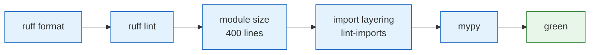

# The toolset — what exists, and what each piece is for

**Standing:** 2026-10-05 — written when the repository was stripped of its previous case
(MVA genomics) and repointed at the SEPIQ 2026 challenge. Every row below was checked
against the branch on that date.

This page answers one question: *given a job, which existing thing does it?* It is the
page to read before writing a new script.

**Nothing here encodes the new case.** This is machinery waiting for a first use.

---

## 1. Python packages

Full detail in [`src/mva/README.md`](../src/mva/README.md) and each package's own README.

| Need | Reach for | Entry point |
|---|---|---|
| Parse a TSV a tool emitted, with rollup lines and `#` comments | `mva.io.read_table` | library |
| Parse a `##`-sectioned text file | `mva.io.read_sections` | library |
| Write a step's rows / numbers to disk | `mva.io.write_tsv`, `write_json` | library |
| Make a figure that matches every other figure | `mva.render` — `Exhibit`, `Section`, the palette | library |
| Assemble figures into one self-contained HTML page | `mva.render.report` | library |
| Run a third-party model as a comparable lane | `mva.zoo` — registry, adapter protocol, tiers | library |
| Spend GPU money with a record of it | `mva.zoo.modal_budget` + `tools/modal_trace.py` | both |
| Serve data to the React app | `mva.viz` | `mva-api` |
| Read a config knob | `mva.settings.setting()` | library |
| Resolve a repo-relative path from any cwd | `mva.paths.resolve()` / `anchor_cwd()` | library |

---

## 2. Command-line tools

| Tool | What it does | Run it |
|---|---|---|
| `tools/check-python.sh` | **The** Python gate — the five checks CI runs, in CI's order. `--fix` formats and autofixes first. | `tools/check-python.sh [--fix]` |
| `tools/check_module_size.py` | Refuses a module over 400 lines (`src`, `tools`). Warns in the band below. | `uv run python tools/check_module_size.py` |
| `tools/check-commit-msg.sh` | The commit-message convention. One implementation, three callers: the husky hook, CI over a range, and `--self-test`. | `sh tools/check-commit-msg.sh <file>` |
| `tools/modal_trace.py` | Wraps every Modal command so the deploy/run/stop and its cost land in `build/modal/trace.jsonl`. | `uv run --group zoo-ml python tools/modal_trace.py …` |
| `tools/md_to_html.py` + `tools/md_to_pdf.mjs` | Markdown → styled HTML → PDF, for a report deliverable. | see the files |
| `tools/xlsx_to_md.py` | An `.xlsx` (an organiser's form, usually) as readable Markdown. | `uv run python tools/xlsx_to_md.py <file>` |
| `tools/setup-env.sh` | First-run environment setup. | `sh tools/setup-env.sh` |
| `tools/setup-git.sh` | Wires the husky hooks and the commit template. | `sh tools/setup-git.sh` |
| `tools/setup-viz-api-service.sh` | Installs `mva-api` as a long-running service. | see the file |
| `tools/activate.sh` | Shell helper for the uv environment. | `. tools/activate.sh` |
| `tools/extract-rules.sh` | Pulls the repo's own rules out of the docs. | `sh tools/extract-rules.sh` |

### The app's generators

| Tool | What it does |
|---|---|
| `app/tools/gen-dictionary.mjs` | Renders [`dictionary.md`](dictionary.md) as the `/learn` page. A cross-link naming a missing heading **fails the build**. |
| `app/tools/gen-theme.mjs` | Re-derives the two generated colour halves from the Tailwind theme, so a chart colour and a CSS class can never drift apart. |
| `app/tools/bundle-budget.mjs` | Fails the build if the bundle grows past its budget. |
| `app/tools/viz3d-measure.mjs` | Measures the 3D viewer's scene cost. |

---

## 3. The quality gates

Five, all static analysis. **There is no test suite on this branch** — see
[`notes/python-quality-gates.md`](notes/python-quality-gates.md).

> **Legend** — blue = a gate · green = the gate passing. Order is deliberate: the cheapest
> and most deterministic check fails first, in seconds.

They run in three places and are **one definition**: `tools/check-python.sh` locally, the
`.husky/pre-commit` hook on a commit that stages Python, and the CI job. The app half has
its own: `pnpm run typecheck`, `format:check`, `theme:check`, `dictionary:check`, `build`.

Two standing rules:

- A gate that is **wrong** for a change gets fixed, and the reason recorded in the note.
  Never `--no-verify`; never a bare `# noqa` — a suppression states its reason inline.
- mypy's per-package strict list in `pyproject.toml` is a **ratchet**: packages come off
  the permissive list as they are annotated, never back onto it.

---

## 4. The dashboard

`app/` — React, Vite, Tailwind. Stripped to its shell on this branch: the router, the
layout, the generic components, the theme system, the `/learn` dictionary, and `viz3d`.

`viz3d` is the piece worth knowing about. It is a 3D scene viewer with a declarative spec
— points, surfaces, protein backbone traces — a camera, picking, and a colour ramp. Track
B produces atomic coordinates, which is exactly what it draws.

Use **pnpm**, never npm.

---

## 5. What is deliberately absent

| Not here | Why |
|---|---|
| A database | 625 MB of CSV does not need one. Parquet + DuckDB/Polars in-process. |
| An object store | Same reason. `data/` is a directory. |
| A test suite | Removed with the previous case; nothing new is built yet. |
| A hypothesis register | This challenge is scored against a held-out answer key, not on pre-registered predictions. |
| Any model | The zoo roster is empty. Choosing lanes is a decision with evidence behind it, not a default. |
| A data-ingest package | The first real thing to write. It becomes a new leaf package in `src/mva/`. |
