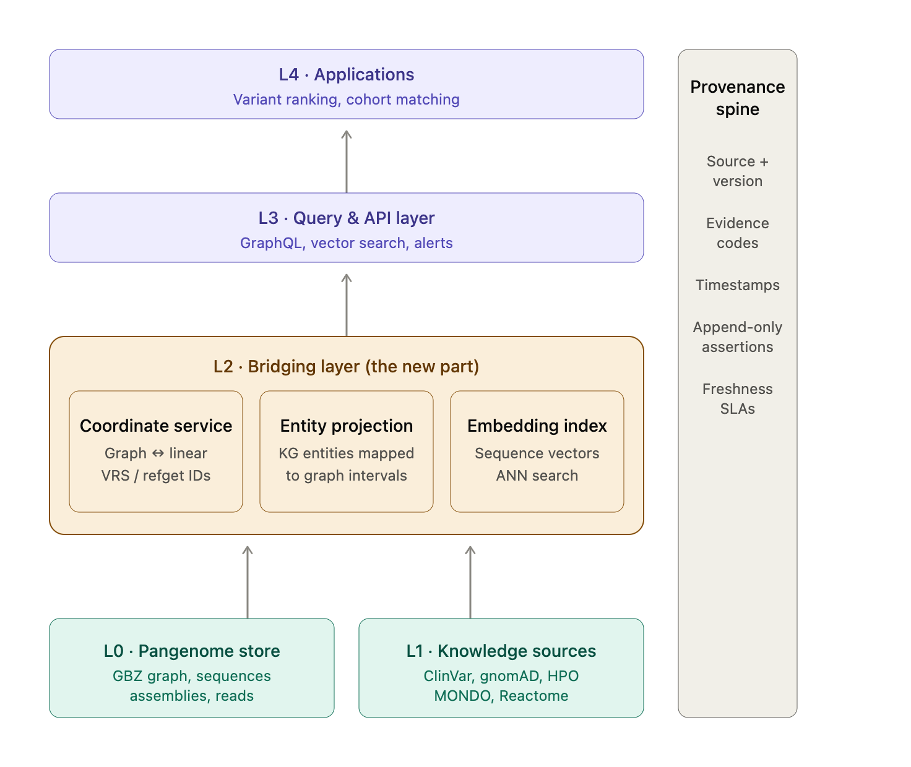

Yes — this makes a lot of sense, and you've actually put your finger on the two biggest unsolved gaps in genomic infrastructure right now. Let me take both ideas seriously, give you an architecture, and be honest about where they're strong and where they'll hurt.

## Part 1: The bridging layer (pangenome ↔ knowledge)

First, framing: 85 GB is not "big data" — it's roughly one deeply-sequenced genome's raw reads, or a few dozen assembled genomes, or a full pangenome graph with annotations. That's good news. Your problem is not scale, it's **joinability**. Rare disease diagnosis fails ~50% of the time not because we lack sequence, but because nothing connects "this patient's variant sits at node 48812, offset 113 in the pangenome graph" to "this disrupts a splice enhancer in a gene associated with HPO:0001250." That join is exactly what you're proposing to build.

The core insight is that you need three kinds of resolution living in one system:

1. **Coordinate resolution** — graph coordinates ↔ linear reference coordinates (GRCh38, CHM13) ↔ stable variant identity. The pangenome world (GFA/GBZ, vg, PGGB, minigraph-cactus) speaks node/offset and path coordinates; virtually all annotation (ClinVar, GENCODE, ENCODE, gnomAD) speaks linear coordinates. Your bridging layer is essentially a **genomic address resolution service**: given any coordinate in any system, resolve to a canonical identity. The GA4GH VRS spec (computed, digest-based variant identifiers) and refget (digest-based sequence identifiers) are the right primitives here — they give you content-addressed IDs that survive reference upgrades, which is what makes provenance tractable.

2. **Entity resolution** — variant/region → gene, transcript, regulatory element, protein, pathway, phenotype (HPO), disease (MONDO/Orphanet). This is a knowledge graph problem, and you don't need to build the KG from scratch — Monarch, PrimeKG, Reactome, GO, and ClinGen exist. Your value-add is the *projection* of those entities into graph coordinate space: materialized interval indexes mapping every KG entity that has a genomic footprint onto the pangenome's paths and bubbles.

3. **Semantic resolution** — the embedding layer, for "find me sequences/variants/patients that are *like* this one" when no exact annotation exists. This is where rare disease actually gets solved: the answer is often analogy, not lookup.

Here's how the layers stack:A few architectural specifics that make or break the bridging layer:

**Coordinate service.** Build this as a standalone, boring, extremely reliable microservice — it's your DNS. Internally it holds the pangenome in GBZ format, the surjection maps to GRCh38 and CHM13, and a digest registry (refget for sequences, VRS for variants). Every other component addresses genomic locations through it, never directly. This isolates you from the biggest operational pain in pangenomics: node IDs change between graph releases. If everything downstream keys on content-addressed digests rather than node IDs, a graph rebuild is a re-indexing job, not a data corruption event.

**Provenance and freshness.** Treat every biological assertion ("variant X is pathogenic for disease Y") as an immutable, timestamped, source-attributed record — an append-only assertion log, in the spirit of nanopublications or W3C PROV. Never overwrite; supersede. ClinVar reclassifies variants constantly (pathogenic → VUS → benign), and in rare disease a reclassification *is* the clinical event. Your freshness model should be per-source ingestion pipelines with declared SLAs (ClinVar monthly, gnomAD per release, literature continuously via text-mining), and queries should be able to ask "as of date D" — reproducibility of a diagnosis matters medically and legally. A lakehouse with time travel (Iceberg/Delta) plus a property graph store versioned by release works well here.

**Embedding search at scale.** Practical recipe: window the pangenome into overlapping segments at multiple resolutions (e.g., 512 bp, 4 kb, 32 kb), embed with a genomic language model (the Evo / Nucleotide Transformer / HyenaDNA family), and index with IVF-PQ or HNSW in a vector store. Two honest cautions: current DNA LMs are much better at coding/proximal-regulatory similarity than long-range regulatory logic, so treat embedding hits as *hypothesis generators*, never evidence; and embed at the level of graph paths (haplotypes), not just nodes, or you lose the variant context that made you build a pangenome in the first place. The killer query this unlocks for rare disease: "this patient has a VUS in an unannotated region — find every segment in the pangenome, and every solved case, whose sequence context is similar."

---

## Part 2: The "Google Maps for the genome"

This metaphor is better than you might realize, and it's worth pushing hard — with one crucial correction: the pangenome is **not a plane, it's a road network**. Latitude/longitude assumes one continuous surface; the genome with structural variation is a graph where haplotypes are alternate routes through town. Once you accept that, nearly every mapping primitive translates:

| Maps concept | Genome equivalent |
|---|---|
| Coordinates (lat/long) | (path, position) or (node, offset) + VRS digest as the canonical "plus code" |
| Geocoding | Resolve "BRCA1", "rs334", or an HGVS string → coordinates |
| Reverse geocoding | "What's at chr7:117,559,590?" → CFTR, exon 11, ClinVar entries |
| Routing / directions | A patient haplotype's path through the graph; the reference is just the "highway"; an SV is a detour |
| Traffic layer | Population allele frequency (gnomAD) as congestion; constraint scores (pLI, missense-Z) as speed limits — heavy constraint = "don't crash here" |
| Points of interest | Genes, enhancers, ClinVar variants, CRISPR target sites, primer sites |
| Terrain / elevation | Conservation (PhyloP), chromatin accessibility, GC content, recombination rate |
| Satellite vs. map view | Raw sequence / read pileup vs. annotation view |
| Street view | Base-level alignment inspection |
| **Geofencing → "genofencing"** | Persistent interval subscriptions: define a fence (a gene, a TAD, a candidate locus) and fire events when anything enters it |
| Isochrones ("everything within 20 min") | "Everything within 500 kb," "within LD r² > 0.8," or "within 3D chromatin contact distance" |

Genofencing is the sleeper feature for rare disease. A clinician's unsolved case defines a set of fences — the candidate loci. The system then watches passively: a new ClinVar submission lands inside a fence, a new paper mentions a gene in a fence, a new patient in a federated network (Matchmaker Exchange–style) has a variant in the same fence — alert. That converts diagnosis from a one-shot analysis into a standing query, which is exactly how unsolved rare disease cases actually get solved (often years later, when the world's knowledge catches up).

The second deep idea the map metaphor gives you is **multiple distance metrics**, like driving vs. walking vs. transit time. Linear base-pair distance is only one geometry. The others that matter biologically: graph distance (through the pangenome), LD distance (population co-inheritance), 3D chromatin distance (Hi-C contact frequency — an enhancer 1 Mb away linearly can be "next door" in 3D), and evolutionary distance (synteny across species). A regulatory variant that looks far from any gene in linear space may be adjacent in Hi-C space — a routing engine that can answer "nearest gene by *contact* distance" would catch non-coding diagnoses that every linear browser misses today.

Architecturally, the map engine sits as your L3/L4 on top of the bridging layer, and it borrows directly from web cartography: a **tile server** pattern with multi-resolution pre-aggregation (chromosome → cytoband → gene → exon → base — genome browsers like JBrowse2 and HiGlass already prove this works), a vector-tile-like format for annotations so the client renders and restyles layers locally, and a spatial index (interval trees / R-trees, or a 1D adaptation of geohashing — you can literally hierarchically bin genomic intervals the way geohash bins the planet, which is what UCSC's bin scheme has quietly done since 2002). Your genuinely novel additions over existing browsers are: graph-native tiles (rendering bubbles/alternate routes, which almost no browser does well), the genofencing event engine, multi-metric routing, and embedding-powered search as the "search box."

## Honest effectiveness assessment

Where this wins: rare disease is *the* use case where a pangenome + KG bridge pays off, because unsolved cases disproportionately involve structural variants and non-coding regions that linear-reference pipelines systematically miss, and because the diagnostic bottleneck is synthesis across fragmented sources — precisely what the bridge automates. The standing-query model matches the actual temporal dynamics of rare disease solving.

Where it will hurt: (1) coordinate instability across pangenome releases — mitigated but not eliminated by digest-based IDs; liftover of annotations into graph space carries real error rates you must quantify and expose, not hide. (2) Annotation quality ceiling — your KG is only as good as ClinVar/HPO curation, which is noisy and biased toward European-ancestry data; propagate confidence scores end-to-end. (3) Embedding immaturity — DNA LMs will produce seductive false analogies; you need a validation harness (can the index re-find known paralogs, known regulatory motifs?) before trusting it in a diagnostic loop. (4) Don't rebuild what exists: lean on GA4GH standards (VRS, refget, Beacon v2 for federated queries, Phenopackets for patient data), vg/GBZ for the graph, and existing KGs — your differentiation is the bridge and the map UX, not the substrate.

## How to enrich it over time

The highest-leverage additions, roughly in order: a **phenotype-driven ranking loop** (Exomiser-style HPO similarity fused with your graph and embedding features — this is what turns infrastructure into diagnoses); **federated case matching** so fences can fire on other institutions' patients without moving data (Beacon v2 / Matchmaker Exchange protocols); **continuous literature ingestion** with an LLM extraction pipeline writing provenance-tagged assertions into the KG; **clinician feedback as training signal** (every confirmed or rejected candidate becomes a labeled example for the ranker — active learning); and eventually **multi-omics layers** (RNA-seq, methylation, proteomics as additional map layers, since ~15–35% of rare disease diagnoses now come from transcriptome evidence that DNA alone misses).

A pragmatic build order: coordinate service + provenance-aware ingestion first (unglamorous, but everything depends on it), then entity projection and genofencing (immediate clinical utility, modest cost), then the map UI on a tile server, and the embedding index last — it's the most expensive and least proven layer, and by then you'll have the ground-truth cases to validate it against.

Would it help if I sketched the concrete tech stack (specific databases, formats, and open-source components for each layer) or a phased roadmap with rough effort estimates?