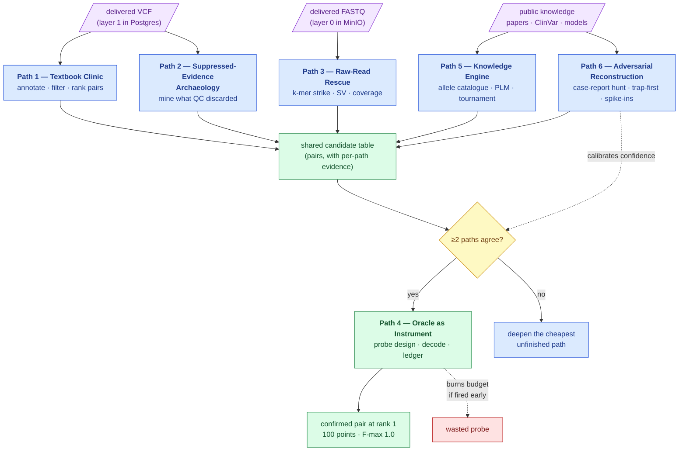

# Six solution paths — the Challenge 1 portfolio

**Standing:** strategy, written 2026-08-29, re-checked 2026-09-04. Partly executed: Path 1
and Path 2 have both run **over the eight-gene panel only**, and Path 1's phenotype half has
run genome-wide ([results](data-findings.md) §6). Paths 3–6 are unexecuted. Scoring
mechanics and biology priors are owned by
[`hackathon-intel.md`](hackathon-intel.md); measured dataset numbers by
[`data-findings.md`](data-findings.md); execution order by
[`../docs/roadmap.md`](../docs/roadmap.md). This page owns the *portfolio*: six independent
routes to the causal pair, ordered from conventional to inventive, and how they combine.

---

## Why a portfolio

- The answer is a compound-heterozygous pair (two different broken copies of one gene) and
  the delivered VCF likely holds only one of the two alleles — the designed trap
  ([intel §"the trap"](hackathon-intel.md)). One method cannot cover both alleles.
- The oracle budget is finite ([intel](hackathon-intel.md)): a probe is spent on a
  *candidate list*, so the paths exist to make that list short and independent.
- **The probe trigger:** independent agreement between ≥2 paths on a candidate is the
  signal to spend a probe. One path alone is a hypothesis; two arriving separately is
  evidence.
- Innovation is a judged criterion. Paths 4–6 are built as reusable N-of-1 tools, not
  one-off scripts.

## The map

> **Legend** — **purple = raw input** (the delivery and public knowledge); **blue = neutral
> machinery** (an evidence-generating path); **yellow = the decision point** (when to spend
> a probe); **green = the goal** (confirmation and the win); **red = lost points** (a probe
> spent without evidence). Solid arrows are evidence flow; dotted arrows are influence.

---

## Path 1 — The Textbook Clinic

The standard rare-disease pipeline, done properly. The baseline every other path is
measured against, and the "automated pipeline" story the methods form requires.

- **Method:** normalize the callset (`bcftools norm` — one standard spelling per variant)
  → annotate with VEP + gnomAD population frequency, ClinVar, CADD/REVEL/AlphaMissense,
  SpliceAI → keep rare variants → enumerate het pairs per gene, panel first
  ([panel counts](data-findings.md)) → genome-wide phenotype ranking with
  **Exomiser** and **LIRICAL** (symptom-list + VCF → ranked genes) on the HPO terms.
- **Tools we build:** the real `Annotator` backend behind the existing
  [port](../docs/notes/annotation-as-a-port.md) (VEP REST now, offline cache later);
  layer-2 tables ([design](../docs/step-0/data-layers.md)) so pair enumeration is SQL.
- **Uniquely finds:** the "easy" coding allele, fast.
- **Cost:** days. The annotator is the
  [critical path](data-findings.md) for the whole portfolio.
- **Kill criterion:** none — the backbone is never killed.
- **Report artifact:** the filtering funnel figure (every filter with its removal count).

## Path 2 — Suppressed-Evidence Archaeology

Mine what the caller's own QC threw away. A real variant in messy sequence is exactly what
hard filters suppress; the caller *saw* it and flagged it.

- **Method:** SQL over `warehouse.variants_raw` (all-text, non-PASS included by design):
  non-PASS calls by filter reason × gene × VAF ([counts](data-findings.md) §3); `1/2`
  multiallelic genotypes (compound het proven by the genotype alone — free phase); the
  low-VAF tail; the TRIP13 cluster where filtered calls concentrate
  ([measured](data-findings.md)).
- **Tools we build:** rescue views as `Derivation(...)` records in
  `src/mva/warehouse/analysis.py` (runner, CLI, provenance come free); a rescue score that
  re-weights filter reasons by local mappability instead of trusting them.
- **Uniquely finds:** a real second allele suppressed by hard filters — the cheapest place
  it could be hiding.
- **Cost:** hours. Highest value per hour in the portfolio.
- **Kill criterion:** rescue set fully annotated and no rare damaging hit in any panel gene.
- **Report artifact:** the filter-reason × gene heat map; before/after rescue funnel.

## Path 3 — Raw-Read Rescue

The FASTQ exists for one reason: an allele that *cannot* be in the delivered VCF — a
structural variant, a deep intronic splice change, or a low-VAF mosaic call
([roadmap §3 owns the full design](../docs/roadmap.md)).

- **Method, staged:** (A) mapping-free **k-mer strike** — stream the FASTQ once against
  panel-gene k-mers ±50 kb, recover the matching read pairs, align that small set to the
  *full* GRCh38, then `mosdepth` per-exon coverage (single-exon deletions), Manta/Delly
  (SV breakpoints), IGV evidence shots. (B) full re-call on Modal (bwa-mem2 → DeepVariant +
  SV consensus) only if A leaves questions.
- **Tools we build:** the streaming k-mer filter — a generic "targeted read recovery
  without alignment" tool, reusable on any N-of-1 case; the Modal pipeline with per-lane
  checkpointing.
- **Uniquely finds:** SV and deep intronic alleles, low-VAF mosaics — evidence no other
  path can produce.
- **Cost:** A = overnight I/O locally; B = hours on Modal, real money.
- **Kill criterion (A→B):** clean diploid coverage and no discordant read pairs across all
  panel genes.
- **Report artifact:** per-exon coverage plot over the suspect gene; IGV screenshots of any
  breakpoint (aggregates/renders only — no raw patient reads in the repo).

## Path 4 — The Oracle as a Measurement Instrument

The creative reframe: the submissions are not guesses, they are **queries against a
membership oracle**, and the reply fields (`f_max`, `partial_match_rank`, …) form a decode
channel. Design probes like experiments — this is group testing (finding the bad items in
batches with few tests) plus information gain (pick the question that removes the most
uncertainty).

- **Method:** hypothesis space as a bitmask over candidates → simulate every candidate
  probe against the [local scorer replica](../docs/notes/local-scorer-replica.md) under
  every hypothesis → submit the probe with the highest expected information gain → decode
  the reply ([decode tables, intel §9](hackathon-intel.md)) → repeat. Singles scan → pair
  scan → final strike; reserve held to the freeze for indel-representation retries.
- **Tools we build:** a `probe/` module — probe simulator, information-gain probe designer,
  decode-table verifier, and the Postgres **probe ledger**
  ([already ruled: build now](../docs/step-0/notes/postgres-for-shared-state.md)).
- **Uniquely finds:** ground truth itself. Converts any path's shortlist into confirmed
  alleles — two submissions in the best case.
- **Cost:** days of tooling; each probe spent is irreversible budget.
- **Kill criterion:** none — it is the confirmation channel. **Gate:** no probe before the
  candidate table is real (Paths 1–2 complete).
- **Report artifact:** the verified decode table; per-probe entropy-reduction chart. The
  flagship innovation exhibit.

## Path 5 — The Knowledge Engine

Build ranking signal no standard annotator provides, from literature and models.

- **Method:** (a) **reported-allele catalogue** — mine PubTator3/LitVar2 + ClinVar for
  every published MVA/SAC-gene allele and join against our callset; the case is clinically
  validated, so the answer may literally be in a case report. (b) **protein-language-model
  scoring** — ESM/AlphaMissense judged zero-shot on missense candidates, plus domain
  mapping (a kinase-domain hit outranks a linker hit). (c) an **LLM evidence tournament** —
  pairwise judged matches between candidate pairs, every judgment logged with citations,
  fused with the mechanical rank via reciprocal rank fusion (RRF).
- **Tools we build:** a case-agnostic allele-catalogue fetcher/joiner; the audited
  tournament re-ranker (grounded: every claim carries a PMID or it is discarded).
- **Uniquely finds:** the allele the numbers cannot rank — a known pathogenic variant with
  unremarkable in-silico scores — and a principled ordering between numerically tied pairs.
- **Cost:** days, desk + API work; runs parallel to everything.
- **Kill criterion:** catalogue join empty **and** tournament order agrees with Path 1
  (then it is confirmation, not signal — still report-worthy).
- **Report artifact:** the tournament bracket with cited judgments; catalogue-overlap table.

## Path 6 — Adversarial Reconstruction

Solve the meta-puzzle: the organizers picked a *clinically validated* case and built a trap
around it. Model the puzzle-setter, not just the genome.

- **Method:** (a) **case-report hunt** — search the MVA literature for compound-het cases
  matching the phenotype vector (sex, malignancy, the HPO terms, the odd features); a
  matching published case *is* the answer key. (b) **trap-first conditional search** —
  assume one-easy-one-hard: for each strong single allele from Paths 1–2, run a
  *conditional* deep search for its partner (SpliceAI across the whole gene's introns,
  Path 3's breakpoints, Path 2's suppressed calls) instead of ranking pairs symmetrically.
  (c) **synthetic-proband spike-ins** — inject known MVA pairs into GIAB-based callsets and
  reads, verify each path recovers them; the only honest pre-oracle calibration.
- **Tools we build:** phenotype-vector literature matcher; a conditional-partner mode in
  `pipeline/ranking.py`; a spike-in evaluation harness (reusable for any N-of-1 tool).
- **Uniquely finds:** the answer directly (case report), or the calibration that decides
  *when* Path 4 fires.
- **Cost:** (a) hours–days of grounded search; (c) days, but it hardens every other path.
- **Kill criterion:** (a) dies if no published case matches; (b) and (c) never die.
- **Report artifact:** spike-in recovery table per path (the portfolio's honesty proof);
  the phenotype-match ranking with citations.

---

## Portfolio logic

| When | What runs | Why |
|---|---|---|
| now | Paths 1–2 | days, cheap, produce the first real candidate table |
| in parallel | Path 3A (overnight I/O), Paths 5–6 (desk/API) | independent evidence, no shared bottleneck |
| gated | Path 4 | fires only when ≥2 paths agree on a candidate |
| conditional | Path 3B | only if 3A leaves questions |

- Shared infrastructure every path lands on: layer-2 tables, the annotator port, the probe
  ledger, one candidate table with per-path evidence columns. No path builds a one-off.
- Paths 1–3 generate candidates from the *data*; Paths 5–6 from *knowledge*; Path 4 turns
  either into ground truth. Agreement across the data/knowledge divide is the strongest
  trigger.
- Every path names its report artifact up front — the figures are produced as the path
  runs, not reconstructed afterwards.
- Relation to the [roadmap](../docs/roadmap.md): the paths group its steps, they do not
  replace them — roadmap steps 1–3 ≈ Path 1, step 4 ≈ Path 2, step 5 ≈ Path 3,
  step 6 ≈ Path 4, **step 7 ≈ Paths 5 and 6**, and step 8 is Track 2, which no path covers.
