# FastGT: an alignment-free method for calling common SNVs directly from raw sequencing reads

## Identity & citation

Fanny-Dhelia Pajuste, Lauris Kaplinski, Märt Möls, Tarmo Puurand, Maarja Lepamets, Maido Remm (Institute of Molecular and Cell Biology, University of Tartu). *Scientific Reports* 7:2537, 2017. Received 21 July 2016, accepted 12 April 2017. DOI 10.1038/s41598-017-02487-5. Open access (CC BY 4.0). 10 pages, 36 references, 1 supplementary file (not in this PDF; not analysed). Cited by 48 (OpenAlex) / 43 (Crossref), checked 2026-09-10.

*Scientific Reports* is a peer-reviewed, open-access Nature Portfolio mega-journal. Reviewed for technical soundness, not perceived importance.

```
APA 7:
Pajuste, F.-D., Kaplinski, L., Möls, M., Puurand, T., Lepamets, M., & Remm, M. (2017). FastGT: an
alignment-free method for calling common SNVs directly from raw sequencing reads. Scientific Reports,
7, 2537. https://doi.org/10.1038/s41598-017-02487-5

BibTeX:
@article{pajuste2017fastgt,
  title   = {{FastGT}: an alignment-free method for calling common {SNV}s directly from raw
             sequencing reads},
  author  = {Pajuste, Fanny-Dhelia and Kaplinski, Lauris and M{\"o}ls, M{\"a}rt and Puurand, Tarmo
             and Lepamets, Maarja and Remm, Maido},
  journal = {Scientific Reports}, volume = {7}, pages = {2537}, year = {2017},
  doi     = {10.1038/s41598-017-02487-5}
}

Vancouver:
Pajuste F-D, Kaplinski L, Möls M, Puurand T, Lepamets M, Remm M. FastGT: an alignment-free method for
calling common SNVs directly from raw sequencing reads. Sci Rep. 2017;7:2537.
doi:10.1038/s41598-017-02487-5
```

Metadata from OpenAlex and Crossref; Semantic Scholar rate-limited (HTTP 429), so influential-citation flags and TLDR are unverified.

## Paper type & how to read it

Bioinformatics **method paper** with a **resource** component (the pre-compiled k-mer database and the `gmer_counter`/`gmer_caller` binaries). It owes: a clear method, honest accuracy numbers against an external truth set, stated thresholds/parameters, and runnable code — all present. It is not a discovery paper (it calls no novel variants) and not a benchmark survey. Read it for: what exactly a "unique k-mer pair" is, how the genotype-calling model is parameterised and trained per-individual, and where the 64% marker-usability ceiling comes from.

## One-minute pitch

Calling genotypes the normal way means aligning every read to the genome (mapping) and then running a caller — 40–50 hours per genome. FastGT skips alignment entirely for **known** variants. For every common SNV in dbSNP, it pre-computes a pair of 25-letter DNA words (**k-mers**): one matching the reference allele, one matching the alternative allele, chosen so each word occurs *nowhere else* in the genome. Genotyping a new person means counting how often each of these ~30 million pre-selected words occurs in their raw sequencing reads — no mapping step — then handing the two counts per variant to a statistical classifier that decides AA/AB/BB (homozygous-reference, heterozygous, homozygous-alt) or "no call". A 30x genome finishes in under an hour on ordinary server hardware, and the genotype calls agree with a gold-standard trio dataset 99.96% of the time. The catch: FastGT can only genotype variants it already has k-mer pairs for. It cannot discover anything new — it is a large digital SNP array built out of sequencing reads, not a variant caller.

**TL;DR:** 25-mer pairs (ref/alt) per known SNV, up to 3 pairs per variant, counted once from FASTQ with a custom radix-tree counter, then an Empirical Bayes classifier (negative binomial emission, per-individual trained) picks the genotype. 30,238,283 of 46,954,719 candidate dbSNP SNVs (64%) survive filtering. 99.96% concordance with Illumina Platinum trio genotypes at 50x; concordance degrades below 20x; no indel or novel-variant calling.

## Domains & keywords

Genomics > variant calling > SNV genotyping > alignment-free / k-mer methods > targeted genotyping from raw reads. Tasks: bi-allelic autosomal SNV genotyping, chrX/chrY haploid genotyping, coverage-dependence and error-rate characterisation. Tools: GenomeTester4 (`glistmaker`, `glistcompare`, `glistquery`), `gmer_counter`, `gmer_caller`, wgsim, GATK 3.6 (for real-genotype simulation), SAMtools.

## Problem & research questions

Gap claimed (Introduction, p.1): standard mapping + calling pipelines take 40–50h per 30x genome, need expert tuning, and different pipelines disagree — but only in ~10–20% of the genome; the rest is "robust and reliable". One prior alignment-free method (Kimura & Koike 2015, BWT-based, ref 23) exists but is not benchmarked here directly. Thesis (Introduction, p.1): a k-mer-counting method that is "1–2 orders of magnitude faster than traditional mapping-based genotype detection" for **known** variants, explicitly *not* a substitute for full variant calling.

Research questions (implied):
1. Can a pair of unique 25-mers per SNV, counted directly from FASTQ, recover the true genotype as reliably as mapping-based calling?
2. How much of the genome (what fraction of dbSNP) is even reachable this way, and what does k-mer length trade off?
3. How does accuracy depend on sequencing depth?
4. Does the same per-individual statistical model handle sex chromosomes and detect non-canonical (CNV-like) genotypes as a side effect?

## Background primer

**k-mer as a coordinate-free lookup key.** A k-mer is every length-k substring of a sequence — think of it as a fixed-width hash key. "Unique" means the key's count in a reference/lookup table is exactly 1. GenomeTester4 (Kaplinski 2015, ref 28) is the set-algebra toolkit behind this: `glistmaker` builds a sorted k-mer list from a FASTA/FASTQ, `glistcompare` performs set operations (union/intersect/subtract) between lists.

**Genotyping without a coordinate system.** A conventional caller places each read at a genome position (alignment) and tallies which base sits at that position across reads. FastGT instead defines two "probe" k-mers per known SNV site — one that only exists if the reference allele is present, one that only exists if the alternative allele is present — and counts how often each probe string appears anywhere in the raw, unaligned reads. This works only because the k-mer is chosen to be unique to that genomic location; if it occurred twice, the count would be ambiguous. This is why FastGT is described as "a large digital microarray": like a SNP array, it interrogates a **fixed panel** of predefined markers and cannot see anything outside that panel.

**Where this fits in the group's later work.** This 2017 paper is the direct ancestor of GeneToCN (Pajuste 2023; sibling analysis in this same folder tree), which reuses `gmer_counter` and the "concordance degrades below 20x" finding but for gene copy number instead of genotype. The prerequisite reading order for this project is: Kaplinski 2015 (GenomeTester4) → this paper → GeneToCN 2023.

## Method

**In plain language.** For every known SNV, cut two short strings of DNA out of the reference and the alternative-allele sequence around that position — like two barcodes, one per allele. Keep only the barcodes that appear exactly once in the whole genome (so a count > 0 can only mean "this exact spot"). Stream a person's raw sequencing reads once, tally every occurrence of every barcode. Two counts per SNV — how often the ref barcode showed up, how often the alt barcode showed up — go into a statistical model that has learned, from this same person's own data, what count ratio for a truly homozygous-ref, heterozygous, or homozygous-alt site looks like at their sequencing depth. The model then reports its best guess, or "no call" if nothing fits.

**Technically.**

- **Unique k-mer pair construction** (Methods, p.7 "Compilation of database of unique k-mers"; Fig. S4/S5 not in this PDF). k = **25** used throughout ("A k-mer length of 25 was used throughout this study", Methods p.7). Input: all validated bi-allelic SNVs plus validated common indels from **dbSNP build 146** (refs 26, 27) — indels are pulled in *only to test k-mer uniqueness against*, they are never themselves genotyped ("Indels were used for testing the uniqueness of k-mers only; they are not included in the database of variants", Methods p.7).
  - *Filter 1 (proximity):* drop any SNV with another SNV or common indel within 25 bp on either side, to avoid combinatorial allele overlap. This alone removes 7–17% of candidates depending on k (Fig. 5 caption, p.6).
  - *Filter 2 (uniqueness):* build the "expanded reference genome" = reference genome k-mers + all alternative-allele k-mers for known SNVs/indels. A k-mer pair is kept only if **both** k-mers occur ≤1 time in this expanded set; k-mer pairs unique even allowing one mismatch are *preferred* (not strictly required) "to reduce the risk of forming an identical k-mer by a rare point mutation or a sequencing error" (Methods p.7). Tool: `Glistcompare` (ref 28).
  - *Filter 3 (empirical, 50 real genomes):* count k-mers and call genotypes for 50 sequenced individuals (25 men/25 women for autosomes, 50 men for chrX/chrY; depth 21–45x, Center of Translational Genomics, Univ. of Tartu). Remove: chrY markers with frequency > 3 in more than one woman; autosomal k-mers with frequency > 3× the median count in more than one individual; SNVs whose allele count is non-canonical (≠2 autosomal, ≠1 male-chrX/chrY) in more than 1 of the 50 individuals.
  - **Result:** 30,238,283 SNVs usable (64% of 46,954,719 candidate dbSNP SNVs fed to the pipeline), 6.8% (2,063,839) in protein-coding regions; >23,832 usable chrY markers (Results p.1–2, Methods p.7).
  - **Up to 3 k-mer pairs per SNV**, not just 1: "we use up to three k-mer pairs per variant to prevent erroneous calls caused by the occasional loss of k-mers because of rare mutations" (Results p.2). One pair is theoretically sufficient.
  - **k-mer length sweep** (Fig. 5, p.6): tested k from below 20 to 32. Usable-marker count "does not increase significantly for k larger than 24"; k between 24–32 "should be equally suitable". k < 20 loses many markers to non-uniqueness. Accuracy vs k was **not measured** ("We have not compared the accuracy of genotype calls of different k-mer lengths", p.6) — only argued theoretically (shorter k-mers: more false unique-hits from sequencing error; longer k-mers: lower effective coverage, more chance of an error landing inside the window).

- **Counting engine** (Results p.2 "Algorithm and software"). `gmer_counter` reads FASTQ directly (no alignment), stores k-mer sequence→frequency in an **adaptive radix tree**: the first 14 nucleotides index into a table of sparse bitwise radix trees holding the remaining k−14 letters; 2 bytes per k-mer store the frequency (implies a count cap around 65,535 before overflow, not discussed in the paper). Accepts k-mer lengths 14–32. Confirmed in the shipped source (`work/src/src/gmer_counter.c`, `README.FastGT.md`): CLI flags include `-32` for 32-bit counts (opt-in) instead of the 16-bit default, `--num_threads` (default 24), `--low_memory`.

- **Genotype-calling model — Empirical Bayes with a negative-binomial emission**, not Poisson (Results p.3 "Empirical Bayes' method"; confirmed in `work/src/src/genotypes.c`, `gmer_caller.c`). This is the single most load-bearing detail for reuse:
  - The classifier computes a posterior over **14 genotype classes** per variant: `X` (no-call/off-panel), `A`, `B` (haploid ref/alt — used for male chrX/chrY), `AA`, `AB`, `BB` (canonical diploid), and 8 non-canonical classes `AAA, AAB, BBA, BBB, AAAA, AAAB, BBBA, AABB, BBBB` (mono-allelic-tri/tetra patterns that read as deletions/duplications).
  - Each class has a **prior mass**: `p_0` (X), `p_1` (haploid classes, split by population allele frequency `pB`), `p_2` (diploid classes, HWE split `p_A²`, `2·p_A·p_B`, `p_B²`), and the *remaining* mass `1 − p0 − p1 − p2` distributed across tri-/tetra-allelic classes via a binomial split (paper: "described by eight parameters", Results p.3; code confirms 7 optimised parameters — `l_viga` (error), `p0, p1, p2, lambda, size, size2` — plus the externally-supplied population allele frequency `pB`, totalling 8).
  - Each class has an **emission**: `count ~ NegBinomial(mu, size)` where `mu` scales with copy number — `lambda/2` per allele-copy in `AB`, `lambda` for a doubled allele in `AA`/`AAA` component, etc. — and dispersion `size + size2·mu` grows with the mean (over-dispersion increases with coverage, not fixed variance as Poisson would imply). The "wrong" allele's count is modelled with mean `l_viga`, the background error rate for that k-mer.
  - **Per-individual training**: model parameters are fit by maximum-likelihood (code: `mlogL3`, a numerical optimiser) on **100,000 autosomal markers** from that same individual's own count data (`--training_size` default 100000, confirmed in code and README). This is not a population-wide fixed model — every genome gets its own error rate, coverage and dispersion estimate.
  - **Genome-wide coverage estimate (`lambda`)**: initialised from the **mean k-mer count over the 100,000-marker training set** (`v[LAMBDA] = mul * keskmine` where `keskmine` = training-set mean; code `gmer_caller.c` line ~276), then refined jointly with the other parameters, with a soft prior (`lambda_sigma = lambda_est/4`) keeping it near that empirical starting point. Coverage is **derived from the counted k-mers themselves**, not supplied externally (though `--coverage` and `--params` CLI flags let a user override or reuse a previously fit model).
  - **Sex determination**: automatic, from the **median k-mer frequency of chrX markers** (Results p.3). Female → autosomal (diploid) model applied to chrX, chrY not called. Male → a second haploid model trained on 100,000 chrX markers, applied to chrX and chrY.
  - **Calling and thresholds**: for each variant, pick the class with maximum posterior (`best_gt` in code). Output is the canonical genotype (`AA/AB/BB` or `A/B`) if `best_gt` falls in that canonical set **and** its posterior mass clears `--prob_cutoff`, whose **default is 0** — i.e., by default there is *no confidence gate*, only a canonical-class gate. If `best_gt` is a non-canonical class (or, with `--non_canonical`, always), the non-canonical genotype is reported; otherwise the variant is emitted as `NC` ("no call"). This means the paper's reported NC rates (0.24% vs Platinum, Table 2) are driven almost entirely by *detected non-canonical signal* (real or artefactual CNV-like counts), not by low-confidence canonical calls being suppressed.

- **Data structure / DB file**: plain text, one line per variant with its k-mer(s); binary-compiled form optional (`-dbb`/`-w` in `gmer_counter`).

```mermaid
flowchart LR
  D["dbSNP b146 SNVs + common indels<br/>46,954,719 candidates"]:::raw --> F1["Filter 1: drop SNVs<br/>&lt;25bp from a neighbour"]:::machine
  F1 --> F2["Filter 2: uniqueness vs<br/>expanded reference genome<br/>(glistcompare, 1-mismatch preferred)"]:::machine
  F2 --> F3["Filter 3: 50 real genomes,<br/>drop non-canonical / high-freq k-mers"]:::machine
  F3 --> DB["30,238,283 SNVs,<br/>up to 3 k-mer pairs each"]:::good
  FQ["Raw FASTQ (any depth)"]:::raw --> C["gmer_counter<br/>radix-tree count, one pass"]:::machine
  DB --> C
  C --> T["Train per individual:<br/>100,000 autosomal markers<br/>-> lambda, error, size, size2"]:::decision
  T --> G["gmer_caller<br/>Empirical Bayes, NegBinom emission<br/>14 genotype classes"]:::decision
  G --> O["AA / AB / BB / A / B<br/>or NC (non-canonical / below cutoff)"]:::good
  classDef raw fill:#e9d5ff,stroke:#7e22ce
  classDef machine fill:#dbeafe,stroke:#1d4ed8
  classDef decision fill:#fef9c3,stroke:#ca8a04
  classDef good fill:#dcfce7,stroke:#15803d
```


> **Legend** — purple: raw inputs (dbSNP, reference, reads); blue: deterministic filtering/counting machinery; yellow: the per-individual statistical decision steps; green: the deliverable (database, final call).

## Figures & tables check

| Fig/Table | Page | What it shows | Claim it supports | Verdict | Note |
|---|---|---|---|---|---|
| Fig. 1 | 2 | Overall principle schematic | — | OK | Schematic only, no data |
| Fig. 2 | 3 | Two-k-mer genotype-calling illustration, boundaries between genotype clusters, λ=38.6 example | C1 (model separates genotype clusters) | OK | Illustrative scatter of the classifier's decision regions, one worked individual |
| Table 1 | 4 | Simulated reference-genome reads, 5 coverages, genotype-call breakdown (AA/AB/BB/NC) | C2 (accuracy vs depth) | OK | Ground truth is "all AA" by construction; cannot assess AB/BB sensitivity here (stated by authors, p.3) |
| Fig. 3 | 4–5 | Sensitivity/specificity vs coverage, 5 populations | C3 (population-independent accuracy) | OK | Text gives the numeric range (61%→99.8% sensitivity, 99.60–99.95% specificity); "lines overlapping" claim for specificity not independently re-plotted here |
| Table 2 | 4–5 | Confusion matrix, FastGT vs Platinum genotypes, 2 individuals | C4 (concordance) | OK | Numbers reproduced verbatim in this analysis (99.96/99.95/99.87% per genotype row) |
| Fig. 4 | 5–6 | Concordance vs coverage (5–40x, downsampled NA12878) | C5 (coverage sensitivity) | OK | Single individual, single downsampling series — the paper's own depth-sensitivity evidence rests on this one genome |
| Fig. 5 | 6 | Fraction of markers retained vs k, filtering steps 1 & 2 | C6 (k-mer length trade-off) | OK | Baseline 46,954,719 SNVs stated in caption |
| Fig. 6 | 7 | Runtime vs coverage / number of FASTQ files | C7 (throughput) | OK | Confirms multi-file parallel read benefit qualitatively; no per-file-count numeric table in main text |

Recomputation: Table 2's "concordant (%)" row (99.96/99.95/99.87) is arithmetically consistent with the confusion-matrix cell counts as printed (spot-checked: AA cell 54,246,425 / (54,246,425+987+68) ≈ 99.998% *per-cell*, but the reported 99.96% is the *overall bi-allelic* concordance across all three genotype categories combined — the paper does not fully disambiguate per-cell vs marginal percentages in the table, a minor reporting ambiguity, not an error).

## Claims vs evidence

| # | Claim | Evidence offered | Where | Strength | Analyst note |
|---|---|---|---|---|---|
| C1 | A pair of unique k-mers per SNV, counted from raw reads, separates genotype classes | Fig. 2 worked example | Results p.3 | moderate | One individual shown; mechanism is transparent but not a statistical validation by itself |
| C2 | On simulated reference-genome reads, AA recovery is 98.94% (5x)–99.95% (20x); NC 1.036%→0.001% | Table 1, wgsim simulation | Results p.3–4, Methods p.8 | strong | Simulation is a closed loop (ground truth known exactly); base error rate calibrated against 100 real genomes (0.0048 mean) |
| C3 | Sensitivity (AB/BB recall) 61% (5x)→99.8% (20x); specificity 99.60–99.95%, population-independent | Fig. 3, 5 individuals from 5 populations | Results p.4 | strong | Real genotypes injected into simulated reads from GATK-called VCFs — a step closer to real data than Table 1, still simulation |
| C4 | 99.96% overall concordance with Illumina Platinum trio genotypes (50x); 99.93% for non-reference calls | Table 2, 2 individuals, 30,238,283 markers each | Results p.4–5 | strong | External, independent truth set (pedigree-validated); large marker count; only 2 individuals |
| C5 | 99.82% concordance with HumanOmniExpress microarray, 10 individuals, 504,173 markers | Text, Table 2 reference | Results p.4–5 | moderate | Independent orthogonal technology; smaller marker set, more individuals |
| C6 | Non-reference concordance declines significantly below 20x coverage | Fig. 4, downsampled Platinum NA12878 | Results p.5–6 | moderate | Single genome downsampled — depth-response shape from n=1 |
| C7 | chrY concordance 99.97% vs HGDP panel (11 men); only 1 discordant marker across 7 CEPH father-son pairs | Text | Results p.6 | moderate | Small external sets; the 1 discordant marker was diagnosed (reference-assembly problem at that site) and removed from the DB |
| C8 | 30x genome genotyped in ~40 min wall time, 32 cores; min 8GB RAM tested | Text, Fig. 6 | Results p.7 | weak | Single hardware configuration, no repeated-run variance reported |
| C9 | k between 24–32 equally usable; usable-marker count plateaus above k=24 | Fig. 5 | Results p.6 | strong for marker count; unsupported for accuracy | Authors explicitly did not test accuracy vs k ("We have not compared...") |

## What works

- **The unique-k-mer-pair idea is simple and auditable.** A count > 0 for a unique 25-mer can only mean that exact genomic location; the whole method's validity rests on that one property, and the paper shows the filtering pipeline that enforces it.
- **Per-individual model training removes the need for a fixed, population-wide threshold.** Coverage, error rate, and dispersion are all re-estimated per genome from that genome's own 100,000-marker sample — the classifier adapts to whatever depth or noise level the input has.
- **Accuracy is genuinely high at ≥20x**, replicated across three independent comparisons (simulation, Platinum trio, microarray) that agree in the 99.7–99.99% band.
- **Speed and memory are real and load-bearing** for the "digital microarray" pitch: I/O-bound (dominated by FASTQ read time), radix-tree memory scales with the *panel size* (30M markers), not with sequencing depth or genome size — matches this project's disk-bound constraint (step 0 was disk-bound; CLAUDE.md).
- **Non-canonical genotype detection falls out of the same model for free** — a side benefit for spotting deletions/duplications without a separate CN caller, later formalised into GeneToCN.

## What doesn't work (or isn't shown)

- **No indel genotyping.** Indels are only used to test k-mer uniqueness; they are never in the callable variant set (Methods p.7). The Discussion (p.8) proposes indel-specific k-mer pairs as a future extension but this is **not implemented or tested** in this paper.
- **No novel-variant discovery.** By design, FastGT can only genotype sites already in its pre-built k-mer database (dbSNP-derived). It answers "what genotype does this person have at this known site", never "is there a variant here at all".
- **36% of dbSNP is silently dropped**, concentrated in regions the paper itself calls "difficult" (near other variants, non-unique, or producing non-canonical counts in the 50-genome filter) — exactly the regions where mapping-based callers also struggle, so this is not obviously worse, but it is unquantified *which* genes/regions are lost.
- **k-mer-length-vs-accuracy relationship is asserted, not measured** (Fig. 5 only measures marker retention, not genotype accuracy, across k).
- **No confidence interval or calibration curve on the posterior probability itself** — `--prob_cutoff` exists as a knob but the paper never sweeps it or reports a precision/recall trade-off at non-zero cutoffs.
- **Coverage-dependence evidence is single-genome** (Fig. 4, one downsampled Platinum sample) — no replication across individuals or sequencing centres.
- **2-byte k-mer count field** implies a hard cap around 65,535 before overflow; not discussed, and irrelevant at 44–50x depth but worth knowing if amplicon-like local coverage spikes occur.

## Limitations

**Stated by the authors.**
- Fixed-length k-mer (max 32) sacrifices calling ~36% of variants in difficult regions, in exchange for the speed of 64-bit-word processing (Discussion p.8).
- No de novo variant detection, unlike the BWT-based competitor (Kimura & Koike 2015) which has drop-scan/step-scan for this (Discussion p.8).
- Structural-variant / large-indel detection via k-mer pairs "requires further investigation and testing" (Discussion p.8).
- Only tested with Illumina data; other platforms untested at publication (Discussion p.8) — GeneToCN (2023) later confirms cross-platform behaviour for the *copy-number* variant of the method.
- The single chrY discordance across CEPH pedigrees traced to a known reference-assembly problem at that site, and the marker was removed rather than the model fixed.

**Not stated (analyst).**
- **Single-ancestry filtering set.** The 50-genome filtering panel (step 3) and the 100 genomes used for error-rate calibration are from the Estonian Genome/Translational Genomics Center (Methods p.7–8); k-mer uniqueness and "non-canonical" thresholds tuned on this population may not transfer cleanly to other ancestries — the same risk flagged for GeneToCN's amylase panel.
- **`--prob_cutoff` default of 0 is a silent trust assumption.** Any canonical-class call is reported regardless of posterior confidence unless the user explicitly raises the cutoff; a downstream pipeline that does not set this flag inherits calls the model itself considers only marginally more likely than the alternative.
- **The negative-binomial "size"/"size2" dispersion parameters are fit on the same 100,000 markers used to fit everything else** — no held-out check that the fitted emission distribution generalises to markers outside the training subsample.
- **No report of what fraction of the panel actually overlaps clinically relevant genes** for a rare-disease use case (the paper reports 6.8% of the panel is protein-coding genome-wide, but not per-gene coverage).

## Validity, bias & reproducibility

*Internal validity.* The simulation (Table 1, Fig. 3) is a closed loop with exactly known truth, so it isolates the classifier's behaviour cleanly; the real-world comparisons (Platinum, microarray, HGDP, CEPH) are external and largely independent of the filtering panel's own construction, reducing (but not eliminating, given the shared Estonian filtering cohort) circularity risk.

*External validity.* Coverage-dependence rests on one genome; ancestry generalisation rests on the population-panel argument (5 pops in Fig. 3) for *simulated* genotypes only, not for the *filtering* step, which used only Estonian samples.

*Reporting.* k=25 stated and code-confirmed; hardware stated (32-core, 512GB RAM, RAID10 for concordance runs); dbSNP build (146) and reference (GRCh37) stated; wgsim version and parameters fully stated (Methods p.8); FastGT package version "20160503" stated for the concordance analysis. Missing: variance/replicate runs for timing; per-population breakdown beyond Fig. 3's five individuals; explicit precision/recall at non-default `--prob_cutoff`.

*Conflicts.* None declared; institutional funding (Estonian Ministry of Education and Research, University of Tartu, EU ERDF). Same author group as GenomeTester4 and later GeneToCN — dependency stack is in-house across all three papers.

**Reproducibility score: 4.** Code is public, compiles from C source (confirmed: cloned `bioinfo-ut/GenomeTester4`, contains `src/gmer_counter.c`, `src/gmer_caller.c`, `src/genotypes.c`, a `Makefile.gmer`, and `README.FastGT.md` with exact CLI usage). Pre-built k-mer databases for the 30M-marker panel are hosted separately (http://bioinfo.ut.ee/FastGT/, CC BY-NC-SA, not verified reachable in this session). No environment/container file, no automated tests in the repo, dbSNP build 146 and GRCh37 are both superseded versions today (this project uses GRCh38). Held back mainly by: the 50/100-genome filtering cohort and the Platinum/microarray comparison data are external or restricted; no CI; versions of dependencies (e.g. GenomeTester4 build) unpinned in the README.

## Related work & key citations

- **Foundations**
  - Kaplinski, Lepamets & Remm (2015) — GenomeTester4 (ref 28) — the k-mer set-algebra toolkit every step depends on. Read first.
- **Direct competitor**
  - Kimura & Koike (2015), *Bioinformatics* 31:1577–83 (ref 23) — BWT-based alignment-free SNV caller; can call SNVs in repetitive regions and detect de novo variants (drop-scan/step-scan), which FastGT explicitly cannot. Discussed at length (Discussion p.8) but not benchmarked head-to-head in this paper.
- **Truth/validation data**
  - Eberle et al. (2016), bioRxiv (ref 24) — Illumina Platinum Genomes pedigree-validated variant set, the main external truth set (Table 2).
  - Meyer et al. (2012), *Science* 338:222-6 (ref 25) — Denisovan genome paper; source of the HGDP chrY comparison panel used here.
- **Direct successor (not in this paper, found via citation search)**
  - Pajuste & Remm (2023) — GeneToCN — reuses `gmer_counter` and the ">20x" depth finding for copy-number estimation instead of genotyping; already analysed in this repo's `papers/iteration2/GeneToCN Pajuste et al-2023/` folder.

Reading order for this project: Kaplinski 2015 → this paper → GeneToCN 2023 → (for a fairness check against a modern aligner-based baseline) GATK/DeepVariant docs.

## Impact & follow-ups

Citations: 48 (OpenAlex) / 43 (Crossref), checked 2026-09-10. Semantic Scholar unreachable (HTTP 429); influential-citation flags unverified. No web search for citing-paper titles was run in this session (metadata script only returned counts, not the citing list) — **impact section is therefore thinner than the GeneToCN sibling analysis; the "up to 3 follow-up papers" requirement for the review is answered separately in the review document with explicit verification status.**

## Code & data

**Availability.** Official repo `bioinfo-ut/GenomeTester4`, GPL-3.0, primarily C (96.6%) with Perl helper scripts (2.7%) — confirmed via `inspect_repo.py` (`work/repo.json`): 35 stars, 15 forks, not archived, last push 2022-11-22 (≈1,388 days before this analysis), 5 open issues (none flagged as reproduction failures; recent issues concern build failures, `MakeIntersection.pl` mismatches, and a `glistcompare -c` cutoff bug). Head commit "Fixed sequence names in index creation" (2022-11-22). Top level contains `README.md`, `README.FastGT.md`, `README.GenomeTester4.md`, `README.KATK.md`, `LICENSE.txt` (GPL-3.0), `src/`, `scripts/`. No dedicated CI, no tests, no container.

**Completeness.**

| Item | Status | Evidence |
|---|---|---|
| Dependencies | partial | `README.FastGT.md` states `make gmer_counter`/`make gmer_caller`; no version pins, no lockfile, no container |
| Database-build script | yes (described, not bundled as a single script) | Filtering pipeline described in Methods; `Glistcompare`/`glistmaker`/`glistquery` are the primitives, the exact filter-3 scripts (50-genome QC) are not in this repo |
| Counting/calling scripts | yes | `gmer_counter`, `gmer_caller` binaries built from `src/gmer_counter.c`, `src/gmer_caller.c`, `src/genotypes.c` |
| Pretrained artefacts (k-mer DB) | external | Hosted at `bioinfo.ut.ee/FastGT/`, CC BY-NC-SA, not in the GitHub repo, not verified reachable this session |
| Results table | no | README has no benchmark numbers; refers to the paper |
| Tests | no | none found |

The automated heuristic scored this 0/5 (looks for ML-style filenames like `train.py`/`eval.py`); by hand, given the C-toolkit shape (compile + two CLI binaries + text DB format), it is closer to 3/5 — the core pipeline is runnable, but the SNV-selection/filtering scripts and the pre-built database are not bundled in this particular repository snapshot.

**Dry run.** Not attempted. Reason: requires building the C toolkit (`gmer_counter`/`gmer_caller`) and either downloading the external ~30M-marker k-mer database or rebuilding one from dbSNP + a whole-genome k-mer list (hours of compute, GBs of disk) — this project already plans its own k-mer/probe pipeline (step-0 Aho-Corasick strike, per CLAUDE.md) and does not need FastGT's SNV panel itself, only its statistical model and filtering logic. The genotype-calling source (`genotypes.c`, 126 lines) and the CLI/README were read in full instead; the model is fully specified by the `genotype_probabilities` function shown above and needs no execution to verify.

## Concept-to-code map

| Concept in the paper | Where it lives in the code | Reading note |
|---|---|---|
| Radix-tree k-mer counting from FASTQ | `src/gmer_counter.c` | 14-nt prefix index into sparse bitwise radix trees (per paper text; not re-derived from code in this pass) |
| 14–32 nt k-mer length range | `README.FastGT.md` CLI options | Paper states the same range; not independently re-verified against a length-check constant in the C source this pass |
| 16-bit vs 32-bit count field | `gmer_counter.c` `-32` flag | Default 16-bit per README ("use 32-bit integers for counts (default 16-bit)") |
| Empirical Bayes classifier, negative-binomial emission | `src/genotypes.c::genotype_probabilities` | 14-class posterior; `dnbinom_mu(count, size+size2*mu, mu)` per class; confirmed by direct read, see Method section above |
| 8 model parameters (error, p0, p1, p2, coverage, size, size2 [+ population allele freq pB]) | `src/gmer_caller.c` (`L_VIGA, P_0, P_1, P_2, LAMBDA, SIZE, SIZE2` + `pB` argument) | Matches the paper's "described by eight parameters" exactly |
| Per-individual training on 100,000 autosomal markers | `gmer_caller.c`, `--training_size` default 100000 | Confirmed in both code default and `README.FastGT.md` |
| Genome-wide coverage (λ) estimated from the individual's own data | `gmer_caller.c`, `v[LAMBDA] = mul * keskmine` (keskmine = training-set mean count) | Self-calibrating; no external genome-size or total-read-count input needed |
| Sex-chromosome model switch | Paper text only (Results p.3); not traced in code this pass | Automatic from chrX median frequency |
| Canonical/non-canonical + `NC` output, `--prob_cutoff` | `gmer_caller.c::print_genotypes`, `cancall` logic | `--prob_cutoff` default **0** — no confidence gate unless the user raises it |
| DB text format | Described in `README.FastGT.md`; example files not in this repo | One line per variant/k-mer, `-dbb`/`-w` for binary compile |

## Adaptation plan

Written against this project: one proband, ~44x mapped short-read WGS (GRCh38), 8 HPO terms, a confirmed causal compound-heterozygous pair in *BUB1B* (stop_gained + missense), iteration-2 plan step 3's genotyping half. Full review with plan-vs-paper deltas written separately to the scratchpad review file; summary here:

1. **Keep as-is.** The unique-k-mer-pair construction discipline (proximity filter, uniqueness-against-expanded-reference filter, empirical non-canonical-count filter on a real cohort) and the negative-binomial (not Poisson) emission with per-individual parameter fitting. At ~44x, this project is comfortably above FastGT's own "20x" reliability floor (Fig. 4).
2. **Swap/adapt.** k=25 vs this project's use of 31-mers elsewhere in the pipeline: FastGT's own Fig. 5 shows marker retention plateaus at k≥24, so a 31-mer choice loses nothing there, but the *uniqueness filter* and *proximity filter* radius should scale with k (a 31-mer proximity filter should probably drop variants within 31bp, not 25bp, of a neighbour). Genome-wide coverage: FastGT estimates λ from a 100,000-marker training subsample of the *same person's* counts — directly reusable for this case's ~44x depth without needing an external coverage estimate.
3. **What breaks first.** With ~2 alleles of interest (not 30 million), the per-individual training step (100,000 markers) cannot use the target variants themselves — it must run on a broad neutral marker set to fit `lambda`/`size`/`size2`/error rate, then apply that fitted model to the 2 variants of interest. The calibration set mentioned in the brief (~1000+1000) is far smaller than FastGT's 100,000-marker training default; whether 2,000 markers suffice to fit an 8-parameter model needs its own check (a null-band/bootstrap experiment, as recommended for the sibling GeneToCN paper).
4. **Minimum viable experiment.** Build unique 25-mer (or 31-mer) ref/alt pairs for the 2 *BUB1B* variants of interest, confirm each is unique against the GRCh38 reference and against the ~1000+1000 calibration set's known variants, count from this proband's FASTQ, and fit/apply the negative-binomial classifier using a modest neutral-marker training subsample (order hundreds to low thousands, scaled down from 100,000). Compare the resulting genotype call against the vendor VCF's genotype at the same sites as a sanity check, and report the model's posterior probability (do not rely on the default `prob_cutoff=0` silently).
5. **Risks.** Licence: GenomeTester4/FastGT code is GPL-3.0 (fine to use; derivative code must stay GPL); the hosted k-mer databases are CC BY-NC-SA and irrelevant here (this project builds its own probes for its own genes). Coordinates: any FastGT-style k-mer/probe file this project builds for its 2 variants of interest will encode genomic positions — must live under an untracked/gitignored path per the coordinate gate (`tools/check_coordinates.py`), never in a tracked file.

**Cross-reference to the clinical dataset.** Nothing in this paper uses phenotype data — FastGT genotypes known SNVs from sequence alone. For this case, a FastGT-style k-mer-count genotype confirmation of the *BUB1B* compound-heterozygous pair is purely genomic evidence; it neither uses nor updates the 8 HPO-term clinical picture, and any finding from this method should be filed with that statement, per the project's two-data-sources directive.

## Glossary

- **Alignment-free** — analysing reads without mapping them to a reference coordinate system; counting k-mers straight from FASTQ. FastGT's central idea.
- **Bi-allelic SNV** — a single-nucleotide variant site with exactly two possible alleles (reference and one alternative).
- **Concordance** — fraction of genotype calls that match an independent truth set exactly (AA/AB/BB agreement), stricter than a correlation coefficient.
- **Digital microarray** — the paper's own analogy: FastGT interrogates a fixed, pre-defined panel of markers from raw sequencing reads, the way a SNP array interrogates a fixed panel of probes on a chip.
- **Empirical Bayes classifier** — a Bayesian decision rule (posterior ∝ likelihood × prior) where the prior/likelihood parameters are themselves estimated from the same dataset being classified, rather than fixed in advance. Here: parameters refit per individual from that individual's own k-mer counts.
- **Expanded reference genome** — the reference genome's k-mer set plus every alternative-allele k-mer for known SNVs/indels; the uniqueness test is run against this combined set, not the plain reference.
- **`gmer_counter` / `gmer_caller`** — FastGT's two binaries: count selected k-mers in FASTQ reads; call genotypes from those counts.
- **Negative binomial distribution** — a discrete count distribution with a mean and a separate dispersion (variance) parameter, allowing variance to exceed the mean (over-dispersion) unlike Poisson, where variance always equals the mean. FastGT's emission model uses this, not Poisson, because real sequencing counts are more variable than Poisson predicts.
- **Non-canonical genotype** — an allele-count pattern other than the expected diploid (autosome) or haploid (male chrX/chrY) pattern, e.g. 3 or 4 copies detected; may indicate a deletion, duplication, or a filtering-panel artefact.
- **`prob_cutoff`** — a `gmer_caller` CLI parameter: the minimum posterior probability required to report a canonical genotype call; default 0 (no gate).
- **Radix tree (adaptive)** — a memory-efficient tree data structure for storing a set of strings sharing prefixes; here indexed by the first 14 nt of each k-mer to look up the remaining suffix's frequency.
- **Unique k-mer (pair)** — a k-mer occurring exactly once in the (expanded) reference genome; a pair is one such k-mer for the reference allele and one for the alternative allele at the same SNV.
- **wgsim** — a SAMtools-family tool that simulates FASTQ reads with a specified error rate and coverage from a reference sequence, used here to generate the paper's simulated-read benchmarks.

## Open questions & extension ideas

Authors' future work (Discussion, p.8): extend to indel-specific and structural-variant k-mer pairs; test on non-Illumina platforms (later done, in GeneToCN 2023, for the copy-number variant of the method).

Analyst's proposals:
1. **k-mer-length-vs-accuracy sweep**, the one measurement Fig. 5 explicitly does not make — directly answers whether this project's 31-mer choice costs anything beyond the marker-retention effect already shown.
2. **`prob_cutoff` sweep** — report precision/recall of canonical calls at a range of cutoffs above the default 0; would turn the paper's single NC rate into a tunable operating point relevant to a high-stakes 2-variant call.
3. **Small-training-set titration** — refit the 8-parameter model on progressively smaller neutral-marker subsamples (100,000 down to a few hundred) to find the floor below which `lambda`/`size`/`size2` estimates become unstable; directly serves this project's ~1000+1000 calibration-set constraint.

Questions for the authors: What does the 2-byte count field do at very high local coverage (potential overflow)? Was `--prob_cutoff` ever swept in unpublished work? Is the "expanded reference genome" uniqueness test re-run whenever a new dbSNP build is released, and does marker set churn across builds get tracked?

## Confidence notes

- **Supplementary File (Fig. S4, S5, Tables S1–S3) was not available in this PDF**; every number attributed to it is quoted from the main-text description and marked as coming from Methods/Results text, not the supplement directly.
- **Semantic Scholar failed** (HTTP 429); citation counts from OpenAlex (48) and Crossref (43) only; no citing-paper titles retrieved this session, so "Impact & follow-ups" is thin — the review document (separate deliverable) supplies verified/unverified follow-up paper candidates instead.
- **Repo inspected via `inspect_repo.py` + a shallow clone**, not the FastGT-specific external database (`bioinfo.ut.ee/FastGT/`) or a full dependency build; no dry run executed.
- **k-mer length limits (14–32 nt) and the 14-nt radix-tree index prefix are taken from the paper's text**, not independently re-derived from a length-check constant in the cloned C source this pass.
- **PDF pages were not rasterised to images** for this analysis (text-only pass, per task instruction); figure descriptions rely on captions and body text, not visual inspection of plot shapes.
- Sections to weight highest: Method, Concept-to-code map, Adaptation plan (grounded in the PDF text and the cloned source). Weight lowest: Impact (partial metadata, no citing-paper list).
