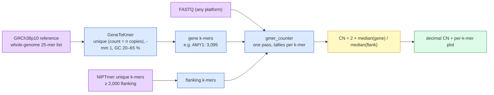

# GeneToCN: an alignment-free method for gene copy number estimation directly from next-generation sequencing reads

## Identity & citation

Fanny-Dhelia Pajuste, Maido Remm (Institute of Molecular and Cell Biology, University of Tartu). *Scientific Reports* 13:17765, 2023. Received 4 May 2023, accepted 10 October 2023. DOI 10.1038/s41598-023-44636-z. Open access (CC BY 4.0); PDF at nature.com/articles/s41598-023-44636-z.pdf. 10 pages, 45 references, 4 supplementary tables and 4 supplementary figures (not in this PDF; not analysed).

*Scientific Reports* is a peer-reviewed, open-access Nature Portfolio mega-journal. Reviewed for technical soundness, not for perceived importance. Not a preprint.

```
APA 7:
Pajuste, F.-D., & Remm, M. (2023). GeneToCN: an alignment-free method for gene copy number estimation
directly from next-generation sequencing reads. Scientific Reports, 13, 17765.
https://doi.org/10.1038/s41598-023-44636-z

BibTeX:
@article{pajuste2023genetocn,
  title   = {{GeneToCN}: an alignment-free method for gene copy number estimation directly from
             next-generation sequencing reads},
  author  = {Pajuste, Fanny-Dhelia and Remm, Maido},
  journal = {Scientific Reports}, volume = {13}, pages = {17765}, year = {2023},
  doi     = {10.1038/s41598-023-44636-z}
}

Vancouver:
Pajuste F-D, Remm M. GeneToCN: an alignment-free method for gene copy number estimation directly from
next-generation sequencing reads. Sci Rep. 2023;13:17765. doi:10.1038/s41598-023-44636-z
```

Metadata came from OpenAlex and Crossref; Semantic Scholar rate-limited (HTTP 429) so influential-citation flags and TLDR are unverified.

## Paper type & how to read it

Bioinformatics **method paper** with a small **resource** component (the published k-mer databases). It owes: a clear method, a fair comparison to the tools a practitioner would use, validation against biological truth rather than only a held-out split, stated reference versions and thresholds, and runnable code. Read it for: does the k-mer ratio track an independent experimental measurement (ddPCR), is the comparison to AMYCNE fair, where does the method break, and can the method be transplanted to a new gene by a non-author. It is not a benchmark paper; the authors' tool "winning" on one gene is not the point.

## One-minute pitch

Some genes exist in more than two copies per person, and the count differs between people. Amylase, the enzyme that digests starch, is the classic case: one person has 2 copies, another 14. Counting copies from short-read sequencing normally means aligning a billion reads to the reference genome and measuring pile-up depth, which is slow and unreliable in exactly the repeated regions where copy number varies. GeneToCN skips alignment. It picks short DNA words (25-letter **k-mers**) that occur only inside the gene of interest, plus a control set of k-mers from a nearby region known to be present in exactly two copies. It counts both sets straight from the raw FASTQ file. Gene copies = 2 × (median gene k-mer count ÷ median control k-mer count). On 39 people with an independent lab measurement (droplet digital PCR), the estimate correlated at R = 0.99. It works on Illumina, PacBio and Nanopore reads. It struggles when two genes are nearly identical (SMN1/SMN2), because almost no k-mer is unique to one of them.

**TL;DR:** Copy number from a ratio of two k-mer medians, no aligner. Matches ddPCR closely for amylase genes and AMYCNE on most genes; beats AMYCNE and CNVnator on FCGR3A from low-coverage data but underestimates FCGR3B. The critical hyperparameter is not k but *how many unique k-mers the target region yields*: 268 k-mers (SMN1) is too few, 3,095 (AMY1) is plenty.

## Domains & keywords

Genomics > structural variation > multiallelic copy number variation (CNV) > alignment-free / k-mer methods > targeted gene copy number estimation. Tasks: amylase (AMY1/2A/2B), FCGR3A/B, SMN1/SMN2, NPY4R, LPA KIV-2 copy number; cross-platform (Illumina, ONT, PacBio) consistency. Tools: GenomeTester4, gmer_counter (FastGT), AMYCNE, CNVnator, ddPCR. OpenAlex topics: not returned (unverified).

## Problem & research questions

Gap claimed: read-depth (RD) and paired-end-mapping (PEM) CNV callers depend on alignment, which is slow and unreliable in repetitive regions, and many need cohorts. Existing alignment-free CNV tool (QuicK-mer2) "has difficulty handling cases where a gene or region has multiple copies in the reference genome". Thesis (Results, p.2): *"a novel alignment-free method GeneToCN for targeted copy number estimation of copy-variable genes"* that works on **single individuals without cohort data**.

Implied research questions:
1. Does a median-ratio of gene k-mers to flanking k-mers recover experimentally measured copy number?
2. Is it at least as accurate as an alignment-based tool tuned for the same locus (AMYCNE)?
3. Does it transfer to other loci, including a multi-copy reference locus (AMY1, KIV-2) and a 5.5 kb sub-gene repeat?
4. Is it platform-independent?

## Background primer

**k-mers as a coordinate-free index.** A k-mer is every substring of length k in a sequence. A genome of 3 Gb has ~3 billion 25-mers, most of them unique. Software analogy: a k-mer is a fixed-width hash key; the reference genome is a dictionary from key to occurrence count. "Unique k-mer" = count 1. GenomeTester4 (Kaplinski 2015, ref 20) is the set-algebra library: build a list, query counts, intersect/subtract lists.

**Depth of coverage as a copy counter.** If a genome is sequenced to 30× depth, a sequence present in 2 copies yields k-mers seen ~30 times; a sequence present in 4 copies yields ~60. So count ÷ (count of a known 2-copy region) × 2 = copy number. Where the analogy breaks: coverage is not uniform. GC-content, sequencing errors and mappability all perturb counts, hence the filters and the use of a *median* over hundreds of k-mers.

**Alignment-free genotyping precedent.** FastGT (Pajuste 2017, ref 22) genotyped known SNVs by counting a reference and an alternate 25-mer per site straight from FASTQ. GeneToCN reuses its counter (`gmer_counter`) and its "20× minimum depth" finding. Same group also did AluMine (ref 24) and KATK (ref 23).

**Prerequisite reading, in order:** (1) Kaplinski 2015 GenomeTester4 (the toolkit); (2) Pajuste 2017 FastGT (the counting idea and depth limits); (3) Eisfeldt 2018 AMYCNE (the alignment-based baseline); (4) Usher 2015 (amylase locus structure and the ddPCR truth data); (5) Shen & Kidd 2020 QuicK-mer2 (the alignment-free competitor).

## Method

**In plain language.** Two bags of DNA words. Bag A: words found only in the target gene (and, if the reference already has 3 copies of the gene, words found in all 3 copies and nowhere else). Bag B: words from a stretch of DNA next door that everyone has exactly two copies of. Stream the raw reads once, tally how often each word appears. Copy number = 2 × median(A tallies) / median(B tallies). Plot every word's tally along the chromosome so a human can see a breakpoint or a bad k-mer cluster.

**Technically.**
- *k-mer selection* (`GeneToKmer.py`): sliding 25-mers over the region from GRCh38p10. For regions with n reference copies, per-copy lists are intersected (keep k-mers present in all copies). `glistquery` against the whole-genome 25-mer list keeps k-mers whose genome count equals the reference copy number n, with `-mm 1` (also excluded if any k-mer at edit distance 1 exists elsewhere) except SMN1/SMN2 where `-mm 0` was needed to keep any k-mers at all. GC filter: a 250 bp window (`--gc_window 250`, default) around the k-mer must have 20–65 % GC.
- *Flanking (reference) k-mers*: not computed per gene in the paper; subsets (≥2,000, split 5′/3′) of the NIPTmer unique-k-mer set (ref 44), further filtered for uniqueness in CHM13. Repo now ships per-chromosome `Ref_kmers_chrN.db.gz` with coordinates (chr1: 538,559 k-mers).
- *Counting and estimate* (`KmerToCN.py`): `gmer_counter -db <kmers> <fastq...>`; `cn = round(median(gene)/median(flank)*2, 2)`; the 5th and 95th percentiles are printed but no confidence interval is produced. Rounding to integer is left to the user.
- *Validation data*: 500 Estonian Biobank (EstBB) genomes, Illumina ~30×, 151 bp; 40 of them with ddPCR (Usher 2015) for AMY genes; 164 1000 Genomes low-coverage samples with an FCGR3 truth set (Qi 2016); CHM13 at 50× Illumina, 120× ONT, 30× PacBio.
- *Compute*: k-mer DB for 36 kb of gene, 105 s CPU, 5 MB RAM. Counting one low-coverage genome, 7,621 s CPU, 32 min wall, 12.6 MB RAM, on a 64-CPU server. Note the 12.6 MB figure: only the selected k-mers are held in memory, so the method is I/O-bound, not memory-bound.


> **Legend** — purple: raw inputs (reference, reads, prior k-mer set); blue: deterministic machinery; yellow: the single arithmetic decision; green: the deliverable.

## Figures & tables check

| Fig/Table | Page | What it shows | Claim it supports | Verdict | Note |
|---|---|---|---|---|---|
| Fig. 1 | 2 | Method overview | — | OK | Schematic only |
| Fig. 2 | 4 | Per-k-mer normalised frequency along AMY1 ± flanks, six individuals CN 2–12 | C1 (k-mer tallies are flat inside gene, step at boundary) | OK | Rotated landscape page; shows spread grows with CN (CN 12 panel visibly noisier). No error bands, but that is the point of showing raw points |
| Fig. 3 | 5 | CN histograms, 500 EstBB, AMY1/2A/2B | C3 (distributions match literature) | Caution | Comparison to "previous studies" is qualitative; no overlay of the published distribution; the 73 % even-CN figure recomputed from histogram not possible (bars unlabeled) |
| Fig. 4A/B | 5 | GeneToCN vs ddPCR and AMYCNE vs ddPCR scatter, 40 samples | C2, C4 | OK | Panel R values: 0.993/0.914/0.915 (GeneToCN) vs 0.992/0.914/0.917 (AMYCNE). The two tools are indistinguishable by R; text's "higher concordance" for AMY1 rests on integer rounding (74 % vs 67 %), i.e. ~3 individuals out of 39. The excluded 8-vs-12 outlier is *not* visible in 4A, consistent with its removal; 4B AMYCNE also reports 12, supporting the exclusion |
| Fig. 5 | 6 | CN histograms NPY4R, SMN1, SMN2, SMN total, KIV-2 | C3 | Caution | Not visually inspected (page 6 not rasterised by scanner selection); text values used |
| Fig. 6 | 7 | Illumina/ONT/PacBio per-k-mer plots, AMY genes, CHM13 | C5 | OK | ONT spread visibly 2–3× Illumina; PacBio tightest. Estimate lines agree. One sample only |
| Table S1 | supp | R and concordance per gene per tool | C2, C4 | unverified | Supplement not in PDF |
| Table S2–S4 | supp | Cross-platform CN, coordinates and k-mer counts, runtime vs AMYCNE | C5, C6 | unverified | Supplement not in PDF |

Recomputation: AMY1 concordance 74 % on 39 samples ≈ 29/39; regression-corrected 85 % ≈ 33/39. AMYCNE 67 % ≈ 26/39. Difference of 3 samples; no significance test reported. The parity test P = 1.253e−14 is stated without the test used.

## Claims vs evidence

| # | Claim | Evidence offered | Where | Strength | Analyst note |
|---|---|---|---|---|---|
| C1 | Gene/flank k-mer median ratio yields copy number for a single individual, no cohort | Fig. 2 plots; whole pipeline | Results p.2, Fig. 2 | strong | Mechanism is transparent and per-k-mer data are shown |
| C2 | GeneToCN CN agrees with ddPCR: R = 0.99 (AMY1), 0.91, 0.92; concordance 74/97/100 % | 39 EstBB samples after excluding 1 | Fig. 4A, Table S1 | moderate | Small n; one outlier removed post hoc (justified by AMYCNE agreement, but still analyst's choice); ddPCR itself imperfect |
| C3 | CN distributions in 500 Estonians match published distributions (AMY, NPY4R, SMN, KIV-2 mean 39.2 vs 39.7) | Histograms; one numeric mean comparison | Fig. 3, Fig. 5 | moderate | Only KIV-2 has a quantitative comparator; others are "consistent with" |
| C4 | Comparable to AMYCNE overall; better integer concordance and parity on AMY1 (74 vs 67 %, 82 vs 67 %) | Same 39 samples | Fig. 4B, Table S1, Discussion | weak | 3-sample difference, no CI; AMYCNE needed code and coordinate modifications by the authors to work, so baseline configuration is author-controlled |
| C5 | Works across Illumina, ONT, PacBio | CHM13, 8 regions | Fig. 6, Table S2 | weak | n = 1 sample; a haploid cell line (CHM13); "similar" not quantified in main text |
| C6 | Higher concordance than AMYCNE/CNVnator on FCGR3A from low coverage (0.74 vs 0.71/0.50) but worse on FCGR3B (0.63 vs 0.85) | 164 1000G samples, Qi 2016 truth set | Results p.3 | moderate | Honest negative result; the FCGR3B failure is diagnosed (systematic underestimation, a subset of low-frequency k-mers) but not fixed |
| C7 | SMN1/SMN2 cannot be separated reliably (268/267 k-mers); sum is reliable (>16,000 k-mers) | 77 % sum-match; Wilcoxon on mismatch group | Results p.6 | moderate | Well-argued limitation; gives the practical floor for k-mer count |
| C8 | Fast and tiny memory: 32 min wall, 12.6 MB for a low-coverage genome | Single measurement | Methods p.8 | weak | One run, hardware stated; no comparison numbers in main text (Table S4 unverified) |

## What works

- **Median ratio is robust at moderate copy number.** R ≥ 0.91 vs ddPCR on all three amylase genes; 97–100 % integer concordance for AMY2A/AMY2B (CN 0–5).
- **Multi-copy reference handling.** Intersecting per-copy k-mer lists (AMY1 ×3, KIV-2 ×6) lets one number be estimated for the whole family; KIV-2 mean 39.2 vs Genome STRiP 39.7 on a different, larger Estonian sample.
- **Low coverage tolerance where k-mers are many.** FCGR3A from 1000G low-coverage data: 0.74 concordance vs 0.71 (AMYCNE) and 0.50 (CNVnator).
- **Platform-agnostic in principle.** ONT's higher per-k-mer noise does not move the median (Fig. 6).
- **Cheap.** Megabytes of RAM; time is dominated by streaming the FASTQ once.

## What doesn't work (or isn't shown)

- **Overestimation above ~8 copies** (AMY1): concordance drops to 74 %; a linear correction (×0.9622) helps but is not shipped because there is no independent test set.
- **FCGR3B systematic underestimation** (93 % of errors are low); cause not resolved.
- **Near-identical paralogs** (SMN1 vs SMN2, 99.9 % identity): too few specific k-mers; individual CN unreliable; SNVs in the sample further depress counts.
- **No uncertainty.** The code prints 5th/95th percentiles but produces no confidence interval, and no rule for when to trust an integer rounding.
- **No dosage-of-coverage experiment.** Minimum depth is discussed, not measured (authors say so).
- **No heterozygous single-exon deletion test.** Every validated locus is a whole-gene or multi-kb repeat with CN ≥ 1 across many samples; the CN 1 vs 2 decision on a small region is never evaluated.
- **No comparison to QuicK-mer2**, the named alignment-free competitor.
- **No held-out gene.** The GC and mismatch thresholds were set on the same loci reported.

## Limitations

**Stated by the authors.**
- Requires approximate knowledge of CNV breakpoints (to define gene and flank); novel breakpoints only visible by eye in plots.
- Minimum depth of coverage unknown; interplay between k-mer count, coverage and accuracy "needs further investigation".
- SMN1/SMN2 separately unreliable.
- Regression correction not implemented for lack of independent data.
- FCGR3B k-mer database "could benefit from additional filtering".
- Flanking regions in repetitive neighbourhoods may need to be megabases long; k-mer search there is slow.

**Not stated (analyst).**
- **Single-ancestry validation.** All 500 quantitative samples are Estonian; FCGR3 from HapMap Asian populations only. k-mers chosen for uniqueness in GRCh38 may be non-unique or absent in other ancestries' haplotypes; a common SNV inside a gene k-mer depresses that k-mer's count in carriers (the SMN mechanism) and would bias CN downward in a population-dependent way.
- **Exclusion of the discordant ddPCR sample was decided after seeing both tools agree**; reporting R with and without it would cost nothing.
- **Baseline fairness.** AMYCNE was modified by the authors (AMY2A coordinates truncated to exon 4), raising its R from 0.54 to 0.92. Good practice, but the same person tuned both tools.
- **Reference build asymmetry.** Gene k-mers unique in GRCh38p10, flanking k-mers filtered against CHM13; the combined uniqueness set is not one reference.
- **Median assumes ≥ 50 % of the gene is at the modal copy number.** A deletion covering less than half the k-mers is invisible in the CN value and only visible in the plot. The AMY2B partial-duplication breakpoint they mention was found by eye.
- **`-mm 1` excludes k-mers with a 1-edit neighbour elsewhere in the reference but does not model sequencing-error k-mers landing on a gene k-mer**; at 25-mers this is small but unquantified.
- **Flanking region = 2 copies is an assumption** the tool cannot check; a flanking CNV silently rescales every gene estimate (GitHub issue #8 shows a user hitting a flank median of 0).
- **CC BY-NC-SA on the k-mer databases** restricts commercial reuse; the paper does not flag this.

## Validity, bias & reproducibility

*Internal validity.* The mechanism is simple enough that the plots are the evidence: Fig. 2 and Fig. 6 show per-k-mer tallies, so a reader can see the step at gene boundaries. The ddPCR comparison is against an external measurement, not a held-out split, so leakage in the ML sense is not a concern. The risk is instead calibration: thresholds (GC 20–65 %, ≥ 2,000 flanking k-mers, `-mm 1`) were tuned on the validation loci.

*External validity.* One ancestry, one sequencing centre for the 500-genome set, one haploid sample for platform claims, and no small-region deletion test. Transfer to a new gene is plausible (NPY4R, KIV-2 worked without gene-specific tuning) but bounded by how many unique k-mers the region yields.

*Reporting.* Reference build and patch (GRCh38p10), k = 25, tool version (GenomeTester4 4.2.16), hardware, and coordinates (Table S3) are stated. Missing: which correlation coefficient (Pearson assumed), the parity test statistic, runtime for 30× data, variance across runs (deterministic method, so acceptable).

*Conflicts.* None declared; public funding. Authors are also the GenomeTester4/FastGT authors, so the dependency stack is in-house.

**Reproducibility score: 3.** Code is public and readable (838 lines of Python, 3 scripts), k-mer databases for the six validated loci ship in the repo, and reference versions are stated. Held back by: the primary 500-genome dataset is restricted (EstBB); no environment file or container (a conda one-liner in the README, versions unpinned); no tests; the C toolkit must be compiled separately; the flanking-k-mer provenance (NIPTmer subset filtered on CHM13) is not fully re-derivable from the repo. Biggest obstacle: **data access**, then the GenomeTester4 build.

## Related work & key citations

- **Foundations**
  - Kaplinski, Lepamets & Remm (2015) — GenomeTester4 — the k-mer list algebra every step uses. Read first.
  - Pajuste et al. (2017) — FastGT — same counting engine applied to SNV genotyping; source of the 20× depth rule.
  - Sauk et al. (2018) — NIPTmer — origin of the flanking unique-k-mer sets.
- **Competitors / baselines**
  - Eisfeldt et al. (2018) — AMYCNE — alignment-based read-depth CN tuned on amylase; the head-to-head baseline.
  - Abyzov et al. (2011) — CNVnator — general RD caller; second baseline on FCGR3.
  - Shen & Kidd (2020) — QuicK-mer2 — alignment-free, paralog-sensitive CN; named but not compared.
  - Handsaker et al. (2015) — Genome STRiP — cohort-based; source of the KIV-2 comparison numbers via Zekavat 2018.
- **Data & tools**
  - Usher et al. (2015) — amylase ddPCR truth data and the AMY1/AMY2A parity observation.
  - Qi et al. (2016) — FCGR3A/B consensus truth set.
  - Nurk et al. (2022) — CHM13 T2T assembly and its multi-platform reads.

Reading order for this project: Kaplinski 2015 → Pajuste 2017 → this paper → Shen & Kidd 2020.

## Impact & follow-ups

Citations: 14 (OpenAlex and Crossref, checked 2026-09-10). Semantic Scholar influential flags unverified (rate-limited). Citing work, from OpenAlex:
- Amylase locus studies use it as a CN caller: Bolognini/Yilmaz et al. (2024, *Science*, "Reconstruction of the human amylase locus"), and "Rapid adaptive increase of amylase gene copy number in Indigenous Andeans" (2025 preprint; 2026 *Nat Commun*).
- Method descendants in the k-mer-from-raw-reads family: Y-mer (2025, *Genome Biology*, Y haplogroups from ultra-low depth), gAIRR-wgs (2025/2026, T-cell receptor allele typing), ntStat (2026, *PLoS Comput Biol*).
- A GCH1 long-read CN paper (2025) cites it as the short-read comparator.
No erratum, retraction or failed reproduction found. No independent benchmark of GeneToCN against QuicK-mer2 found. Impact is modest and concentrated in the amylase community; the *Science* citation is the strongest external endorsement.

## Code & data

**Availability.** Official repo `bioinfo-ut/GeneToCN`, GPL-3.0, Python 3 only, 18 stars, 1 fork, last push 2026-04-15 (148 days before this analysis), not archived. Head commit "Example k-mer db path file". 9 issues total, 3 open; none report a failed reproduction. Issue themes: unclear `-db/-kp` flags (#6), FASTA must contain only the target chromosome (#4), region-file ordering (flank before gene, #8), long GeneToKmer runtimes on megabase flanks (#7), and **exome data not supported** (#5, author: capture bias violates uniform-coverage assumption). Dependency: GenomeTester4 (C, GPL-3.0, separate build). Data: EstBB restricted; 1000G and CHM13 public; k-mer DBs in repo under CC BY-NC-SA (82 MB of `Ref_kmers_chr*.db.gz` plus gene DBs for AMY, FCGR3, KIV-2, NPY4R, SMN).

**Completeness.**

| Item | Status | Evidence |
|---|---|---|
| Dependencies | partial | README names biopython, pandas, matplotlib and GenomeTester4; no versions, no env file, no container |
| "Training" (k-mer DB build) script | yes | `GeneToKmer.py`, `extract_flanking_kmers.py`; README commands |
| Evaluation (CN estimate) script | yes | `KmerToCN.py`; README command |
| Pretrained artefacts | yes | Gene and reference k-mer DBs in `Kmer_db/` |
| Results table | no | README has no numbers; refers to paper |
| Tests | no | none |

The skill's heuristic scored 0.5/5 because it looks for ML-style file names; by hand the repo is closer to 3.5/5.

**Paper-to-code consistency.** Matches: k = 25 (README suggests 25), `-mm 1` default, GC 20–65 default, 2,000 flanking default in `extract_flanking_kmers.py`, `cn = median/median*2` exactly as described. Differences: the 250 bp GC window is in code but not in the paper text; the paper says flanking k-mers were CHM13-filtered NIPTmer subsets, the repo ships a newer coordinate-annotated set (paper acknowledges this). The regression correction is absent from code, as the paper says.

**Dry run.** Skipped. Reason: `gmer_counter`/`glistquery` need a C build of GenomeTester4 and a whole-genome 25-mer list from GRCh38 (hours of compute), and this project already plans its own k-mer counter (see Adaptation plan). The Python scripts were read in full; the estimator function is 35 lines and needs no execution to verify.

## Concept-to-code map

| Concept in the paper | Where it lives in the code | Reading note |
|---|---|---|
| Unique, gene-specific k-mers (count = n copies, `-mm 1`) | `GeneToKmer.py::main` → `glistquery ... -mm 1 -max <n>` | `-max` is the reference copy count; per-copy lists intersected with `glistcompare` first |
| GC filter 20–65 % | `GeneToKmer.py::filter_kmers`, `get_gc_content` | Window is 250 bp around the k-mer, not the k-mer itself |
| Flanking (2-copy) reference k-mers | `extract_flanking_kmers.py`; `Kmer_db/Ref_kmers/Ref_kmers_chr*.db.gz` | takes ≥ n/2 nearest k-mers each side, n = 2000 |
| k-mer counting from FASTQ | `KmerToCN.py::run_counter` / `run_separate_counters` → `gmer_counter -db` | one pass over all FASTQ; `-p` parallel counters |
| CN = 2 × median(gene)/median(flank) | `KmerToCN.py::get_median_and_CN` | `statistics.median`; 5th/95th percentiles computed, printed only |
| Per-k-mer plot (Fig. 2/6) | `KmerToCN.py::draw_plot` | matplotlib; region file `-r` sets x-range |
| DB text format | `Kmer_db/**/*.db` | `chr:pos  n_kmers  kmer` per line, plain text |

## Adaptation plan

Written against this project: one proband, 85 GB WGS (1.07 B reads, 2×149 bp, ~44× mapped, GRCh38 no-alt analysis set), searching for a compound-heterozygous pair in a small target gene set; iteration-2 plan step 3 already specifies "k-mer copy number per coding exon, genome-wide median as denominator, H019 flags an exon at ≤ 0.6".

1. **Keep as-is.** The estimator (median ratio × 2), the k-mer selection rules (unique in reference, `-mm 1` equivalent, GC window filter), the single-pass count over FASTQ, and above all the **per-k-mer plot** as the report artifact. The paper's Fig. 2 is exactly the "exon-CN strip" step 3 promises.
2. **Swap.** (a) Counter: project has its own bait/probe k-mer pass (KMC/Jellyfish or in-house); GenomeTester4 not needed. (b) k: plan uses 31-mers; paper used 25. Keep 31 for consistency with steps 2–3, note that longer k yields *fewer* unique k-mers per exon and more error-dropout. (c) Denominator: paper uses a **local** flanking median, plan uses a **genome-wide** unique-k-mer median. Local is more robust to regional GC/coverage waves; genome-wide is one number for all genes. Recommend computing **both** and reporting the ratio between them as a QC column. (d) Input is WGS, so issue #5's exome caveat does not apply.
3. **What breaks first.** Exon-level resolution. A 150 bp exon yields ≤ 120 31-mers before filtering; the paper shows 268 k-mers (SMN1) is already unreliable and cites 3,095 (AMY1) as comfortable. Expect wide per-exon spread; H019's 0.6 threshold on a raw per-exon median will produce false deletion candidates. Detection: compute the per-exon 5th–95th percentile band (the code already computes these numbers) and calibrate on 1,000 random exons with no known CNV; set the threshold from that null, not from theory. Second break: any target gene with a close paralog (the SMN failure mode) will show systematic under-count; check reference uniqueness fraction per exon before trusting its CN.
4. **Minimum viable experiment.** Two hours, local. Take one whole target gene (≥ 2 kb of unique k-mers), one 20 kb flank on each side, count from the FASTQ once, and confirm CN ≈ 2.0 ± 0.1 with the flat per-k-mer plot. Then repeat for the 1,000-exon null to derive the band. Only then run every target exon. Record the run as a step-3 methodology entry with `## Hypothesis and prediction` written first.
5. **Risks.** Licence: GeneToCN code is GPL-3.0 (fine to *use*, derivative code must stay GPL); k-mer DBs are CC BY-NC-SA and irrelevant here (different genes). Coordinates: every `.db` file in the cloned repo holds GRCh38 positions; the clone lives under `papers/`, which is untracked, and must never be moved into a tracked path (coordinate gate). Scale: a single pass over 85 GB is I/O-bound; batch all probes into one pass. Missing piece: no confidence interval in the method; the project must supply its own (percentile band or bootstrap over k-mers).

**Cross-reference to the clinical dataset.** Nothing in this paper uses phenotype. For this case, an exon-level CN result on a target gene says nothing by itself about the proband's 8 HPO terms; its clinical weight comes only from the gene already being in the MVA target set. Any CN finding must be filed with that statement.

## Glossary

- **Alignment-free** — analysing reads without mapping them to a reference coordinate; here, counting k-mers straight from FASTQ. The whole point of the paper.
- **AMYCNE** — alignment-based read-depth copy-number tool tuned for amylase genes; the baseline.
- **CHM13** — a haploid human cell line fully assembled by the T2T consortium; used here as the one multi-platform sample.
- **Concordance** — fraction of samples whose *integer* CN matches the truth; stricter than correlation.
- **Copy number (CN)** — how many copies of a sequence a genome carries; diploid baseline is 2.
- **CNV (copy number variation)** — a region whose CN differs between people; multiallelic when more than two CN states exist.
- **ddPCR (droplet digital PCR)** — a lab assay that counts DNA molecules in thousands of droplets; the experimental "gold standard" for CN here.
- **Depth of coverage** — average number of reads covering a base; ~30× in EstBB, ~44× in this project.
- **EstBB** — Estonian Biobank, source of the 500 genomes.
- **Flanking region** — DNA adjacent to the gene assumed to be at CN 2; its k-mer median is the denominator.
- **GC content** — fraction of G and C bases in a window; extreme values bias sequencing coverage, hence the 20–65 % filter.
- **gmer_counter / glistquery / glistmaker** — GenomeTester4 tools: count selected k-mers in reads; look up k-mer counts in a list; build a k-mer list from FASTA.
- **k-mer** — every length-k substring of a sequence; k = 25 here, 31 in this project.
- **KIV-2 (Kringle IV type 2)** — a 5.5 kb repeated protein domain in the LPA gene, 12–63 copies; the high-CN test.
- **Median ratio** — the estimator: 2 × median(gene k-mer counts) / median(flank k-mer counts).
- **`-mm 1`** — GenomeTester4 option treating k-mers with one mismatch as matches when checking uniqueness; excludes near-duplicates.
- **NIPTmer** — the group's prenatal-aneuploidy tool; its unique-k-mer sets were reused as flanking references.
- **Paralog** — a gene copy created by duplication (SMN1/SMN2, AMY1/AMY2A); near-identical paralogs starve the method of unique k-mers.
- **Parity** — whether AMY1 and AMY2A CN are both even or both odd; a biological consistency check from Usher 2015.
- **Read depth (RD) / paired-end mapping (PEM)** — the two alignment-based CNV detection families the paper contrasts itself with.
- **SMN1 / SMN2** — survival-motor-neuron genes, 99.9 % identical; SMN1 loss causes spinal muscular atrophy.

## Open questions & extension ideas

Authors' future work: publish k-mer databases for all copy-variable genes; investigate the k-mer-count × depth × accuracy relationship; add filtering to fix FCGR3B.

Analyst's proposals:
1. **Titration experiment.** Downsample one 44× genome to 30/20/10/5× and re-estimate CN for regions with 100, 300, 1,000, 3,000 k-mers. Produces the accuracy surface the paper says is missing. Directly serves this project's exon-level question.
2. **Null band for small regions.** Estimate CN for 1,000 random non-CNV exons in one genome; report the 2.5–97.5 % band as the detection limit. Cheap and turns H019's 0.6 into a measured threshold.
3. **Local vs genome-wide denominator.** Same genome, both denominators, all target genes; the disagreement map shows where regional coverage waves matter.
4. **Ancestry robustness.** Count how many chosen gene k-mers overlap common SNVs (gnomAD AF > 1 %) and mask them; re-estimate. Tests the unstated population-bias limitation.
5. **Head-to-head with QuicK-mer2** on the FCGR3 truth set, the comparison the paper omitted.

Questions for the authors: Which correlation coefficient and which parity test? What was R with the excluded sample kept? Why was `-mm 0` acceptable for SMN but not elsewhere, and does that inflate SMN counts?

## Confidence notes

- **Supplementary tables S1–S4 and figures S1–S4 were not available**; every number attributed to them is quoted from the main text and marked unverified.
- **Fig. 5 not visually inspected** (page not rasterised); text values used.
- **Semantic Scholar failed** (HTTP 429); citation count from OpenAlex/Crossref (14), influential-citation flags absent.
- **No dry run.** Code read, not executed; the concept-to-code map is from reading `KmerToCN.py`, `GeneToKmer.py`, `extract_flanking_kmers.py` (838 lines total) at commit 693d907.
- **Relevance 4** assumes step 3 of iteration 2 (k-mer CN per exon) goes ahead as planned; if CN is dropped, relevance falls to 2.
- Sections to weight highest: Method, Claims table, Adaptation plan (all grounded in the PDF text and the code). Weight lowest: Impact (partial metadata) and Fig. 5 row.
