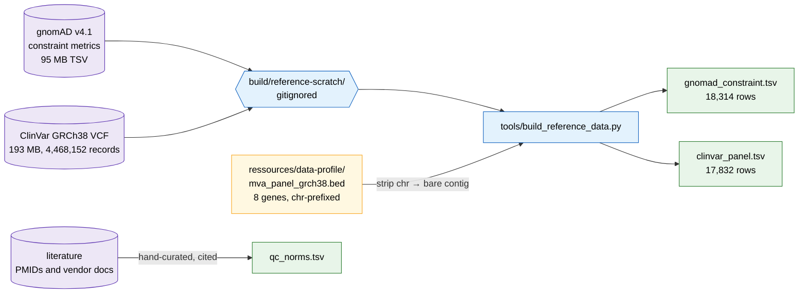

# Population reference — what "normal" looks like

**Standing:** three public reference tables, downloaded and derived 2026-08-31.
Row counts and per-gene breakdowns verified against the files in this directory on the
same date. Method and observed output:
[`docs/step-0/methodology/030-population-reference-data.md`](../../docs/step-0/methodology/030-population-reference-data.md).
`qc_norms.tsv` was extended from 20 to **27 rows on 2026-09-01** and re-verified against
the live derivation on that date:
[`docs/step-0/methodology/047-observed-expected-extension.md`](../../docs/step-0/methodology/047-observed-expected-extension.md).

A patient callset on its own says nothing. Five million variants is neither high nor low
until you know what five million *should* be, and a broken gene copy is not a finding until
you know the gene is one healthy people never break. This directory holds the comparison
set: three small tables of **public, non-patient** data, safe to commit, that turn a raw
count into a judgement.

| File | Answers | Rows | Size |
|---|---|---|---|
| `gnomad_constraint.tsv` | *Do healthy people tolerate damage to this gene?* | 18,314 | 3.2 MB |
| `clinvar_panel.tsv` | *Has a clinical lab already classified this exact variant?* | 17,832 | 2.6 MB |
| `qc_norms.tsv` | *Is this callset's shape normal for a human genome?* | 27 | 14 KB |

Nothing here is patient-derived. The two large upstream files (95 MB and 193 MB) are
downloaded to gitignored scratch and never enter the tree.



> **Legend** — purple = raw public input (never committed); blue = neutral machinery;
> yellow = the decision point where the chr-prefix mismatch is bridged; green = the
> committed output.

## Regeneration

```bash
brew install bcftools                              # clinvar step needs bcftools + tabix
uv run tools/build_reference_data.py gnomad        # ~2 s once the 95 MB TSV is cached
uv run tools/build_reference_data.py clinvar       # ~0.5 s once the 193 MB VCF is cached
```

Both subcommands download into `build/reference-scratch/` (gitignored) and skip the
download when the file is already there. `qc_norms.tsv` is hand-curated from the
literature and has no generator — it is edited by hand and every row carries its source.

---

## `gnomad_constraint.tsv` — gene intolerance to damage

**gnomAD** (Genome Aggregation Database) is an aggregate of 730,947 exomes and 76,215
genomes from people **not** ascertained for a severe paediatric disease. Its *constraint
metrics* compare, per gene, how many damaging variants were **observed** against how many
a mutation model **expected**. A gene where healthy people carry far fewer broken copies
than chance predicts is a gene that cannot be broken without cost — which is exactly the
prior you want when ranking a candidate.

| Field | Source column | Plain meaning |
|---|---|---|
| `pli` | `lof.pLI` | probability the gene is intolerant of **losing one copy** (haploinsufficient). ≥ 0.9 = intolerant. |
| `loeuf` | `lof.oe_ci.upper` | **LOEUF**, the upper bound of the 90% CI on observed/expected loss-of-function. **Lower = more constrained**; < 0.35 is the conventional strict cutoff. This is the metric gnomAD itself recommends over pLI. |
| `oe_lof` | `lof.oe` | the raw observed/expected LoF point estimate. Noisy in small genes — use `loeuf`. |
| `mis_z`, `syn_z` | `mis.z_score`, `syn.z_score` | z-score of missense / synonymous depletion. `syn_z` is the built-in control: synonymous variants are mostly harmless, so a large `syn_z` means the *model* is off for that gene, not that the gene is constrained. |
| `lof_obs`, `lof_exp` | `lof.obs`, `lof.exp` | the two numbers the ratios are built from. |
| `constraint_flags` | `constraint_flags` | gnomAD's own quality caveats (`no_exp_lof`, `outlier_mis`, `no_variants`, …), flattened to a comma-separated string. Non-empty = read the row with suspicion. |

- **Source:** <https://storage.googleapis.com/gcp-public-data--gnomad/release/4.1/constraint/gnomad.v4.1.constraint_metrics.tsv>
- **Release:** gnomAD **v4.1**; upstream object `Last-Modified: 2024-04-18`, 95,546,041 bytes,
  SHA-256 `68d8abdb7fc48f570869b02dfaa74b9fecaece7fcc5f301ddca40ec1ce12da00`
- **Downloaded:** 2026-08-31
- **Subset rule:** Ensembl `canonical == true` **and** `transcript_type == protein_coding`
  — one row per gene. Drops the RefSeq (`NM_`/`XM_`) mirror rows, which carry no
  chromosome or transcript-type, and the 110,556 rows with no `level`.
- **License:** the primary gnomAD data are released under the **Creative Commons Zero
  Public Domain Dedication (CC0)**; the project *requests* (does not require) attribution.
  <https://gnomad.broadinstitute.org/policies>. Attribution as requested: *this repository
  includes data from the gnomAD v4.1 release.*

### Panel genes, as measured

All 8 panel genes are present. Higher `pli` and **lower** `loeuf` mean less tolerated:

| gene | transcript | LoF obs/exp | oe_lof | **LOEUF** | decile | pLI | mis_z | syn_z |
|---|---|---|---|---|---|---|---|---|
| DICER1 | ENST00000343455 | 41 / 193.23 | 0.212 | **0.275** | 0 | 1.000 | 6.151 | 0.607 |
| TP53 | ENST00000269305 | 12 / 43.32 | 0.277 | **0.449** | 1 | 0.998 | 1.154 | 0.958 |
| CENPE | ENST00000265148 | 75 / 201.37 | 0.372 | **0.451** | 1 | 0.9996 | 1.816 | 0.281 |
| TRIP13 | ENST00000166345 | 23 / 55.05 | 0.418 | **0.592** | 2 | 0.192 | 2.671 | 0.123 |
| CEP192 | ENST00000506447 | 92 / 179.22 | 0.513 | **0.610** | 2 | 3.3e-11 | 1.622 | 2.158 |
| BUB1B | ENST00000287598 | 81 / 137.83 | 0.588 | **0.707** | 2 | 2.6e-14 | 1.781 | 0.588 |
| SMC5 | ENST00000361138 | 60 / 103.87 | 0.578 | **0.716** | 2 | 1.7e-10 | 1.652 | 0.455 |
| CEP57 | ENST00000325542 | 34 / 61.14 | 0.556 | **0.740** | 3 | 6.8e-06 | 0.050 | -0.413 |

Read this the right way round. **BUB1B and CEP57 — the two established MVA genes — have
pLI ≈ 0.** That is expected, not disqualifying: MVA is **recessive**, so carriers of one
broken copy are healthy and gnomAD is full of them. pLI measures *dominant* intolerance
and is the wrong instrument for a recessive disease. LOEUF in decile 2–3 still says both
genes are moderately depleted of LoF. The two genes with pLI ≈ 1 (DICER1, TP53) are the
*dominant* cancer-predisposition differentials the panel carries on purpose.

### Genome-wide, as measured

18,314 rows over 18,035 distinct genes. 3,162 of the 18,131 rows with a pLI (17.4%) reach
pLI ≥ 0.9; 1,397 (7.7%) reach LOEUF < 0.35.

---

## `clinvar_panel.tsv` — variants already classified by a lab

**ClinVar** is NCBI's public registry of variants that clinical laboratories have
submitted with a classification. If a candidate variant is already there as
*Pathogenic* with expert-panel review, that is the strongest single piece of evidence
available; if it is there as *Benign* with 30 submitters, the candidate is dead.

- **Source:** <https://ftp.ncbi.nlm.nih.gov/pub/clinvar/vcf_GRCh38/clinvar.vcf.gz> (+ `.tbi`)
- **Release:** VCF header `##fileDate=2026-08-29`, `##reference=GRCh38`, 193,427,450 bytes,
  **4,468,152 records** genome-wide
- **Downloaded:** 2026-08-31
- **Subset rule:** the 8 regions of
  [`ressources/data-profile/mva_panel_grch38.bed`](../data-profile/mva_panel_grch38.bed)
  (each gene ± 20 kb), extracted with `bcftools query -r`
- **License:** ClinVar is a US-government public resource; NCBI asks for attribution when
  data are redistributed and states the data are *not intended for direct diagnostic use
  without review by a genetics professional*.
  <https://www.ncbi.nlm.nih.gov/clinvar/docs/maintenance_use/>. Cite PMID **29165669**.

**17,832 rows.** 16,547 fall in a panel gene; the remaining 1,285 sit in a neighbouring
gene caught by the 20 kb padding (WRAP53 and ATP1B2 beside TP53, MTMR2/BRD9/FAM76B beside
CEP57, SEH1L beside CEP192, BDH2 beside CENPE, DICER1-AS1). They are kept — the padding is
deliberate — but filter on `gene` before quoting a per-gene number.

| gene | rows | **P / LP** | VUS | benign | conflicting | no classification |
|---|---|---|---|---|---|---|
| DICER1 | 7,785 | **860** | 3,872 | 2,707 | 317 | 28 |
| TP53 | 3,908 | **1,147** | 958 | 1,165 | 534 | 99 |
| BUB1B | 2,471 | **84** | 1,486 | 844 | 42 | 11 |
| CEP57 | 972 | **19** | 623 | 305 | 13 | 12 |
| CENPE | 592 | **5** | 302 | 245 | 10 | 30 |
| CEP192 | 418 | **0** | 316 | 42 | 0 | 60 |
| TRIP13 | 242 | **9** | 84 | 136 | 2 | 11 |
| SMC5 | 159 | **5** | 119 | 12 | 0 | 23 |
| *8 panel genes* | *16,547* | ***2,129*** | | | | |
| *flanking genes* | *1,285* | *52* | | | | |

*P / LP* counts `Pathogenic`, `Likely_pathogenic`, `Pathogenic/Likely_pathogenic` and
`Pathogenic|…` combinations. **CEP192 has zero pathogenic entries in ClinVar** — it is a
candidate gene, not an established disease gene, so absence of evidence there is expected
and is not evidence of absence.

Review status (`clnrevstat`, the "star rating"): 373 rows are `reviewed_by_expert_panel`
(3 stars), 5,174 `criteria_provided,_multiple_submitters,_no_conflicts` (2 stars), 10,691
single-submitter (1 star), 257 `no_assertion_criteria_provided` (0 stars).

---

## `qc_norms.tsv` — expected shape of a healthy human genome

**27 rows, 8 columns**, hand-curated 2026-08-31, extended 2026-09-01, no generator. Columns: `metric`,
`expected_low`, `expected_high`, `unit`, `applies_to`, `source`, `url`, `basis`. Every row
carries the PMID/DOI and a paraphrase of the sentence the number came from. **A metric with
no citable range is absent, not guessed.**

`applies_to` is load-bearing: a Ts/Tv measured genome-wide (~2.0) and one measured in
coding regions (~3–4) are different numbers, and comparing a callset against the wrong one
is the classic way to conclude a good genome is broken.

Where a source gives a point estimate rather than a range, `expected_low == expected_high`
and the `basis` column says so — `de_novo_snv_indel_per_genome`, `mean_coverage_wgs`,
`candidate_comp_het_per_wgs_trio`, all three `dbsnp_membership_rate_*` rows, and the two
cohort-scale context rows.

| Source | PMID | Supplies |
|---|---|---|
| Betschart et al. 2024, *Biometrical Journal* | 38988195 | Ts/Tv (genome 2.0–2.1, coding 3–4), het/hom by ancestry, cross-publication dbSNP spread, typical coverage |
| 1000 Genomes Project Consortium 2015, *Nature* | 26432245 | total variant sites and SVs per genome; low-coverage SNV/indel counts |
| Byrska-Bishop et al. 2022, *Cell* | 36055201 | **30× per-sample** SNV and indel counts, the insertion/deletion ratio, the SNV/indel ratio, and two cohort-scale context rows (multi-allelic locus fraction, novel-allele rate vs dbSNP b155) |
| Taliun et al. 2021, *Nature* (TOPMed) | 33568819 | per-genome dbSNP membership, 99.2% — for the whole callset and again for its PASS subset |
| Supernat et al. 2018, *Scientific Reports* | 30552369 | per-genome heterozygote count, and the SNV/indel spread across three callers on one set of reads |
| DePristo et al. 2011, *Nature Genetics* | 21478889 | dbSNP membership of a VQSR-passing SNP call set, 89.89% — the 2011 floor |
| Pedersen et al. 2021, *npj Genomic Medicine* | 34267211 | AF filter thresholds, de-novo count, post-filter candidate yield per trio |
| Whiffin et al. 2017, *Genetics in Medicine* | 28518168 | corroborates the 1% / 0.1% AF convention |

Four rows are **derived arithmetic** over a paper's stated per-sample counts rather than a
quoted range, and their `basis` column says so and shows the division:
`insertion_deletion_ratio`, `indel_per_genome_30x`, `snv_to_indel_ratio` and
`snv_to_indel_ratio_across_callers`.

### Four rows are cited but **deliberately ungradeable**

A metric id is the join key between this table and an observation. Four rows carry an id
that matches **no** observation on purpose, so the comparison they would invite can never
be made by accident:

| row | why it must not be joined |
|---|---|
| `tstv_coding` | coding Ts/Tv is 3–4; a genome-wide callset measured against it looks broken when it is fine |
| `multiallelic_locus_fraction_cohort` | 6.6% is measured across **3,202 samples**; a locus is multi-allelic only when two ALTs are seen across samples called together, so the fraction grows with cohort size and has no one-sample counterpart |
| `dbsnp_novel_allele_rate_cohort_b155` | 5.9% novel is cohort-level and 92.7% of those novel alleles are singletons, so the per-genome rate is far lower and the paper states no per-genome figure |
| `snv_to_indel_ratio_across_callers` | 4.744–6.201 is the spread across three callers on **the same reads** — present so the tight Byrska-Bishop band is never read as a hard threshold |

`structural_variants_per_genome` is a fifth: nothing in a short-variant VCF can be measured
against it.

### The two dbSNP membership rows are the same number, pointed at two populations

`dbsnp_membership_rate_per_genome` and `dbsnp_membership_rate_pass_only` both carry
Taliun's 99.2%. No second number is introduced. TOPMed's *average of 3.78 million variants
in each genome* is a **finished** callset, so 99.2% describes a filtered one; grading an
unfiltered delivery against it is the loose comparison and grading its PASS subset against
it is the tight one. Both rows exist so the distance between the two observations is a
number rather than an argument. `dbsnp_membership_rate_pass_snv` is a *third*, independent
figure — DePristo 2011's 89.89% for a VQSR-passing SNP call set — and is graded against the
PASS **biallelic-SNV** observation because that source counts SNPs only. It is a historical
floor: the 2011 dbSNP is orders of magnitude smaller than build 155+, so 89.89% and 99.2%
do not contradict each other.

### Metrics this warehouse can measure and this table deliberately does **not** norm

Both are computed on every derivation run and emit no row until a citable band exists.
Evidence and the sources checked:
[`docs/step-0/methodology/047-observed-expected-extension.md`](../../docs/step-0/methodology/047-observed-expected-extension.md).

| metric | why no band |
|---|---|
| multi-allelic site fraction (single sample) | cohort-size dependent; no source states a single-sample figure |
| indel length 1–2 bp share | no primary source states it or tabulates it — Montgomery 2013 and Byrska-Bishop 2022 both carry it only as an unlabelled figure |
| X/Y depth ratio for sex confirmation | Webster 2019 (PMID 31289836, DOI 10.1093/gigascience/giz074) found XX/XY separate cleanly *within* a dataset but the depths vary *between* datasets, and concludes a general cross-experiment threshold would be difficult to implement. `somalier` and `seGMM` likewise use cohort-derived gates, not fixed ratios |

**Use the 30× rows, not the phase-3 rows,** when grading this project's callset: 1000G
phase 3 was low-coverage and undercounts. Both are present so the comparison is explicit.

### Two things this table says that contradict the usual shorthand

**1. AF < 1e-3 is the *dominant* threshold, not the recessive one.** Both sources found say
the same thing. Pedersen 2021's methods use **AF < 0.001** for de novo and autosomal
dominant models and **AF < 0.01** for recessive and compound-heterozygous models. Whiffin
2017 names *the lenient values of 1 and 0.1% often invoked as conservative frequency cutoffs
for recessive and dominant diseases respectively*. For an MVA compound-het search the
literature-backed cutoff is therefore **1e-2, not 1e-3** — filtering at 1e-3 is defensible
as a deliberately stricter choice, but it is a choice, and it can drop a real recessive
allele. Both rows are in the table so the decision is explicit.

**2. Deletions outnumber insertions, consistently.** `insertion_deletion_ratio` is
**0.924–0.936**, never 1.0 — derived from Byrska-Bishop 2022 Table 1 per-sample counts and
stable across all five superpopulations. A callset reporting ins/del ≈ 1.0 or above is the
anomaly, not the norm.

Also worth having in view when ranking: after AF/GQ/AB filtering a whole-genome trio yields
a mean of **13.1–18.3 candidate variants**, of which **9.2 are compound heterozygotes**
(Pedersen 2021, 94 trios, DeepVariant and GATK). That is the order of magnitude a correct
compound-het shortlist should land on.

---

## Gotchas for whatever stages this next

1. **Contig naming disagrees across the three sources.** The panel BED is `chr15`, the
   ClinVar VCF (and this repo's patient callset) is `15`, and `gnomad_constraint.chrom` is
   `chr15`. `clinvar_panel.chrom` is **bare** to match the callset. Joining gnomAD to
   either requires stripping the prefix.
2. **gnomAD v4.1 constraint covers autosomes only.** 22 contigs, `chr1`–`chr22`. There is
   **no chrX or chrY row at all** — `DMD`, `F8`, `AR`, `MECP2` are absent from the file
   entirely. A missing constraint row for an X-linked gene must not be rendered as
   "unconstrained".
3. **`NA`, not empty, is gnomAD's null.** 183 rows have `NA` in every LoF column, 275 rows
   have `gene == NA`, 445 have no `loeuf_decile`. Cast with an explicit `NULLIF(col,'NA')`.
4. **Everything is a string until you cast it.** `pli` and `loeuf` are floats,
   `lof_obs`/`cds_length`/`num_coding_exons` are integers, `mane_select`/`canonical` are
   the literals `true`/`false`.
5. **Gene symbol is not a key.** 6 symbols appear on more than one canonical transcript in
   the gnomAD subset. Key on `transcript` (or `ensembl_gene_id`).
6. **ClinVar `alt` is not always a base string.** 3 rows carry `.` (no alternate allele
   asserted). Longest `ref` is 7,027 characters and longest `alt` is 319; one BUB1B
   insertion contains a run of `N`. Size the columns as unbounded text.
7. **ClinVar multi-value fields are pipe-delimited inside one cell.** `condition` regularly
   holds 20+ disease names joined by `|`, and `clnsig` can be `Pathogenic|Affects`. Split
   on `|` if you need one row per condition; do not assume one value.
8. **373 ClinVar rows have an empty `clnsig` and empty `clnrevstat`.** These are records
   whose only classification is *oncogenicity* or *somatic clinical impact* (`ONC*`,
   `SCI*` INFO fields), which this subset does not carry. Empty means "no germline
   classification", not "unclassified".
9. **Both TSVs are quote-free and rectangular** — 26 fields on every `gnomad_constraint`
   line, 10 on every `clinvar_panel` line, zero `"` characters in either file. They load
   with `COPY … FORMAT text` without a CSV parser.
10. **`variation_id` is the ClinVar stable key**, not the rsid. 4,442 rows have no rsid at
    all. Link out with `https://www.ncbi.nlm.nih.gov/clinvar/variation/<variation_id>/`.
