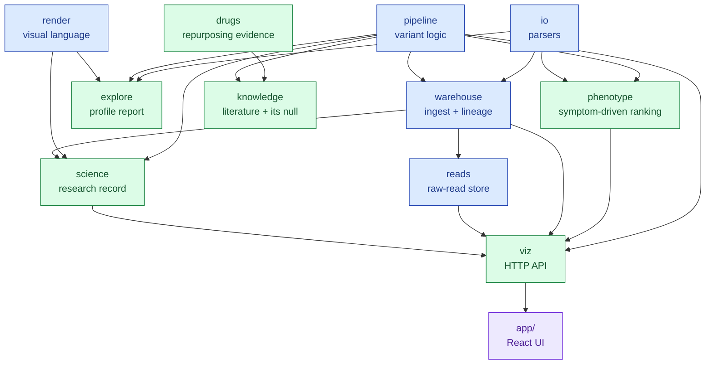

# `src/mva` — package index

**Standing:** 2026-09-06 — verified against source at commit `274624d`; the `drugs` row and
its place in the graph added 2026-09-06; the `knowledge` row added 2026-09-18 with
iteration 2's step 5.

One line per package. Each package's own `README.md` carries the module map, callers,
gotchas and CLI/HTTP surface; this page only says what lives where.

| Package | Holds | Entry point |
|---|---|---|
| [`io/`](io/README.md) | Parsers for the plain-text shapes bioinformatics tools emit — TSV tables, `##`-sectioned files, `bcftools stats`, BED intervals, VCF headers. Missing values become `None`, never exceptions. | library only |
| [`pipeline/`](pipeline/README.md) | The deterministic core: read a VCF (variant call format — one row per difference from the reference genome), build candidate variant pairs, classify phase (which parent each copy came from), rank them, write the submission CSV. Includes a local replica of the official scorer. | library only |
| [`warehouse/`](warehouse/README.md) | Ingest and lineage: delivered files → Parquet → PostgreSQL, plus ~20 named SQL derivations into a `results` schema, and the append-only ledgers (source uploads, lineage edges, integrity fingerprints, oracle probe budget). | `mva-warehouse` |
| [`reads/`](reads/README.md) | Raw sequencer output (FASTQ) turned into sharded Parquet so k-mer and QC questions run in seconds; three swappable conversion engines, plus a scan/triage path. | `mva-reads`, `mva-reads-api` |
| [`phenotype/`](phenotype/README.md) | The child's HPO terms ranked against every gene the Human Phenotype Ontology curates, by a scorer that reads two public text files and never the callset, the panel, or a variant. A human-only reimplementation of Exomiser's hiPHIVE path — no JVM, no 31.5 GB bundle. | `mva-phenotype` |
| [`drugs/`](drugs/README.md) | Track 2's data layer: a coordinate-free **mechanism card** in, and a target set, a candidate-drug table, trial and literature tables out — all from seven public APIs (Open Targets, ChEMBL, DGIdb, Reactome, ClinicalTrials.gov, PubMed, openFDA), disk-cached, each table with a provenance manifest. | `mva-drugs` |
| [`knowledge/`](knowledge/README.md) | What the literature says about a candidate set, and the baselines that decide whether that is worth anything: published alleles per **sample** allele (LitVar 2.0), script-derived case-report anchors (PubTator 3.0), protein domain and structure context (UniProt → InterPro → AlphaFold DB), plus a citation-volume baseline and a matched-decoy null. Case-agnostic. | library only |
| [`science/`](science/README.md) | The research record: append-only hypothesis and evidence registers. Enforces in code that a claim carries a prediction and a refutation condition, that an observation names a source, and that no genomic coordinate reaches an exported file. | `mva-science` |
| [`viz/`](viz/README.md) | FastAPI service putting one HTTP origin in front of PostgreSQL, the Parquet object store and `mva-reads-api`, with a uniform `{data, cached_at, source}` envelope and a self-describing catalog. Serves the React app in [`app/`](../../app). | `mva-viz-api` |
| [`render/`](render/README.md) | The shared visual language — exhibit/section primitives, report shell, and the one palette (`GOOD` green, `BAD` red, `DECISION` yellow, `MACHINE` blue, `RAW` purple, `MUTED` grey). Subject-agnostic. | library only |
| [`explore/`](explore/README.md) | The callset-profile report and its views (overview, quality, karyotype, panel, locus, reads, callset). `figure.py` and `theme.py` here are re-export shims over `render/`. | `mva-explore` |

## How they depend on each other

> **Legend** — blue = neutral machinery (leaf libraries and stores, no cross-package callers above them);
> green = a deliverable surface a human reads or queries; purple = the consumer outside `src/mva`.
> An arrow means "is imported by". `io`, `render` and `pipeline` import no sibling package.
> `drugs` is imported by exactly one sibling — `knowledge` reuses its cached HTTP client and its
> PubMed adapter rather than owning a second one — and imports none itself; its own inputs are a
> JSON card and seven public APIs, and its outputs are files.

## Rules that hold across every package

- No module over 400 lines — split by concern instead of growing a file. See [`CLAUDE.md`](../../CLAUDE.md).
- Python runs through `uv` only: `uv run <entry point>`. Never `pip`, never bare `python`.
- A default path spelled relative (`ressources/reference/...`, `build/...`, `docs/...`) names a
  position in **this repository**, not on one machine. `mva/paths.py` is what makes that true
  from any working directory: `repo_root()`, `resolve()` for one path, and `anchor_cwd()`, which
  the two server entry points call at startup. Without it a server started from a subdirectory
  answers 200 with an empty list for every file-backed endpoint — see
  [`docs/step-0/methodology/125`](../../docs/step-0/methodology/125-the-api-anchors-itself-to-the-repository-root.md).
- Every measured dataset number is owned by [`ideation/data-findings.md`](../../ideation/data-findings.md). These READMEs link to it; they never restate a number.
- No genomic position (a chromosome coordinate) in any exported file — `science` enforces this in code.
- Docs index: [`docs/README.md`](../../docs/README.md). Platform build history: [`docs/step-0/`](../../docs/step-0).
