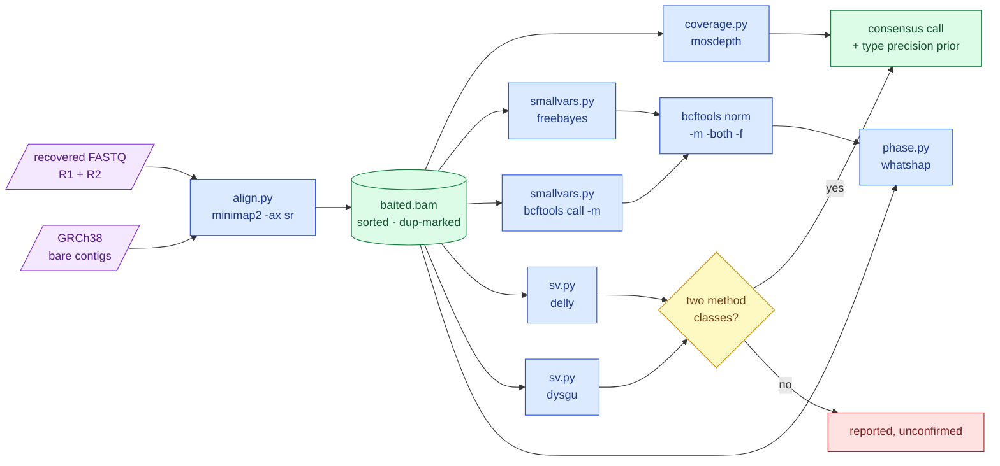

# `mva.calling` — the external tools, behind adapters

**Standing:** 2026-09-12 — written with the package, for iteration 2 step 2.

## What it is

Five stages that turn recovered reads into alleles, each wrapping one published tool as a
subprocess. The package exists because of what those tools are: black boxes we did not
write and cannot fix, whose entire value comes from published benchmarks attached to
**specific versions**. A result whose version was not recorded is a result with no
benchmark behind it — so every invocation goes through `tools.run` and every stage writes
a manifest holding the exact argv, the version string the tool printed about itself, the
wall time, and the sha256 of its inputs and outputs.

| Module | Tool | The question |
|---|---|---|
| `align.py` | minimap2 + samtools | where did each recovered read come from |
| `coverage.py` | mosdepth | how much evidence is there per region |
| `smallvars.py` | freebayes, `bcftools call` | which bases differ — said twice, by two models |
| `sv.py` | delly, dysgu | which larger rearrangements are there, and how far to trust each type |
| `phase.py` | whatshap + a direct fragment count | which copy is each allele on |
| `tools.py` | — | run, time, version, hash, manifest |

A **leaf**: it imports nothing from `mva`, takes no database connection, and returns rows.
Putting rows anywhere is the loader's job, which is what keeps the chain swappable —
replace an adapter, keep the table.

## The chain

> **Legend** — **purple** = raw input; **blue** = an adopted tool behind its adapter;
> **yellow** = the decision the SV consensus turns on (two *method classes*, not two
> names); **green** = an artifact later stages trust; **red** = a call that is reported
> but not trusted.

## Key facts / gotchas

- **The second caller must fail differently, not just be different.** The delivered
  callset came from Sentieon's Haplotyper (a GATK local-reassembly reimplementation).
  freebayes is Bayesian over haplotypes observed directly in the reads with no reassembly;
  `bcftools call -m` is the pileup model with no haplotype notion at all. Three models,
  three failure modes. Where they agree the allele is as certain as one sample allows;
  where they disagree, the disagreement is the finding (H022).
- **Concordance is computed after the calls exist.** It is a check, never a filter — a
  filter would make H022 unfalsifiable by construction.
- **Nothing is filtered in this package.** Rarity, consequence and pair enumeration happen
  later over a table, because a hard filter at calling time cannot be revisited without
  re-calling.
- **Normalise before comparing callers.** Without `bcftools norm -m -both -f`, comparing
  callers compares spellings: one writes an insertion as one record with two alternates
  where another writes two, and the same deletion sits at either end of a homopolymer.
  This is the same normalisation the delivered callset went through.
- **Align to the whole genome, call only in the baited intervals.** A 42 Mb reference
  would force every recovered read to land inside it, including reads recovered because
  they share a k-mer with a paralogue. Given the whole genome those go where they belong
  and are excluded by position — the only way to tell "an extra allele" from "a cousin".
- **`fixmate` before `sort`, always.** `markdup` decides what a duplicate is from mate
  coordinates and template length, and both are only filled in once `fixmate` has seen the
  pair together. Duplicates are **marked, not removed**: they stay inspectable and callers
  skip them by flag.
- **minimap2, not bwa-mem2**, because bwa-mem2's index construction needs tens of GB of
  RAM. `-I 4G` bounds the index batch so peak memory stays near 6 GB. The cost is stated:
  minimap2's short-read mode is less studied at indel-heavy loci, and alignment-derived
  indel calls carry that caveat.
- **SV precision is type-specific and travels with the call.** Kosugi 2019's best observed
  short-read precision on real data: deletions behave, duplications reach 57.1 %,
  inversions 49.1 %, translocations were not evaluated at all. A duplication confirmed by
  two method classes is near-coin-flip evidence and is labelled as such rather than
  promoted to a finding. Those numbers are a **2019 benchmark on GRCh37 with that era's
  tools** — a prior, not our measurement.
- **Bait-edge calls are flagged, not deleted.** A baited alignment has a coverage cliff at
  every padding boundary and unpaired mates where a fragment straddles one: exactly what a
  read-pair caller reads as a deletion. Flagging keeps the artefact countable.
- **Depth is the evidence behind every absence.** A gene with no second allele at 40x is a
  finding; the same gene at 3x is a gap wearing a finding's clothes. Every "nothing here"
  is reported beside the depth of the exons it covers, and beside the per-gene bait density
  from the uniqueness pass — because thin coverage inside a baited region has three
  possible causes and only one of them is biology.
- **A phase claim needs a shared block.** Two alleles in different WhatsHap blocks are not
  unphased by accident: the phaser is saying the reads gave it no path between them.
  `Phasing.same_block` is the precondition, and `FragmentSupport` is the auditable second
  reading — it cannot phase a distant pair at all, but where it speaks a reader can check
  it by hand.

## Tests

`tests/test_calling.py` covers the translation layer, not the tools: the flagstat JSON
keys samtools actually emits, mosdepth's fifth column, phase blocks grouped by `PS`, the
bait-edge window measured from both ends, the type-precision ordering, and that a pipeline
raises naming the stage that failed. Running minimap2 in a unit test would test homebrew.

## Related

- [`mva.reads`](../reads/README.md) — where the recovered reads come from.
- [`mva.kmer`](../kmer/README.md) — the bait, and the per-gene density this package's
  coverage numbers are read against.
- `docs/iteration2/step-2/` — the step that needed this package.
