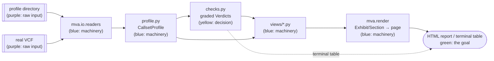

# `mva.explore`

Turns a genomic dataset (all the DNA data for one patient) into one graded, interactive report — no server, no notebook.

**Standing:** 2026-09-01 — written from source at commit `c652265`.

## What it is

- A Python package that loads a **profile directory** (a folder of small summary files — TSV tables, `bcftools stats` output, a BED file of gene intervals — pre-computed by `tools/profile-genomic-data.sh` from the full ~80 GB dataset) into one typed object.
- Grades measured numbers (accuracy, coverage, filter rates, allele balance) against stated expected ranges, each with the reasoning behind the range.
- Renders both into one self-contained HTML page: sidebar, scroll-tracking navigation, keyword filter, every chart interactive (zoom, hover for exact values).
- Ships a CLI (`mva-explore`) so this runs from a terminal with no notebook.

## Why it exists

A raw genomic dataset is tens of gigabytes of compressed text. Answering "is there anything wrong with this data, and where do candidate causal variants (DNA differences from the reference genome) live?" normally means running four or five separate command-line tools by hand, reading their output tables by eye, and remembering which numbers are acceptable — knowledge that lives in an analyst's head and gets re-applied inconsistently every time (`checks.py` docstring).

This package writes that knowledge down as code: one file of graded thresholds (`checks.py`), one file of colour conventions (`theme.py`), and view modules that turn a loaded profile into charts that carry their own explanation. The profile-directory approach also means the ~600 KB of summary artifacts are small enough to commit to git, even though the source data (~80 GB) cannot be.

## Module map

| Module | Responsibility | Key exports |
|---|---|---|
| `profile.py` | Loads a profile directory into one typed object (`ProfileLayout` maps filenames → attributes) | `CallsetProfile`, `ProfileLayout`, `Contig`, `ChromBalance`, `ReadFile`, `PanelGene` |
| `checks.py` | Grades measured numbers against expectation bands, each with a stated basis | `Check`, `Verdict`, `run_checks`, `ts_tv` |
| `figure.py` | Re-export of `mva.render.figure` — kept so `mva.explore.figure` imports still work | `Exhibit`, `Section`, `inline`, `sized` |
| `theme.py` | Re-export of `mva.render.theme` — kept so `mva.explore.theme` imports still work | `GOOD`, `BAD`, `DECISION`, `MACHINE`, `RAW`, `MUTED`, `install_template`, `legend_line` |
| `report.py` | The profile-specific report: which sections it holds, its opening blurb | `build_report`, `write_report`, re-exports `render`/`export_exhibits` from `mva.render` |
| `cli.py` | The `mva-explore` command-line entry point | `main` |
| `__init__.py` | Package-level re-exports; calls `install_template()` at import time | `CallsetProfile`, `build_sections`, `write_report`, … |

### `views/`

Each module turns a `CallsetProfile` (or, for `locus`, a list of parsed VCF calls) into a list of `Exhibit` objects. A view returns nothing when its underlying data is absent — a missing artifact is a gap in the report, never a crash.

| View | Visualizes |
|---|---|
| `overview.py` | Headline number tiles, the graded quality-check table, and file provenance (reference genome, caller, chromosome-naming convention) |
| `reads.py` | Raw sequencing quality: per-lane yield, Q30/GC/duplication/insert-size gauges, what read filtering removed |
| `callset.py` | What the variant caller produced: variant-class mix, substitution spectrum, indel length spectrum, depth distribution |
| `quality.py` | What the caller filtered out and why (filter funnel, per-flag suppression reasons), genotype composition, phasing coverage |
| `karyotype.py` | Per-chromosome allele balance (the direct Mosaic Variegated Aneuploidy signal — a whole chromosome present in extra or missing copies in some cells), per-chromosome depth, variant density |
| `panel.py` | Candidate genes: where they sit on the genome, calls per gene, the resulting variant-pair search space |
| `locus.py` | Live VCF calls for one region: variant track by allele balance, phase groups (which calls sit on which of the two inherited chromosome copies), and the pairwise phase matrix |

`views/__init__.py` holds the `SECTIONS` registry — the order sections appear in the report — and `build_sections`, which runs every view and keeps only the ones that produced output. `locus` is not in `SECTIONS`; it is wired directly into the CLI's `locus` subcommand because it needs a real VCF, not a profile directory.

## CLI surface

Entry point registered in `pyproject.toml`: `mva-explore = "mva.explore.cli:main"`.

| Subcommand | Does | Invocation |
|---|---|---|
| `report` | Builds the full interactive HTML report from a profile directory | `uv run mva-explore report ressources/data-profile -o figures/explore-report.html` |
| `checks` | Prints the graded metrics table to the terminal (no files, no browser) | `uv run mva-explore checks ressources/data-profile` |
| `locus` | Builds the locus browser over a real VCF — the only verb that reads patient records | `uv run mva-explore locus path/to.vcf -o /outside/repo/locus.html -l BUB1B` |
| `export` | Writes every exhibit as its own standalone file (add `--images` for PNGs, needs optional `kaleido`) | `uv run mva-explore export ressources/data-profile -o figures/exhibits` |

`checks --strict` exits non-zero if any check fails, for use in a pipeline gate.

## Outputs

- `report` and `locus` each write **one self-contained HTML file** — everything inlined except Plotly's JS runtime, which loads from a CDN. Opens from the filesystem, no server needed.
- `export` writes **one HTML file per exhibit** under `<output>/<section-slug>/<exhibit-slug>.html`, plus optional `.png` per exhibit if `kaleido` is installed.
- Default destinations point at `figures/`: `figures/explore-report.html` (report) and `figures/exhibits/` (export). `locus` requires an explicit `-o` and its docstring/help text says to write it **outside the repository**, since VCF records are patient data.
- Committed examples in `figures/`: `explore-report.html` (built from the real profile — safe, no patient coordinates), `locus-fixture.html` (built from the synthetic `tests/fixtures/mini.vcf`, not real patient data).

## Relationship to `src/mva/render/`

`mva.render` is the generic, subject-agnostic renderer; `mva.explore` is one of its consumers.

- `mva/explore/figure.py` and `mva/explore/theme.py` are **thin re-export shims**, not distinct implementations. Each docstring says outright: "The real definitions moved to `mva.render.figure`/`mva.render.theme`... This module stays so that `from mva.explore.figure import Exhibit` keeps meaning what it has always meant." They exist only so old import paths keep working.
- `mva/explore/report.py` imports `render`, `export_exhibits`, `SCRIPT`, `STYLE` straight from `mva.render.report` and re-exports them. What it adds itself is `build_report`/`write_report` (wires `build_sections(profile)` into `render`) plus the two blurb strings (`PROFILE_BLURB`, `LOCUS_BLURB`) that open the report — the only genuinely `explore`-specific content in that file.
- `mva.render` knows nothing about callsets, profiles, or genes — it only knows `Exhibit`/`Section` objects and how to assemble them into a page (`mva/render/__init__.py` docstring: "Nothing in here knows what it is drawing"). `mva.science` (the research-record report) is `render`'s other consumer, sharing the same palette and page shell.
- In short: **`render` = generic report engine + palette (source of truth). `explore` = the callset-profile domain logic (loading, grading, views) built on top, plus compatibility re-exports of `render`'s primitives.**

## Where it is used

- CLI entry point: `pyproject.toml` (`mva-explore = "mva.explore.cli:main"`).
- Documented and invoked from the repo root `README.md` (quickstart commands) and `figures/README.md` (regeneration commands for the committed reports).
- Described architecturally in `docs/step-0/exploration.md` (module diagram, section list) — cross-checked here.
- `mva/explore/cli.py`'s `_locus` handler imports `read_calls` from `mva.pipeline`; `views/locus.py` imports `Call`, `Phase`, `candidate_pairs` from `mva.pipeline` — the only place `explore` depends on the pipeline package.
- `profile.py` builds on `mva.io.readers` (TSV/`bcftools stats`/BED/VCF-header parsers), which the docstring notes is shared with the data warehouse.
- Tests: `tests/test_explore_checks.py`, `tests/test_explore_profile.py`, `tests/test_explore_report.py`, `tests/test_explore_views.py`, `tests/test_explore_readers.py`, `tests/test_cli_parsers.py`.

## Key facts / gotchas

- **Plotting library:** Plotly (`plotly.graph_objects`, `plotly.subplots.make_subplots`), rendered to HTML via `Figure.to_html`.
- **Theme:** `theme.py` (via `mva.render.theme`) hard-codes the repository colour convention from `CLAUDE.md` — `GOOD` (green) = good/safe/the goal, `BAD` (red) = broken/dangerous/lost points, `DECISION` (yellow) = a decision point, `MACHINE` (blue) = neutral machinery, `RAW` (purple) = raw input, plus `MUTED` (grey) for "context, not the subject." Semantic names are used at every call site, never raw hex codes, so a palette change is one edit.
- **`install_template()`** registers this palette as Plotly's default template and is called at `mva.explore` import time — every figure in the package inherits it without asking.
- **Every `Exhibit`** (figure.py) bundles a chart with a caption and a `> **Legend**` line by construction — a view cannot emit a chart without its explanation.
- **Data sources:** a profile directory of pre-generated summary artifacts (never the raw ~80 GB dataset directly) for `report`/`checks`/`export`; a real VCF file for `locus` only.
- **Error behaviour:** every loader in `profile.py` skips missing files rather than raising; `CallsetProfile.available` reports which sections actually loaded. Every view function returns an empty list rather than crashing when its data is absent. The CLI's `_load` helper prints a clear error and returns exit code 1 for a missing/empty profile directory.
- **`locus` is the only verb touching patient coordinates** — its output must be written outside the repository (enforced by convention/docs, not by code).

## Flow

> **Legend** — purple: raw input (a profile directory or a VCF); blue: neutral machinery (parsing, grading, view-building, rendering); yellow: a decision point (a graded verdict); green: the goal (the finished report or table).

## Related

- [`src/mva/render/`](../render/) — the generic report engine and palette this package builds on (see relationship above).
- [`src/mva/io/readers.py`](../io/readers.py) — the case-agnostic file-format parsers `profile.py` loads through.
- [`docs/step-0/exploration.md`](../../../docs/step-0/exploration.md) — architecture doc for this toolkit, with its own module diagram.
- [`figures/README.md`](../../../figures/README.md) — what the committed generated reports are and how to regenerate them.
