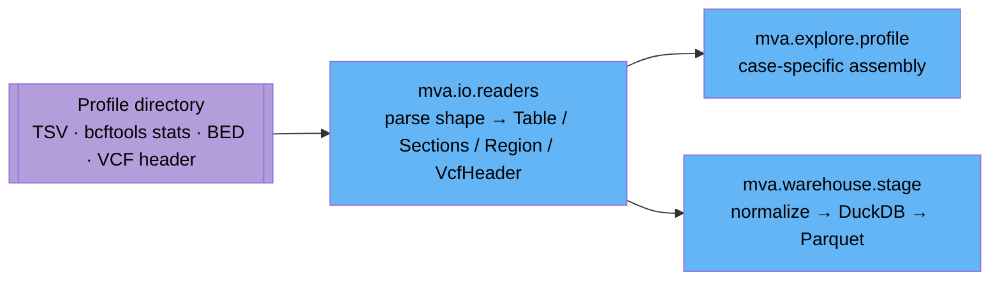

# `mva.io` — plain-text format parsers

Parses the file *shapes* bioinformatics tools emit into typed Python objects. Knows nothing
about this proband, this gene panel, or this hackathon.

**Standing:** 2026-09-01 — written from source at commit c652265.

## What it is

A single module, `readers.py`, with no case-specific logic. It reads:
tab-separated tables with rollup lines glued to the bottom, files cut into `## name`
sections, `bcftools stats` output (a variant-calling QC tool's summary format), BED
intervals (genome coordinate ranges), and VCF headers (the declarative preamble of a
Variant Call Format file — the row-oriented record format that stores one row per genomic
variant). Two conventions apply everywhere: a missing value is `None`, never an exception;
nothing is coerced to a number until a caller asks for one.

## Why it exists

The delivered TSVs are not uniformly rectangular — some have no header, one is cut into
`##` blocks, several glue two-column rollup lines (`est_raw_coverage_x  51.9`) under the
table proper. A generic CSV/TSV reader either throws on these or silently truncates. This
package normalizes that mess once, so both `mva.warehouse` (loads profile files into typed
Parquet tables) and `mva.explore` (builds the interactive HTML report) parse the same files
the same way instead of each re-inventing a TSV reader. Splitting parsing (shape) from
profile assembly (case-specific filename mapping, one layer up in `mva.explore.profile`)
is what lets the toolkit point at a different N-of-1 case by writing a new profile layout,
not a new parser.

## Module map

| Module | Responsibility | Key exports |
|---|---|---|
| `readers.py` | Parse TSV tables, `##`-sectioned files, `bcftools stats`, BED, VCF headers; safe numeric coercion | `Table`, `Sections`, `Region`, `VcfHeader`, `Row`, `read_table`, `read_sections`, `read_bcftools_stats`, `summary_numbers`, `read_bed`, `read_vcf_header`, `as_int`, `as_float` |
| `__init__.py` | Re-exports everything from `readers.py` | same names, importable as `mva.io.<name>` |

## Where it is used

| Caller | What it calls |
|---|---|
| `src/mva/warehouse/stage.py` | `readers.read_bed`, `readers.read_sections`, `readers.read_table` — normalizes each profile source file before handing it to DuckDB's CSV sniffer for typing |
| `src/mva/explore/profile.py` | All readers (`read_bed`, `read_vcf_header`, `read_bcftools_stats`, `summary_numbers`, `read_sections`, `read_table`, `as_int`, `as_float`) — assembles a profile directory into one typed `CallsetProfile` |
| `tests/test_explore_readers.py` | Exercises every reader plus `as_int`/`as_float` against fixture files |

Both callers import as `from ..io import readers` (module-qualified), not the flat
`__init__.py` names — check either file before renaming an export.

## Key facts / gotchas

- **A missing/malformed value is `None`, not an exception.** A truncated pipeline run must
  degrade to a gap in a chart, never a crash mid-report. `as_int`/`as_float` swallow
  `TypeError`/`ValueError` and return `None`.
- **Nothing is coerced on read.** `Table.rows` and `Sections.blocks` hold raw strings;
  callers convert with `as_int`/`as_float` only where a value is actually used numerically,
  because the same column is an integer in one case and a float or sentinel in another.
- **`read_table`** splits three things out of one file: `rows` (full-width records),
  `scalars` (two-cell rollup lines like `est_raw_coverage_x\t51.9`, distinguished by not
  matching the header width), `comments` (`#`-prefixed provenance lines).
- **`read_sections`** distinguishes a block header (`## name`, no tab) from a scalar line
  (`## name<TAB>value`, states one figure and does not open a block).
- **`read_bcftools_stats`** drops the leading multi-file id column (`0` for a single
  callset) and keys the result by the two-letter section code (`SN`, `TSTV`, `ST`, `IDD`,
  `DP`). `summary_numbers` strips `SN`'s `"number of …:"` phrasing down to a bare key.
- **`read_bed`** intervals are half-open, 0-based, per the BED spec; anything past column 4
  is kept verbatim in `Region.extras`.
- **`read_vcf_header`** only reads the `##`-prefixed declaration lines and the `#CHROM`
  column line — it never opens a data record, so it is cheap even on a huge VCF. The
  sample name comes from column index 9 of `#CHROM` if present.
- **File I/O**: `_lines()` reads the whole file into memory
  (`Path.read_text(errors="replace")`), strips trailing `\n`/`\r`, and drops blank lines
  unless `keep_blank=True` (used by `read_vcf_header` since a header line is never blank
  anyway). No streaming — fine for QC/profile-sized text files, not for full VCF bodies.
- Every dataclass here is `frozen=True` — parsed objects are immutable value objects.

## Related

- `src/mva/explore/` — depends on this package; assembles parsed files into a case-specific
  `CallsetProfile` ([`docs/step-0/exploration.md`](../../../docs/step-0/exploration.md)).
- `src/mva/warehouse/` — depends on this package to normalize sources before DuckDB typing
  ([`docs/step-0/data-layers.md`](../../../docs/step-0/data-layers.md)).
- [`docs/step-0/architecture.md`](../../../docs/step-0/architecture.md) — architecture
  invariant: "a malformed or truncated artifact is a gap, never an exception."
- [`docs/step-0/methodology/015-step-1-consolidation.md`](../../../docs/step-0/methodology/015-step-1-consolidation.md) —
  records the move from `explore/readers.py` to `io/readers.py` and why.

## Data flow

> **Legend**: purple = raw input (delivered profile files); blue = neutral machinery
> (parsing and assembly, no domain judgement made here).
