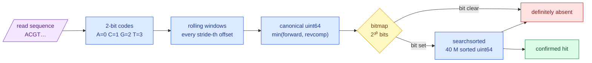

# `mva.kmer` — alignment-free k-mer arithmetic

**Standing:** 2026-09-12 — written with the package, for iteration 2 step 2.

## What it is

A **k-mer** is a substring of length *k* of a DNA sequence; this project uses *k* = 31.
A 31-letter stretch of human DNA is long enough to be unique almost everywhere in the
genome, and short enough to sit inside a 150-letter sequencing read with room on both
sides. That is the whole idea the package rests on: if a read came from a region we care
about, it shares 31-mers with that region's *reference* sequence — and it still does when
the read carries a variant, because one changed letter breaks only the 31 windows that
span it and leaves the rest of the read's ~90 windows intact.

This package does four things and knows nothing else:

| Module | Question it answers |
|---|---|
| `encode.py` | "What is this DNA as integers?" — 2-bit packing, rolling windows, canonical form |
| `fasta.py` | "Give me one contig of the reference at a time" |
| `bait.py` | "Cut these reference intervals into a k-mer set, and tell me how big the job is" |
| `uniqueness.py` | "How many times does each of my k-mers occur in the whole genome?" |
| `membership.py` | "Do these reads share a k-mer with that set?" |
| `count.py` | "How many reads carry each of these k-mers?" |
| `probes.py` | "Spell this allele both ways, in windows that discriminate" |
| `genotype.py` | "Given the two counts, how many copies carry the allele?" |

It is a **leaf**: it imports no other `mva` package, takes no database connection, and
never sees patient sequence — the bait is cut from the public reference.

## Why it exists beside `mva.reads.scan`

`mva.reads.scan` answers *"does this one 31-mer appear anywhere in 1.07 billion reads"*
with a multi-literal string matcher (Polars `contains_any`, Aho-Corasick/Teddy). It was
measured at 20 literals and the HTTP API caps a request at 500; its docstring says the
survivor set is "dozens to thousands of reads", and the code materialises it.

Step 2 asks the opposite-shaped question: **~40 million literals, ~15 million matching
reads**. That is not the same question more slowly — an automaton over 40 M patterns is a
different data structure, and a survivor relation 10⁴ times larger is a different query
plan. So the two coexist: `scan` for a handful of designed probes, `kmer` for a whole
baited region. Step 2's H021 uses the first to validate the second.

## How membership is answered

> **Legend** — **purple** = raw input (a read); **blue** = neutral machinery; **yellow** =
> the decision point (the bitmap prefilter); **green** = a confirmed hit; **red** = a
> rejected k-mer. The bitmap never decides a hit on its own: a set bit only means *maybe*,
> and every candidate is confirmed against the sorted array, so the answer is exact.

## Key facts / gotchas

- **Canonical form, not two searches.** A fragment is sequenced from whichever strand it
  came off. `encode` computes the forward and reverse-complement packing in the same pass
  and keeps the smaller integer, so one stored k-mer covers both spellings. *k* = 31 is
  odd on purpose: an odd-length k-mer can never equal its own reverse complement.
- **`N` is not `A`.** A window containing a base the machine could not call has no k-mer.
  Every function returns a validity mask beside its values; nothing silently encodes `N`.
- **Stride is the affordability knob.** A 150 bp read holds 120 31-mers. Testing every
  16th costs ~15× less and still catches any read overlapping the bait by ≥ 46 bases. The
  loss is at the edges of the baited region, and step 2 *measures* it (H021) rather than
  assuming it.
- **The bitmap is a prefilter, never an answer.** ~4 % of its 2³⁰ bits are set at 40 M
  k-mers, so ~96 % of misses are rejected with one memory access instead of ~25. Turning
  it off (`bits=None`) changes the runtime and not one bit of the result — there is a test
  that asserts exactly that.
- **Membership is not count, and the difference is a stride.** `hits()` samples every
  16th window and is still exact, because a read overlapping the bait by ≥ 46 bases hits
  *some* sampled window. `count.tally()` has no stride at all: a probe occurring once in a
  read is seen by exactly one window, and sampling would miss it fifteen times in sixteen.
  Selecting reads and counting them are different questions on the same bytes.
- **A read pair is one molecule.** `count.hits_per_read()` returns which read carried which
  probe so a caller can collapse R1 and R2 of a fragment before counting; at a ~266 bp
  fragment against 2 × 150 bp of read the two overlap, and a probe in the overlap is one
  observation of one piece of DNA, not two.
- **Uniqueness reverses the usual direction.** KMC and Jellyfish build a table of *every*
  k-mer in the genome. We only need the occurrence count of the 40 M we already hold, so
  the reference streams past the bait instead of into a new table. That is why this stage
  needs no Linux-only counter and runs on a laptop.
- **`unseen > 0` is a hard failure.** Every bait k-mer was cut from the same reference the
  uniqueness pass reads, so a k-mer the pass never finds means the two disagree — wrong
  build, wrong contig naming, or a truncated download.
- **Contig names are normalised once, at read time.** `fasta.rename` maps `chr1` → `1` and
  `chrM` → `MT`, matching the delivered callset and `ressources/reference/coding_regions.tsv`.
  No coordinate in this project ever crosses a naming boundary later.

## Related

- [`mva.reads`](../reads/README.md) — the read store this bait is applied to.
- `docs/iteration2/step-2/` — the step that needed this package, and its methodology log.
