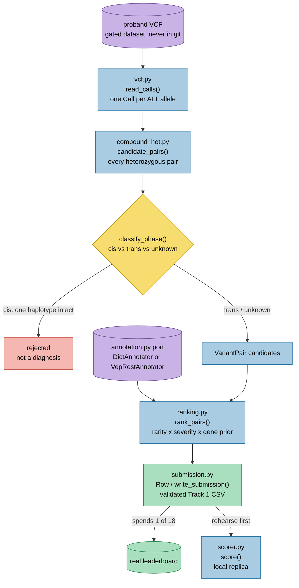

# `mva.pipeline`

Turns a proband VCF (variant call format — a row-oriented text record of every place the
sample differs from the reference genome) into a scored, submittable Track 1 CSV: which
two variants form the causal compound heterozygote (two different broken copies of one
gene, one inherited from each parent).

**Standing:** 2026-09-01 — written from source at commit `c652265`.

## What it is

- The deterministic core of the hackathon solution: VCF in, ranked variant pairs out,
  validated CSV out.
- Nine modules, one bounded concern each (`variant`, `vcf`, `compound_het`, `annotation`,
  `annotate_vep`, `vep_response`, `ranking`, `scorer`, `submission`), re-exported through
  `__init__.py` as one flat API.
- No bioinformatics binding (no pysam, no VEP install required for the core path) — a
  hand-rolled VCF reader over four FORMAT fields, so the package installs anywhere,
  including a bare container.
- Carries its own local replica of the challenge's grading function (`scorer.py`), so a
  candidate submission can be graded before one of the eighteen real submissions is spent.

## Why it exists

The challenge gives one proband, ~5 million variants, and an answer key of exactly two of
them in one gene, one on each haplotype (chromosome copy). Ranking single variants is the
wrong unit — the ranked object has to be a **pair**, and a pair only counts if the two
variants sit on opposite haplotypes (phase — see `docs/dictionary.md`). This package is
the pipeline that gets from raw genotype calls to that ranked, validated pair list, plus
the local scorer that lets a rank be rehearsed before it is spent on the real leaderboard.

## Module map

| Module | Responsibility | Key exports |
|---|---|---|
| `__init__.py` | Package facade — flat re-export of the "quick path" API | (re-exports below) |
| `variant.py` | Variant identity in the scorer's exact comparison form; owns the bare-contig ↔ `chr`-prefixed bridge | `Variant`, `to_submission_contig`, `to_vcf_contig` |
| `vcf.py` | Plain-text VCF reader → one `Call` per ALT allele | `Call`, `read_calls`, `iter_calls` |
| `compound_het.py` | Pairs heterozygous calls in one gene, classifies phase | `Phase`, `VariantPair`, `candidate_pairs`, `classify_phase` |
| `annotation.py` | The functional-annotation port (protocol) + a dict-backed fake | `Annotation`, `Annotator`, `DictAnnotator`, `LOSS_OF_FUNCTION`, `MISSENSE`, `UNKNOWN` |
| `annotate_vep.py` | `Annotator` backed by Ensembl VEP REST, with retry/backoff | `VepRestAnnotator`, `VepError`, `DEFAULT_BASE_URL`, `MAX_BATCH`, `batches` |
| `vep_response.py` | Pure parse of one VEP REST JSON reply into ranking-ready fields | `VepRecord`, `parse`, `query_line`, `vep_allele` |
| `ranking.py` | Scores and orders candidate pairs: rarity × severity × gene prior | `RARE_AF`, `PairEvidence`, `RankedPair`, `rank_pairs` |
| `scorer.py` | Local replica of the challenge's Track 1 grading function | `RankedRow`, `ScoreResult`, `rank_rows`, `score` |
| `submission.py` | Track 1 CSV: row shape, every scorer-enforced rule, read/write | `Row`, `HEADER`, `MAX_ROWS`, `PROBAND_ID`, `FINDING_TYPES`, `validate`, `problems`, `write_submission`, `read_submission` |

## Pipeline flow

> **Legend:** purple = raw input / external data source · blue = neutral machinery ·
> yellow = decision point · red = broken / rejected · green = the goal (submittable CSV,
> real leaderboard). `variant.py` is not drawn as a stage — every module above speaks its
> `Variant` type, and it is the sole owner of the chromosome-name bridge cutting across
> all of them.

## Where it is used

- `src/mva/warehouse/annotate.py` — builds a `VepRestAnnotator`, uses `to_vcf_contig`,
  `Variant`, `VepRecord` to populate the warehouse's annotation table.
- `src/mva/warehouse/analysis_pairs.py`, `analysis_suppressed.py`, `analysis_funnel.py` —
  cite `iter_calls`, `classify_phase`, `variant.py` as the source of truth their SQL
  reproduces.
- `src/mva/viz/probebuild.py` — imports `pipeline.scorer` and `pipeline.submission`
  directly to build and grade a probe submission from the viz UI; declares itself as
  owning no format/scoring rules of its own.
- `src/mva/viz/phase.py` — imports `Call`, `Phase`, `classify_phase`, `Variant` to re-run
  phasing over warehouse rows for the phase-map view.
- `src/mva/viz/queries.py`, `search.py`, `search_resolve.py`, `genestructure.py` — import
  `to_vcf_contig` / `Variant` / `query_line` for contig conversion and VEP query lines.
- `src/mva/explore/views/locus.py` — imports `Call`, `Phase`, `candidate_pairs` to answer
  locus questions without loading a BAM (binary alignment file — the read-level evidence
  a VCF is summarized from).
- `src/mva/explore/cli.py` — imports `read_calls` for ad-hoc pipeline debugging.
- `src/mva/science/dossier.py` — imports `RankedPair`, `Row` to turn ranking output and
  submission rows into evidence-register entries.
- `tests/test_*.py` (one file per module, plus `test_pipeline_end_to_end.py`) — the seam
  guarantees in `docs/step-0/architecture.md` are each pinned to one test module.
- No `pyproject.toml` console script targets this package directly; it is a library
  consumed by `mva-explore`, `mva-warehouse`, `mva-science`, and the viz app.

## Key facts / gotchas

- **One call per ALT allele.** A `1/2` genotype record is split into two `Call`s in
  `vcf.py` — the scorer has no notion of a comma-separated ALT, and biologically a `1/2`
  site *is* a compound heterozygote.
- **`vcf.py` filters and rewrites nothing.** Non-PASS records and raw alleles pass through
  untouched; filtering and normalization are ranking-stage decisions, not reader-stage ones.
- **Phase logic (`compound_het.py`):** same `PID` (phase set) + same `PGT` (phased
  genotype) → cis, rejected. Same `PID` + opposite `PGT` → trans, confirmed. Two ALTs of
  one `1/2` record → trans by construction. Anything else → unknown, and unknown pairs
  stay live candidates (no parental samples to resolve them). Physical phasing only spans
  ~300 bp (from a 266 bp insert size), so unknown is the common case across a whole gene.
- **The chr-prefix bridge is single-owner.** `variant.py`'s `Variant.from_vcf()` /
  `to_submission_contig()` is the *only* place in `src/` allowed to build a chromosome
  string; the scorer compares `(chrom.strip(), int(pos), ref.upper(), alt.upper())`
  verbatim with no normalization, so a stray `f"chr{chrom}"` elsewhere is a silent
  zero-score bug. See `docs/step-0/notes/chr-prefix-bridge.md`.
- **Ranking thresholds (`ranking.py`):** `RARE_AF = 1e-3` — at/above this gnomAD allele
  frequency a variant is suppressed to a rarity weight of 0.05, not excluded; an unknown
  frequency (absent from gnomAD) scores 0.5 rather than 0 or 1, since "absent" and "never
  looked up" are indistinguishable. Severity: loss-of-function = 1.0, other
  protein-altering (missense etc.) = 0.6, some consequence but neither = 0.1, no
  consequence at all = 0.0. A pair is only scored if both annotated genes match; the score
  is `(variant_a_score + variant_b_score) * gene_prior[gene]` (default prior 1.0).
- **`annotation.py` is a Protocol port,** not a concrete dependency — `DictAnnotator` is
  the test fake/cache; `VepRestAnnotator` (`annotate_vep.py`) is the live Ensembl REST
  backend. Both must return `UNKNOWN` rather than raise on an unseen/failed variant.
- **VEP REST specifics:** default endpoint `https://rest.ensembl.org` (GRCh38, confirmed
  live via `/info/assembly/homo_sapiens`); batches capped at `MAX_BATCH = 200` alleles per
  POST; 429 responses honour the server's `Retry-After` header, 5xx/timeouts back off
  exponentially, both bounded by `max_attempts`; frequency preference is gnomAD genomes
  before exomes (`FREQUENCY_SOURCES`); grpmax (highest frequency in any one ancestry
  group) excludes `ami`, `asj`, `fin`, `mid`, and `remaining` — matching gnomAD's own
  definition (`GRPMAX_GROUPS`).
- **`submission.py` enforces every scorer rule before a file is written:** exactly
  `PROBAND01` (case-sensitive, stripped), at most `MAX_ROWS = 10` rows, `epcr` in the
  half-open interval (0, 1], `finding_type` in `("primary", "secondary")`, and all `epcr`
  values distinct (equal values make the rank an oracle probe reports ambiguous). A pair
  must go in one row via the `*_2` columns — split across two rows it only ever scores
  partial credit.
- **`scorer.py` is a transcription of the published grading code**, not an approximation:
  full-match rank points use whatever rank the full match sits at even if a partial match
  ranked higher; f-max sweeps `epcr` thresholds and keeps the *first* (highest) threshold
  that strictly improves the F1 score, which is why a single-variant probe cannot
  distinguish "second allele ranked low" from "second allele absent."
- **Performance/caching:** `VepRestAnnotator` caches per-`Variant` results in-process only
  (`self._cache`, no disk persistence); `DictAnnotator` is an in-memory lookup table with
  no I/O. No caching in `vcf.py` — every call re-reads the file from disk.
- Dataset-scale numbers (variant counts, panel size, etc.) are not restated here — see
  `ideation/data-findings.md`.

## Related

- `src/mva/warehouse/` — depends on this package for VCF reading, phasing, contig
  conversion, and VEP annotation; builds the Postgres/Parquet layer on top.
- `src/mva/viz/` — depends on this package for scoring, submission rules, and contig
  conversion in the interactive probe-builder and phase/search views.
- `src/mva/explore/` — depends on `Call`/`Phase`/`candidate_pairs`/`read_calls` for
  locus-level exploration views.
- `src/mva/science/` — depends on `RankedPair`/`Row` to populate the hypothesis/evidence
  register (`docs/method.md`).
- Docs: [`docs/step-0/architecture.md`](../../../docs/step-0/architecture.md) (the map
  this README specializes), [`docs/decisions.md`](../../../docs/decisions.md) (why each
  seam is shaped this way), [`docs/step-0/notes/chr-prefix-bridge.md`](../../../docs/step-0/notes/chr-prefix-bridge.md),
  [`docs/notes/annotation-as-a-port.md`](../../../docs/notes/annotation-as-a-port.md),
  [`docs/notes/local-scorer-replica.md`](../../../docs/notes/local-scorer-replica.md),
  [`docs/notes/ranking-pairs-not-variants.md`](../../../docs/notes/ranking-pairs-not-variants.md),
  [`docs/notes/hand-rolled-vcf-reader.md`](../../../docs/notes/hand-rolled-vcf-reader.md),
  [`docs/dictionary.md`](../../../docs/dictionary.md) (compound heterozygote, phase, VCF, etc.).
