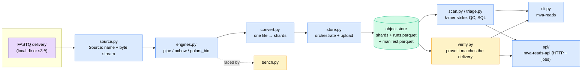

# `mva.reads` — the queryable read store

Converts the delivered raw sequencer output (FASTQ) into sharded, queryable Parquet, and
answers questions of it — from a shell, a library call, or HTTP.

**Standing:** 2026-09-01 — written from source at commit `c652265`.

## What it is

**FASTQ** is the raw file format a DNA sequencer emits: one record per fragment read, each
four lines — a name, the DNA letters, a separator, and a per-letter confidence score
(Phred quality). It has no index and no columns, so any question means decompressing and
scanning the whole thing. This package converts it once into **Parquet** — a column-oriented
table format (each field stored together across rows, so a query touching 3 of 7 columns
reads only those 3) — sharded and partitioned so later questions cost seconds, not a full
decompression pass. See [`docs/step-0/reads-storage.md`](../../../docs/step-0/reads-storage.md)
for the built store's numbers.

## Why it exists

The delivery is ~79 GiB of gzip-compressed FASTQ across 8 files (4 lanes x 2 mates). Every
raw-read question this project asks — "does this candidate variant's sequence actually
appear in the reads", "is one sequencer lane worse than the others", "how deep is
coverage" — otherwise means decompressing and scanning that whole set from scratch, every
time. `mva.reads` converts it once into a self-describing Parquet store in the object store,
then answers those questions as column-pruned SQL over it: minutes for a full k-mer sweep
of 1.07 billion reads, instant for shard/partition metadata.

## Architecture

> **Legend** — purple: raw input (the delivery). Blue: neutral machinery (conversion,
> orchestration, query). Yellow: decision points (`bench.py` picks the fastest engine,
> `verify.py` passes/fails the store). Green: the goal — the published, queryable store.

## Module map

| Module | Responsibility | Key exports |
|---|---|---|
| `schema.py` | Row shape, shard/partition layout, name↔columns codec | `COLUMNS`, `PROJECTION`, `ROW_GROUP_SIZE`, `ROW_GROUPS_PER_FILE`, `shard_key`, `lane_and_read`, `RunFacts` |
| `source.py` | Where FASTQ bytes come from (local dir or `s3://`), as one byte-stream abstraction | `Source`, `resolve`, `presigned_url`, `NotADeliveryError` |
| `engines.py` | Three interchangeable FASTQ→DuckDB-view readers | `pipe`, `oxbow`, `polars_bio`, `ENGINES`, `available`, `find_decompressor` |
| `convert.py` | One FASTQ → one partition of Parquet shards | `convert_file`, `peek`, `as_source`, `Converted` |
| `store.py` | Convert every file in parallel, size the machine, publish to the object store | `discover`, `convert_all`, `machine_share`, `check_room`, `write_tables`, `upload` |
| `verify.py` | Prove the store matches the delivery (3 independent checks) | `run`, `against_manifest`, `pair_symmetry`, `round_trip`, `Report` |
| `scan.py` | Query the built store: k-mer strike, per-lane QC, raw SQL | `kmer`, `kmers`, `counts`, `qc`, `sql`, `reverse_complement`, `Hit` |
| `bait.py` | The opposite-shaped query: which reads came from a whole baited region | `manifest`, `Shard`, `Funnel`, `code_matrix`, `sweep`, `sweep_shard`, `pair_keys` |
| `recover.py` | Survivors back to paired FASTQ, including the mates the sweep missed | `orphans`, `collect_mates`, `runs`, `write_fastq`, `to_fastq`, `Recovered` |
| `baitjob.py` | One bait pass end to end, runnable either side of the object-store link | `run_bait`, `fetch_bait`, `publish`, `load_bait`, `write_report`, `BaitResult` |
| `cli_bait.py` | The `mva-reads bait` verb (its own module; `cli.py` was at the size ceiling) | `do_bait`, `register` |
| `triage.py` | Turn a probe count into a verdict word | `verdict`, `EXPECTED_HINT` |
| `bench.py` | Race the engines on a shared sample; catch buffering vs. streaming | `race`, `winner`, `streams`, `cut_sample`, `Timing` |
| `access.py` | Resolve store root + open a DuckDB connection (shared by CLI and API) | `s3_root`, `resolve_root`, `connection` |
| `cli.py` | `mva-reads` command-line entry point | `main` |
| `__init__.py` | Package docstring / map only | — |

### `api/`

| Module | Responsibility | Key exports |
|---|---|---|
| `app.py` | FastAPI app: routes, auth, request→job wiring | `create_app`, `require_token` |
| `jobs.py` | Async job registry: submit, poll, cancel, restart-safe history | `Manager`, `Job`, `TERMINAL` |
| `models.py` | Pydantic request/response schemas, validated at the edge | `ProbeRequest`, `ScanRequest`, `SqlRequest`, `VerifyRequest`, `BenchRequest`, `ConvertRequest`, `JobOut` |
| `runners.py` | What each verb actually runs inside a job's worker thread | `scan_runner`, `count_runner`, `qc_runner`, `sql_runner`, `status_runner`, `verify_runner`, `bench_runner`, `convert_runner` |
| `serve.py` | `mva-reads-api` uvicorn entry point | `main` |

## CLI surface

`mva-reads <verb>` (entry point in `pyproject.toml`):

| Verb | Does |
|---|---|
| `bench` | Race the conversion engines on a sample; `--scale` checks memory stays flat as input grows |
| `convert` | Convert every FASTQ to sharded Parquet and upload to the object store |
| `verify` | Prove the store matches the delivery (manifest, pair symmetry, round-trip) |
| `bait` | recover every read that came from a baited region — the step-2 pass |
| `scan` | k-mer strike: find probe subsequences on either strand, one pass, list hits |
| `count` | Same strike, but counts per probe with a verdict instead of listing reads |
| `qc` | Per-lane read counts, filter rate, quality profile |
| `sql` | Arbitrary read-only SQL with the store bound as the `reads` view |
| `status` | What the object store currently holds (shards/reads/GiB per partition) |

## HTTP surface

`mva-reads-api` (FastAPI app in `api/app.py`, served by `api/serve.py`). Every route but
`/health` requires an `X-API-Key` header matching `MVA_API_TOKEN`.

| Method + path | Does |
|---|---|
| `GET /health` | Liveness only, no store access, no auth |
| `GET /store/status` | Shards/reads/GiB per partition — job |
| `GET /store/qc` | Per-lane QC — job (full scan, minutes) |
| `POST /bait` | recover every read from a baited region of tens of millions of k-mers — job |
| `POST /scan` | k-mer strike, up to 500 probes in one pass — job |
| `POST /count` | Per-probe counts + verdict — job |
| `POST /sql` | Read-only SQL over the `reads` view — job |
| `POST /verify` | Prove the store matches the delivery — job |
| `POST /bench` | Race the engines on a sample — job |
| `POST /convert` | Rebuild the whole store; 409 if one is already running — job |
| `GET /jobs` | List all known jobs (filterable by state/verb) |
| `GET /jobs/{id}` | One job's state/result |
| `GET /jobs/{id}/wait` | Long-poll (capped at 290s) until terminal |
| `POST /jobs/{id}/cancel` | Interrupt the underlying DuckDB query |
| `DELETE /jobs/{id}` | Forget a finished job |
| `GET /docs`, `/redoc`, `/openapi.json` | Auto-generated interactive docs |

## Where it is used

- `src/mva/viz/readstore.py` — reads `access`, `schema` directly; runs column-pruned
  aggregate queries (`runs`, `partitions`, `flowcell`, `cycle_quality`, `quality_levels`)
  straight against the object store for the viz app's dashboards.
- `src/mva/viz/routes_reads.py` — exposes `readstore.py`'s aggregates as `/api/reads/*`,
  and proxies the expensive, job-shaped verbs (`/api/probe/*`, `/api/jobs/*`) to a running
  `mva-reads-api` process (via `src/mva/viz/proxy.py`), answering `503` if it is down.
- `tests/test_reads_store.py` — unit/integration tests over `bench`, `engines`, `scan`,
  `schema`, `store`, `source`, `convert`.
- `tests/test_reads_api.py` — tests over `api.runners`, `api.app.create_app`, `api.jobs`,
  `scan.Hit`.
- `pyproject.toml` — registers the `mva-reads` and `mva-reads-api` console entry points.

Note: `src/mva/explore/views/reads.py` renders FASTQC/fastp-style read-quality gauges from
a `CallsetProfile`'s precomputed metrics — it does not import this package.

## Key facts / gotchas

- **Three conversion engines, one contract.** Each turns a `.fastq.gz` into a DuckDB view
  with exactly `header`/`sequence`/`quality`; everything downstream is engine-agnostic.
  - `pipe` — no dependency beyond a system gzip decompressor (`igzip` > `pigz` > `gzip`,
    whichever is installed) piped through `paste`. Always available; the floor.
  - `oxbow` — Rust (`noodles`) reader as a PyArrow dataset; DuckDB scans it in bounded
    batches. Optional (`import oxbow`); missing wheel = reported unavailable, not a crash.
  - `polars_bio` — Rust/DataFusion reader as a Polars LazyFrame. Optional, and **path-only**
    (cannot take a remote stream — see `engines.polars_bio`).
- **Sources: local dir or `s3://`.** `source.resolve` reads either; MinIO's own storage
  directory (`~/mva-objects/<bucket>/...`) is *not* a folder of files — every object is a
  directory of parts — and is detected and refused with a pointer to `--source s3` instead
  of failing deep inside a parser.
- **No index required, but streaming has limits.** A local path works with every engine
  (fastest). A remote object streams via a presigned URL (`oxbow`, needs seek/range
  requests) or a raw non-seekable stream (`pipe` only). `polars_bio` needs a real local file.
- **Row group size is a memory budget, not just layout** (`schema.ROW_GROUP_SIZE` =
  200,000 rows): DuckDB's Parquet writer holds a full row group per thread in memory before
  flushing.
- **Shards roll over every 20 row groups** (~4M reads, ~250 MB) — `schema.
  ROW_GROUPS_PER_FILE`.
- **The read name is not stored.** Per-file constants (instrument, run, flowcell, lane,
  read number, control) go to an 8-row `runs` dimension table; only what varies per read
  (flowcell coordinates, filter flag, barcode, sequence, quality) is stored per row. The
  name is reconstructed on demand (`schema.RunFacts.rebuild_name`).
- **The store is self-describing.** Two small companion tables, `runs.parquet` and
  `manifest.parquet`, sit beside the shards; verification and viz aggregates read the
  manifest, never a build process's memory.
- **Verification is 3 independent checks**, each against a different witness: manifest
  row counts vs. Parquet footers, R1/R2 pair symmetry per lane, and byte-identical
  round-trip of the first/last record of each source file (the last record requires a
  full decompression — that cost is the proof).
- **Two k-mer verbs, two different questions.** `scan`/`count` ask *"is this designed
  31-mer present"* for up to 500 probes and expect dozens of survivors; `bait` asks
  *"which reads came from these 42 Mb of reference"* for ~40 million k-mers and expects
  ~15 million survivors. They are not the same query at different sizes: the first is a
  multi-literal string matcher over a text column, the second is a sorted-`uint64` lookup
  (:mod:`mva.kmer`) over the sequence column reshaped out of its Arrow buffer. Step 2 uses
  the first to validate the second (H021).
- **Run `bait` beside the data.** Measured 2026-09-11 from the laptop: 55.8 s per shard,
  whether one shard streams or eight in parallel — the object-store link saturates and
  parallelism buys nothing, so a full pass is ~4.2 h remote against minutes local. Same
  code either side; which side it ran on is recorded with the result.
- **The bait pass publishes Parquet, not FASTQ.** 15 million reads are not an HTTP
  response, and the store's quality strings are NovaSeq four-level binned — a columnar
  format compresses them far harder than gzipped text. FASTQ is written by `recover` on
  the machine that holds the aligner.
- **Both mates cost a second pass.** R1 and R2 share `(lane, tile, x, y)`. A fragment
  inside the baited region matches on both for free; one straddling the edge matches on
  one, and `recover.collect_mates` fetches the other by key. The orphan count is kept as a
  measurement — it is the empirical size of the bait-edge zone, the same edge a read-pair
  SV caller misreads as a deletion.
- **The k-mer strike is one pass regardless of probe count.** All probes (plus their
  reverse complements) compile into one regex/multi-literal match, so 50 probes cost the
  same as 1; a per-probe loop was measured ~9x slower (`docs/step-0/methodology/025`).
  Uses Polars' SIMD multi-literal matcher when installed, falls back to DuckDB
  `regexp_matches`.
- **HTTP API is job-based, not blocking.** Every store-touching verb returns `202` with a
  job id (`api/jobs.py`); poll, long-poll (`/wait`, capped 290s), or cancel (interrupts the
  live DuckDB query). Jobs persist to disk as JSON and survive an API restart; jobs that
  were in flight when the process died come back as `lost`, never silently re-run.
- **`mva-reads-api` runs as one process on purpose** — the job registry lives in memory, so
  a multi-worker server would split it. Auth is one shared bearer token (`MVA_API_TOKEN`
  via `X-API-Key`); an unset token leaves the API open.
- **`convert` is exclusive**: the API refuses a second `/convert` while one is queued or
  running (`409`), since two would race the same staging directory and object keys.
- **Config via env vars**: `MVA_SOURCE_DIR`, `MVA_STAGING_DIR`, `MVA_API_TOKEN`,
  `MVA_API_JOB_WORKERS` (read through `mva.warehouse.settings.setting`).

## Related

- [`docs/step-0/reads-storage.md`](../../../docs/step-0/reads-storage.md) — the built
  store: layout, schema, size (owns the measured numbers).
- [`docs/step-0/reads-api.md`](../../../docs/step-0/reads-api.md) — the HTTP API's design
  rationale and endpoint reference.
- `src/mva/warehouse/` — object store client/settings and the DuckDB warehouse this
  package builds on (`source.py`, `store.py`, `access.py` import from it).
- `src/mva/viz/` — the dashboard app consuming `readstore.py` and proxying to
  `mva-reads-api` (`routes_reads.py`, `proxy.py`).
- [`docs/dictionary.md`](../../../docs/dictionary.md) — FASTQ, Parquet, Arrow, k-mer,
  row group, and other terms used above.
