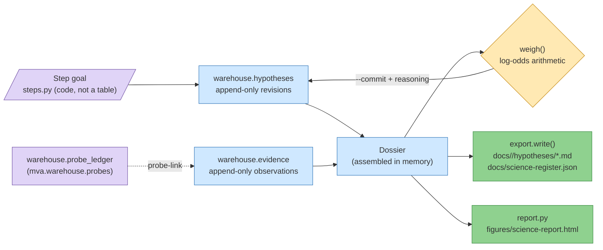

# `mva.science` — the research record

Turns "what do we believe, how strongly, and on what basis" into queryable tables, instead
of prose. Owns the loop of **hypothesis (a falsifiable claim, plain English for "testable
guess") → test → evidence → verdict** that the rest of the project's reporting is generated
from.

**Standing:** 2026-09-01 — written from source at commit `c652265`.

## What it is

A Python package plus one CLI (`mva-science`) over two append-only Postgres tables
(`warehouse.hypotheses`, `warehouse.evidence`). It is the second half of the repository's
provenance story: the warehouse already answers *where did this byte come from*; this
package answers *what does the team believe about the patient, and why*. Every number in
the generated research report (`figures/science-report.html`) and every submission row's
`notes` column traces back to a row here.

## Why it exists

Five rules, enforced in code (constructors / functions that raise), not asked for in a
template:

| Rule | Enforced by |
|---|---|
| A hypothesis (claim) needs a prediction and a refutation condition (what observation would disprove it) before it is filed | `Hypothesis.__post_init__` in [`hypothesis.py`](hypothesis.py) — raises `ValueError` if `statement`, `prediction`, or `refuted_by` is blank |
| A hypothesis must belong to a research step, never the platform step (`step-0`) | `Hypothesis.__post_init__`, checking `Step.takes_hypotheses` from [`steps.py`](steps.py) |
| An evidence row (one observation) needs a `source_ref` (a methodology entry, warehouse table, PMID, ClinVar id, or probe reply) | `Evidence.__post_init__` in [`evidence.py`](evidence.py) — raises `ValueError` if `claim` or `source_ref` is blank |
| A confidence needs a stated reason before it can be written | `hypothesis.revise()` in [`hypothesis.py`](hypothesis.py) — raises `ValueError` if `reasoning` is blank; the CLI's `verdict --commit` refuses without `--reasoning` too (`cli/read.py:do_verdict`) |
| No genomic coordinate (chromosome position) may reach a committed file | `export.scan()` in [`export.py`](export.py) — regex-scans every free-text field and `export.write()` raises `ValueError` on any match |
| Both register tables are append-only — a changed belief is a new revision, never an `UPDATE` | `hypothesis.propose()` / `revise()` always `INSERT`; `evidence.record()` always `INSERT` — no update/delete path exists in either module |
| Confidence is never asserted, only suggested | `evidence.weigh()` computes a `Weighing` and writes nothing; only `hypothesis.revise()` (called from `verdict --commit`) persists a confidence, and only with human-supplied `reasoning` |

## Module map

| Module | Responsibility | Key exports |
|---|---|---|
| [`steps.py`](steps.py) | The fixed map of research steps (one goal each), hardcoded — not a table, so the map is reviewable in a diff | `Step`, `STEPS`, `by_slug`, `research_steps`, `slugs` |
| [`hypothesis.py`](hypothesis.py) | The claim register: append-only revisions, one per belief change | `Hypothesis`, `Status`, `propose`, `revise`, `board`, `history`, `all_revisions`, `latest` |
| [`evidence.py`](evidence.py) | The observation ledger, and the log-odds weighing arithmetic | `Evidence`, `Direction`, `Weighing`, `weigh`, `record`, `listing`, `by_hypothesis` |
| [`dossier.py`](dossier.py) | Assembles one claim + its history + its evidence + its weighing into one `Dossier`; bridges a ranked variant pair to a submission row and back | `Dossier`, `assemble`, `assemble_all`, `to_row`, `hypothesis_of`, `evidence_from_pair`, `tally` |
| [`record.py`](record.py) | The whole register (all dossiers + spent oracle probes) as one object, readable live from Postgres or from the exported JSON mirror | `Record`, `SpentProbe`, `read`, `from_register` |
| [`export.py`](export.py) | Writes the committed mirror (`docs/<step>/hypotheses/*.md`, `docs/science-register.json`); refuses to leak a coordinate | `scan`, `Leak`, `write`, `register`, `dossier_markdown`, `board_markdown` |
| [`report.py`](report.py) | Renders a `Record` into the self-contained HTML research report, reusing the shell from `mva.render` | `build_report`, `write_report` |
| [`views/`](views) | One module per report section (below) | `SECTIONS`, `build_sections` |
| [`cli/`](cli/) | The `mva-science` argparse CLI, split by verb group: `read.py` (no writes), `write.py` (append-only), `publish.py` (`check`/`export`/`report`), `parser.py` (the command-line surface), `context.py` (the connection — and the seam tests replace: `cli.context.attached`, `cli.context.settings`) | `main` |
| [`__init__.py`](__init__.py) | Re-exports the package's public surface | (all of the above) |

`views/` sections, in report reading order:

| View module | Section | What it draws |
|---|---|---|
| [`views/loop.py`](views/loop.py) | The method | The 5-station loop diagram (hand-drawn SVG) and the table of refusal rules |
| [`views/board.py`](views/board.py) | The questions | Step map cards + the hypothesis board table |
| [`views/ledger.py`](views/ledger.py) | The evidence | Evidence ledger table + a supports/refutes weight bar chart |
| [`views/submission.py`](views/submission.py) | The oracle | Probe budget pips + the probe-to-hypothesis trace table |
| [`views/methods.py`](views/methods.py) | The methods form | The hackathon's methods-form questions, answered from the record where possible |

## CLI surface

`mva-science <verb>`, wired in [`cli/parser.py`](cli/parser.py):

| Verb | Does |
|---|---|
| `steps` | Print the step map: every goal, in dependency order |
| `board [--step]` | Every claim, one latest revision each |
| `show <id>` | One claim in full: prediction, refutation condition, evidence, weighing, history |
| `evidence-list [--hypothesis]` | The evidence ledger, optionally narrowed to one claim |
| `verdict <id> [--commit --status --reasoning --confidence --by]` | Weigh the evidence and print the arithmetic; writes only with `--commit` + `--reasoning` |
| `hypothesis-add --step --statement --prediction --refuted-by [--gene --path --by]` | Propose a claim (needs step, prediction, and refutation condition) |
| `hypothesis-revise <id> --status --reasoning [--confidence --by]` | Append a revision changing status or confidence |
| `evidence-add --hypothesis --direction --claim --source-ref [--kind --strength --lineage-ref --by]` | Record one observation against a claim |
| `probe-link <probe> --hypothesis (repeatable) --direction --claim [--strength --by]` | Record what an oracle reply means for the claims it tested |
| `check` | The publish gate: refuses genomic coordinates and settled claims with no evidence |
| `export [--root]` | Write the committed Markdown + JSON mirror under `docs/` |
| `report [-o --from]` | Render `figures/science-report.html`; `--from docs/science-register.json` renders with no database |

## Data model

> **Legend** — purple = raw input (the step goal, and the oracle probe ledger this package
> does not own); blue = neutral machinery (the two append-only tables and the in-memory
> assembly); yellow = a decision point (the weighing, which writes nothing until a human
> commits it); green = the goal (the two published artifacts a reviewer actually reads).

| Table / file | Format | Append-only? |
|---|---|---|
| `warehouse.hypotheses` | Postgres table, one row per revision, DDL in `hypothesis.ensure_table` | yes — `propose`/`revise` only `INSERT` |
| `warehouse.evidence` | Postgres table, one row per observation, DDL in `evidence.ensure_table` | yes — `record` only `INSERT` |
| `docs/<step>/hypotheses/*.md` | One Markdown dossier per claim, written by `export.write` | regenerated wholesale on each `export`; the *source* (the warehouse) is append-only, not this mirror |
| `docs/science-register.json` | The whole register as plain data, written by `export.register` | same — a generated mirror, not hand-edited |
| `figures/science-report.html` | Self-contained HTML, written by `report.write_report` | generated artifact |

## Where it is used

- `pyproject.toml:21` — registers the `mva-science` console script pointing at `mva.science.cli:main`.
- [`src/mva/viz/science.py`](../viz/science.py) — FastAPI routes `/api/science/hypotheses` and `/api/science/evidence`; imports only the two table-name constants (`HYPOTHESIS_TABLE`, `EVIDENCE_TABLE`) from `mva.science.hypothesis`/`evidence`, never any behaviour, and never calls `ensure_table` (a GET must not materialise a table that doesn't exist yet).
- [`src/mva/viz/catalog_semantics.py`](../viz/catalog_semantics.py) and [`src/mva/viz/catalog_columns.py`](../viz/catalog_columns.py) — reference the same table/column names for the API catalog.
- [`src/mva/pipeline/ranking.py`](../pipeline/ranking.py) — `PairEvidence` is the object `dossier.evidence_from_pair()` converts into recorded evidence rows.
- [`src/mva/render/__init__.py`](../render/__init__.py) and [`src/mva/explore/figure.py`](../explore/figure.py) — share the `Exhibit`/`Section` rendering primitives that `science/views/*` and `science/report.py` build on.
- Tests: `tests/test_science_cli.py`, `tests/test_science_export.py`, `tests/test_science_register.py`, `tests/test_science_report.py`, `tests/test_viz_science.py`, `tests/test_cli_parsers.py`.
- Docs: [`docs/method.md`](../../../docs/method.md) owns the method this package implements; [`docs/step-0/methodology/017-the-research-record.md`](../../../docs/step-0/methodology/017-the-research-record.md) and [`041-science-page.md`](../../../docs/step-0/methodology/041-science-page.md) record how it was built; `docs/step-1/hypotheses/` and `docs/science-register.json` are its exported mirror.

## Key facts / gotchas

- **`check` refuses two things**: any genomic coordinate found by `export.scan()` in a hypothesis's `statement`/`prediction`/`refuted_by`/`reasoning` or an evidence `claim`; and any hypothesis whose status `is_settled` (`supported`/`refuted`/`superseded`) but has zero evidence rows.
- **`export` refuses on the same coordinate scan**, before writing anything — it is all-or-nothing, not best-effort per file.
- **The coordinate regex is deliberately loose** (`export.COORDINATE` in `export.py`): it matches `chr15:40142000`, `15:40142000`, `chr15-40142000`, and `g.40142000A>G` spellings. A false positive costs a rewording; a false negative would breach the data transfer agreement — see `docs/notes/no-patient-data-in-the-repository.md`.
- **`verdict` never writes without `--commit --reasoning`** — it always prints the log-odds arithmetic first so a human can check it before trusting it.
- **The weighing is a heuristic, not a calibrated posterior** — stated in `evidence.py`'s module docstring and repeated in every rendered dossier: strengths are human judgments, and evidence rows drawn from the same underlying data are not treated as independent by the log-odds sum.
- **A platform step (`step-0`) cannot take a hypothesis** — `Hypothesis.__post_init__` raises if `Step.takes_hypotheses` is `False`; only steps 1–6 (`steps.research_steps()`) qualify.
- **`Record.from_register` (reading the JSON mirror) loses revision history** — the export keeps only the latest revision per claim, so `Dossier.history` comes back one entry long. Full history requires reading the warehouse directly.
- **`probe-link` doesn't touch the probe ledger** — it only appends evidence rows tagged `kind="oracle"` and `source_ref=f"probe:{probe_id}"`; the ledger itself (`warehouse.probe_ledger`) is owned by `mva.warehouse.probes`.

## Related

- [`docs/method.md`](../../../docs/method.md) — owns the scientific-record method this package implements (the loop, the five stations, the refusal rules, the weighing example).
- `mva.warehouse` (sibling package, `src/mva/warehouse/`) — owns `probes.py` (the probe ledger and budget) and the Postgres attachment (`postgres.py`) this package's tables live behind.
- `mva.render` (sibling package, `src/mva/render/`) — owns the shared HTML report shell (`report.py`) and figure/exhibit primitives (`figure.py`) that `science/report.py` and `science/views/*` render onto.
- `mva.viz` (sibling package, `src/mva/viz/`) — exposes the two register tables read-only over HTTP (`science.py`).
- `mva.pipeline` (sibling package, `src/mva/pipeline/`) — owns `ranking.py` (`RankedPair`/`PairEvidence`, the bridge input) and `submission.py` (`Row`, the bridge output).
