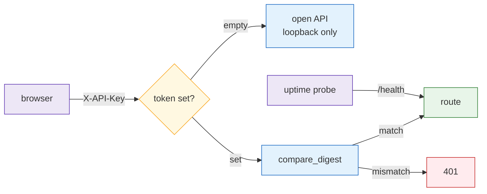

# `viz/` — one HTTP origin in front of the data layer

**Standing:** 2026-10-05 — written when the repository was stripped of its previous case.
**This package is a shell: it wires no routers yet.** Everything below describes machinery
that works and is waiting for the first route.

The React app in [`app/`](../../../app) talks to exactly one origin. Whatever answers
behind it — Parquet read in-process, a cached computation, an upstream job service — is
this package's problem, not the browser's.

## Modules

| Module | Holds |
|---|---|
| `app.py` | The app factory. CORS, the auth guard, the disk cache, a `/health` liveness route, and `include_router` over whatever routers it is handed. Assembly only — this is the one place to look for "what is wired to what". |
| `auth.py` | One shared bearer token as `X-API-Key`. Empty token = open API; set token = every `/api/*` route requires it. `/health` is deliberately outside the guard. |
| `cache.py` | A disk cache whose hit returns the payload **and** the instant it was built. Writes go to a temp file and are renamed into place. |
| `response.py` | The `{data, cached_at, source}` envelope every `/api/*` route returns. |
| `proxy.py` | Forwards a job-shaped verb to an upstream service instead of reimplementing it, attaching the token server-side. |
| `serve.py` | The `mva-api` uvicorn entrypoint. Anchors the working directory, refuses a non-loopback bind without a token. |
| `mmcif_tokens.py` | A tokenizer for the mmCIF `loop_` table syntax — the text format structures are published in. Pure syntax, no chemistry. |

## The envelope, and why every route uses it

```json
{ "data": [...], "cached_at": "2026-10-05T09:12:44Z", "source": "data/parquet/counts.parquet" }
```

`source` names where the numbers came from. `cached_at` is non-null **exactly when** the
payload was served from the disk cache.

This is one decision doing two jobs. A chart component can render provenance without a
per-endpoint special case — and a stale number becomes *visible in the UI* instead of
silently pretending to be live. A cache that hides its own age is how a dashboard ends up
showing yesterday's answer with today's confidence.

## The three safety rules



> **Legend** — purple = a client · yellow = the configuration branch · blue = machinery ·
> green = the request is served · red = refused. `/health` bypasses the guard entirely.

1. **CORS is configured, not hard-coded.** `API_CORS` is a comma-separated list, plus any
   loopback port by regex. Vite walks from 5173 to 5174 when the port is busy, and a
   port-exact list turns that drift into a blocked fetch the app can only report as "api
   down". Note that `localhost` and `127.0.0.1` are *different origins* to a browser.
2. **The token comparison is `secrets.compare_digest`, not `!=`.** A plain comparison
   returns as soon as two bytes differ, so how long it takes leaks how much of a guessed
   token was right — enough, over many requests, to recover it a character at a time.
3. **A non-loopback bind without a token is refused.** `--insecure` overrides it, which is
   the point: the operator has to say so out loud.

## Configuration

Every knob is in `mva.settings.DEFAULTS`: `API_TOKEN`, `API_CORS`, `API_CACHE`,
`UPSTREAM_URL`. Real environment beats `.env` beats the defaults.

## Running it

```sh
uv run mva-api                      # 127.0.0.1:8900
uv run mva-api --reload             # restart on source changes
uv run mva-api --host 0.0.0.0       # refused unless API_TOKEN is set
```

## Layering

`mva.viz` may import anything. **Nothing may import `mva.viz`** — it is a consumer of
every other package and a dependency of none, enforced by the "nothing depends on the web
layer" contract in `pyproject.toml`.
