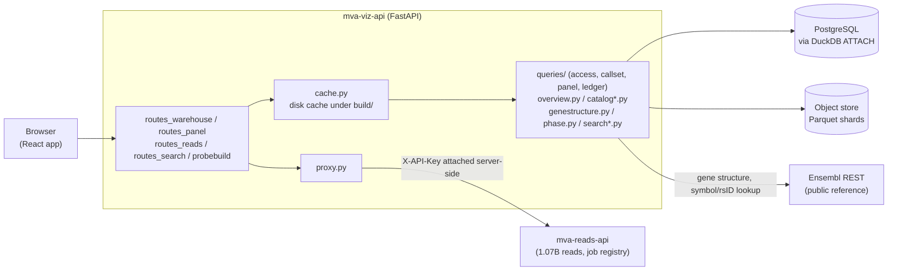

# mva.viz — the viz API

The warehouse and the read store as JSON for one browser app.

**Standing:** 2026-09-01 — written from source at commit `c652265`.

## What it is

- A **FastAPI** application (`app.py`), served by **uvicorn** via the `mva-viz-api` CLI (`serve.py`).
- One HTTP origin in front of three back ends: PostgreSQL (queried through DuckDB — an
  in-process analytics database that can `ATTACH` a remote Postgres and run SQL against it),
  an S3-compatible object store (Parquet — a columnar file format — read with
  column-pruned scans), and `mva-reads-api` (a separate service, proxied rather than
  reimplemented).
- Every `/api/*` route returns one envelope shape: `{data, cached_at, source}`.
- No authentication. Safe only while bound to loopback (`127.0.0.1`) — see Gotchas.

## Why it exists

The React app (`app/`) needs one stable HTTP surface instead of three storage engines with
different SDKs, auth, and cost profiles. This package:
- Hides which back end answers a question (Postgres table, Parquet shard, upstream service).
- Caches the handful of routes that are seconds-slow (a locus scan, a 250 MB shard read) so a
  chart re-render never re-pays that cost.
- Keeps two invariants a browser cares about: a stale answer says so (`cached_at`), and a
  gene's real chromosome position never gets written to a place the repo's git history can see.

## Architecture



> **Legend:** purple = raw input / external data source, blue = neutral machinery inside this
> package, yellow = a service this package depends on but does not own (down = 503, not a hang).

## Module map

### App / serving

| Module | Responsibility | Key exports |
|---|---|---|
| `app.py` | Assembles the FastAPI app: CORS, cache, routers, `/health` | `create_app`, `cors_origins` |
| `health.py` | `/api/health/dependencies`: runs the probes concurrently, caches ~10 s, never raises | `router`, `probe_all`, `overall` |
| `health_probes.py` | One probe per dependency — what it touches and what it advises when it fails | `probe_warehouse`, `probe_object_store`, `probe_parquet`, `probe_reads_api`, `probe_ensembl` |
| `health_results.py` | The check registry (name, kind, pages powered) and the result vocabulary | `REGISTRY`, `up`, `degraded`, `down`, `skipped`, `failed` |
| `serve.py` | `mva-viz-api` CLI entry point, uvicorn runner | `main` |
| `cache.py` | Disk cache: JSON entries under `build/`, atomic write. An entry can carry a provenance dict beside its payload (`Built`), so a cache **hit** reports what built the reply it serves | `Cache`, `Built`, `Cached`, `safe_key`, `default_directory` |
| `response.py` | The one envelope shape every route returns; `describe` appends this reply's own provenance to `source` | `Envelope`, `live`, `cached`, `describe` |
| `proxy.py` | Forwards requests to `mva-reads-api`; 503 on unreachable | `Upstream`, `forward`, `UnreachableError` |

### Routes (route registration only)

| Module | Responsibility | Key exports |
|---|---|---|
| `routes_warehouse.py` | The PostgreSQL-backed routes: overview, catalog, genome, callset, and the plain table reads; mounts the panel, search and science routers | `router`, `TABLES` |
| `routes_panel.py` | Every `/api/panel/*` route. Split in two inside the module: the whole panel (no gene parameter) and one gene in detail. Owns the rule that `/api/panel/locus` responses carry real patient positions | `add_routes` |
| `routes_reads.py` | Read-store aggregates + proxy to `mva-reads-api` for probe/job verbs | `router` |
| `routes_search.py` | `GET /api/search` and `GET /api/callset/region` | `add_routes` |
| `probebuild.py` | `POST /api/probe/build` — turn candidates into a Track 1 submission CSV | `router`, `build` |

### Data access

| Module | Responsibility | Key exports |
|---|---|---|
| [`queries/`](queries/) | Every warehouse (PostgreSQL) read, one function per endpoint. A package: `access.py` (attach, execute, convert — no SQL of its own), `callset.py`, `panel.py`, `ledger.py`. `__init__.py` re-exports the endpoint functions but **not** the plumbing: `queries.access.fetch` is the one seam tests replace. | `locus`, `het_pairs`, `panel_genes`, …; `queries.access.fetch`/`rows`/`table` |
| `readstore.py` | Read-level aggregates straight from Parquet in the object store | `runs`, `partitions`, `flowcell`, `cycle_quality`, `quality_levels` |
| `overview.py` | Assembles the landing-page headline object from nine tables in one connection | `overview` |
| `genotype.py` | Decodes the VCF `FORMAT`/sample-call genotype pair into typed fields | `decode`, `Genotype` |
| `panelbed.py` | Reads the two extra columns (Ensembl id, note) out of the committed panel BED file | `annotations` |
| `phase.py` | Turns one gene's heterozygous alleles into the compound-het pair matrix | `matrix`, `resolved`, `classify` |
| `ensembl.py` | One Ensembl REST call, every failure stated. No retry loop — the reason is in the module docstring. `release` asks `/info/data` once per process, for the build tools | `get`, `post`, `call`, `release`, `EnsemblError`, `ENSEMBL_BASE` |
| `geneset.py` | The curated gene set the structure explorer may draw (`ressources/reference/structure_genes.tsv`), and symbol → id resolution. Panel BED first, then the TSV; derives `in_panel` rather than storing it twice. `provenance` reads the release and digest out of the manifest beside the TSV | `genes`, `lookup`, `resolve`, `provenance` |
| `genestructure.py` | Fetches one gene's exons/domains from Ensembl REST, behind the disk cache. `anatomy` is the half that reads no warehouse table; `structure` adds the proband's alleles on top | `structure`, `anatomy`, `EnsemblError` |
| `search.py` | Search query grammar (region / gene / rsID), span cap, the region read | `classify`, `region`, `Resolved` |
| `search_resolve.py` | Resolves a gene symbol or rsID to a window (panel BED / callset / Ensembl) | `resolve`, `resolve_gene`, `resolve_rsid` |
| `science.py` | Reads the hypothesis/evidence research register, tolerating absent tables | `hypotheses`, `evidence`, `add_routes` |

### Catalog / semantics (what data exists, and what it means)

| Module | Responsibility | Key exports |
|---|---|---|
| `catalog.py` | Object inventory + table catalogue (description, row count, lineage) | `objects`, `tables`, `columns` |
| `catalog_columns.py` | Resolves one column's meaning: table-specific first, then shared | `meaning`, `SHARED`, `BY_TABLE` |
| `catalog_columns_ingest.py` | Column meanings for the ingest schema (delivery, reference, ledgers) | `INGEST_COLUMNS` |
| `catalog_columns_results.py` | Column meanings for the result schema (derived tables) | `RESULT_COLUMNS` |
| `catalog_semantics.py` | Which command writes each table (`created_by`) and why it exists (`why`) | `facts`, `TableFact`, `TABLE_FACTS` |
| `refprovenance.py` | Reads every `*provenance.json` manifest — committed reference tables and fixture directories — and normalises the two families onto one row shape. Also owns the file digest and the current commit, so a writer and a reader cannot disagree about how a sha256 is computed | `rows`, `digest`, `code_version`, `now` |
| `genesetmanifest.py` | Writes `ressources/reference/structure_genes.provenance.json`: the Ensembl release, the endpoints, every input and output digest, and the OMIM/PMID citations extracted from the curated notes | `manifest`, `literature`, `METHOD`, `ENDPOINTS` |
| `referencemanifest.py` | Writes the three population-reference manifests — `gnomad_constraint`, `clinvar_panel`, `qc_norms`. A digest is measured or `null` with a `known_gap`; a release comes from the payload (gnomAD's versioned URL, ClinVar's `##fileDate`); `qc_norms`' inputs are the citations extracted from its own columns | `gnomad`, `clinvar`, `qc_norms`, `write`, `citations`, `repo_relative` |
| `fixturemanifest.py` | Writes `app/src/fixtures/data/*/_provenance.json`: per gene the model, its version and creation date, the file digest, and a REAL-vs-SYNTHETIC map for every top-level field. Merges onto what earlier runs recorded | `write_manifest`, `protein_entry`, `structure_entry`, `existing_genes` |

`catalog_columns_ingest.py` and `catalog_columns_results.py` are a size split of one registry
(the 400-line-per-file rule), not a schema-driven design choice.

The three provenance modules are a **concern** split, not a size one: one reader, two
writers. Reference data is *fetched*, not derived, so it gets no `warehouse.data_lineage`
edge — an edge naming a transform that never ran would be a fabricated row in the one table
the project treats as evidence. It gets a manifest beside the bytes instead, written by the
build tool on every run and never by hand
([`docs/step-0/methodology/061`](../../../docs/step-0/methodology/061-reference-data-provenance.md)).

## HTTP surface

All paths are prefixed `/api` except `/health`. `refresh=true` on a cached route forces a rebuild.

| Method | Path | Returns |
|---|---|---|
| GET | `/health` | Liveness only (`{ok, service}`) — touches nothing |
| GET | `/api/health/dependencies` | Seven dependency probes: warehouse, object store, parquet read path, reads API, Ensembl, reference snapshots (cached ~10 s) |
| GET | `/api/overview` | Landing-page headline numbers (cached) |
| GET | `/api/catalog/objects` | Delivered objects: kind, role, size, hash, upload time |
| GET | `/api/catalog/tables` | Every warehouse/results table: description, row count, lineage (cached) |
| GET | `/api/catalog/columns` | Every column of every table, with its meaning |
| GET | `/api/genome/allele-balance` | Per-contig allele-balance flags |
| GET | `/api/genome/contig-density` | Variant density per contig |
| GET | `/api/genome/density-bins` | 1 Mb variant-count bins, whole genome or one contig |
| GET | `/api/genome/baf-bins` | 1 Mb B-allele-fraction bins, whole genome or one contig |
| GET | `/api/callset/filters` | FILTER value impact ranking |
| GET | `/api/callset/genotypes` | Genotype counts (`0/1`, `1/1`, …) |
| GET | `/api/callset/depth-distribution` | Read-depth histogram |
| GET | `/api/callset/substitutions` | Substitution-type spectrum |
| GET | `/api/callset/indel-lengths` | Indel length spectrum |
| GET | `/api/callset/tstv` | Transition/transversion ratio |
| GET | `/api/callset/observed-expected` | Callset QC metrics against published healthy-genome bands |
| GET | `/api/callset/funnel` | Candidate-ranking waterfall (genome + panel scope) |
| GET | `/api/callset/zygosity-split` | The `bcftools` AF section, het/hom split |
| GET | `/api/callset/fields` | Every declared FILTER/INFO/FORMAT field |
| GET | `/api/callset/region` | Callset records in an arbitrary window (real positions, cached) |
| GET | `/api/panel/background` | Candidate genes' density/PASS share vs. whole-genome background |
| GET | `/api/panel/genes` | The 8 candidate genes: interval, density, PASS rate |
| GET | `/api/panel/constraint` | Candidate genes vs. gnomAD constraint + ClinVar |
| GET | `/api/panel/annotations` | VEP-annotated panel alleles with genotype evidence |
| GET | `/api/panel/locus` | Every variant in one gene, with genotype evidence (real positions, cached) |
| GET | `/api/panel/gene-structure` | One gene's exons, domains, protein-altering alleles (cached) |
| GET | `/api/panel/protein-structure` | One gene's folded protein as an alpha-carbon trace, from AlphaFold DB (cached) |
| GET | `/api/panel/het-pairs` | One gene's compound-het pair matrix |
| GET | `/api/panel/clinvar-presence` | ClinVar P/LP panel sites: present or not |
| GET | `/api/panel/suppressed` | Non-PASS records inside the panel + per-gene FILTER census |
| GET | `/api/reads/yield` | Estimated reads/bases per flowcell lane |
| GET | `/api/reads/runs` | One row per delivered FASTQ (instrument, lane, reads, bytes) |
| GET | `/api/reads/partitions` | Shards/reads/GiB per (lane, read) partition |
| GET | `/api/reads/flowcell` | Read density across one shard's flowcell surface (cached) |
| GET | `/api/reads/cycle-quality` | Mean Phred per sequencing cycle, per partition (cached) |
| GET | `/api/reads/quality-levels` | Base counts per Phred quantisation level (cached) |
| POST | `/api/probe/count` | Proxied to `mva-reads-api`: reads-per-probe job |
| POST | `/api/probe/scan` | Proxied: which reads carry each probe |
| POST | `/api/probe/build` | Validate + render a Track 1 submission CSV (no table read) |
| GET | `/api/jobs` | Proxied: every reads-API job |
| GET | `/api/jobs/{job_id}` | Proxied: one job |
| GET | `/api/jobs/{job_id}/wait` | Proxied: long-poll for job completion |
| POST | `/api/jobs/{job_id}/cancel` | Proxied: cancel a running job |
| GET | `/api/provenance/lineage` | Data lineage edges |
| GET | `/api/provenance/derivations` | Derivation run log |
| GET | `/api/provenance/sources` | Source object ledger |
| GET | `/api/provenance/reference` | Every committed reference table and offline fixture directory, from its `*provenance.json` manifest. Reads **no database** |
| GET | `/api/probe/ledger` | Oracle submission ledger |
| GET | `/api/search` | Resolve a gene/region/rsID query to a window (cached where safe) |
| GET | `/api/science/hypotheses` | Research register: every hypothesis revision (or `table_exists: false`) |
| GET | `/api/science/evidence` | Research register: every evidence row (or `table_exists: false`) |

## How to run it

```bash
uv run mva-viz-api                       # binds 127.0.0.1:8900
uv run mva-viz-api --port 8901 --reload  # dev: restart on source change
```

Frontend dev server (separate process, `app/`):

```bash
cd app && pnpm install && pnpm run dev     # http://127.0.0.1:5173, VITE_API_URL points here
```

## Where it is used

- **Consumer:** the React app in `app/` (Vite + React 18 + TypeScript, `@tanstack/react-query`,
  `plotly.js-dist-min`) — one fetch wrapper (`app/src/api/client.ts`) calls every route above.
  When the API is unreachable, the app falls back to committed fixtures
  (`app/src/fixtures/`) rather than showing a blank page.
- **Declared entry point:** `mva-viz-api = "mva.viz.serve:main"` in `pyproject.toml`.
- **Depends on (not called by):** `mva-reads-api` (`mva.reads.api.serve:main`) for probe/job
  routes — proxied, never imported.
- Documentation: [`docs/step-0/viz-app.md`](../../../docs/step-0/viz-app.md) (the frontend's page
  map and design rules), `docs/step-0/methodology/029-viz-app.md` and later entries for how each
  route was built and verified.

## Key facts / gotchas

- **No auth.** The service has no write verb and no secret the browser could not already reach
  — true only while bound to loopback. `serve.py` prints a warning if `--host` is anything else.
- **Caching.** Disk cache (`cache.py`) under `MVA_VIZ_CACHE` (default `build/viz-cache`,
  gitignored). A cache hit returns the stored payload plus its build instant (`cached_at`); a
  miss writes to a temp file and renames into place, so a killed process never leaves a partial
  entry. Cached routes: `overview`, `catalog/tables`, `panel/locus`, `panel/gene-structure`,
  `panel/protein-structure`,
  `reads/flowcell`, `reads/cycle-quality`, `reads/quality-levels`, `callset/region`, `search`
  (per resolved kind).
- **Real patient positions.** `panel/locus`, `callset/region`, and cached search results contain
  real genomic coordinates. They are cached only under gitignored `build/` and must never reach
  a path git tracks. This package never writes a coordinate into an exported or committed file —
  see `probebuild.py`'s round-trip self-test, which proves the CSV renders correctly without
  ever asserting a specific position is right.
- **Env vars** (`src/mva/warehouse/settings.py`): `MVA_VIZ_CORS` (allowed browser origins, plus
  any `localhost`/`127.0.0.1` port automatically), `MVA_VIZ_CACHE` (cache directory),
  `MVA_READS_API_URL` (upstream reads service, default `http://127.0.0.1:8765`),
  `MVA_API_TOKEN` (attached server-side as `X-API-Key` when forwarding to the reads API — never
  reaches the browser).
- **Proxying.** `mva-reads-api` down becomes `503` with the URL it tried, never a hang. Its own
  4xx/5xx (unknown job, non-DNA probe) is forwarded with status and body intact.
- **Response shaping.** Every route returns `{data, cached_at, source}`. `cached_at` is `null`
  for live (uncached) reads. `source` names the table/file/service the numbers came from.
- **Null vs. zero.** Decoded genotype fields (`genotype.py`) are `null`, never a fabricated
  value, at a `1/2` multiallelic site (two ALT depths, no single "the" alt depth) — a blank is a
  question, a silently halved VAF is a wrong answer. The same discipline holds throughout
  `queries/panel.py`: a missing gnomAD constraint row is `null`, never zero.
- **Callset reads are pushed down.** `variants_raw` (5,012,204 rows, no index) is only ever
  queried with `chrom` constrained first (`queries.locus`, `search.region`) — unconstrained,
  the same query is ~3x slower.
- **Ensembl calls happen server-side only** (`genestructure.py`, `search_resolve.py`): no usable
  CORS header from Ensembl's public REST server, API-key discipline stays on one process, and a
  user's typed query or the proband's own alleles never leave a process this repo controls.

## Related

- `mva.warehouse` — the PostgreSQL/DuckDB layer this package queries (`attached`, `Postgres` settings).
- `mva.reads` — the read store and `mva-reads-api`, proxied by `proxy.py` / `routes_reads.py`.
- `mva.science` — the hypothesis/evidence register this package reads read-only (`science.py`).
- `mva.pipeline` — variant/contig-naming, genotype phasing rule, submission CSV format, and the
  scorer — all imported, never re-implemented, by `probebuild.py` and `phase.py`.
- `app/` — the React frontend; see [`docs/step-0/viz-app.md`](../../../docs/step-0/viz-app.md).
