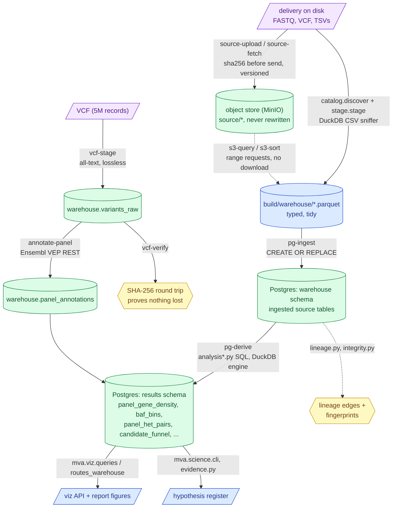

# `mva.warehouse`

Turn a delivered profile directory into hash-verified object storage, typed tables in a
hosted PostgreSQL, and a registry of SQL derivations the report and the API read from.

**Standing:** 2026-09-01 — written from source at commit `c652265`.

## What it is

A **data warehouse** (a database organised for querying and analysis, separate from the
raw delivery) built as a pipeline of small, composable steps: sniff a directory of
tab-separated files → normalise into typed **Parquet** (a columnar, compressed file
format) → load into PostgreSQL → run named SQL **derivations** (precomputed result
tables) → serve them to `mva.viz` and `mva.science`. Every step is case-agnostic — a
different N-of-1 case is a different `--profile` argument, not a fork — except the three
committed public reference tables (gnomAD, ClinVar, QC norms) and the eight-gene panel,
which are this case's fixed comparison points.

30 modules, the biggest package in the repo, split into three families: storage/lineage
core (the plumbing), `analysis*.py` (the SQL registry), and `cli*.py` (the `mva-warehouse`
command surface).

## Why it exists

- **Reproducible ingest.** The delivered TSVs are irregular (headerless, sectioned,
  rollup lines glued under a table). `catalog.py` + `stage.py` turn them into one
  consistent shape without hand-editing any file.
- **Provable retention.** "We kept 100% of the data" is checked, not assumed —
  `vcfstage.verify_roundtrip` reconstructs a VCF's exact bytes from what was staged, and
  `integrity.py` fingerprints every column so a silent retype or dropped NULL is caught.
- **Lineage.** Every derived table has an append-only edge in `lineage.py` naming the
  object, version and hash it came from. A result nobody can trace back is not evidence.
- **Queryable without downloading.** `objects.py` lets DuckDB run SQL against Parquet
  sitting in the S3-compatible object store over HTTP range requests — a filtered query on
  a 5-million-row file moves a fraction of a percent of it (measured in
  `docs/step-0/methodology/013-remote-object-store.md`).
- **One registry of analyses.** `analysis*.py` is 20+ named derivations (SQL, not code) so
  every chart in the report and every route in the viz API reads a table with lineage
  instead of running an ad hoc query.

## Architecture

> **Legend** — **purple = raw input** as delivered; **green = a stored, queryable table
> (the goal state)**; **blue = neutral machinery** (staging, the API, the register);
> **yellow = a verification/decision gate**. Dotted arrows are read-in-place paths, not
> copies.

## Module map

### Storage / lineage core

| Module | Responsibility | Key exports |
|---|---|---|
| `settings.py` | `.env`/environment loader; real env wins over file, password never printed | `Postgres`, `object_store()`, `setting()`, `find_env()` |
| `objects.py` | DuckDB↔S3/MinIO client; range-request queries, sorted copies | `ObjectStore`, `connect()`, `put()`, `sorted_copy()`, `query()`, `diagnose()` |
| `postgres.py` | DuckDB-as-engine ingest/derive/query against hosted Postgres | `attached()`, `ingest()`, `derive()`, `query()`, `list_tables()`, `safe_identifier()` |
| `catalog.py` | Sniffs a profile directory into `Dataset` specs (shape, columns) | `Dataset`, `discover()`, `OVERRIDES`, `sniff()` |
| `stage.py` | Normalises sources into typed Parquet via DuckDB's CSV sniffer | `Staged`, `stage()`, `safe_column()` |
| `vcfstage.py` | Lossless all-text raw VCF layer + round-trip proof | `VcfShape`, `stage_raw()`, `verify_roundtrip()`, `source_digest()` |
| `derivation.py` | The `Derivation` dataclass + `{src}` schema placeholder | `Derivation`, `resolve()` |
| `lineage.py` | The public entry point over the three modules below: re-exports them and owns `ensure_tables()` | `enrich()`, `survey()`, `record()`, `edges()`, `repoint()`, `derivation_edge()`, `ensure_tables()` |
| `lineage_naming.py` | Parse a delivered filename into structured facts | `Enriched`, `enrich()` |
| `lineage_inventory.py` | Survey what the bucket currently holds, and the object inventory table | `OBJECTS_TABLE`, `survey()`, `replace_objects()` |
| `lineage_edges.py` | The append-only "what produced what" edge list: write, read, repair, backfill | `LINEAGE_TABLE`, `record()`, `edges()`, `repoint()`, `derivation_edge()`, `backfill_derivations()` |
| `track2_lineage.py` | The Track 2 drug tables (and a transfer case's) as `data_lineage` edges: card, API host, submission, table | `TRACK2_SCHEMA`, `planned_edges()`, `table_edges()`, `transfer_edges()`, `record_tables()` |
| `track2_manifests.py` | One `*.provenance.json` read: the manifest, its API hosts, its roll-up digest and the version-or-window an API edge may claim | `Manifest`, `read_manifest()`, `card_version()`, `rollup_digest()`, `api_version()` |
| `integrity.py` | Order-independent content fingerprints for ingest verification | `fingerprint()`, `compare()`, `retyped()`, `TableFingerprint` |
| `reference.py` | Staging specs + lineage for the 3 committed public reference tables | `datasets()`, `LINEAGE`, `record_lineage()` |
| `source.py` | Landing-zone ledger: hash, upload, verify, or stream from Hugging Face | `SourceFile`, `scan()`, `checksum()`, `upload()`, `stream_to_bucket()` |
| `probes.py` | Ledger of spent Track-1 oracle submissions (budget = 6 = 6 per registered member x 1 member) | `Probe`, `Budget`, `log()`, `budget()`, `BUDGET` |
| `annotate.py` | Reads panel alleles, calls Ensembl VEP REST, writes `panel_annotations` | `intervals()`, `alleles()`, `run()`, `plan()` |

### Analysis surfaces (`analysis*.py` — SQL derivations, registered as data)

| Module | Question(s) it answers | Output table(s) |
|---|---|---|
| `analysis.py` | Registry root; callset-wide QC (density, filters, bcftools stats, sequencing yield) | `panel_gene_density`, `contig_density`, `allele_balance_flags`, `filter_impact`, `variant_density_bins`, `stats_sn/tstv/dp/st/idd`, `sequencing_yield`, + `DERIVATIONS`, `by_name()` |
| `analysis_reference.py` + `analysis_reference_qc.py` | Callset vs. gnomAD constraint, ClinVar, and cited QC norms | `panel_gene_constraint`, `panel_candidates`, `qc_observed_expected` |
| `analysis_karyogram.py` | Per-megabase B-allele fraction — mosaic segment detection finer than a chromosome mean | `baf_bins` |
| `analysis_pairs.py` | Every het allele a panel gene could pair up (compound-het candidate grid) | `panel_het_pairs` |
| `analysis_funnel.py` | The waterfall: 5M records → candidate pairs, one row per filter stage | `candidate_funnel` |
| `analysis_stats.py` | The `AF` section of `bcftools stats`, parsed | `stats_af` |
| `analysis_background.py` | Is a gene's density/PASS-rate a z-score outlier vs. the genome-wide 1 Mb background? | `panel_gene_background` |
| `analysis_suppressed.py` | What non-PASS ("suppressed") records inside the panel look like | `panel_suppressed`, `panel_filter_census` |
| `analysis_clinvar.py` | Does the callset carry a site ClinVar already calls pathogenic/likely pathogenic? | `clinvar_presence` |

### CLI (`cli.py` + `cli_*.py`)

| Module | Verb family |
|---|---|
| `cli.py` | `stage`, `pg-check`, `pg-ingest`, `pg-derive`, `pg-list`, `pg-query`; wires the rest in |
| `cli_vcf.py` | `vcf-shape`, `vcf-verify`, `vcf-stage`, `vcf-ingest` |
| `cli_annotate.py` | `annotate-panel` |
| `cli_objects.py` | `s3-check`, `s3-put`, `s3-ls`, `s3-query`, `s3-sort` |
| `cli_source/` | `source-scan`, `source-upload`, `source-status`, `source-check`, `source-fetch`. A package split by what each verb touches: `upload.py` (the local delivery directory), `fetch.py` (streaming from the publisher into the bucket), `check.py` (auditing bucket hashes), plus `parser.py` (the argparse surface) and `context.py` (the `attached`/`object_store` seams) |
| `cli_ledger.py` | `lineage-repair`, `lineage-backfill`, `lineage-list`, `probe-log`, `probe-list`, `probe-budget` |

`__init__.py` re-exports only `Dataset`, `Staged`, `discover`, `stage` — the case-agnostic
staging surface; everything else is imported from its own module.

## CLI surface

Entry point: `mva-warehouse` (registered in `pyproject.toml`).

| Command | Does |
|---|---|
| `stage` | Normalise profile + reference directories into Parquet under `build/warehouse/` |
| `pg-check` | Print resolved connection settings, probe the server, no writes |
| `pg-ingest` | Load staged Parquet into the `warehouse` schema (`CREATE OR REPLACE`) |
| `pg-derive` | Run `analysis*.py` derivations, write `results` schema, stamp provenance |
| `pg-list` | List every table in both schemas with row counts |
| `pg-query` | Run one read-only SQL statement against the hosted database |
| `vcf-shape` | Report a VCF header's declared columns/sample, no records read |
| `vcf-verify` | SHA-256 round-trip proof that reading loses nothing |
| `vcf-stage` | Write the lossless all-text raw layer to Parquet |
| `vcf-ingest` | **Run on the server**: load the raw layer straight into Postgres |
| `annotate-panel` | Ask Ensembl VEP REST about every panel allele; `--dry-run` prints the batch plan only |
| `s3-check` / `s3-ls` | Prove the object store answers; list its contents |
| `s3-put` | Upload one Parquet |
| `s3-query` | Run SQL against an object without downloading it |
| `s3-sort` | Rewrite an object clustered by filter columns (makes range requests small) |
| `source-scan` / `source-upload` / `source-status` / `source-check` | Inventory, hash-upload-verify, and reconcile the delivery against the ledger |
| `source-fetch` | **Run on the server**: stream a file from the Hugging Face dataset repo straight into the bucket |
| `lineage-repair` / `lineage-backfill` / `lineage-list` | Fix local-path lineage edges, backfill pre-automation runs, list the edge history |
| `probe-log` / `probe-list` / `probe-budget` | Record, list, and count remaining oracle submissions (of the budget) |

## Where it is used

- `src/mva/viz/queries.py`, `src/mva/viz/routes_warehouse.py` — read result tables via
  `warehouse.postgres.attached()` for every non-cached API route.
- `src/mva/viz/catalog.py`, `catalog_columns*.py`, `catalog_semantics.py` — build the
  self-describing data catalogue the API exposes, importing table-name constants
  (`LINEAGE_TABLE`, `PROBE_TABLE`, `CATALOG_TABLE`, …) and `DERIVATIONS` directly so the
  catalogue cannot drift from the registry.
- `src/mva/viz/phase.py` — classifies compound-het phase from `analysis_pairs`' grid.
- `src/mva/science/cli.py`, `evidence.py`, `hypothesis.py` — the hypothesis register reuses
  `warehouse.postgres.attached()`/`safe_identifier()` and follows `probes.py`'s
  schema-placement and id-assignment pattern.
- `src/mva/reads/verify.py` — reuses `warehouse.objects.connect()` for read-level checks.
- `tests/test_warehouse*.py`, `test_viz_*.py`, `test_integrity.py`, `test_qc_norms_extension.py`,
  `test_catalog_semantics.py`, `test_cli_parsers.py`, `test_annotate_vep.py` — one test
  module per derivation family plus the ingest/CLI/catalog machinery.

## Key facts / gotchas

- **Connection settings**: `.env` (nearest one, walking upward) or real environment
  variables — real env always wins. Keys: `PGHOST`, `PGPORT`, `PGDATABASE`, `PGUSER`,
  `PGPASSWORD`, `PGSCHEMA` (default `warehouse`), `PGRESULTSCHEMA` (default `results`),
  `S3_ENDPOINT`, `S3_ACCESS_KEY`, `S3_SECRET_KEY`, `S3_BUCKET`, `S3_USE_SSL`,
  `MVA_SOURCE_DIR`, `MVA_STAGING_DIR`, `MVA_HF_REPO`, `MVA_API_TOKEN`. `Postgres.password`
  and every `__repr__`/`describe()` redact the password.
- **Schema split is load-bearing**: `warehouse` (ingest, replaced wholesale by
  `pg-ingest`) vs. `results` (derived, replaced only by `pg-derive`) — re-ingesting can
  never destroy a derived table and vice versa.
- **Idempotency**: every ingest/derive/annotate table uses `CREATE OR REPLACE` — a rerun
  is a pure function of its inputs. The exceptions are deliberately append-only:
  `source_files` (upload ledger), `data_lineage` (lineage edges), `probe_ledger`,
  `derivation_runs` (provenance stamps). A correction there is a new row, never an edit.
- **Table/column name safety**: `postgres.safe_identifier()` (`^[A-Za-z_][A-Za-z0-9_]*$`)
  rejects anything not already a plain SQL identifier — names come from filenames, so they
  are validated rather than quoted.
- **Integrity**: `vcfstage.verify_roundtrip` proves byte-for-byte VCF retention;
  `integrity.fingerprint`/`compare` catch silent retypes, dropped NULLs, or
  NULL/empty-string conflation in any other table.
- **Object store**: MinIO speaking the S3 protocol, `url_style='path'` required (MinIO is
  not virtual-host addressable like AWS). Nothing goes to AWS.
- **External dependencies**: DuckDB (`httpfs`, `postgres` extensions) does virtually all
  computation; `boto3` for opaque-byte uploads/downloads; `huggingface_hub`/`requests` for
  `source-fetch`; the Ensembl VEP REST API for annotation (network, third party).
- **Oracle budget**: 6 total Track-1 submissions (6 per registered member; one member is
  registered), tracked in `probe_ledger` — a consumable resource, not just a log. Set
  `MVA_TEAM_MEMBERS` if the roster grows.
- **Never a genomic position**: consistent with the repo-wide rule, no module in this
  package writes a chromosome coordinate into an exported hypothesis/evidence artifact
  (that constraint lives in `mva.science`, which this package feeds).

## Related

- [`docs/step-0/README.md`](../../../docs/step-0/README.md) — the built platform this
  package implements.
- [`docs/step-0/architecture.md`](../../../docs/step-0/architecture.md) — full pipeline
  map, including the parts upstream and downstream of this package.
- [`docs/step-0/data-layers.md`](../../../docs/step-0/data-layers.md) — the delivery →
  object store → `variants_raw` → results layering this package builds.
- [`docs/step-0/methodology/`](../../../docs/step-0/methodology/) — the append-only record
  of how each derivation and integrity check was reached (008–051 cover this package).
- `mva.viz` — the FastAPI service and report exhibits that read the `results` schema.
- `mva.science` — the hypothesis/evidence register, sibling schema-placement conventions.
- `mva.io.readers` — the TSV/BED/section parsers `stage.py` normalises through.
- [`ideation/data-findings.md`](../../../ideation/data-findings.md) — owns every measured
  number about this dataset; this README states none.
