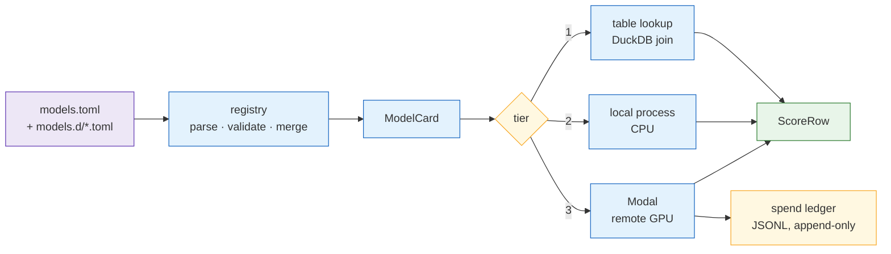

# `zoo/` — frozen models as interchangeable lanes

**Standing:** 2026-10-05 — written when the repository was stripped of its previous case.
**The roster is empty.** `models.toml` ships one disabled template entry and no real model
card: nothing has been chosen for this challenge yet, and a card is a claim about a
published artefact that must be checked before it is written. The lane contract below
works; it has no lanes.

## The idea

**Nothing here is trained.** Every model is somebody else's frozen, published artefact.
The package's job is organisational: make a dozen unrelated third-party predictors look
the same to the code that calls them, so comparing them is a loop rather than a rewrite.

A **lane** is one model behind that contract. In software terms: the registry is a plugin
table, the adapter is the plugin interface, and the tier says where the plugin runs.



> **Legend** — purple = the declaration a human writes · blue = machinery · yellow = a
> decision point (which tier; may this call be afforded) · green = the one output shape
> every lane produces.

## Modules

| Module | Holds |
|---|---|
| `types.py` | The contracts: `SequenceRecord` (named chains + open metadata), `ScoreRow`, `Coverage`, `RemoteJob`, the `Adapter` protocol, and `item_id()`. |
| `registry.py` | The roster: parse and validate `models.toml` and the `models.d/` fragments, generate one JSON card per model and the licence manifest. |
| `models.toml` | The shared roster. Empty but for a disabled template. |
| `models.d/` | One TOML fragment per later lane or measured digest, so two people adding two lanes never edit one file. |
| `modal_contract.py` | The tier-3 wire shape — `Item`, `ScoredItem`, `Reply`, the GPU price table, the budget caps. Pure data: no `modal`, no `torch`. |
| `modal_budget.py` | The append-only JSONL spend ledger and the per-lane cap check. |
| `modal_apps/` | The container side: the shared image base and the CPU gateway app. |

## The record shape

```python
SequenceRecord.of({"binder": "QVQLQESGGG...", "target": "TQVCTGTDMK..."}, cluster="Cluster1")
```

Chains are **named, not positional**. An interface model that silently swapped its two
inputs would still run and still produce numbers — naming them makes that a `KeyError`
instead of a plausible wrong answer.

`item_id()` is **content-addressed**: 16 hex characters of SHA-256 over the chain
contents. Two runs that build the same record agree on its id without coordinating, so a
score cached by one is a hit for the next, and a changed input is a *different id* rather
than a silent overwrite.

`meta` is deliberately open. A lane reads only the keys it declares, so adding a field
never breaks a lane that does not use it.

## The three tiers

| Tier | Where it runs | Example shape |
|---|---|---|
| 1 | a precomputed table, joined in-process with DuckDB | a published score file |
| 2 | a local CPU process | a small model with a CLI |
| 3 | a remote GPU, via Modal | anything that needs real hardware |

Tier 3 is the one that costs money, so it is the one with a ledger. Every remote call
appends a line: the GPU, the seconds, the price. `modal_budget` refuses a call that would
cross the lane's cap. Spend that is not recorded at the moment it happens gets
reconstructed later from a dashboard nobody can cite — hence the wrapper in
[`tools/modal_trace.py`](../../../tools/modal_trace.py), which every Modal command goes
through.

## `catalogue_adjacent` — the honesty flag

A model trained on the same public data an evaluation is drawn from is marked
`catalogue_adjacent = true`. Such a lane is **not excluded**, but its agreement with the
answer is reported separately, because it may be recall rather than prediction. Dropping
it would throw away a strong model; quoting it alongside the others without the flag would
overstate what was predicted.

## Adding a model

1. Write the card — a `[models.<key>]` table in `models.d/<key>.toml`. Every field comes
   from the model's own README and licence file, not from memory.
2. Write the adapter if its source needs a new one.
3. Set `enabled = true`.

Never an edit to a shared file. That is the whole design constraint.

## What the roster declares, and why `ships` matters

`SHIPS` says what this repository may commit for each source kind. A non-commercial score
table is never committed; the fetch script and its digest are. A licence that forbids
redistribution is a property of the model, and the registry is where that property is
recorded rather than remembered.

## Layering

`mva.zoo` may import `mva.io`. Only `mva.viz` may import it.
