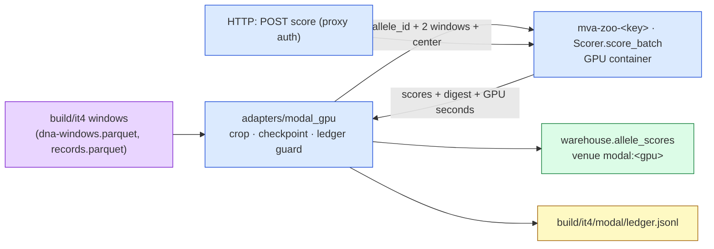

# `mva.zoo.modal_apps` — one Modal app per GPU lane

**Standing:** opened 2026-09-23 (iteration 4, step 8). The contract is
[`../modal_contract.py`](../modal_contract.py); the laptop half is
[`../adapters/modal_gpu.py`](../adapters/modal_gpu.py).

> **Legend** purple = the raw input (patient windows, `build/` only) · blue = machinery ·
> green = the cache the report reads · yellow = the spend ledger the guard checks before every wave.

## The recipe every lane follows

1. **One file, `<key>.py`,** defining `app = modal.App("mva-zoo-<key>")` (use
   `modal_contract.app_name`). Everything heavy (`torch`, the model) is imported **inside**
   container methods, never at module top.
2. **Image:** a `modal.Image` with pinned versions, then `image = _common.with_mva(image, "<key>")`
   last — it ships only the contract modules and this lane's file (the whole package would
   re-upload any file another lane is editing, and the build fails).
3. **Weights** download once into `_common.weights_volume("<key>")` (mounted, e.g. at `/weights`),
   inside `@modal.enter()`; commit the volume after the first download.
4. **Class `Scorer`** (`modal_contract.CLASS_NAME`) with
   `@app.cls(gpu=..., volumes=..., scaledown_window=_common.SCALEDOWN_SECONDS, timeout=...,
   max_containers=<small>)`:
   - `@modal.enter()` loads the model and computes the weights digest (`_common.sha256_tree`);
   - `@modal.method() def score_batch(self, items: list[Item]) -> Reply` — time the work with
     `_common.timed()`, return `modal_contract.reply(...)`. Score = the model's **published**
     number (the card's `score_sign` makes it "higher = more damaging"); anything else in `aux`;
   - `@modal.fastapi_endpoint(method="POST", requires_proxy_auth=True) def score(self, body: dict)`
     — `{"items": [...]}` in, the same `Reply` out; plus a GET `health` returning the model id,
     version and digest. Proxy auth, because the endpoint spends our GPU budget.
5. **A `@app.local_entrypoint() def smoke()`** that scores ~8 synthetic items (random bases or
   a public reference protein, **never a patient window**) and prints the reply.
6. **Card fragment** `../models.d/<key>.toml`: `enabled = true`, the measured `digest`,
   `params` (`image`, `gpu`, `needs`, `batch`, `wave`, `window`, `score_sign`).
7. **Every Modal command goes through `tools/modal_trace.py`** (deploy, run, stop). Scoring
   the case goes through `uv run --group zoo-ml mva-zoo score --model <key>`, which prices
   every reply into the ledger and stops at the lane's share of the $50 cap.
8. **Stop the app when done:** `tools/modal_trace.py stop <key>`.

Nothing here writes a patient window anywhere but back to the laptop's `build/`: containers
keep no input, and volumes hold weights only.
