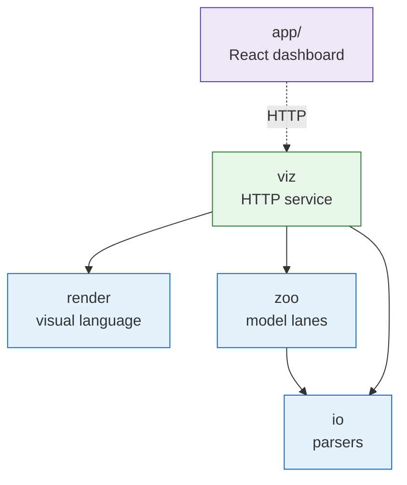

# `src/sepiq` — package index

**Standing:** 2026-10-05 — written when the repository was stripped of its previous case
(MVA genomics) and repointed at the SEPIQ 2026 antibody–antigen challenge. Everything
listed here is machinery; none of it encodes the new case yet.

One line per package. Each package's own `README.md` carries the module map, callers,
gotchas and CLI/HTTP surface; this page only says what lives where.

| Package | Holds | Entry point |
|---|---|---|
| [`io/`](io/README.md) | Parsers for the plain-text shapes command-line tools emit — header-first TSVs with rollup lines glued to the bottom, `##`-sectioned files — and the TSV/JSON writers that stage a step's output. A missing value becomes `None`, never an exception. | library only |
| [`render/`](render/README.md) | The shared visual language — exhibit/section primitives, the report shell, and the one palette (`GOOD` green, `BAD` red, `DECISION` yellow, `MACHINE` blue, `RAW` purple, `MUTED` grey). Subject-agnostic. | library only |
| [`zoo/`](zoo/README.md) | The model zoo: frozen third-party models run under one contract — a record in, a cached score out. A TOML registry of model cards, the tier-3 Modal wire contract and its spend ledger. Nothing is trained; adding a model is a TOML entry plus one adapter. | library only |
| [`viz/`](viz/README.md) | FastAPI service putting one HTTP origin in front of the data layer, with a uniform `{data, cached_at, source}` envelope. Serves the React app in [`app/`](../../app). | `sepiq-api` |

Two loose modules sit beside them:

| Module | Holds |
|---|---|
| `settings.py` | The `.env` loader. Real environment beats the file beats `DEFAULTS`; the parse is cached on the file's fingerprint. `DEFAULTS` is the one place to look for "what can I configure". |
| `paths.py` | Where the repository root is, so a relative default path means the same thing from any working directory. `anchor_cwd()` is what a long-running entry point calls at startup. |

## How they depend on each other

> **Legend** — blue = neutral machinery · green = the layer something outside the package
> talks to · purple = the consumer that is not Python · a solid arrow is a Python import,
> the dashed one is an HTTP call.

**The rule, and it is enforced.** `io` and `render` are leaves: they import no sibling
package. Nothing outside `sepiq.viz` may import `sepiq.viz` — the web layer is a consumer of
everything and a dependency of nothing. Three import-linter contracts in `pyproject.toml`
check this on every run of `tools/check-python.sh`; without them the graph above would be
a diagram in a README that nothing verifies.

## What is deliberately missing

There is no data-ingest package yet. The challenge's two CSVs are read in-process with
Polars/DuckDB rather than loaded into a database — see the **Data** section of
[`CLAUDE.md`](../../CLAUDE.md). When that code lands it becomes a new leaf package here.
