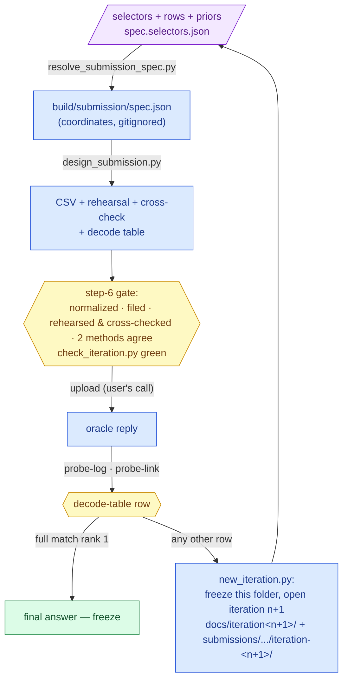

# Submissions — one iteration, one folder

**Standing:** the lifecycle of a submission iteration, written 2026-09-05. Rules are in
[`CLAUDE.md`](../CLAUDE.md) (*Submissions — one iteration, one folder*); this page is the
index and the how-to.

| Track | Iteration | Standing | Folder |
|---|---|---|---|
| Track 1 | 1 | **uploaded 2026-09-09, frozen** — reply *full match at rank 1: stop+missense* (100 rank points, F-max 1.0); 1 of 6 spent | [`track1/iteration-1/`](track1/iteration-1/README.md) |
| Track 1 | 2 | **built, rehearsed on two scorers — not uploaded, held in reserve**: the blind replication report; a second upload gains 0.000 bits (H044), so 5 of 6 remain | [`track1/iteration-2/`](track1/iteration-2/README.md) · [`docs/iteration2/`](../docs/iteration2/README.md) |
| Track 2 | 1 | draft, **superseded** by iteration 2 — never uploaded; kept for provenance (card v3, F8 unmeasured). Restructured 2026-09-20 to the panel's four judged criteria, facts unchanged | [`track2/iteration-1/`](track2/iteration-1/README.md) |
| Track 2 | 2 | **draft** — the curated report from all eight iteration-2 steps and card **v5** (F8 measured by step 8's two instruments); written to the panel's four judged criteria, with the second-case transfer run as its scalability evidence; one submission only, due ~2026-10-20, not uploaded | [`track2/iteration-2/`](track2/iteration-2/README.md) · [`docs/iteration2/step-7/`](../docs/iteration2/step-7/README.md) · dashboard `/track2` |
| Track 2 | 4 | **draft** — built from **iteration 4 only** (steps 1–11, user decision 2026-09-25): the mechanism from five independent instruments, four drug generators fixed before any join and tested against a permutation null (one drug, dasatinib, at chance level), per-child two-source safety; opened by hand because `new_iteration.py` would open iteration 3; iteration 2 stays an unfrozen draft; the user plans to merge the Track 2 iterations into one upload | [`track2/iteration-4/`](track2/iteration-4/README.md) · [`docs/iteration4/step-10/`](../docs/iteration4/step-10/README.md) |

## What an iteration folder holds

| File | Committed? | Made by |
|---|---|---|
| `README.md` | yes | hand — what to upload, how to read, which steps contributed, what to do after the reply |
| `report.md` → `<user>_<track>_report.pdf` | yes | hand → `tools/md_to_html.py` + `tools/md_to_pdf.mjs` |
| `methods-form.json` → `<user>_<track>_methods_form.xlsx` | yes | hand → `tools/fill_methods_form.py` |
| `spec.selectors.json` | yes | hand — every allele as a **selector** (gene, consequence, flags), never a position |
| `decode-table.md` | yes | `tools/design_submission.py` — labels only |
| `build/submission/spec.json`, `build/submission/<csv>` | **never** (gitignored) | `tools/resolve_submission_spec.py`, `tools/design_submission.py` |

Research evidence lives in `docs/<iteration>/step-<n>/`; the folder links to it, never copies it.

## The lifecycle



> **Legend** — **purple = the raw input** (what a human decides: which alleles, which rows,
> which priors); **blue = machinery** (every arrow is one tool); **yellow = a decision point**
> (the gate, and the reply's row in the decode table); **green = the goal**.

## Commands, in order

```bash
# 1. resolve the committed selectors into the gitignored spec (needs the database)
uv run python tools/resolve_submission_spec.py --selectors submissions/track1/iteration-<n>/spec.selectors.json --out build/submission/spec.json
# 2. build, rehearse (replica + organisers' scorer), decode
uv run python tools/design_submission.py --spec build/submission/spec.json --out build/submission/track1_submission_v<n>.csv --decode-md submissions/track1/iteration-<n>/decode-table.md
# 3. figures, PDF, xlsx
uv run python tools/render_track1_figures.py
uv run python tools/md_to_html.py submissions/track1/iteration-<n>/report.md build/track1-report.html --repo-url https://github.com/agharsallah/mva-hackathon/blob/main
node tools/md_to_pdf.mjs build/track1-report.html submissions/track1/iteration-<n>/<user>_track1_report.pdf
uv run python tools/fill_methods_form.py --sheet "Track 1 methods" --answers submissions/track1/iteration-<n>/methods-form.json --out submissions/track1/iteration-<n>/<user>_track1_methods_form.xlsx
# 4. the folder gate (also part of tools/check-python.sh)
uv run python tools/check_iteration.py submissions/track1/iteration-<n>
# 5. after the reply
uv run mva-warehouse probe-log --by <member> --type F --payload-file build/submission/track1_submission_v<n>.csv --response '<reply>' --rationale 'iteration <n>'
uv run mva-science probe-link <probe_id> --hypothesis H009 --direction <supports|refutes> --claim '<what the reply said>'
uv run python tools/new_iteration.py --track track1 --reply '<reply as the decode table names it>'
```

## Where it shows in the dashboard

The app's `/submissions` page (API `GET /api/submissions`) lists every iteration folder,
cumulatively: state, deliverables, decode table, the coordinate-free selectors, which steps
contributed, a lineage view (the raw VCF object, the clinical HPO terms, the warehouse tables
and every `data_lineage` edge between them), and the audit trail (probe ledger, register).
Recipe for the next iteration: steps 1–5 above, then re-capture `app/src/fixtures/data/submissions.json`
from the live API and re-bless its hash in `app/src/test/fixtureHashes.json` — the page needs no other
change. Each iteration gets a generated beginner walkthrough with dictionary links; figures open in a
shareable lightbox (`?figure=<slug>`).
`tools/resolve_submission_spec.py --record-lineage` appends the iteration's own lineage edges
(`target_schema = submissions`): one per selector table, one for `spec.selectors.json`
(sha256), one for the clinical dataset (sha256). Rerunning is a no-op.

## Rules that the tools enforce

- **No coordinate in the tree** — `tools/check_coordinates.py` (quality gate).
- **A folder is complete before it is called ready** — `tools/check_iteration.py`: every
  deliverable present, PDF and xlsx newer than their sources, methods form fully answered
  and abstract ≤ 500 words, selectors consistent with rows and hypotheses, README sha256
  matching the CSV when it is present, frozen folders unmodified.
- **Frozen means frozen** — `tools/new_iteration.py` stamps `**Frozen:**` on the previous
  iteration's README and the docs index; the folder gate then refuses any diff under it.
