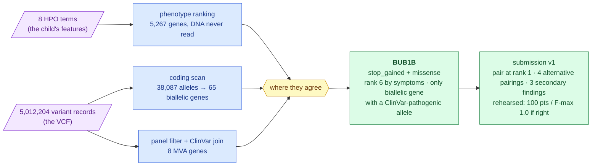
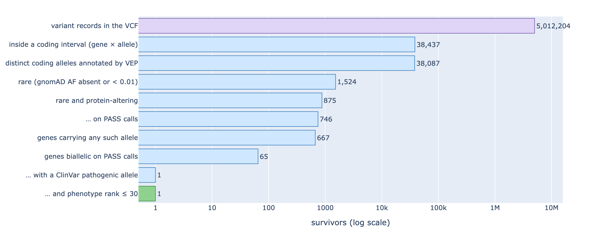
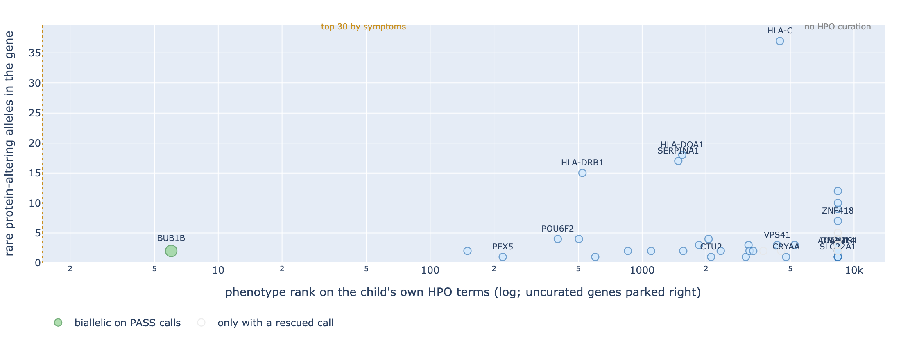
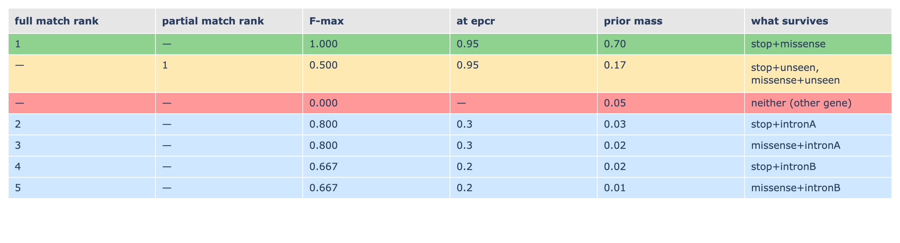

# Track 1 report — one child, one gene, two broken copies

**Standing:** the Track-1 submission report, written 2026-09-05 from executed runs. Every
number below is owned by [`ideation/data-findings.md`](../../../ideation/data-findings.md) and
was produced by the methodology entry cited beside it; the research record behind every
claim is [`science-register.json`](../../../docs/science-register.json), rendered in
[`figures/science-report.html`](../../../figures/science-report.html). **Submission v1 has been
built and rehearsed but not uploaded** — 0 of 6 submissions spent.

Written for a reader who knows software, not genetics. Each domain term is given as
`technical term (plain meaning)` on first use; the full vocabulary is
[`dictionary.md`](../../../docs/dictionary.md).

---

## 1. The answer in one paragraph

The child has **mosaic variegated aneuploidy (MVA)** — a condition in which cells randomly
gain or lose whole chromosomes because the machinery that checks chromosome separation is
weak. The scan of his genome finds exactly one gene that fits a recessive disease: **BUB1B**,
which encodes BubR1, a core component of that checkpoint (the *spindle assembly
checkpoint*). He carries two different damaged copies of it, one inherited from each parent
(a **compound heterozygote**): a **stop-gain variant** (a "premature full stop" that
truncates the protein; already classified pathogenic for MVA syndrome 1 in the public
ClinVar database) and a **missense variant** (one amino acid swapped) in the protein's
kinase domain that no population database has ever seen and that AlphaMissense calls likely
pathogenic. Four independent instruments converge on this pair — a gene-panel filter, a
public-database join, a genome-wide scan of every protein-coding gene, and a symptom-only
ranking that never read the DNA — and the raw-read, filtered-call and structural-variant
alternatives were checked and found empty within their scope. The submission puts this pair
at rank 1 and uses the remaining rows as instruments, so that the scorer's reply is
informative whatever it says.



> **Legend** — **purple = raw input** (what the challenge delivered); **blue = machinery**
> (each an independent instrument); **yellow = the decision point** (convergence);
> **green = the goal** (the gene, the pair, the file).

---

## 2. The clinical picture, and what it predicts

The challenge supplied eight **HPO terms** (Human Phenotype Ontology — a controlled
vocabulary of clinical features, each with a stable identifier) and nothing else: no age,
sex, karyotype or parental DNA ([`ressources/hackathon-rules/`](../../../ressources/hackathon-rules/README.md)).

| Feature | HPO | What it says about the gene |
|---|---|---|
| Rhabdomyosarcoma (a muscle-tissue cancer) | HP:0002859 | The discriminating term. Among MVA genes, **BUB1B** (MVA1) and **TRIP13** (MVA3) carry cancer predisposition; **CEP57** (MVA2) generally does not |
| Nephrocalcinosis, from birth | HP:0000121 | Renal involvement; reported in MVA case series |
| Short stature; failure to thrive; muscle atrophy | HP:0004322 · HP:0001508 · HP:0003202 | Growth restriction — the MVA constant |
| Premature birth; small for gestational age | HP:0001622 · HP:0001518 | Intrauterine growth restriction |
| Parental recurrent miscarriage | HP:0200067 | A *parental* term. It argues for **biallelic** inheritance (both parents carriers of a chromosome-instability allele) — and it is not a feature of the child, so it must not enter the child's ranking (H002) |

MVA is caused by biallelic (both copies) variants in a handful of spindle-assembly-checkpoint
genes; the prior before any DNA is read is *compound heterozygous in BUB1B*, fallback
TRIP13 ([intel §3](../../../ideation/hackathon-intel.md)). Two things about the data sharpen it:

- **Sex inferred male** from the callset — hemizygous X, Y present at real depth
  ([data-findings §5](../../../ideation/data-findings.md)).
- **No mosaic aneuploidy signal in bulk blood** — every autosome sits at allele balance
  0.5 and ~44× depth ([037](../../../docs/step-0/methodology/037-baf-karyogram.md)). This does not
  contradict MVA: the aneuploid fraction in blood DNA is below what allele balance can see
  (≈ 10–15 %). Reported as a bounded negative, not hidden.

A symptom-only ranker built for this project (Exomiser's human-phenotype path
re-implemented in Python, reading two public ontology files and never the callset) places
**BUB1B 6th of 5,267 curated genes** on the child's seven own terms, and reproduces the
panel's own confidence order without being shown it — DICER1 8, TP53 11, CEP57 17, TRIP13 26
([067](../../../docs/iteration1/step-3/methodology/067-phenotype-ranking-without-java.md)). Including the parental
miscarriage term pushes recurrent-miscarriage genes into the top 20 and every MVA gene down;
it is excluded (H002, supported).

---

## 3. The data, and what it can and cannot show

| Delivered | What it is | Consequence |
|---|---|---|
| `WGS_EX2312012_HGWCNDSX7.vcf.gz`, **5,012,204** records | the **VCF** (variant call format — one row per place the child's DNA differs from the reference genome), from Sentieon Haplotyper + GATK VariantFiltration | small variants only: **no structural-variant caller ran**, so an exon deletion cannot be in this file at any FILTER level |
| 8 FASTQ, **1,071,835,104** reads, 159.7 Gb | the raw sequencer output | the only route to an allele the caller never emitted; not needed for the answer below |
| no BAM | — | any read-level work means aligning ourselves |

Three facts that shaped the pipeline ([data-findings §2](../../../ideation/data-findings.md)):
contigs are bare (`15`, not `chr15`) while the scorer wants `chr15` and compares strings
verbatim; the sample is not called `PROBAND01`; and the VCF carries **no annotation** —
its `INFO/AF` is within-sample (0.5 or 1.0), not a population frequency. Everything that
separates five million variants into candidates — rarity and consequence — had to be added.

Callset quality is normal for a human genome: 4.09 M SNVs, 0.93 M indels, ts/tv 1.94,
het/hom 1.61, 66,860 multi-allelic sites ([data-findings §3](../../../ideation/data-findings.md)).

---

## 4. The platform (what was built before the question was asked)

Every byte the challenge delivered is hash-verified in an object store; the VCF is loaded
losslessly as text into PostgreSQL (`warehouse.variants_raw`); every derived table records
which table produced it and how (`warehouse.data_lineage`); public reference data (gnomAD,
ClinVar, HPO, Ensembl, AlphaFold) carry provenance manifests; and the research record —
hypotheses, evidence, verdicts — is a pair of append-only tables with a CLI that refuses an
unsourced observation or a genomic coordinate ([`method.md`](../../../docs/method.md),
[`toolset.md`](../../../docs/toolset.md)). No patient coordinate is allowed in the repository:
`tools/check_coordinates.py` scans every tracked file for the candidate positions and the
candidate gene's span and runs inside the quality gate; the one earlier entry that had quoted
the pair was redacted when the gate first ran ([075](../../../docs/step-0/methodology/075-coordinate-gate-and-redaction.md)).
The submission file lives outside the repository.

---

## 5. Step by step — how five million became two

### 5.1 The panel, annotated (step 2, entries 031 and 051)

The eight MVA/differential genes hold 861 records (874 alleles after splitting
multi-allelic sites). Ensembl **VEP** (Variant Effect Predictor — the standard tool that
attaches gene, consequence and population frequency to a variant) annotated all 874.
Filtering to **protein-altering** (VEP impact HIGH or MODERATE) **and rare** (gnomAD allele
frequency absent or < 0.01, the recessive threshold) leaves **exactly two alleles, both in
BUB1B, both heterozygous, both PASS** ([data-findings §6.1](../../../ideation/data-findings.md)).
Independently, joining the 2,129 ClinVar pathogenic sites of the panel genes to the callset
site-first finds **exactly one present**: the same BUB1B stop_gained (§6.2). Registered as
**H003 (retrospective), supported 0.93**.

### 5.2 Genome-wide, without a panel (step 2, entries 069–070) — new this week

A panel is a list someone chose. The honest test is the whole genome. Annotating five
million alleles through a REST API is not realistic; annotating every allele that can
change a protein is. So:

1. **Coding intervals.** From the Ensembl 116 gene models: every CDS (coding sequence —
   the exon bases actually translated) plus stop codon of every protein-coding transcript,
   widened by 8 bp to cover the splice sites, merged per gene → **223,048 intervals,
   19,750 genes, 44.6 Mb** (1.4 % of the genome). Case-agnostic tool with a provenance
   manifest: `tools/build_coding_regions.py`.
2. **Layer 2.** A binned range join of the callset to those intervals → `results.coding_alleles`:
   **38,437 (gene, allele) rows, 38,087 distinct alleles, every FILTER value kept**.
   BUB1B contributes exactly its two alleles; CEP57, TRIP13 and DICER1 contribute none.
3. **Annotation.** `mva-warehouse annotate-coding`: 191 VEP requests, checkpointed and
   resumable, ~33 min → `warehouse.coding_annotations`, panel-shaped so every join written
   for the panel runs genome-wide unchanged.
4. **Gene table.** `results.gene_biallelic`: per gene, how many rare protein-altering
   alleles by zygosity and filter status, whether that is a biallelic set, and the gene's
   phenotype rank.



> **Legend** — **purple = the raw input** (every VCF record); **blue = machinery** (each
> filter); **green = the goal** (the last bar). Log axis: on a linear one every bar after the
> first would be invisible.

| Stage | Survivors |
|---|---|
| variant records | 5,012,204 |
| distinct coding alleles, all annotated | 38,087 |
| rare | 1,524 |
| rare and protein-altering | 875 (746 on PASS calls) |
| genes carrying any such allele | 667 |
| genes biallelic on PASS calls | **65** |
| … with a ClinVar pathogenic allele | **1** |
| … and phenotype rank ≤ 30 | **1 — BUB1B** |

The hypothesis was filed *before* the annotation ran (**H004**: BUB1B is the only gene
satisfying all three conditions; other biallelic genes will exist but fail the second or
third). It held: **supported 0.93**. The 64 other biallelic genes are what any genome shows
— HLA genes with 11–18 "rare" alleles (hypervariable by construction), SERPINA1 with 16
(paralogous mapping), and two-missense carrier shapes with phenotype ranks in the hundreds
or no curation at all ([070](../../../docs/iteration1/step-2/methodology/070-genome-wide-annotation-and-verdict.md)).

### 5.3 Symptoms versus DNA (step 3, entry 071)



> **Legend** — **green = the goal** (the highlighted gene); **yellow = a decision point** (a
> gene carrying a ClinVar-pathogenic allele); **blue = machinery** (other biallelic genes);
> **grey = context** (genes biallelic only if a filtered call is rescued). Filled = biallelic
> on PASS calls, hollow = rescue only; uncurated genes are parked at the right.

Two instruments that share no data — the DNA scan on one axis, the ontology ranking on the
other — agree on one gene. Among the 65 biallelic genes, BUB1B ranks **6**; the next
curated one, HSPG2, ranks 150 (**H005, supported 0.80**). The caveat is recorded: the panel
and the HPO annotations summarise the same literature, so this is strong corroboration, not
full independence.

### 5.4 Nothing hides behind a filter (step 4, entries 049 and 072)

The caller suppressed 271k calls genome-wide, 1,594 of them inside coding intervals
(`MQ40` 1,048, `QD2` 245, `LowQual` combinations 301). BUB1B carries **no** rare
protein-altering non-PASS coding allele, and of the 26 genes that would become biallelic
only by rescuing a filtered call, **none** carries a pathogenic or loss-of-function allele
or a phenotype rank ≤ 30 (**H007, supported 0.80**; panel result **H006, retrospective,
supported 0.77**). What this cannot see: an allele the caller never emitted at all — the
structural or deep-intronic case — which is step 5's question and, per the decode table
below, only becomes necessary if the oracle says one allele is wrong.

### 5.5 Spelled the way the scorer reads it (step 1, entry 073)

The scorer matches `(chrom, pos, ref, alt)` by exact string. Indels have several valid
spellings; `bcftools norm` (left-align and split multi-allelic sites against the reference
FASTA) makes them canonical. Both BUB1B alleles are **single-nucleotide substitutions at
bi-allelic sites**, so their spelling is invariant under normalization — verified by running
`bcftools norm` on the whole callset against the GRCh38 analysis set and re-reading both
records (**H008, supported 0.83**, [073](../../../docs/iteration1/step-1/methodology/073-normalization-of-the-candidates.md)).
Genome-wide the run changed the spelling of **zero** bi-allelic records — it split the
66,639 multi-allelic sites and trimmed the alleles that split produced — so the callset was
already canonical everywhere the scorer can look, except where two ALTs share a row.

---

## 6. The two alleles

Coordinates and the missense spelling are deliberately absent from this repository (Data
Transfer Agreement); the stop_gained is a public ClinVar record
([data-findings §6.4](../../../ideation/data-findings.md)).

| | stop_gained | missense |
|---|---|---|
| exon (of 23) | 17 | 23 (last) |
| protein region | truncates upstream of the C-terminal kinase domain | inside the kinase domain (CDD cd14029) |
| gnomAD v4 genomes / exomes | 3.29e-5 / 7.87e-5, no homozygote | **absent / absent** |
| ClinVar | **VCV000533901**, pathogenic / likely pathogenic, multiple submitters, no conflicts, *Mosaic variegated aneuploidy syndrome 1* | none |
| CADD phred | 36 | 24.5 |
| AlphaMissense | — | **0.92, likely pathogenic** |
| SpliceAI | 0.03 | 0.00 |
| genotype · depth · allele fraction | 0/1 · 46× · 0.54 | 0/1 · 28× · 0.46 |
| FILTER · QUAL | PASS · 709 | PASS · 345 |

**Mechanism.** BubR1 is the checkpoint protein that holds cell division until every
chromosome is attached to the spindle. Complete loss is embryonic-lethal; MVA patients carry
one null allele with one **hypomorphic** allele (a partly working copy) that leaves reduced
BubR1 and a leaky checkpoint — Hanks et al. 2004 (PMID 15475955), Suijkerbuijk et al. 2010
(PMID 20516114). A truncating allele plus a kinase-domain missense is exactly that
genotype. Rhabdomyosarcoma is a reported MVA malignancy (PMID 31184400). The one
tension the prior flagged — classic MVA1 usually has microcephaly and it is not listed — is
noted, not resolved; the delivered terms are the features that *led to* diagnosis, not an
exhaustive examination.

**Phase.** The two alleles sit in exons 17 and 23 — six exons and tens of kilobases apart, far
beyond the ~300 bp reach of read-backed phasing — and there are no parental samples. Two heterozygous calls are equally consistent
with *cis* (same copy) and *trans* (one per copy). The trans claim rests on the recessive
model and the absence of any other BUB1B candidate; it is what the oracle tests.

---

## 7. The submission, read as a measurement (step 6, entry 074)

The scorer returns `full_match_rank`, `partial_match_rank`, `f_max` and its threshold. Read
against an explicit **hypothesis space** — every answer key still considered possible — a
reply is a measurement, not a score. `mva.pipeline.probe_design` simulates the reply for
every key with the local scorer replica, groups keys by the reply they produce (the
**decode table**), and reports the expected information gain in bits.

Two facts the designer surfaced, both under test: a single allele ranked *below* the pair
adds almost nothing (it cannot say which member of the pair it partners), while an
alternative **pair** row at rank *r* decodes directly through `full_match_rank = r` and
earns 50 or 25 points instead of 10. So ranks 2–5 hold pairs.

| rank | epcr | type | row |
|---|---|---|---|
| 1 | 0.95 | primary | **BUB1B stop_gained + missense** (H009) |
| 2–3 | 0.30 · 0.29 | primary | stop / missense + the gnomAD-absent intronic BUB1B allele (SpliceAI 0.00) |
| 4–5 | 0.20 · 0.19 | primary | stop / missense + the rare intronic BUB1B allele (ClinVar VUS, SpliceAI 0.00) |
| 6 | 0.05 | secondary | **LZTR1** heterozygous stop_gained, ClinVar P/LP, gnomAD 1.4e-6 — dominant schwannomatosis predisposition, unrelated to MVA |
| 7 | 0.04 | secondary | **F5** Factor V Leiden, heterozygous — low-penetrance thrombosis risk |
| 8 | 0.03 | secondary | **FLG** heterozygous stop_gained, ClinVar P — ichthyosis vulgaris / atopy |



> **Legend** — **green = the pair confirmed at rank 1**; **yellow = a reply that needs a
> follow-up probe**; **red = nothing matched**; **blue = a decisive alternative**.

Rehearsed byte-for-byte on the replica **and re-graded with the organisers' published
`evaluation.py`** — the two scorers agree on every one of the eight keys
([075](../../../docs/step-0/methodology/075-coordinate-gate-and-redaction.md)). If the pair is right, **100 points, F-max 1.0**.
Seven distinguishable replies over eight keys; prior entropy 1.60 bits, **expected gain
1.46 bits**. The one residual ambiguity is structural — "one allele right, partner not in
the callset" cannot say *which* allele — and it is the exact trigger for the raw-read
route (step 5) and a two-row singles probe. Rows 6–8 are secondary findings: free under
the scoring rules (rows below the hit cannot lower F-max), reviewed qualitatively, chosen by
a stated rule (ClinVar P/LP after excluding conflicts and benign-tagged records, gnomAD
< 0.02, dominant or risk-factor genes; recessive carrier states GNRHR, CIAO1, ZFYVE26 are
reported here, not submitted).

**Not uploaded.** The four gate conditions of [step 6](../../../docs/iteration1/step-6/README.md) hold — normalized
spellings, hypotheses with predictions and refutations, a byte-level rehearsal, four
agreeing methods — and the timing is the team's decision. File:
`build/submission/track1_submission_v1.csv` (gitignored; sha256 `fbc9e750…`).

---

## 8. Reproducibility, runtime and cost

```bash
uv sync --all-groups
uv run python tools/build_coding_regions.py --gtf Homo_sapiens.GRCh38.116.gtf.gz   # 5 s
uv run mva-warehouse stage && uv run mva-warehouse pg-ingest --tables coding_regions   # 23 s
uv run mva-warehouse pg-derive --only coding_alleles                                   # ~17 min (WAN pull of 5 M rows)
uv run mva-warehouse annotate-coding --workers 4                                       # ~33 min, resumable
uv run mva-warehouse pg-derive --only coding_candidates gene_biallelic                 # 24 s
uv run python tools/render_track1_figures.py
uv run python tools/resolve_submission_spec.py --selectors submissions/track1/iteration-1/spec.selectors.json --out build/submission/spec.json   # selectors → coordinates
uv run python tools/design_submission.py --spec build/submission/spec.json --out build/submission/track1_submission_v1.csv        # CSV + rehearsal + cross-check
```

The submission itself is reproducible without a single committed coordinate: every allele
in `spec.selectors.json` is a *selector* (gene, consequence, ClinVar and gnomAD flags) that
must match exactly one row of the warehouse; the resolver refuses anything else.

Everything ran on one laptop against a small hosted PostgreSQL and the free Ensembl REST
API: **about one hour of wall clock, no paid compute**. The heavy alternative — aligning
160 Gb of reads — was not needed for the answer and stays conditional.
[`tools/check-python.sh`](../../../tools/check-python.sh) runs the eight quality gates (the last two are the
coordinate gate and the iteration-folder gate); the new tooling adds 77 tests across eight new
test modules, 1,687 in all.

---

## 9. Limitations, stated

- **Coding-only scope.** The genome-wide scan covers CDS ± 8 bp (1.4 % of the genome). A
  deep-intronic, UTR or structural second allele in *another* gene is outside it. Within
  BUB1B the two only rare non-coding alleles were checked (SpliceAI 0.00).
- **Phase unresolved.** No reads or parents connect the two alleles; trans is inferred.
- **No mosaicism measurement.** Bulk blood WGS bounds the aneuploid fraction below
  ≈ 10–15 %; it does not measure it.
- **Missing feature.** Microcephaly, usual in MVA1, is not among the delivered terms.
- **Confidence numbers are a heuristic.** The register's weighing is transparent arithmetic
  for triage, not a calibrated posterior; evidence rows about the same two alleles are not
  independent, which is why H009 carries no committed confidence.
- **The oracle is the only authority.** The scorer replica is transcribed from the published
  code, tested against hand-derived values, and cross-checked key by key against the
  organisers' own `evaluation.py`; agreement between two scorers proves the *grading* is
  right, nothing about the answer key.

---

## 10. Methods form (Track 1), answered

| Question | Answer |
|---|---|
| Model | one approach, model 1: panel filter → genome-wide coding scan → phenotype join → pair submission |
| Automated or curated? | **Automated** to the ranked gene table and the candidate pair; the submission *layout* (which alternative pairings and secondary rows fill ranks 2–8) is a designed measurement, chosen by a stated rule and simulated, not hand-curated from belief |
| Public data only? | **Yes**: Ensembl 116 gene models and VEP (gnomAD v4, ClinVar, SpliceAI, AlphaMissense, CADD), HPO release 2026-06-23, PubMed. No proprietary data |
| Pairs or singles? | **Pairs**: every primary row is a compound-heterozygous pair in one row; the pipeline ranks pairs, not variants |
| Secondary findings | ClinVar P/LP after excluding conflicting and benign-tagged records, gnomAD AF < 0.02, dominant or risk-factor genes → three rows marked `secondary`; recessive carrier states reported, not submitted |
| Runtime and cost | ~1 h wall clock on one laptop, free public APIs, one small hosted PostgreSQL; no paid compute |
| Abstract | §1 and §9 above, 300 words together |

---

## 11. Where every claim lives

| Claim | Register | Test |
|---|---|---|
| Panel filter leaves exactly the BUB1B pair | H003, supported 0.93 (retrospective) | [031](../../../docs/step-0/methodology/031-vep-rest-panel-annotation.md), [051](../../../docs/step-0/methodology/051-clinvar-presence.md) |
| No coding gene outranks the pair, genome-wide | H004, supported 0.93 | [069](../../../docs/iteration1/step-2/methodology/069-layer-2-coding-scan.md), [070](../../../docs/iteration1/step-2/methodology/070-genome-wide-annotation-and-verdict.md) |
| Symptoms and DNA agree on BUB1B | H005, supported 0.80 | [071](../../../docs/iteration1/step-3/methodology/071-phenotype-callset-join.md) |
| The parental term degrades the ranking | H002, supported 0.86 | [067](../../../docs/iteration1/step-3/methodology/067-phenotype-ranking-without-java.md) |
| No filtered call hides a second allele | H006 (0.77, retrospective), H007 (0.80) | [049](../../../docs/step-0/methodology/049-suppressed-calls.md), [072](../../../docs/iteration1/step-4/methodology/072-genome-wide-suppressed-calls.md) |
| Both alleles are spelled as the scorer reads them | H008 | [073](../../../docs/iteration1/step-1/methodology/073-normalization-of-the-candidates.md) |
| The causal pair is the BUB1B stop_gained + missense, in trans | H009, `testing` | [074](../../../docs/iteration1/step-6/methodology/074-submission-v1-design.md) → the oracle |
| The causal gene ranks ≤ 30 by symptoms | H001, `proposed` | settled by the oracle together with H009 |
