# Track 1 report, iteration 2 — the same pair, found again with the answer hidden

**Standing:** the Track-1 replication report, written 2026-09-19 from executed runs. Every
number below was produced by the methodology entry cited beside it
(`docs/iteration2/step-<n>/methodology/`), and every claim is a pre-registered hypothesis in
the append-only register ([`science-register.json`](../../../docs/science-register.json),
rendered at [`figures/science-report.html`](../../../figures/science-report.html)).
Submission 1 was uploaded on 2026-09-09 and answered *full match at rank 1, 100 rank points,
F-max 1.0* ([083](../../../docs/iteration1/step-6/methodology/083-oracle-reply-submission-1.md)).
**Submission 2 is built, rehearsed on two scorers and not uploaded**: it would teach nothing
([124](../../../docs/iteration2/step-6/methodology/124-the-reserve-file-built-and-rehearsed.md)),
so 5 of 6 uploads stay in reserve.

Written for a reader who knows software, not genetics. Each domain term is given as
`technical term (plain meaning)` on first use; the full vocabulary is
[`dictionary.md`](../../../docs/dictionary.md), served at `/learn` on the dashboard.

---

## 1. The answer in one paragraph

The child has **mosaic variegated aneuploidy (MVA)**: some of his cells carry the wrong
number of chromosomes, because the checkpoint that holds a dividing cell until every
chromosome is attached is weak. Iteration 1 found the cause top-down, from the vendor's
variant calls: two different broken copies of **BUB1B**, the gene for that checkpoint's
protein BubR1, one copy from each parent (a **compound heterozygote**) — a **stop-gain**
allele (a premature full stop, already classified pathogenic for MVA syndrome 1) and a
**missense** allele (one amino acid swapped) that no population database has seen. The
challenge's answer key confirmed that pair at rank 1. Iteration 2 asked a harder question:
**would we have found it without knowing it?** It started again from the raw reads, the
callset and the eight clinical terms, under a **blind protocol** (no iteration-1 candidate,
gene or table allowed as an input), by routes that share no code with iteration 1 — a
symptom-only gene ranking, a k-mer read bait with two independent callers, an
alignment-free genotyper, a genome-wide likelihood-ratio ranking with no hard filter, and a
public-knowledge engine — fused them, froze the ranking, and only then looked. **The same
two BUB1B alleles came out first, under both weightings**
([109](../../../docs/iteration2/step-6/methodology/109-what-the-mirror-found.md)). The
honest second half: one route found it, two corroborated it at a distance, one instrument
confirmed it in the raw reads, and the literature never listed it. A second instrument then
set the first real bound on the disease's defining feature: no chromosome in the sequenced
sample carries a mosaic aneuploidy above 2–3 % of cells, where the earlier statistic had no
power at all ([116](../../../docs/iteration2/step-8/methodology/116-the-statistic-that-has-power-and-the-limit-it-buys.md)).

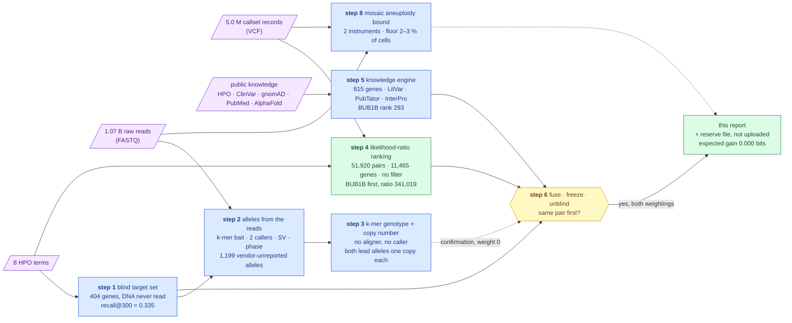

> **Legend** — **purple = raw input** (what the challenge delivered); **blue = machinery**
> (one research step each); **yellow = the decision point** (the unblinding);
> **green = the goal** (the one route with discriminating power, and the report). Dotted
> arrows are evidence that confirms but does not rank.

---

## 2. What the reply said, and what iteration 2 is for

The scorer's reply to submission 1 — `full_match_rank 1`, `rank_points 100`, `f_max 1.0` at
threshold 0.9963 — matched row 1 of iteration 1's pre-registered **decode table** (the
lookup, built before the upload, that translates every possible reply into "which rows held
the true alleles"). Survivors: `stop+missense` only. The seven alternative answer keys were
eliminated in one upload; hypothesis H009 went to `supported`
([083](../../../docs/iteration1/step-6/methodology/083-oracle-reply-submission-1.md)).

Nothing is left to *find* for the automated score. What is left is the question the
automated score cannot ask: **is the pipeline right, or was it lucky?** Iteration 1 trusted
the vendor's caller, applied hard filters (rarity, consequence) and checked that four
instruments agreed. Each of those choices could have been the reason the pair surfaced. So
iteration 2 is iteration 1's **mirror**, run **blind** ([plan §1](../../../docs/iteration2/plan.md)):

| Allowed as input | Not allowed until step 6 |
|---|---|
| the 8 HPO terms; the FASTQ; the VCF; public knowledge (HPO, Ensembl, gnomAD, ClinVar, PubMed, protein models) | the identity of the two iteration-1 alleles; the gene name as a filter; iteration 1's decode table, verdicts and figures |
| the step-0 platform (read store, warehouse, annotator, register, scorer replica) | any `results.*` table iteration 1 derived that encodes the candidate — iteration 2 re-derives its own under `results.it2_*` |

The gene is written all over this repository, so the blinding is a **procedural rule, not a
secret**: every methodology entry declares its inputs, and `tools/check_blind.py` (a CI gate)
refuses an entry that names an iteration-1 candidate table before entry 109. Software
analogy: not a sandbox, but a code review that rejects a forbidden import. The gate's current
state: *38 iteration-2 entries, every one declaring its inputs — unblinded by 109*.

A pair rediscovered from scratch by a disjoint route is the strongest replication a single
sample allows, and it is what makes the tooling transferable to a case with **no answer key**.

---

## 3. The clinical picture, and how both inputs were used

The challenge delivered eight **HPO terms** (Human Phenotype Ontology — a controlled
vocabulary of clinical features, each with an id) and no karyotype:

| Feature | HPO id | Where iteration 2 used it |
|---|---|---|
| Rhabdomyosarcoma (a childhood muscle-tissue cancer) | HP:0002859 | step 1 ranking; step 5 case-report search; Track 2 direction D4 |
| Nephrocalcinosis | HP:0000121 | step 1; step 5 |
| Short stature | HP:0004322 | step 1; step 5 |
| Failure to thrive | HP:0001508 | step 1; step 5 |
| Skeletal muscle atrophy | HP:0003202 | step 1; step 5 |
| Premature birth | HP:0001622 | step 1; step 5 |
| Small for gestational age | HP:0001518 | step 1; step 5 |
| Recurrent spontaneous abortion (**parental** history) | HP:0200067 | step 1's `with-parental` query only; the recessive-with-lethality prior in step 4 |

Every step states which input it read. Step 1 read the clinical terms and **no DNA**. Steps 2
and 3 read the raw reads over a gene set that exists only because of the clinical terms.
Step 4 read the VCF and the terms together, and its ablation says exactly what the terms
added (§4.4). Step 5 read public knowledge against the seven proband terms. Step 8 read both
raw inputs and the clinical document, and found in it no karyotype and no term a blood
aneuploid fraction would predict
([115](../../../docs/iteration2/step-8/methodology/115-the-callset-reduced-to-what-a-mosaic-model-needs.md)).
The warehouse's `data_lineage` table carries an edge from every derived table to both the
delivered callset object and the clinical document by digest, and the submission's own three
edges were appended by the resolver ([124](../../../docs/iteration2/step-6/methodology/124-the-reserve-file-built-and-rehearsed.md)).

---

## 4. The mirror, step by step

Each step declared one goal in `src/mva/science/steps.py`, filed its hypotheses with a
prediction and a refutation condition **before** running, and closed only when every
hypothesis had a verdict. Refutations are reported with the same weight as supports: they are
the half that changed the plan.

### 4.1 Step 1 — which genes do the symptoms alone nominate? (entries 084, 091)

A phenotype ranker (Exomiser's human-phenotype path, re-implemented in Python over HPO
release 2026-06-23) scored 5,267 genes on the child's terms. Fixing N = 300 in advance would
have been the usual move; step 1 **measured** it first, on a held-out benchmark of every
recessive disease in the ontology with degraded query terms.

| Measured | Value | Entry |
|---|---|---|
| target set | **404** genes in three tiers — `core` 62, `net` 272, `mechanism-term` 70 — plus **396** matched decoys (same length distribution, seed fixed) | [084](../../../docs/iteration2/step-1/methodology/084-the-blind-target-set.md) |
| held-out recall@300, full population of 3,240 diseases | **0.335** [0.318, 0.350]; recall@1000 0.508; **27.8 %** of held-out genes unrankable at any N | [091](../../../docs/iteration2/step-1/methodology/091-recall-at-the-full-population.md) |
| protein-coding genes with **no** HPO curation | **14,523 of 19,723 (73.6 %)** | [084](../../../docs/iteration2/step-1/methodology/084-the-blind-target-set.md) |
| agreement with a second ranker (Phen2Gene) in the top 300 | **97 of 300 (32.3 %)** | [084](../../../docs/iteration2/step-1/methodology/084-the-blind-target-set.md) |

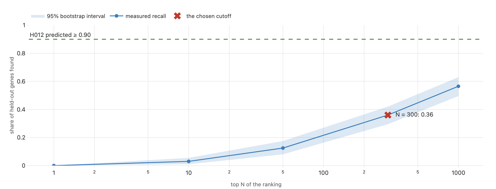

> **Legend** — **blue line** = measured recall with its 95 % bootstrap band, on the
> 200-disease sample of entry 084; **green dashed** = the 0.90 H012 predicted; **red cross** =
> the chosen N. The full-population number quoted above (0.335, entry 091) sits inside this
> band. An internal consistency check, not an external validation: ground truth and scoring
> database share curators.

Verdicts: **H012 refuted** (recall ≥ 0.90; measured 0.335), **H014 refuted** (rankers agree
≥ 50 %), **H015 refuted** (< 20 % uncurated; measured 73.6 %), **H013 supported** (a
recessive chromosome-instability gene is in the set — 33 are; a sanity check, since the
mechanism-term tier guarantees a seat). Consequence, recorded in
[plan §11](../../../docs/iteration2/plan.md): the target set is an **enrichment, never
coverage**; "absent from the target set" excludes nothing; the genome-wide route (step 4)
becomes the primary discriminator.

### 4.2 Step 2 — which alleles do the raw reads carry? (entries 085–090, 092)

The **read route** never touches the vendor's caller. A **k-mer bait** (every 31-letter
window of the 792 target and decoy genes, packed into 2 bits per base and searched by binary
search behind a bitmap prefilter — the new leaf package `mva.kmer`) selected from 1.07
billion reads the ones that touch those genes; those were aligned and called by two callers
with disjoint models, and structural variants (large deletions, duplications, inversions)
were called by two method classes.

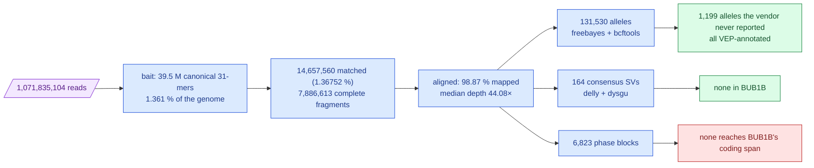

> **Legend** — **purple = raw input**; **blue = one stage each**; **green = what the route
> added**; **red = what it could not measure** (phase). Numbers from entries 087, 088, 090, 092.

| Measured | Value | Entry |
|---|---|---|
| reads recovered against bait share of genome | **1.36752 %** vs **1.361 %** — the bait is not enriched for anything but its own size | [087](../../../docs/iteration2/step-2/methodology/087-the-pass-and-what-it-recovered.md) |
| bait recall on reads carrying a known allele | **0.9052** [0.815, 0.974] | [087](../../../docs/iteration2/step-2/methodology/087-the-pass-and-what-it-recovered.md) |
| concordance with the vendor's genotypes, substitutions only | `bcftools call` **0.9957** (45,316 / 45,512); freebayes **0.9927** (43,322 / 43,639) | [088](../../../docs/iteration2/step-2/methodology/088-the-alleles-the-reads-carry.md) |
| alleles in or beside a coding exon the vendor never reported | **1,199**, all annotated | [090](../../../docs/iteration2/step-2/methodology/090-the-alleles-the-vendor-never-reported.md) |
| target vs decoy genes with a rare, protein-altering biallelic candidate, **novel alleles scored** | **10 / 396 vs 10 / 396**, Fisher one-sided p = **0.589** | [090](../../../docs/iteration2/step-2/methodology/090-the-alleles-the-vendor-never-reported.md) |
| the same, with **no** rarity or consequence filter | decoys **57.3 %** vs targets **51.0 %** — the decoys win | [088](../../../docs/iteration2/step-2/methodology/088-the-alleles-the-reads-carry.md) |
| the lead pair's phase | **unmeasurable**: 10,911 bp apart, 4 heterozygous sites between, ~266 bp fragments, at 43.7× | [088](../../../docs/iteration2/step-2/methodology/088-the-alleles-the-reads-carry.md), [092](../../../docs/iteration2/step-2/methodology/092-depth-per-exon-and-the-phasing-drawn.md) |
| cost of the bait per read across a 36,000-fold bait-size range | **1.05×** — bound by bytes of sequence, not bait size | [089](../../../docs/iteration2/step-2/methodology/089-the-instruments-and-the-gate-that-was-skipped.md) |

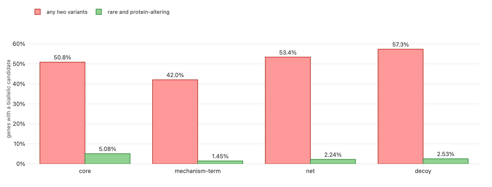

> **Legend** — **green = target genes**, **red = matched decoys**; left, no filter; right, the
> rarity + consequence filter with every read-derived allele scored. The bars are equal on
> the right: the symptom-derived list carries no signal of its own.

**The finding that re-weighted the whole iteration.** H020 predicted the target genes would
carry biallelic candidates more often than random decoys. Its first reading (targets 4,
decoys 2) was an **artefact**: the scoring query judged an allele by joining an annotation
table built from the delivered callset, so an allele only the read callers saw could not be
scored at all — a route built to find what the vendor missed could only rediscover what the
vendor found. Scoring the 1,199 novel alleles too made the rates **exactly equal**. H020 is
**refuted** on its pre-registered condition and its consequence applies: the read route
enters the fusion as a **confirmation route at weight 0** — it says whether an allele is real,
one copy, and not deleted; it never ranks. The discriminating power lives in the **filter**,
not in the **gene list**.

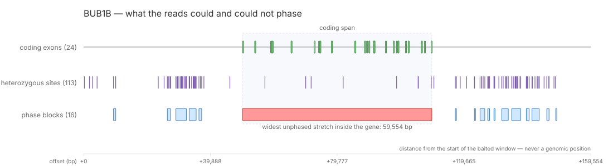

> **Legend** — the BUB1B exon rule with the heterozygous sites the reads carry and the
> read-backed **phase blocks** (stretches where the reads themselves say which alleles sit
> on the same chromosome copy). No block bridges the two lead alleles: **red = the unphased
> span**. This is a property of short-read fragments, not of depth; no deeper pass fixes it.

Verdicts: **H016, H019, H021, H022 supported**; **H020, H023 refuted** (two structural
variants over an exon of a rare-allele gene were found, `NLRP7` net-tier and `OBSCN` decoy,
both weak leads); **H017, H018 superseded** by H022/H023 because DeepVariant, Manta, LUMPY and
GRIDSS have no arm64 build on this machine ([089](../../../docs/iteration2/step-2/methodology/089-the-instruments-and-the-gate-that-was-skipped.md)).
The off-target bait gate (< 5 %) was **not reached** at any parameter — 8.79 % measured,
8.38–10.25 % across padding and k ([086](../../../docs/iteration2/step-2/methodology/086-can-the-off-target-gate-be-reached.md));
it was mis-specified, and a per-gene bait-density gate replaced it.

### 4.3 Step 3 — genotype and copy number without an aligner (entries 093, 095–097)

A third instrument re-typed every allele the read route found — plus every ClinVar
pathogenic allele in the target genes and 20,000 calibration markers — by counting the two
31-mers that differ only at the allele, straight from the baited reads: **no aligner, no
caller**. A negative-binomial model (counts are over-dispersed; Poisson would be ~3× overconfident)
fitted on the calibration markers turned counts into genotype posteriors.

| Measured | Value | Entry |
|---|---|---|
| alleles typed / probe pairs kept | **164,044** / **381,510** of 439,851 designed (37,306 dropped because the alternate k-mer exists elsewhere in GRCh38) | [095](../../../docs/iteration2/step-3/methodology/095-the-probes-and-the-counting-kernel.md) |
| fitted per-copy coverage | **17.96** → 35.93× diploid, against **35.2×** predicted from read length alone | [096](../../../docs/iteration2/step-3/methodology/096-the-alleles-at-their-multiplicity.md) |
| **the two lead alleles** | both **heterozygous at posterior 1.0**, ref/alt counts **11/12** and **18/16**, 3 of 3 probes agreeing each | [096](../../../docs/iteration2/step-3/methodology/096-the-alleles-at-their-multiplicity.md) |
| vendor-reported alleles confirmed vs vendor-unreported | **96.1 %** (645/671) vs **35.3 %** (140/397) | [096](../../../docs/iteration2/step-3/methodology/096-the-alleles-at-their-multiplicity.md) |
| copy number, 1,430 regions | median **2.00** autosomal, **0.95** on X (the proband is male — the model was not told); null band **[1.028, 2.823]**; no BUB1B exon below it | [097](../../../docs/iteration2/step-3/methodology/097-copy-number-without-an-aligner.md) |

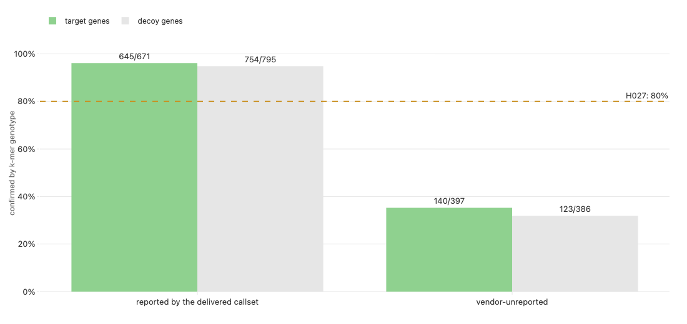

> **Legend** — **green = confirmed**, **red = contradicted**, **grey = no call**; by tier and
> by whether the vendor's caller had reported the allele. The 1,199 novel alleles are an
> **upper bound** with a measured error rate, not a caveat.

Verdicts: **H028 supported** (one copy each; 0.85), **H025 supported** (a ClinVar pathogenic
allele present at heterozygous multiplicity — the BUB1B stop; four other "confirmed" ClinVar
alleles are an artefact of an over-tight error rate and are said to be), **H024, H026, H027,
H029 refuted**. H026's refutation surfaced one candidate autosomal exon loss unrelated to the
pair — `BRD4` exon 7 at CN 0.85, net tier — flagged, not claimed. **One-copy dosage is not
phase evidence**; the entry says so.

### 4.4 Step 4 — the genome-wide ranking with no hard filter (entries 098–101)

The one route with measured discriminating power. Every coding allele in the VCF — **all
38,087 of them, every FILTER value kept** — gets a **likelihood ratio** (how many times more
likely the observation is if the allele is causal; a filter says in-or-out, a ratio says
*×4.33*, and nothing is ever removed). One calibrated lane per consequence class (LOFTEE-style
rules for truncating alleles, AlphaMissense for missense, SpliceAI for the splice window,
ClinVar, gnomAD frequency, a non-PASS down-weight of ⅓) on the Tavtigian ACMG ladder;
a phenotype lane calibrated on step 1's **own measured recall curve** (66.96× at rank 1 down
to 0.379× for an unranked gene); a STRING network lane, capped at "supporting", for the 72 %
of genes with no curation. Pairs, not genes, are the unit.

| Measured | Value | Entry |
|---|---|---|
| biallelic hypotheses / genes | **51,920** over **11,465** — 35,120 compound, 14,130 homozygous, 2,670 single | [099](../../../docs/iteration2/step-4/methodology/099-every-gene-ordered-with-nothing-filtered-out.md) |
| leader | **BUB1B** stop + missense, ratio **341,019** | [099](../../../docs/iteration2/step-4/methodology/099-every-gene-ordered-with-nothing-filtered-out.md) |
| runner-up | `ADAMTS1`, ratio 201,029, **1.70×** behind — and phased **cis** by the caller's own physical phasing, so not a compound heterozygote | [099](../../../docs/iteration2/step-4/methodology/099-every-gene-ordered-with-nothing-filtered-out.md) |
| target vs matched-decoy separation | AUC **0.706** [0.655, 0.751] | [100](../../../docs/iteration2/step-4/methodology/100-two-nulls-and-an-ablation.md) |
| permutation null (1,000 term sets matched to the child's) | **55 / 1,000** reach the observed leader, p = **0.056** — near-degenerate: only 4 genes in the callset can ever exceed it | [100](../../../docs/iteration2/step-4/methodology/100-two-nulls-and-an-ablation.md) |
| DNA alone (phenotype lane silenced) | BUB1B **joint third**, ratio 6,548, behind `ADAMTS1` and `HLA-DRB1` | [100](../../../docs/iteration2/step-4/methodology/100-two-nulls-and-an-ablation.md) |
| P(trans) from population co-occurrence | **undetermined** — 5 of 50 leading alleles reach gnomAD v2; reported at the uninformative 0.5 | [101](../../../docs/iteration2/step-4/methodology/101-the-phase-that-cannot-be-measured.md) |

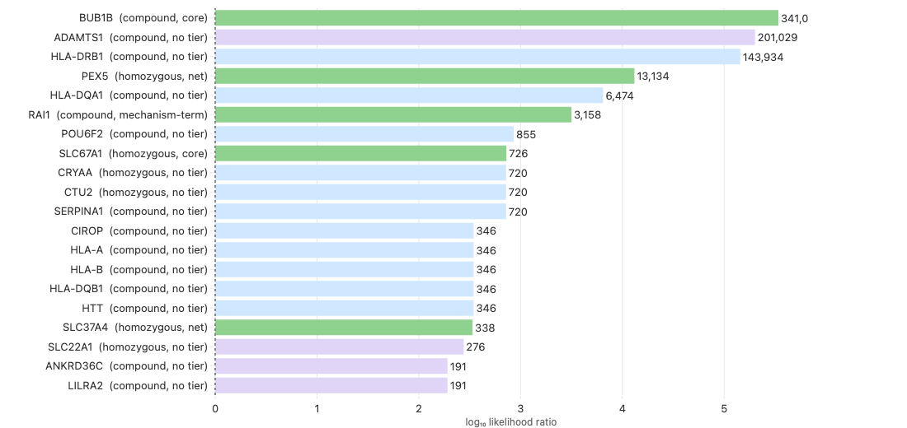

> **Legend** — **green = a step-1 target gene**, **red = a matched decoy**, **purple = an
> uncurated gene**, log scale. The leader stands 1.70× clear of a runner-up that is not a
> compound heterozygote at all.

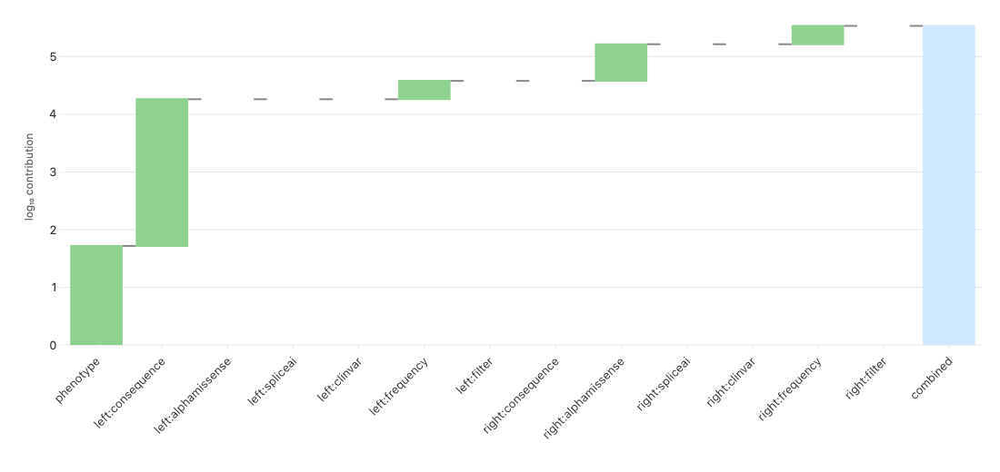

> **Legend** — the BUB1B pair's likelihood ratio decomposed into its lanes: **blue = genotype
> lanes**, **green = the phenotype lane**. The symptom route does the work of moving it from
> joint third to first.

Verdicts: **H030, H034, H035 supported**; **H031 refuted** (runner-up ≥ 10× behind: 1.70×),
**H032 refuted** (an uncurated gene reached the top 20 — through the unranked-phenotype
bucket, not the network lane), **H033 refuted** (p < 0.001 predicted; 0.056 measured). The
step names its single most load-bearing assumption: the AlphaMissense and SpliceAI ACMG
mappings could not be fetched and were **capped at *moderate***; lowering the cap to
*supporting* flips the lead to `ADAMTS1` ([098](../../../docs/iteration2/step-4/methodology/098-the-lanes-and-what-they-were-calibrated-against.md)).

### 4.5 Step 5 — does public knowledge nominate a pair? (entries 102–106)

Against 815 genes (404 targets, 396 decoys, step 4's top 20): LitVar for published alleles,
PubTator for papers co-mentioning a gene and each of the seven proband terms (5,705
searches), UniProt → InterPro → AlphaFold for where a missense sits in its protein, and
PubMed hit counts as the **baseline the engine must beat**. Two planned items were cut and
recorded: ESM1b (needs `torch`; AlphaMissense already covers every allele) and the LLM
evidence tournament (the plan's own first cut).

| Measured | Value | Entry |
|---|---|---|
| askable alleles with ≥ 1 publication | **1,821 of 1,914 (95.1 %)** — near saturation, orders almost nothing | [103](../../../docs/iteration2/step-5/methodology/103-the-alleles-somebody-already-published.md) |
| ClinVar pathogenic alleles the child carries, typed in the raw reads | **15** across 14 genes, one of them the BUB1B stop | [103](../../../docs/iteration2/step-5/methodology/103-the-alleles-somebody-already-published.md) |
| target vs matched-decoy separation | AUC **0.634** [0.593, 0.672] — below step 4's 0.706 on the same gene sets | [105](../../../docs/iteration2/step-5/methodology/105-does-the-literature-beat-a-hit-count.md) |
| against citation volume | Spearman ρ = **0.024**, top-5 overlap **0 of 5** | [105](../../../docs/iteration2/step-5/methodology/105-does-the-literature-beat-a-hit-count.md) |
| where BUB1B ranks by knowledge | **293 of 815**; the route's own top two genes are decoys, 10 of its top 25 are | [105](../../../docs/iteration2/step-5/methodology/105-does-the-literature-beat-a-hit-count.md) |
| the missense, in the protein | **95.4 %** along the chain, **outside every InterPro domain-typed entry**, AlphaFold pLDDT **91.06** (confidently modelled), AlphaMissense *likely_pathogenic* | [106](../../../docs/iteration2/step-5/methodology/106-where-the-missense-sits-in-the-protein.md) |
| best case report found blind for the leading gene | PMID 35804254 (MVA1 with a novel BUB1B variant), 3 of 7 terms — below H037's 5-term bar | [104](../../../docs/iteration2/step-5/methodology/104-the-papers-the-script-found.md) |

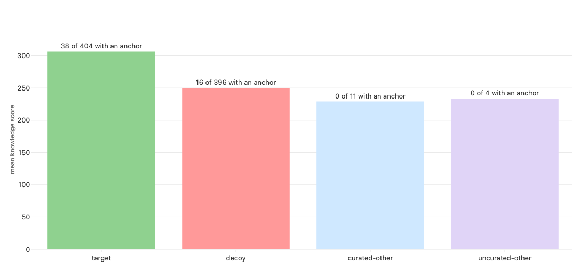

> **Legend** — **green = targets**, **red = matched decoys**, the bootstrap band on the AUC.
> Length-matched decoys are essential: unmatched controls would measure gene size, not knowledge.

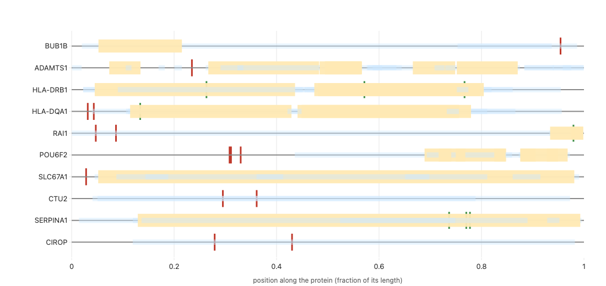

> **Legend** — **blue = InterPro domain-typed entries**, **purple = the family-level entry
> spanning the chain**, **red marker = the missense**, shading = AlphaFold confidence. The
> residue is past the kinase domain, in a confidently modelled stretch.

Verdicts: **H036, H038, H039 supported**; **H037 refuted** (a ≥ 5-term case report names a
top-20 gene — the threshold selects surveys and guidelines, not case reports; no post-hoc fix
was applied), **H040 refuted** (the missense is not in a domain-typed entry). The knowledge
route is **corroborating, not discovery-grade**, and enters the fusion with that weight.

### 4.6 Step 6 — fuse, freeze, unblind (entries 107–109, 124)

Three routes earned a vote by a rule fixed beforehand — a route ranks only if it separates
targets from decoys **and** reorders a trivial baseline: `phenotype` (step 1), `likelihood`
(step 4), `knowledge` (step 5). The read route (steps 2–3) confirms at **weight 0**.
**Reciprocal rank fusion** (add `w / (k + rank)` from each list, k = 60 fixed in advance,
absent = rank 51, never 0) over each route's top 50 gave 274 fused pairs. The ranking was
written and **hashed before the comparison** — sha256 `a596abf8…`
([108](../../../docs/iteration2/step-6/methodology/108-the-ranking-frozen-before-anyone-looked.md)).
Only then did `tools/unblind_it2.py` read the pair to look for **from the committed
iteration-1 selector file**, never by searching the ranking for a good answer.

| Measured | Value | Entry |
|---|---|---|
| fused rank 1, equal weights | **the BUB1B stop + missense pair** | [108](../../../docs/iteration2/step-6/methodology/108-the-ranking-frozen-before-anyone-looked.md) |
| fused rank 1, measured-error-rate weights (phenotype 0.3346, likelihood 0.9441, knowledge 0.6337) | **the same pair**; `ADAMTS1` rises to 2, `CLCNKB` falls 2 → 49 | [108](../../../docs/iteration2/step-6/methodology/108-the-ranking-frozen-before-anyone-looked.md) |
| the pair's rank on each route | likelihood **1** · phenotype **9** · knowledge **not listed** | [109](../../../docs/iteration2/step-6/methodology/109-what-the-mirror-found.md) |
| leave-one-route-out | without `likelihood` → rank **62**; without `phenotype` → 1 (tied with decoy `DDX11`); without `knowledge` → 1 | [108](../../../docs/iteration2/step-6/methodology/108-the-ranking-frozen-before-anyone-looked.md) |
| disjoint inputs behind the leader | **3 of 4** — HPO, VCF, reads; the literature is missing | [108](../../../docs/iteration2/step-6/methodology/108-the-ranking-frozen-before-anyone-looked.md) |
| what fills ranks 2–20 | `CLCNKB`, 11 pairs (ranks 2–12); `DDX11`, a **decoy**, 8 pairs (13–20) — three genes, not twenty candidates | [108](../../../docs/iteration2/step-6/methodology/108-the-ranking-frozen-before-anyone-looked.md) |
| expected information gain of a second upload | **0.000 bits** on every expressible question | [109](../../../docs/iteration2/step-6/methodology/109-what-the-mirror-found.md), [124](../../../docs/iteration2/step-6/methodology/124-the-reserve-file-built-and-rehearsed.md) |

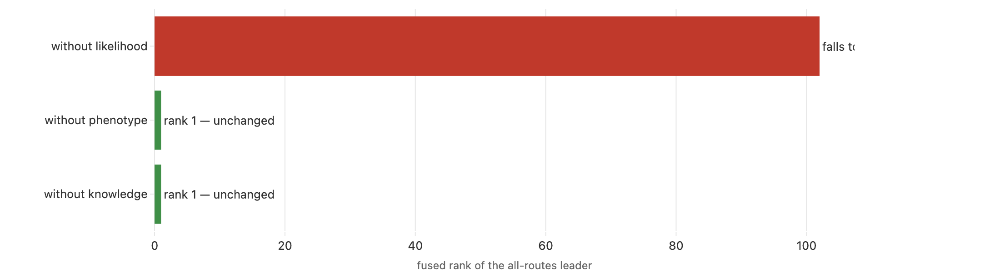

> **Legend** — the leader's fused rank with each route removed. **Green = still first**;
> **red = falls to 62** when the likelihood route is silenced. The fusion was never a consensus.

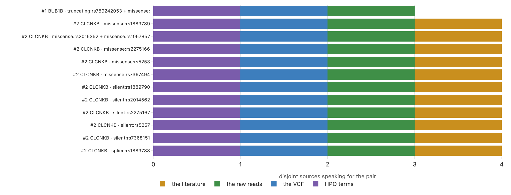

> **Legend** — one segment per disjoint input (**HPO, VCF, reads, literature**); the BUB1B
> pair's literature segment is empty. `CLCNKB` scores 4 of 4 on this count and is still not
> the answer — a count of inputs is not a rank.

Verdicts: **H043 supported** (≥ 2 disjoint inputs; 0.80), **H044 supported** (a second upload
is not informative; 0.90, re-tested on the built file in 124), **H041 refuted** (rank 1 *and*
no route below rank 3 — two routes were), **H042 refuted** (no single route carries the
result — the likelihood route does). Decision-table row 1 fires: **a replication report, and
no upload**. The plan's fourth row — a second pair with comparable posterior — is *live in
fact* (`ADAMTS1`, 1.70× behind) and *closed by the instrument*: the answer key holds one or two
alleles, so "both" is not a reply this oracle can give.

---

## 5. The two alleles, re-measured by iteration 2

Iteration 1 characterised the pair from annotations. Iteration 2 measured it, by instruments
that did not know which pair they were measuring. The Track 2 mechanism card (version 4)
carries these as facts F1–F9; the primary sources are the Track 1 entries below.

| Fact | Iteration 2's measurement | Entry |
|---|---|---|
| both alleles present, one copy each | heterozygous at posterior 1.0 in the raw reads, alignment-free; a **null + hypomorph** genotype, so some BubR1 is made | [096](../../../docs/iteration2/step-3/methodology/096-the-alleles-at-their-multiplicity.md) |
| no hidden third allele | every BUB1B exon region at two copies; no consensus structural variant in the gene | [097](../../../docs/iteration2/step-3/methodology/097-copy-number-without-an-aligner.md), [088](../../../docs/iteration2/step-2/methodology/088-the-alleles-the-reads-carry.md) |
| the missense is damaging | AlphaMissense *likely_pathogenic*, lane contribution 4.33 (capped at moderate); the pair leads 51,920 hypotheses with no filter | [099](../../../docs/iteration2/step-4/methodology/099-every-gene-ordered-with-nothing-filtered-out.md) |
| where the missense sits | past every domain-typed entry, 95.4 % along the chain, confidently modelled (pLDDT 91.06) — dosage, not folding, is the argued mechanism | [106](../../../docs/iteration2/step-5/methodology/106-where-the-missense-sits-in-the-protein.md) |
| **phase** (one allele per parental copy) | **unmeasured**: no read-backed phase block reaches the pair; population co-occurrence undetermined. *Trans* is the **oracle's** statement, not a read measurement | [092](../../../docs/iteration2/step-2/methodology/092-depth-per-exon-and-the-phasing-drawn.md), [101](../../../docs/iteration2/step-4/methodology/101-the-phase-that-cannot-be-measured.md), [083](../../../docs/iteration1/step-6/methodology/083-oracle-reply-submission-1.md) |
| the literature | the gene ranks 293 of 815 by public knowledge; the blind script still found a citable MVA1 case report for it | [105](../../../docs/iteration2/step-5/methodology/105-does-the-literature-beat-a-hit-count.md), [104](../../../docs/iteration2/step-5/methodology/104-the-papers-the-script-found.md) |

---

## 6. Step 8 — the disease's defining feature, bounded (entries 115–118, 121, 123)

MVA means some cells have the wrong chromosome count. Iteration 1's karyogram (entry 037)
said every autosome looked flat. Step 8 asked what that was worth — and found the statistic
had **no power**: a mosaic gain splits heterozygous sites into two bands symmetric about the
centre, so their plain mean does not move. Folding the bands first (**B-deviation**,
`|BAF − centre|` averaged *after* taking the distance) does.

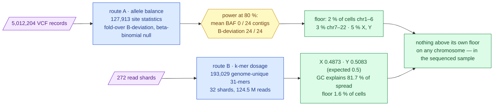

> **Legend** — **purple = the two raw inputs**; **blue = two instruments sharing nothing past
> the FASTQ**; **yellow = the power question**; **green = the bounds**. Route A is blind to X
> and Y in a male (almost no heterozygous sites); route B is blind to copy-neutral loss of
> heterozygosity. Where both can see, they must agree (H054).

| Measured | Value | Entry |
|---|---|---|
| power at 80 %, 037's mean-BAF statistic vs fold-over B-deviation | **0 of 24** vs **24 of 24** contigs | [116](../../../docs/iteration2/step-8/methodology/116-the-statistic-that-has-power-and-the-limit-it-buys.md) |
| detection floor, allele route | **2 %** of cells chr1–6, **3 %** chr7–22; nothing above its own floor | [116](../../../docs/iteration2/step-8/methodology/116-the-statistic-that-has-power-and-the-limit-it-buys.md) |
| the divisor under a *variegated* genome | leave-one-out depth baseline **42.42×** [42.30, 42.64]; 1–3 injected abnormal chromosomes at 5–20 % recovered in **100 %** of 30 replicates, untouched ones false-flagged at **≤ 0.0048** | [118](../../../docs/iteration2/step-8/methodology/118-the-baseline-and-what-a-variegated-genome-does-to-it.md) |
| five-model mechanism comparison (Kong 2018, re-implemented) | **not usable**: 19 of 24 contigs end at a parameter bound; fitted fraction tracks the noise share at ρ = **0.938** | [117](../../../docs/iteration2/step-8/methodology/117-five-models-and-the-family-this-data-does-not-fit.md) |
| k-mer dosage, the positive control | X **0.4873** [0.4790, 0.4958], Y **0.5083** [0.4959, 0.5201] against 0.5 — the model was never told the sex | [121](../../../docs/iteration2/step-8/methodology/121-the-second-instrument-and-the-shards-it-did-not-need.md) |
| composition correction | chromosome GC explains **81.7 %** of the between-chromosome spread (1.876 % → 0.802 %) | [121](../../../docs/iteration2/step-8/methodology/121-the-second-instrument-and-the-shards-it-did-not-need.md) |
| chr21, the only autosome that moved | **4.03 σ** on probe GC → **2.33 σ** on the chromosome's own GC, Bonferroni p **0.43**; a mismapping pile-up tail (p99 depth 247 vs 66–69), not copy number | [121](../../../docs/iteration2/step-8/methodology/121-the-second-instrument-and-the-shards-it-did-not-need.md) |
| honest floor, dosage route | **1.6 % of cells** — twice the corrected residual spread, not the bootstrap width | [121](../../../docs/iteration2/step-8/methodology/121-the-second-instrument-and-the-shards-it-did-not-need.md) |
| the divisor that assumes nothing | absolute k-mer-mass and autosomal-median denominators agree on **24 of 24** contigs to **0.017 %** | [123](../../../docs/iteration2/step-8/methodology/123-the-denominator-that-assumes-nothing-read-back.md) |

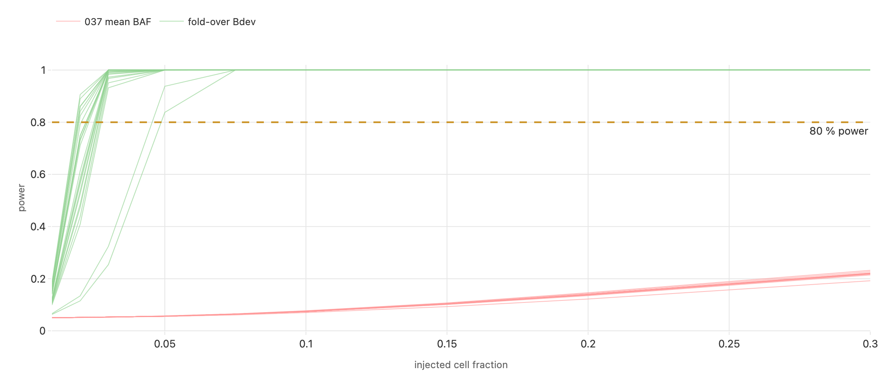

> **Legend** — power against injected cell fraction, per contig: **red = entry 037's mean
> BAF**, which never reaches 80 %; **green = fold-over B-deviation**, which does on every contig.

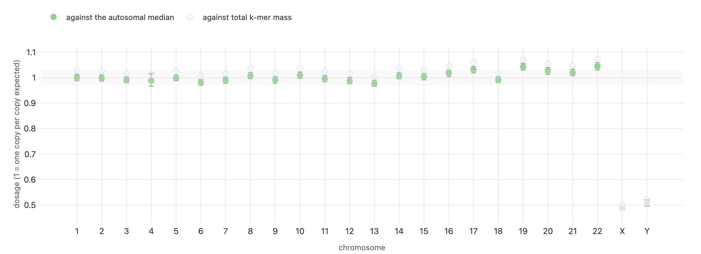

> **Legend** — relative dosage per contig with bootstrap intervals; **blue = autosomes**,
> **green = X and Y at one copy**, the control to read first; the band is the composition-corrected null.

**All seven claims supported** (H051–H057). What this does **not** say: the tissue sequenced
is not named by the delivery, a karyotype's fraction is measured in cultured cells, position
was aggregated away so focal and sub-arm events are invisible by construction, and
copy-neutral loss of heterozygosity is invisible to the dosage route. A bound on the sequenced
sample, never a statement about the diagnosis.

---

## 7. The submission, read as a measurement (entry 124)

The scorer returns `full_match_rank`, `partial_match_rank`, `f_max` and its threshold. Read
against the hypothesis space — every answer key still considered possible — a reply is a
measurement. After the reply to submission 1 that space is **a single point**. The file
iteration 2 would upload was nevertheless built from coordinate-free selectors, graded
byte-for-byte on our replica **and** on the organisers' published `evaluation.py`, and decoded:

| rank | epcr | type | row |
|---|---|---|---|
| 1 | 0.9993 | primary | **BUB1B stop_gained + missense** (H009) |
| 2 | 0.4996 | secondary | **LZTR1** heterozygous stop_gained, ClinVar P/LP — dominant schwannomatosis predisposition, unrelated to MVA |
| 3 | 0.02498 | secondary | **FLG** heterozygous stop_gained, ClinVar P — ichthyosis vulgaris / atopy |
| 4 | 0.01499 | secondary | **F5** Factor V Leiden, heterozygous — low-penetrance thrombosis risk |

**No number in this table was typed.** The rank-1 epcr is the register's suggested confidence
for H009 after the oracle's own reply entered its evidence (a transparent triage heuristic
taken to its end, not a calibrated posterior); the secondary rows sit below it by allele
score; the notes quote only columns of the table each allele was selected from
([`derivation.md`](derivation.md)). Iteration 1's alternative pairings are gone — the reply
eliminated them.

| Reply: full match rank | partial match rank | F-max | at epcr | prior mass | survivors |
|---|---|---|---|---|---|
| 1 | — | 1.000 | 0.9993 | 1.00 | stop+missense |

Both scorers agree: **100 rank points, F-max 1.0**. Prior entropy **0 bits**, expected
information gain **0.000 bits**. The plan's rule ([§6](../../../docs/iteration2/plan.md)) is
that an upload is spent only when a pre-registered decode table shows a gain above zero on a
live hypothesis. It does not. **Not uploaded; 5 of 6 remain, deliberately.** The file is
`submissions/track1/iteration-2/agharsallah_bub1b-comphet-replication.csv` (in the iteration folder,
gitignored; sha256 `325205a8…`; rebuild in [`README.md`](README.md)). Timing of any upload is the team's call.

---

## 8. Reproducibility, runtime and cost

Every step has a `How to reproduce it` block in its README under
[`docs/iteration2/`](../../../docs/iteration2/README.md); the commands below are the spine.

```bash
# step 1 — the blind target set (laptop; the full benchmark ~2 h 16 min on one core, entry 091)
uv run python tools/build_it2_targets.py && uv run mva-phenotype benchmark --sample 3240 --seed 20260910
# step 2 — bait, one pass over 1.07 B reads (server-side POST /bait, 50.8 min; 4.2 h projected on the laptop, entry 087)
uv run python tools/build_it2_bait.py && uv run python tools/run_it2_step2_calling.py
# step 3 — k-mer genotypes and copy number from the baited reads (laptop; 765 s + 512 s, entries 095, 097)
uv run python tools/build_it2_probes.py && uv run python tools/run_it2_step3_counts.py && uv run python tools/fit_it2_genotypes.py
# step 4 — likelihood-ratio ranking (laptop; the 1,000-draw permutation null 34 min, entry 100)
uv run python tools/rank_it2_pairs.py
# step 5 — the knowledge engine (free public APIs; 5,705 PubTator searches, entry 104)
uv run python tools/fetch_it2_catalogue.py && uv run python tools/build_it2_anchors.py --interval 0.7
# step 6 — fuse, freeze, unblind
uv run python tools/fuse_it2_routes.py && uv run python tools/assess_it2_upload.py && uv run python tools/unblind_it2.py && uv run python tools/check_blind.py
# step 8 — mosaic bound (route A laptop; route B 32 of 272 shards server-side, 2,803.8 s, entry 121)
uv run python tools/fit_it2_mosaic.py --stages constants bdev baseline models limits multi
uv run python tools/run_it2_dosage_pass.py --upload --subsample 32 --workers 8
# the submission
uv run python tools/resolve_submission_spec.py --selectors submissions/track1/iteration-2/spec.selectors.json --out build/submission/spec.json
uv run python tools/design_submission.py --spec build/submission/spec.json --out submissions/track1/iteration-2/agharsallah_bub1b-comphet-replication.csv
```

Hardware: one arm64 laptop (16 GiB) for everything but two read passes, which ran on a small
Linux server holding the 272-shard read store; a hosted PostgreSQL for the warehouse; free
public APIs (Ensembl VEP REST, LitVar, PubTator, UniProt, InterPro, AlphaFold DB, PubMed,
STRING). **No paid compute.** The k-mer engine's cost is bound by bytes of sequence, not by
bait size (1.05× per read across 36,000× of bait), which is what makes "give me the reads for
these genes" a case-agnostic tool. What the arm64 machine could not run is recorded, not
hidden: DeepVariant, Manta, LUMPY, GRIDSS, Exomiser/LIRICAL — substituted by freebayes +
`bcftools call`, delly + dysgu, and step 1's own ranker.

The tooling is generic: a reference k-mer read bait and counting kernel (`mva.kmer`), a
negative-binomial k-mer genotyper and local-flank copy number, a per-lane calibrated
likelihood-ratio pair ranker, a reciprocal-rank fuser with leave-one-out and a freeze
receipt, a knowledge fetcher with matched-decoy baselines, a mosaic-fraction bound with two
instruments and an injection harness, a blind gate, and a per-iteration step map. Every
table is in `warehouse.data_lineage`; every figure is drawn from a run's own output file.
`tools/check-python.sh` runs the eight quality gates, including the coordinate gate and the
iteration-folder gate.

---

## 9. Limitations, stated

- **One route carried the rediscovery.** Silence the likelihood ranker and the pair falls to
  rank 62; the symptom route had it at rank 9; the literature never listed it. "Three routes
  agree" would be false; "one found it, two corroborated it at a distance, one confirmed it
  in the reads" is the sentence ([109](../../../docs/iteration2/step-6/methodology/109-what-the-mirror-found.md)).
- **The rank-1 position depends on the clinical terms and on one calibration cap.** DNA alone
  puts the pair joint third; capping the missense and splice lanes at *supporting* instead of
  *moderate* flips the lead to `ADAMTS1` ([099](../../../docs/iteration2/step-4/methodology/099-every-gene-ordered-with-nothing-filtered-out.md), [100](../../../docs/iteration2/step-4/methodology/100-two-nulls-and-an-ablation.md)).
- **Phase is unmeasured.** No read-backed phase block reaches the pair and population
  co-occurrence is undetermined. *Trans* rests on the recessive model and on the oracle's
  answer key; iteration 2's own instruments cannot reach it.
- **A rediscovery is not coverage.** The symptom ranker's held-out recall@300 is 0.335, and
  73.6 % of protein-coding genes have no HPO curation; the route found *this* pair and says
  nothing about the next case. The genome-wide ranking is the safety net, and its permutation
  p is 0.056, not < 0.001.
- **The read route has no ranking power of its own** (H020 refuted); its 1,199 novel alleles
  are corroborated at 35.3 % by the alignment-free instrument and are an upper bound with a
  measured error rate. Concordance with the vendor covers substitutions only; the structural
  variant consensus used two of four planned callers and no positive-control sample.
- **Below rank 1 the fused ranking has poor resolution.** Rank inheritance makes the top 20
  three genes; a matched decoy holds ranks 13–20. The confirmation triple is gene-level, not
  allele-level.
- **The literature route is weak by measurement**, AUC 0.634, and would not have found the
  gene (rank 293 of 815). A publication is not evidence about this child; 95.1 % of alleles
  have one.
- **The mosaic bound is about the sequenced sample.** Tissue unstated; focal and sub-arm
  events invisible by construction; copy-neutral loss of heterozygosity invisible to the
  dosage route; the mechanism-of-origin models do not fit this data at all. The dosage
  route's divisors were checked against each other (0.017 %) but were not put through the
  injection harness the allele route was ([118](../../../docs/iteration2/step-8/methodology/118-the-baseline-and-what-a-variegated-genome-does-to-it.md), [123](../../../docs/iteration2/step-8/methodology/123-the-denominator-that-assumes-nothing-read-back.md)).
- **Confidence numbers are a heuristic.** The register's weighing is transparent arithmetic
  for triage, not a calibrated posterior; the epcr of 0.9993 inherits that caveat.
- **Some of the plan's instruments never ran on this hardware**, and two exhibits (the
  per-exon depth grid, the BUB1B phase track) are committed figures not yet on the dashboard
  route (`docs/iteration2/step-2/notes/completion-audit.md`, D7–D8).

---

## 10. Methods form (Track 1), model 2 — answered

| Question | Answer |
|---|---|
| Model | model 2: the **blind mirror** — target set → k-mer read bait + two callers → alignment-free genotype and copy number → genome-wide likelihood-ratio pair ranking → knowledge engine → reciprocal-rank fusion, frozen, then unblinded |
| Automated or curated? | **Automated** to the fused ranking and its rank-1 pair, which was hashed before anyone compared it to iteration 1. The submission layout (one primary pair, three secondary rows) follows a stated rule and was simulated; nothing in it is a belief typed by hand |
| Public data only? | **Yes** — Ensembl 116 and VEP REST (gnomAD v4, ClinVar, AlphaMissense, SpliceAI), HPO release 2026-06-23, STRING, LitVar, PubTator, UniProt, InterPro, AlphaFold DB, PubMed, GRCh38 |
| Pairs or singles? | **Pairs**: every hypothesis in step 4 and every fused unit in step 6 is a biallelic pair; the primary row holds both alleles |
| Secondary findings | ClinVar P/LP after excluding conflicting and benign-tagged records, gnomAD AF < 0.02, dominant or risk-factor genes → LZTR1, FLG, F5 as `secondary`; recessive carrier states reported, not submitted |
| Runtime and cost | two read passes on a small Linux server (50.8 min; 2,803.8 s for 32 of 272 shards), the rest on one laptop; the longest laptop jobs are the 3,240-disease benchmark (~2 h 16 min) and the permutation null (34 min); free public APIs; one small hosted PostgreSQL; no paid compute |
| Abstract | [`methods-form.json`](methods-form.json), question 18, under 500 words; strengths and limitations from §1 and §9 |

---

## 11. Where every claim lives

| Step | Supported | Refuted or superseded | Entries |
|---|---|---|---|
| 1 target set | H013 (0.83) | H012 (0.04), H014 (0.10), H015 (0.02) | [084](../../../docs/iteration2/step-1/methodology/084-the-blind-target-set.md), [091](../../../docs/iteration2/step-1/methodology/091-recall-at-the-full-population.md) |
| 2 reads | H016 (0.88), H019 (0.70), H021 (0.65), H022 (0.88) | H020 (0.07), H023 (0.25); H017, H018 superseded | [085](../../../docs/iteration2/step-2/methodology/085-the-bait-and-where-it-runs.md)–[090](../../../docs/iteration2/step-2/methodology/090-the-alleles-the-vendor-never-reported.md), [092](../../../docs/iteration2/step-2/methodology/092-depth-per-exon-and-the-phasing-drawn.md) |
| 3 k-mer genotype | H025 (0.60), H028 (0.85) | H024 (0.15), H026 (0.30), H027 (0.08), H029 (0.20) | [093](../../../docs/iteration2/step-3/methodology/093-where-the-aligner-was-unsure.md), [095](../../../docs/iteration2/step-3/methodology/095-the-probes-and-the-counting-kernel.md)–[097](../../../docs/iteration2/step-3/methodology/097-copy-number-without-an-aligner.md) |
| 4 likelihood ratio | H030 (0.75), H034 (0.95), H035 (0.86) | H031 (0.14), H032 (0.25), H033 (0.15) | [098](../../../docs/iteration2/step-4/methodology/098-the-lanes-and-what-they-were-calibrated-against.md)–[101](../../../docs/iteration2/step-4/methodology/101-the-phase-that-cannot-be-measured.md) |
| 5 knowledge | H036 (0.80), H038 (0.78), H039 (0.85) | H037 (0.15), H040 (0.20) | [102](../../../docs/iteration2/step-5/methodology/102-the-sources-and-what-they-could-be-asked.md)–[106](../../../docs/iteration2/step-5/methodology/106-where-the-missense-sits-in-the-protein.md) |
| 6 fusion | H043 (0.80), H044 (0.90) | H041 (0.20), H042 (0.12) | [107](../../../docs/iteration2/step-6/methodology/107-the-routes-and-which-of-them-earned-a-rank.md)–[109](../../../docs/iteration2/step-6/methodology/109-what-the-mirror-found.md), [124](../../../docs/iteration2/step-6/methodology/124-the-reserve-file-built-and-rehearsed.md) |
| 8 mosaic bound | H051 (0.80), H052 (0.85), H053 (0.95), H054 (0.85), H055 (0.80), H056 (0.85), H057 (0.85) | — | [115](../../../docs/iteration2/step-8/methodology/115-the-callset-reduced-to-what-a-mosaic-model-needs.md)–[118](../../../docs/iteration2/step-8/methodology/118-the-baseline-and-what-a-variegated-genome-does-to-it.md), [121](../../../docs/iteration2/step-8/methodology/121-the-second-instrument-and-the-shards-it-did-not-need.md), [123](../../../docs/iteration2/step-8/methodology/123-the-denominator-that-assumes-nothing-read-back.md) |
| the pair (iteration 1) | H009 (supported; oracle) | — | [074](../../../docs/iteration1/step-6/methodology/074-submission-v1-design.md), [083](../../../docs/iteration1/step-6/methodology/083-oracle-reply-submission-1.md) |

Confidences are the register's committed values (`mva-science board`); where a committed value
sits below the arithmetic's suggestion, the hypothesis file records why. Step 7 is Track 2's
step (H045–H050, H061, all supported) and is reported in
[`submissions/track2/iteration-2/`](../../track2/iteration-2/README.md), a draft built on the
confirmed pair and on the facts above; it does not test the pair and is not cited here as
evidence for it.
