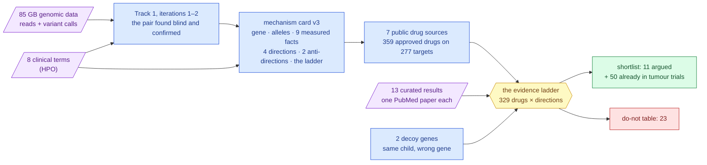
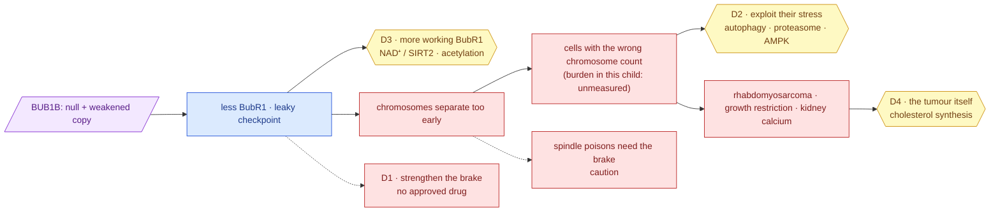
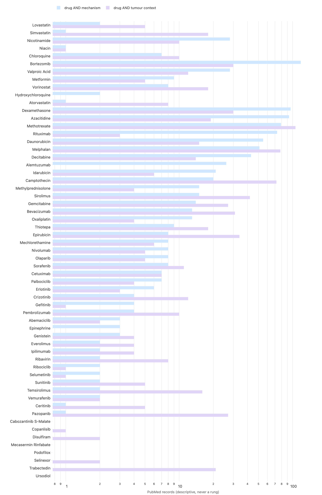
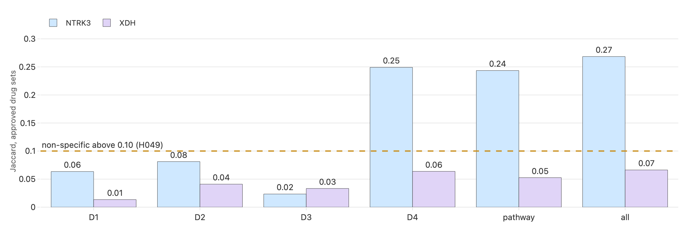
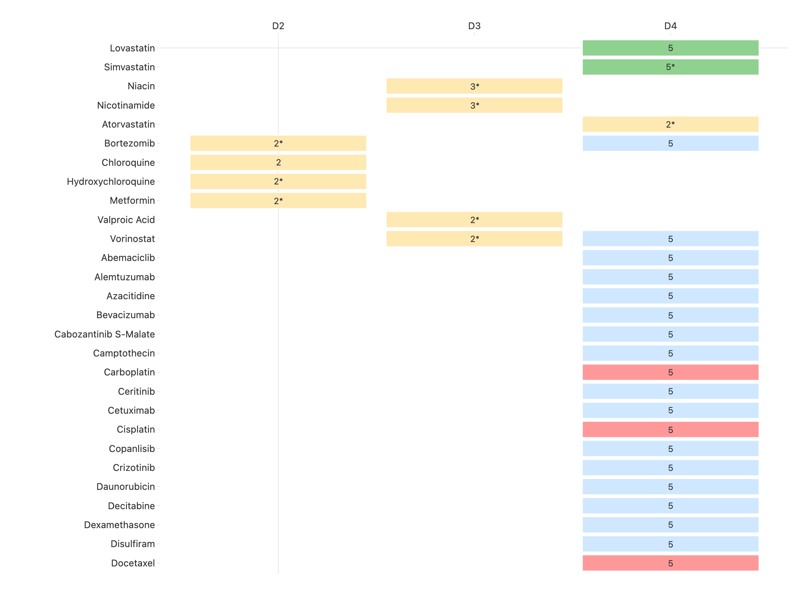
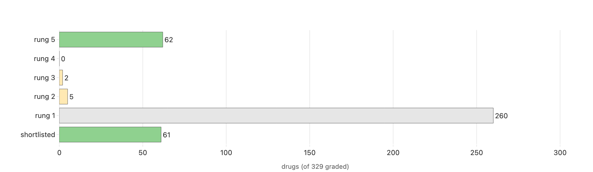
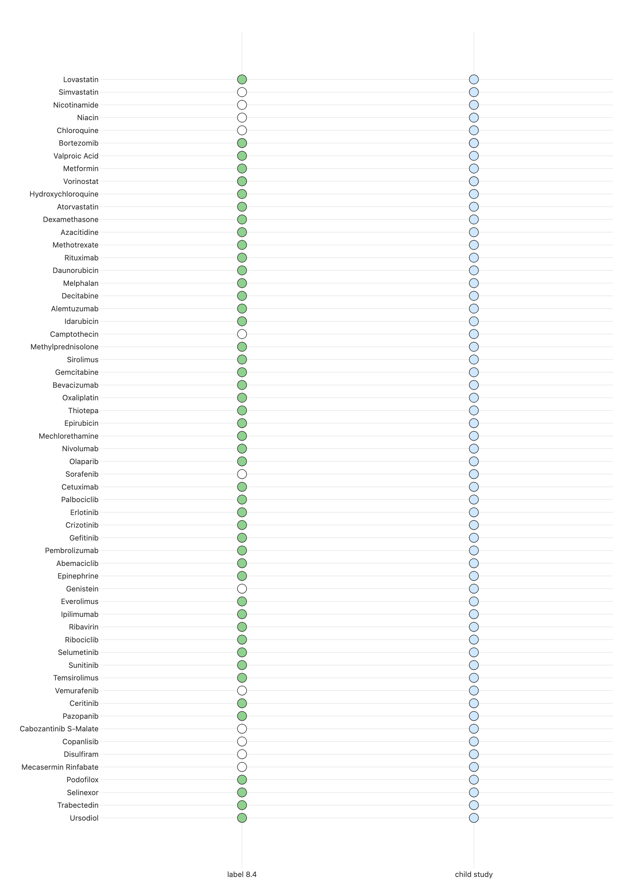

# Track 2 report — which approved medicines could act on this child's broken checkpoint?

**Standing:** draft, written 2026-09-18 from executed runs (iteration 2, step 7 — methodology
entries [110](../../../docs/iteration2/step-7/methodology/110-the-card-revised-and-the-claims-filed-before-the-search.md)–[113](../../../docs/iteration2/step-7/methodology/113-the-ladder-the-shortlist-and-the-do-not-table.md)).
Every number is read from a table with a provenance manifest, every claim was registered before
its test, and every cited paper was resolved against PubMed the same day. **Superseded by
[`../iteration-2/`](../iteration-2/report.md) and never uploaded** — kept for provenance, with
its facts frozen at mechanism card **version 3** (the aneuploidy burden, fact F8, is *unmeasured*
here). Restructured on 2026-09-20 to the same four-criteria shape as iteration 2, **with every
fact unchanged at card v3**: sections were added and renumbered, nothing was remeasured and no
later result was imported.

Written for the panel, in plain words. Each technical term appears once with its meaning in
brackets; the full dictionary is served at `/learn` on the dashboard.

> The challenge's own framing, kept in view throughout: *submissions are hypotheses for
> follow-up, not evidence that a medicine works.* Nothing below is a recommendation to treat.

---

## 1. How this report answers the panel's four criteria

> **Rubric:** all four — this section is the map, and the last column names each criterion's
> weakest point before a judge has to go looking for it.

| criterion | weight | where in this report | the evidence, in one line | the weakest point we know |
|---|---|---|---|---|
| **Scientific Rigor** | 35 % | §2, §4, §5, §6, §10, §12 | the mechanism is read off a genotype the challenge's answer key confirmed, with nine facts measured onto the card; every approved drug sits on a five-rung ladder written before the search; six claims were registered with their refutation conditions before any drug-level query | **no approved drug has a molecule-level result on BubR1 itself.** The deepest mechanism lead (D3) is one mouse paper, and the two approved molecules inherit it as a *proxy* |
| **Potential Impact** | 25 % | §7, and the do-not table in §6.3 | a do-not table naming 13 spindle poisons — two of them this child's standard chemotherapy — that work by relying on the very checkpoint that is broken; the D1 result and that caution follow from the checkpoint, so they are arguments about the disease, not only about this gene | the child's **aneuploid fraction is unmeasured in this draft**, so direction D2 is argued from published aneuploid-cell biology and not from him; and nothing here is evidence that a medicine works |
| **Innovation** | 25 % | §8, §5.3 | one structured mechanism card drives every query; the same pipeline is re-run on a decoy gene as a negative control and the overlap is measured against a threshold fixed in advance; automated and person-read evidence are printed side by side; the do-not table is a first-class output | these are **process** innovations, not new biology: no new model, no new algorithm, and knowledge-graph repurposing rankers already exist (§8) |
| **Scalability** | 15 % | §9, §11 | one card in, five commands out, every table carrying its own provenance manifest; the whole run is two laptop runs of about ten minutes against public APIs, seconds when cached, no cloud | the curated rungs are the human bottleneck — 13 abstracts read by one person on one day — and the transfer run onto a genuinely different case **post-dates this draft** and belongs to iteration 2 (§9) |

---

## 2. The answer in one page

> **Rubric:** Scientific Rigor — the whole claim on one page: the mechanism read off a
> confirmed genotype, the four directions with the highest rung each reached, and what is
> not known. Every later section exists to support or qualify something stated here.

**The child.** A boy with mosaic variegated aneuploidy (MVA: in some of his cells, a chromosome
is missing or duplicated, and different cells are wrong in different ways), short stature,
failure to thrive, calcium deposits in the kidneys, and a rhabdomyosarcoma (a muscle-tissue
cancer of childhood). Eight clinical terms were delivered with the case.

**The cause.** Track 1 found, and the challenge's answer key confirmed, two different broken
copies of one gene, `BUB1B` — one from each parent (a *compound heterozygote*). The gene makes
BubR1, the protein that acts as the **brake** on cell division: it holds a dividing cell until
every chromosome is properly attached before the cell is allowed to split. One copy makes no
protein at all (a *stop* change); the other makes a weakened protein (a *missense* change in the
protein's last stretch). The child therefore has **some brake, but less than normal** — which is
exactly the pattern every published MVA case with this gene shows, because having no brake at
all is not survivable.

**The mechanism, in the form the methods form asks for.** *Loss of function*, not gain: less
BubR1, a leakier checkpoint, chromosomes that separate too early, cells with the wrong count,
and — in surviving cells — a chronic stress from carrying the wrong number of copies of many
proteins. Downstream: the aneuploidy that names the disease, the growth problems, and a
predisposition to exactly the cancers this child has.

**Four ways a drug could act, graded on a ladder written before the search.**

| Direction | The idea | What we found | Best rung |
|---|---|---|---|
| **D1** reinforce the brake | make the remaining checkpoint stronger | **no approved drug does this.** Every checkpoint drug on the market or in trials *weakens* it. D1 became the do-not table | — |
| **D2** exploit the stress of aneuploid cells | aneuploid cells are already stressed; some approved drugs tip them over | **chloroquine** (a malaria drug) killed aneuploid cells preferentially in the reference screen; metformin, hydroxychloroquine and bortezomib inherit the result through their drug class | 2 (cell model) |
| **D3** raise the amount of working BubR1 | the weakened copy still works; stabilise it | **niacin / nicotinamide** (vitamin B3 forms): boosting the NAD⁺ pathway raised BubR1 in mice bred to have too little of it; valproic acid and vorinostat act on BubR1's acetylation switch | 3 (animal model) |
| **D4** the child's actual tumour | approved, non-chemotherapy drugs with a mechanism in rhabdomyosarcoma | **statins** (lovastatin, simvastatin, atorvastatin): rhabdomyosarcoma cells depend on making their own cholesterol; lovastatin itself slowed them; simvastatin has already been in a completed paediatric sarcoma trial | 5 (approved, trialled in this tumour, used in children) — carried by rung-2 mechanism evidence |

**The half a clinician may care about most: what not to do.** Thirteen approved drugs are
*spindle poisons* — they work by jamming cell division and relying on the checkpoint to hold
the cell. In a child whose checkpoint is the broken part, that reliance is a hypothesis worth
weighing before treatment. Several of them (vincristine, vinorelbine) are standard
rhabdomyosarcoma chemotherapy. **This report flags the question for the treating team; it does
not advise withholding standard care.**

**What we do not know.** How aneuploid this child's cells actually are (the sequencing data
delivered cannot measure it with any power; the analysis that could is planned and not run).
Whether the weakened BubR1 copy is unstable or simply inactive. And whether any drug on this
page helps — rung 3 is one mouse paper.

---

## 3. Where this comes from — two datasets, one line of evidence

> **Rubric:** Scientific Rigor — shows that both delivered datasets (the DNA and the
> clinical terms) enter the argument, and where each stage's output can be checked.



> **Legend** — **purple = raw inputs** (the child's DNA, the child's clinical terms, and the
> papers a person read); **blue = machinery** (every box is a tool with a manifest); **yellow =
> the decision point** (the ladder); **green = the goal** (the shortlist); **red = what to
> avoid** (the do-not table).

Both datasets are used at every stage: the genomic data fixed the gene and the two alleles;
the clinical terms fixed the disease, the tumour and — through the tumour — the fourth
direction and the paediatric questions. Where a result uses only one, the table says so.

---

## 4. The mechanism (methods form Q14: loss- versus gain-of-function, pathway, consequence)

> **Rubric:** Scientific Rigor — this is the methods form's Q14, the variant-mechanism
> characterisation. Every drug argument below is only as sound as this section.

### 4.1 Loss of function, of a specific shape

| copy | what changed | what it does to the protein | evidence |
|---|---|---|---|
| one | a *stop* change in exon 17 of 23 | the protein ends early, before its last working part — **no functional protein** | catalogued as disease-causing for MVA (ClinVar VCV000533901) |
| the other | a *missense* change in exon 23 of 23 — one amino acid swapped | a **weakened** protein: never seen in 140,000 healthy genomes, predicted damaging by two independent predictors | Track 1 (iteration 1, entries 070–074; iteration 2, entry 099) |

Nine facts measured in iteration 2 sit on the mechanism card so the argument does not rest on
the allele labels alone:

| fact | measured | what it changes for a drug |
|---|---|---|
| the two copies are on **different** chromosomes (*trans*) | **confirmed** by the challenge's answer key (a full match at rank 1) | the whole argument stands on a confirmed genotype, not an inference |
| each copy present **once** in the raw sequencing reads | yes — both alleles at one-copy dosage, read without an aligner | a *null + weakened* genotype: some BubR1 exists to stabilise (D3 is live) |
| no deleted or duplicated stretch in the gene | every exon at two copies; no structural variant in the gene | the two alleles are the whole story |
| where the missense sits in the protein | outside every catalogued domain, in a region the structure model is confident about | we **cannot** say whether the weakened copy is unstable or inactive; D3 is argued as *more BubR1*, not *refold it* |
| how aneuploid this child's cells are | **unmeasured** — the karyotype test iteration 1 ran has no power for mosaic gains; the powered analysis (step 8) has not run | D2 is argued from published aneuploid-cell biology, not from this child's burden |

(Complete list F1–F9, with the entry each comes from: mechanism card v3, and step 7's README.)

### 4.2 The pathway: the spindle assembly checkpoint

BubR1 is a core part of the **spindle assembly checkpoint** (SAC — the wait-until-attached
brake) and of the complex that switches off the machinery that pulls chromosomes apart. Less
BubR1 means a **leaky brake**: division can proceed with chromosomes still unattached.
Published MVA patient cells show strongly reduced BubR1 and a weakened checkpoint
(Suijkerbuijk 2010, PMID 20516114); the founding paper tied biallelic `BUB1B` changes to MVA
with cancer predisposition (Hanks 2004, PMID 15475955). Complete loss is lethal before birth
in mouse and human — which is why "switch BubR1 off" is never a therapeutic direction here.

### 4.3 Downstream consequences, and where a drug could stand



> **Legend** — **purple** the genotype; **blue** the molecular consequence; **yellow** the three
> places an approved drug could stand, each a direction below; **red** what goes wrong, and the
> two dotted boxes are the direction with no drug and the class to be cautious with.

---

## 5. How the candidates were found and graded

> **Rubric:** Scientific Rigor, and the negative control that §8 claims as the new part —
> how a candidate got in, how it was graded, and what the pipeline returns for a gene that
> should return nothing.

### 5.1 The search: one card, seven public sources, no hand-typed query

The mechanism card (a structured file naming the gene, the two allele classes, the pathway,
the disease, the tumour and four *directions* with seed genes) drives every query. The Reactome
pathway map widens the seed genes into 277 targets; Open Targets, ChEMBL and DGIdb list every
drug known to act on them (3,859 drug–target rows, **359 market-approved drugs**); openFDA
confirms a current US label; ClinicalTrials.gov and PubMed answer the trial and literature
questions. Every table carries a manifest with the retrieval time and a digest of every reply,
and the same command re-runs it for any other case by swapping the card.

One of those per-drug queries is worth showing, because it is the one a reader is most likely to
mistake for evidence:



> **Legend** — one row per shortlisted drug, the eleven argued drugs first, then the fifty
> already in rhabdomyosarcoma trials. The axis is PubMed record counts on a **log scale**, so
> equal bar lengths mean equal *ratios*, not equal counts. **Blue** = records matching the drug
> *and* this mechanism (the gene, the protein, the pathway or the disease); **purple** = records
> matching the drug *and* the tumour context. A missing bar is a count of zero, not missing data.
> These counts are **descriptive and never move a rung**: the longest bars belong to the
> most-written-about drugs (bortezomib, dexamethasone, methotrexate), which is a fact about the
> literature, not about the strength of the argument for them here.

### 5.2 The ladder: written before the search

Every approved drug, on every direction it touches, is placed on **the highest rung it passes**:

| rung | meaning | how it is tested |
|---|---|---|
| **5** | approved for a related indication, with paediatric use | approved **and** a registered trial in the child's tumour **and** a paediatric pointer (a label section 8.4, or a registered study admitting children) |
| **4** | clinical trial in a related indication | a registered trial in the child's tumour |
| **3** | animal model of the mechanism | a paper, read by a person, with its PubMed id |
| **2** | cell model of the mechanism | a paper, read by a person, with its PubMed id |
| **1** | mechanism only | the drug acts on a target in the direction's set — *named, never submitted* |

Two rules the ladder prints rather than hides. **Automated and curated tests sit side by side:**
rungs 4–5 are looked up by a program and say "already being tried in this tumour"; rungs 2–3
come from a paper a person read, and the row carries the PubMed id. **Inherited evidence is
marked:** when the paper tested a same-axis compound and not the approved drug (the screen used
AICAR; the approved drug is metformin), the row says `proxy` and names what was tested.

### 5.3 A control the search had to pass: the same child, a different gene

Track 1 tested every ranker against decoy genes; Track 2 does the same. The mechanism card was
copied with the child's clinical side kept and the gene swapped — once for **NTRK3**, drawn by a
seeded rule from Track 1's matched decoy set, once for **XDH**, a metabolic enzyme with nothing
to do with cell division — and the unchanged pipeline ran on both. Whatever came out for the
decoy as readily as for `BUB1B` was nominated by the clinical queries or by database density,
not by the mechanism.



> **Legend** — one bar per decoy gene; the dashed yellow line is the pre-registered 0.10
> threshold. **D4 (the tumour direction) is above it** against NTRK3 (Jaccard 0.25): the
> cancer pharmacopoeia comes out for any cancer-adjacent gene. **D1–D3 are below it** against
> both decoys: the mechanism directions are specific to the gene. The consequence, applied:
> D4 is argued only from curated mechanism results, never from "this drug has a
> rhabdomyosarcoma trial".

The control also caught a flaw in the first grading run: a rhabdomyosarcoma trial was lifting
drugs onto rung 5 on *mechanism* directions (85 drugs, tetracycline among them). A trial in the
tumour says nothing about a checkpoint; the rule was narrowed to the tumour direction and the
run repeated before any verdict — the change is recorded with before/after counts in entry 113.

---

## 6. The candidates

> **Rubric:** Scientific Rigor — whether each proposed drug is actually supported by the
> mechanism, drug by drug, rung by rung, with the inherited evidence marked as inherited.



> **Legend** — the number is the rung; **green** a curated result and rung 4–5; **yellow** a
> curated result at rung 2–3; **blue** the automated tests alone (already being tried in the
> tumour — not a finding of this work); **red** set aside (a spindle poison or the standard
> chemotherapy); `*` inherited (proxy) evidence. Drugs with a curated result are listed first.

### 6.1 The eleven drugs with a cited mechanism result

| # | drug (approved for) | direction | rung | the cited result | inherited? | given to children? |
|---|---|---|---|---|---|---|
| 1 | **lovastatin** (cholesterol) | D4 tumour | 5 | lovastatin itself slowed rhabdomyosarcoma cells; the tumour depends on making its own cholesterol and cannot take it up instead (Gizaw 2025, PMID 41249736). A completed phase-1 study gave a statin with chemotherapy to children with relapsed solid tumours including rhabdomyosarcoma (NCT02390843) | no | label section 8.4; studies admitting children |
| 2 | **simvastatin** (cholesterol) | D4 | 5 | same class result; it is the statin in NCT02390843 | yes (lovastatin) | studies admitting children |
| 3 | **nicotinamide** (vitamin B3) | D3 more BubR1 | 3 | the NAD⁺ precursor NMN raised BubR1 in mice, and more SIRT2 (the enzyme that stabilises BubR1) extended the life of BubR1-deficient mice (North 2014, PMID 24825348) | yes (NMN) | studies admitting children |
| 4 | **niacin** (cholesterol; vitamin B3) | D3 | 3 | same result; niacin is the prescription-strength NAD⁺ precursor | yes (NMN) | studies admitting children |
| 5 | **chloroquine** (malaria) | D2 stress | 2 | chloroquine itself preferentially killed cells with an extra chromosome in the reference screen (Tang & Amon 2011, PMID 21315436) | **no** | studies admitting children |
| 6 | **bortezomib** (myeloma) | D2 | 2 | aneuploid human cells depend on degrading proteins faster and are more sensitive to proteasome inhibitors; myeloma patients' aneuploidy tracked their response (Ippolito 2024, PMID 39247952; Chui 2019, PMID 31530568) | yes (the drug class) | label 8.4; studies admitting children |
| 7 | **valproic acid** (epilepsy) | D3 | 2 | HDAC2/3 strip the acetyl mark that protects BubR1 from being degraded (Park 2017, PMID 28985013; Choi 2009, PMID 19407811); an HDAC inhibitor would be expected to slow that loss — inferred, not shown | yes (class mechanism) | label 8.4; studies admitting children |
| 8 | **metformin** (diabetes) | D2 | 2 | the AMPK activator AICAR was aneuploidy-selective in the same screen; metformin is the approved AMPK activator | yes (AICAR) | label 8.4; studies admitting children |
| 9 | **vorinostat** (lymphoma) | D3 | 2 | same class mechanism as valproic acid | yes | label 8.4; studies admitting children |
| 10 | **hydroxychloroquine** (lupus, arthritis) | D2 | 2 | chloroquine's result, inherited by its clinical analogue | yes (chloroquine) | label 8.4; studies admitting children |
| 11 | **atorvastatin** (cholesterol) | D4 | 2 | same class result as lovastatin; carries a paediatric indication on its label | yes (lovastatin) | label 8.4; studies admitting children |

Reading the table honestly: **one** drug has a molecule-level animal result on the checkpoint
itself — none. The deepest mechanistic lead (D3, more BubR1) rests on one mouse paper and is
inherited by two vitamin-B3 forms. The best-supported *tumour* lead (statins) has a completed
paediatric trial behind it and a molecule-level cell result. The only molecule-level
*aneuploidy* result is chloroquine's.



> **Legend** — drugs counted once at their best rung; **green** rung 4–5 and the shortlist,
> **yellow** rungs 2–3, **grey** rung 1 (named, never submitted). Most of the 62 at rung 5 are
> there by the automated test alone: approved, trialled in rhabdomyosarcoma, used in children.

### 6.2 Fifty drugs already being tried in rhabdomyosarcoma — listed, not claimed

Fifty more approved drugs reach rung 5 automatically: they have a registered rhabdomyosarcoma
trial and a paediatric pointer (dexamethasone, azacitidine, methotrexate, bevacizumab, the
CDK4/6 and mTOR inhibitors, the checkpoint antibodies…). They are in `shortlist.tsv` with the
verdict *context trial only – not a mechanism finding*, because the decoy control showed the
same list comes out for a gene that has nothing to do with the checkpoint. They are the tumour's
trial landscape, and a reader deserves to see them; they are not this work's finding.

### 6.3 The do-not table

| verdict | drugs | why |
|---|---|---|
| **caution** — spindle poisons (13) | vincristine, vinorelbine, vinblastine, vinflunine, paclitaxel, docetaxel, cabazitaxel, eribulin, ixabepilone, epothilone D, colchicine, brentuximab vedotin, polatuzumab vedotin | these drugs work by jamming the division machinery and *relying on the checkpoint to hold the cell*; MVA cells have a weakened checkpoint and slip through (Suijkerbuijk 2010, PMID 20516114; Sinha 2019, PMID 30601084). Vincristine and vinorelbine are standard rhabdomyosarcoma chemotherapy: **a hypothesis for the treating team to weigh, never advice to withhold treatment** |
| **do not** — further checkpoint weakening (0 approved) | Mps1/TTK and Aurora inhibitors | aneuploid cancer cells are selectively killed by weakening the checkpoint further (Cohen-Sharir 2021, PMID 33505028) — the same logic makes a child whose checkpoint is constitutionally weak the worst possible candidate. None is approved; every one in the candidate table is phase 3 or earlier |
| **standard of care** (10) | vincristine, dactinomycin, cyclophosphamide, ifosfamide, doxorubicin, etoposide, irinotecan, temozolomide, carboplatin, cisplatin, topotecan | already the treatment for the tumour; giving them is not a repurposing. Named so a reader sees they were considered, not missed |

### 6.4 Has each candidate been given to children?



> **Legend** — **green** a US label with a *Pediatric Use* section (8.4); **blue** at least one
> registered study admitting children, in any indication; empty = neither found. Every argued
> drug has at least one pointer. **A pointer is something to read, never a licence**: a label
> section can say "safety not established", and a study that admits children may have enrolled
> none.

---

## 7. What this could change — for this child, for others with MVA, for diagnosis

> **Rubric:** Potential Impact — what independent validation of this work would be worth, said
> separately for the child in front of us, for the disease, and for recognising the condition.

### 7.1 For this child: one question a treating team can act on, and one experiment that was not run

The do-not table (§6.3) is not a list; it is a question with a name on it. Thirteen approved
drugs are **spindle poisons** (they work by jamming the machine that pulls chromosomes apart, and
then relying on the checkpoint to hold the cell until the damage is noticed). This child's
checkpoint is the broken part. Two of the thirteen — **vincristine** and **vinorelbine** — are
standard rhabdomyosarcoma chemotherapy, so the question is not hypothetical for him.

| the question a treating team could put | what this report supplies | what it does **not** supply |
|---|---|---|
| does a constitutionally weakened checkpoint change how this child's cells respond to vincristine or vinorelbine? | the mechanism (§4), the two published results the caution rests on (Suijkerbuijk 2010, PMID 20516114; Sinha 2019, PMID 30601084), and the full list of thirteen (§6.3) | any measurement in this child's cells, any dose implication, and any reason to withhold standard care. **This report flags the question; it does not answer it.** |
| is there an approved drug that reinforces the checkpoint instead? | the answer is **no** — direction D1 returned none, and every checkpoint drug on the market or in trials *weakens* it (§2, §6.3) | a reason to stop looking: the finding is about today's approved pharmacopoeia, not about what is achievable |

**The one experiment that would move the deepest lead.** D3 (raise the amount of working BubR1)
is the only direction that touches the broken protein itself, and it sits at rung 3 on a single
mouse study in which the NAD⁺ precursor **NMN** — not an approved drug — raised BubR1; niacin and
nicotinamide, which *are* approved, inherit that result as a `proxy` (North 2014, PMID 24825348).
The experiment that would turn a proxy animal result into a molecule-level one: expose cells
carrying a *null + weakened* `BUB1B` genotype to **nicotinamide or niacin themselves**, and
measure BubR1 protein level and checkpoint strength against an untreated control. **This is a
proposal. It was not run, and nothing in this report is evidence of what it would show.**

### 7.2 For others living with MVA: two results that belong to the mechanism, not to this gene

MVA is not a one-gene disease, and its other known causes sit in the same chromosome-segregation
machinery: `BUB1B` is the core of the checkpoint itself, `TRIP13` resets the MAD2 switch so the
checkpoint signal can be rebuilt, and `CEP57` is part of the centrosome that builds the spindle
the checkpoint watches. Whichever gene is broken, the cell ends up with **a leaky brake**.

Two of this report's results are therefore arguments about a weakened checkpoint rather than
about this child's particular gene:

1. **No approved drug reinforces the checkpoint** (direction D1, §2). Every marketed or trialled
   checkpoint drug is built to *weaken* it, because weakening it is what kills cancer cells. A
   child whose checkpoint is constitutionally weak is on the wrong side of that entire
   development programme — and that is true for any MVA genotype, not only this one.
2. **The spindle-poison caution** (§6.3). It rests on the checkpoint being leaky, which is the
   shared endpoint of every MVA gene above.

Said plainly: this is reasoning *from* the mechanism, not a measurement across genes. The claim
that the same pipeline reproduces both results on a different MVA gene is registered as **H066**,
and its test **post-dates this draft** — see §9 and
[`../iteration-2/report.md`](../iteration-2/report.md).

### 7.3 For diagnosis: a pipeline and its stated limits, not a measurement

Be precise about what *this draft* contributes to recognising the condition. It contributes the
**pipeline and the limits it prints**, not a number:

| contribution | what it is | what it is not |
|---|---|---|
| the mechanism card as a hand-off format | a structured record — gene, allele *classes* (never positions), pathway, tumour context, the measured facts and the unmeasured ones — that a downstream tool consumes without a person retyping the case | a diagnostic test |
| an explicit *unmeasured* row | this draft's card (version 3) records the aneuploid fraction as **unmeasured**, and says why: the karyotype statistic run in iteration 1 has no power for mosaic gains (§4.1) | a measurement. A pipeline that prints "I cannot see this" helps diagnosis only by stopping a reader trusting a number nobody took |
| the burden itself | **not in this draft.** The powered analysis was run afterwards and iteration 2 reports fact F8 as measured — [`../iteration-2/report.md`](../iteration-2/report.md) | anything this report should be cited for |

---

## 8. What is new here, against standard practice

> **Rubric:** Innovation — what this pipeline does that a repurposing write-up does not usually
> do, and, just as importantly, what it does not claim.

**The prior art, named accurately.** Computational drug repurposing has mature tooling, much of
it graph-based: **PrimeKG** (a biomedical knowledge graph, PMID 36732524) and **TxGNN** (a graph
neural network scoring drugs against a disease, PMID 39322717) both take a **disease node** as
input and return a ranked drug list. That is a
different question from the one asked here, which starts from **one child's two alleles and the
mechanism they imply**. The repo's own notes on both tools live in `docs/iteration4/cards/` and
**post-date this draft**; they are named here as prior art, not as a result of this work.

| what a repurposing report usually does | what this one does |
|---|---|
| a person hand-types the target and the literature queries, and the reader never sees which queries were tried | **one structured mechanism card** — gene, allele classes, pathway, tumour context, four directions with seed genes — drives every query; swap the card, get another case (§5.1, §11) |
| returns a ranked list, with the ranking function's weights implicit | a **five-rung evidence ladder written down before the search**, with the automated test and the person-read test **printed side by side** on every row, and inherited class-level evidence flagged `proxy` (§5.2) |
| no negative control: the pipeline is never run on an input that should return nothing | the **same pipeline re-run on a decoy gene** — the child's clinical side kept, the gene swapped, twice — with the overlap measured against a threshold fixed in advance, and the one direction that failed it argued differently as a result (§5.3). *To our knowledge* this is the part most repurposing work has no equivalent for |
| candidates only | a **do-not table as a first-class output**: 13 spindle poisons, the checkpoint inhibitors, and the standard of care, named so a reader can see they were considered rather than missed (§6.3) |
| confidence asserted after the fact, in prose | an **append-only claim register**: each claim carries its prediction *and* its refutation condition, filed before the test, and a correction stays visible instead of being edited away (§12) |

What is **not** claimed: no new model, no new algorithm, no new biology. The novelty is in the
process — pre-registration, a negative control, and never silently merging machine-found with
person-read evidence. "To our knowledge" is doing real work in the table above: no systematic
survey of repurposing methods was run, so read it as *we are not aware of a comparable decoy
control*, never as *none exists*.

---

## 9. Could this run for the next child?

> **Rubric:** Scalability — what it takes to point this pipeline at another person, another gene
> or another disease, and what breaks first when you do.

**Case-agnostic by construction.** The pipeline has one input — the mechanism card — and five
commands (§11). Nothing about this child is compiled into a module: the gene, the allele classes,
the pathway, the disease, the tumour context and the four directions are all fields on the card,
and every table written out carries a provenance manifest naming its queries and its retrieval
time. The decoy runs in §5.3 are the demonstration: the same code, one field changed, no edit.

**The cost shape, measured on this case.**

| resource | this case |
|---|---|
| compute | a laptop. Two runs of about ten minutes each — the snapshot and the enrichment — most of it polite waiting between requests; **seconds when the replies are cached**. No cloud, no GPU, no cluster |
| data | seven public APIs; no licence, no patient-scale file to move |
| a person | the curated rungs: thirteen abstracts, read on one day |

**What breaks at scale.** Three things, in the order they bite:

1. **The politeness interval on public APIs.** The runtime is per-drug and dominated by waiting
   between requests, not by computation. Ten minutes for one card is fine; a thousand cards is
   not the same run repeated, it is a rate-limit and caching problem this pipeline does not solve.
2. **The curated rungs are the human bottleneck.** Rungs 2 and 3 exist only because a person read
   a paper — here, thirteen abstracts, one reader, one day (§10, item 5). The automated rungs
   scale freely; the rungs that carry the actual mechanism argument do not.
3. **One drug database was never queried.** DrugBank needs a licence for programmatic access, so
   it is absent from every count in this report (§10, item 6). At scale that is a licensing
   decision, not an engineering one.

**A transfer onto a genuinely different case exists — and it is not this draft's.** The pipeline
was run on a card for a different MVA gene, with its own disease identifiers, its own clinical
terms, its own tumour context and no curated evidence. That run's tables are stamped 2026-09-19,
**after this draft was written on 2026-09-18**; its claim is registered as H066 and its results
belong to iteration 2: [`../iteration-2/report.md`](../iteration-2/report.md). **No number from
that run appears in this report**, because this report is not written from it.

---

## 10. What this report cannot tell you

> **Rubric:** Scientific Rigor — a report a panel can check is one that names its own
> limits before the panel has to find them.

1. **Whether any of these drugs helps this child.** Rung 3 is one mouse paper; rung 2 is a dish.
   The challenge's words hold: hypotheses for follow-up.
2. **How aneuploid this child is.** The delivered data was tested with a statistic that has no
   power for mosaic gains; the powered analysis is planned (iteration 2, step 8) and has not
   run. Direction D2 inherits this gap entirely.
3. **Whether the weakened BubR1 copy is unstable or inactive.** It sits outside every
   catalogued domain; the structural model is confident about the region but says nothing about
   function. D3 is therefore argued as *more BubR1*, not *repair this BubR1*.
4. **Anything about a drug the public sources never listed** beyond what a person put in the
   curated table. Four of the eleven argued drugs (chloroquine, hydroxychloroquine, niacin,
   nicotinamide) are there only because a person read the paper; their rows say `curated_only`.
5. **The curated rungs are one person's reading of thirteen abstracts on one day.** Every row
   carries its PubMed id so the reading can be checked.
6. **DrugBank was not queried** (it needs a licence for programmatic access); Open Targets,
   ChEMBL, DGIdb, openFDA, Reactome, ClinicalTrials.gov and PubMed were.

---

## 11. Reproducibility

> **Rubric:** Scalability and Scientific Rigor — the five commands that rebuild every
> number in this report, and the cost of running them.

Every step is one command, case-agnostic (swap the card, get another case), with a manifest:

```bash
uv run mva-drugs snapshot                       # card → 5 tables, 7 public APIs, cached replies
uv run python tools/track2_decoys.py ...        # a decoy card and its snapshot (×2)
uv run python tools/track2_enrich.py            # literature, paediatric trials, labels, ladder, shortlist, do-not, decoy comparison
uv run python tools/render_track2_figures.py    # the figures in this report
uv run python tools/record_track2_lineage.py    # 63 lineage edges into the warehouse ledger
```

Runtime on a laptop: the snapshot ~10 minutes cold (mostly polite waiting between requests),
the enrichment ~10 minutes cold, both seconds when cached. Code: the public repository named in
the submission form; every table is under `ressources/track2/`, every entry under
`docs/iteration2/step-7/`. **No patient data appears anywhere in Track 2** — gene symbols, drug
names, trial ids and PubMed ids only; the mechanism card names allele *classes*, never positions.

---

## 12. Where every claim lives

> **Rubric:** Scientific Rigor — each claim, its register id, its verdict and the entry
> that tested it, so a reader can audit the reasoning rather than trust it.

| claim | register id | verdict · confidence | entry |
|---|---|---|---|
| D1 yields no submittable drug and becomes the do-not table | H045 | supported · 0.80 | 113 |
| D2 holds an approved compound with a molecule-level cell result | H046 | supported · 0.70 | 113 |
| D3 has an approved route on the NAD⁺/SIRT2 axis with animal evidence, by proxy | H047 | supported · 0.60 | 113 |
| D4 holds a non-chemotherapy approved drug at rung ≥ 2 with paediatric data | H048 | supported · 0.80 | 113 |
| the automated stages are non-specific (a direction overlaps a decoy ≥ 0.10) | H049 | supported · 0.85 | 112 |
| every argued drug has a paediatric pointer | H050 | supported · 0.70 | 113 |
| no approved drug acts directly on BubR1 | H011 (iteration 1) | supported · 0.80 | 078 |

Confidence is a transparent triage heuristic printed with its arithmetic, not a calibrated
probability; the register is append-only and shows every revision, including one committed too
early and corrected in the open (entry 113).
