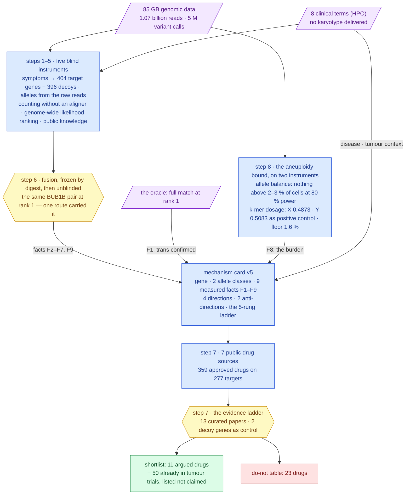
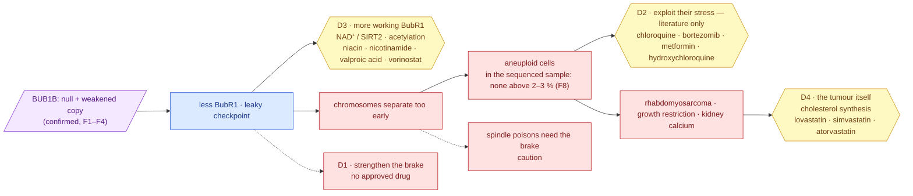
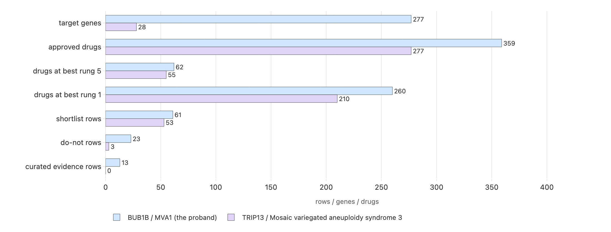

# Track 2 report — from a confirmed genotype to graded, approved medicines, with its own negative control

**Standing:** draft, written 2026-09-19, revised 2026-09-20 from executed runs. Iteration 2 of
Track 2 supersedes [iteration 1](../iteration-1/report.md) (never uploaded): the mechanism card
is at **version 5** with all nine measured facts filled — the last one, the aneuploid fraction in
the sequenced sample, by iteration 2's step 8, now on **two instruments that share nothing past
the raw reads** — and the report tells the whole path, steps 1 to 8, plus a **transfer run** of
the same pipeline on a second, different case. Every number is read from a table with a
provenance manifest; every claim was registered before its test; every cited paper was resolved
against PubMed. **Not uploaded.** Track 2 accepts one submission (due about 2026-10-20).

Written for a panel that includes clinicians and patient advocates as well as scientists.
Each technical term appears once with its meaning in brackets; the full dictionary is served
at `/learn` on the dashboard, and the same tables render on its `/track2` page.

> The challenge's own words, kept in view throughout: *submissions are hypotheses for
> follow-up, not evidence that a medicine works.* Nothing below is a recommendation to treat.

---

## 1. How this report answers the panel's four questions

> **Rubric:** all four — this is the map; every row names the section that carries the work and
> the softest spot we know in it.

| criterion | weight | where | the evidence, in one line | the weakest point we know |
|---|---|---|---|---|
| **Scientific rigor** — is the mechanism sound, and is the drug argument built on it? | 35 % | §2–§7 | a genotype confirmed by the challenge's own answer key and then **rediscovered blind**; nine measured facts on a versioned mechanism card, the last on two independent instruments; every approved drug graded on a ladder written **before** the search, with a decoy gene through the same pipeline as a negative control | the two rungs that carry the argument (a result in an animal, a result in a dish) are **13 abstracts read by one person on one day**; the deepest mechanistic lead is a single mouse paper, inherited by two vitamin forms; **no** drug has a molecule-level animal result on the checkpoint itself |
| **Potential impact** — what could this change if it validated? | 25 % | §8 | a do-not table that turns the mechanism into one concrete question for the treating team; a mechanism-level (not gene-level) conclusion that reaches the other MVA genes; a **sequencing-only** bound on mosaic aneuploidy with a stated detection limit, where the classical test needs cells that grow | nothing here has been tested in this child or in any patient; the do-not table weighs a mechanism hypothesis against regimens that have survival data behind them; the aneuploidy bound is a statement about a sample whose **tissue the delivery never named** |
| **Innovation** — is the angle genuinely new? | 25 % | §9 | one structured card drives every query; a pre-registered evidence ladder; a decoy gene *and* a whole transfer case as controls; a do-not table as a first-class output; an append-only claim register where each claim carries its refutation condition and corrections stay visible | every part is standard on its own — public APIs, a rubric, a register. What we claim is the **assembly**, and only "to our knowledge": we did not run a literature survey. Knowledge-graph repurposing rankers exist (PrimeKG, TxGNN — §9) and we did not run them |
| **Scalability** — does this reach other people and other diseases? | 15 % | §10 | the pipeline was **executed unchanged** on a transfer case with a different MVA gene, a different disease, a different tumour and its own phenotype terms read out of a public annotation file: a second complete output, at **0 lines of code changed** and 0 hand-typed queries | our own pre-registered claim about the transfer came back **refuted** (H066 · 0.10): four limbs held, including every limb that tests portability, but the spindle-poison caution **did not fire** on the transfer case, because the public pathway database had no annotation for that gene. So the **automated safety half degrades on a new gene with thin pathway coverage** — a new case needs that coverage checked before its do-not table is trusted (§10.5). Also: one transfer case, sharing the same pathway; only the **automated** rungs compare, because a transfer card has no curated literature, and the curated rungs that carry the drug argument stay a human bottleneck |

---

## 2. The answer in one page

> **Rubric:** scientific rigor (35 %) — the claim, the confirmed genotype behind it, and what is not known, on one page.

**The child.** A boy with mosaic variegated aneuploidy (MVA: some of his cells carry a wrong
number of chromosomes, and different cells are wrong in different ways), short stature, failure
to thrive, calcium deposits in the kidneys, and a rhabdomyosarcoma (a childhood cancer of
muscle tissue). Eight clinical terms were delivered with the case; no karyotype was.

**The cause, found twice.** Track 1 found two different broken copies of one gene, `BUB1B` —
one from each parent (a *compound heterozygote*) — and the challenge's answer key confirmed the
pair with a full match at rank 1. Iteration 2 then rebuilt the answer **blind**, from the raw
reads and the eight clinical terms, by routes sharing no code with the first: the same pair
came out first. The gene makes BubR1, the **brake** on cell division that holds a dividing cell
until every chromosome is attached. One copy makes nothing (a *stop* change); the other makes a
weakened protein (a *missense* change in the protein's last stretch). Less brake, not no brake —
the only pattern compatible with life, and the pattern every published case shows.

**Nine measured facts** sit on the mechanism card (now at version 5) so that no drug argument
rests on the allele labels alone. The one that matters most for this report: **no chromosome in
the sequenced sample carries a mosaic population above 2–3 % of cells** (step 8, at 80 % power),
where the statistic used earlier would have found nothing at any fraction. That bound is now
carried by **two instruments that share nothing past the raw reads** — allele balance, and a
k-mer dosage route that reads the sex chromosomes the first is blind to, recovering one copy of X
(0.4873) and one of Y (0.5083) against 0.5 expected as its positive control, and setting an
honest floor of **1.6 % of cells** on what it could have detected. It is a statement about the
sequenced sample — its tissue is not named by the delivery, and a karyotype's fraction is
measured in cultured cells — not about the diagnosis.

**Four ways a drug could act, graded on a five-rung ladder written before the search**, then
run again with the gene swapped for two decoys as a control:

| Direction | The idea | What we found | Standing after step 8 |
|---|---|---|---|
| **D1** reinforce the brake | strengthen the remaining checkpoint | **no approved drug does this**; every checkpoint drug on the market or in trials *weakens* it | the do-not table |
| **D3** raise the amount of working BubR1 | the weakened copy still works — make more of it last longer | **niacin / nicotinamide** (vitamin B3 forms): boosting the NAD⁺ pathway raised BubR1 in mice bred with too little of it (rung 3, animal model, by proxy); valproic acid and vorinostat act on BubR1's acetylation switch (rung 2, class level) | **the deepest mechanistic lead** — acts on the constitutional genotype whatever the burden; thinnest automated support |
| **D4** the child's actual tumour | approved, non-chemotherapy drugs with a mechanism in rhabdomyosarcoma | **statins**: rhabdomyosarcoma cells depend on making their own cholesterol; lovastatin itself slowed them (rung 2, molecule level); simvastatin has been in a completed paediatric sarcoma trial (NCT02390843) | **the best-supported lead** — a molecule-level result and a paediatric trial agree |
| **D2** exploit the stress of aneuploid cells | aneuploid cells are already stressed; some approved drugs tip them over | **chloroquine** preferentially killed aneuploid cells in the reference screen (rung 2, molecule level); metformin, hydroxychloroquine, bortezomib inherit class results | **literature only** — the sequenced sample shows no aneuploid population ≥ 2–3 % for such a drug to act on; a tumour-context angle, not a treatment of the child's state |

**What not to do — the half a clinician may care about most.** Thirteen approved drugs are
*spindle poisons*: they jam cell division and rely on the checkpoint to hold the cell. In a
child whose checkpoint is the broken part, that reliance is a hypothesis worth weighing.
Vincristine and vinorelbine are standard rhabdomyosarcoma chemotherapy. **This report flags the
question for the treating team; it does not advise withholding standard care.** No approved drug
weakens the checkpoint further — that class exists only in trials, and it is the one to avoid.

**What we do not know.** Whether any drug on this page helps (rung 3 is one mouse paper).
Whether the weakened BubR1 copy is unstable or simply inactive. What tissue was sequenced.
Anything about events smaller than a chromosome arm, or about a copy-neutral swap that moves no
sequence for the dosage route to see.

---

## 3. Two datasets, one line of evidence — the whole path

> **Rubric:** scientific rigor (35 %) — both input datasets, and which stage each one acts on.



> **Legend** — **purple = raw inputs** (the child's DNA, the child's clinical terms, the
> oracle's reply); **blue = machinery** (every box is a tool with a manifest and a methodology
> entry); **yellow = decision points** (the fusion that was frozen before it was compared; the
> ladder whose rungs were written before the search); **green = the goal**; **red = what to
> avoid**. The labelled arrows are the measured facts each step contributed to the card.

Both datasets act at every stage: the genomic data fixed the gene, the alleles, their dosage
and the absence of aneuploidy in the sample; the clinical terms fixed the disease, the target
set of step 1, the tumour context and — through the tumour — direction D4 and the paediatric
questions. A result that uses only one says so.

---

## 4. How the genotype was established — steps 1 to 6 and 8, in the order they ran

> **Rubric:** scientific rigor (35 %) — how the genotype the drug argument rests on was established and checked.

Iteration 2 was designed as a **blind mirror** of the first answer: could the pair be found
again from the raw material, by instruments sharing no code with iteration 1, with no
iteration-1 table read until the last entry? It could — and the way it could is the finding.

| Step | Question | What it measured | What it gave the drug argument |
|---|---|---|---|
| **1** the blind target set | which genes do the eight symptoms alone nominate? | 404 genes tiered by symptom evidence, 396 size-matched **decoy genes** beside them; held-out recall@300 **0.335** — a third of known disease genes would be missed. 73.6 % of protein-coding genes have no symptom curation at all | the decoy set that later controls the drug pipeline; the lesson that symptom-only ranking is an *enrichment*, never coverage |
| **2** alleles from the raw reads | what do the reads carry in those genes, without the vendor's caller? | 14.7 M reads recovered from 1.07 billion by a k-mer bait; two independent callers agreed with the vendor at 99.6 % / 99.3 %; **1,199 alleles the vendor never reported**; 164 structural variants, **none in the gene**; 6,823 phased blocks, none reaching the gene | F4: no hidden deletion; phase unmeasured in the reads — *trans* is the oracle's statement |
| **3** counting, not aligning | are the alleles at one copy each, and every exon at two? | 164,044 alleles typed from k-mer counts with no aligner and no caller; **both lead alleles at one copy** (posterior 1.0); every exon region at **two copies** (median 2.00; the X at 0.95 in a male, found with nothing told to the method) | F2, F3: a *null + weakened* genotype — some BubR1 exists to stabilise, so D3 is live |
| **4** genome-wide likelihood ranking | with no hard filter, which pair has the highest posterior? | **51,920** biallelic hypotheses over 11,465 genes; `BUB1B` first at a ratio of 341,019; the missense's pathogenicity lane 4.33; targets separate from decoys at AUC 0.706; population phasing **undetermined** | F6, F7: "damaging" quantified; population data cannot corroborate *trans* |
| **5** public knowledge | does the literature nominate the pair? | 815 genes asked of LitVar, PubTator, UniProt/InterPro, AlphaFold and PubMed; the route separates from decoys (AUC 0.634) and is *not* citation volume; yet its top two genes are decoys and `BUB1B` sits at rank **293** of 815; the missense lies **outside every curated domain**, in a region the structure model is confident about (pLDDT 91) | F5: whether the weakened copy is unstable or inactive is **open**; D3 is argued as *more BubR1*, not *refold it*. The literature is searched per drug, never trusted as a ranker |
| **6** fusion, then unblinding | fused, does the mirror rediscover the pair? | the ranking frozen (sha256 recorded) *before* any iteration-1 table was read; **the same pair at rank 1** under both weightings — but silencing the likelihood route drops it to rank 62; the symptom route had it at rank 9; the literature route never listed it. A second oracle upload: **0.000 bits** of information — not made | F9: a rediscovered, confirmed answer; and the honesty rule the drug section inherits — *one route found it, two corroborated at a distance* |
| **8** the aneuploidy bound, twice | is mosaic aneuploidy detectable in the sample, and at what limit? | **instrument 1, allele balance:** 2,778,844 heterozygous calls reduced to 127,913 arm rows; a fold-over statistic reaches 80 % power at **2 % of cells** (chr1–6) and **3 %** (chr7–22), where the statistic iteration 1 used had no power at any fraction; **no autosome above its own limit**; the divisor holds under three injected abnormal chromosomes. **Instrument 2, k-mer dosage** (shares nothing with the first past the raw reads): reference-unique 31-mers counted over 32 of 272 flowcell shards recover **one copy of X (0.4873) and one of Y (0.5083)** against 0.5 expected — the positive control allele balance cannot give in a male — and put no autosome beyond its composition-corrected null (chromosome-GC regressor, Pearson 0.904, 81.7 % of the spread explained; residual spread 0.802 %); the one chromosome that looked suspicious (chr21, 2.33 σ, Bonferroni p 0.43) dissolved under tail trimming, a probe half-split and a depth check that read the excess as mismapping pileups. Honest floor **1.6 % of cells**, twice the residual spread — not the ±1 % a bootstrap interval suggested | F8: **measured on two instruments**, with X and Y covered and a positive control behind them; D2 becomes literature-only |

Three things this path teaches that shape the drug section: the decoys were the most useful
thing built (they later exposed a non-specific drug direction); a "negative" result is only
one when it carries its detection limit (step 8 corrected step 0's flat karyogram on exactly
that point); and a rank-1 answer with one route carrying it is reported as such, not as a
consensus.

---

## 5. The mechanism (methods form Q14: loss- versus gain-of-function, pathway, consequence)

> **Rubric:** scientific rigor (35 %) — the variant mechanism characterization the panel asks for: loss- versus gain-of-function, pathway, downstream consequence.

### 5.1 Loss of function, of a specific shape

| copy | what changed | what it does to the protein | evidence |
|---|---|---|---|
| one | a *stop* change in exon 17 of 23 | the protein ends early, before its last working part — **no functional protein** | ClinVar VCV000533901, pathogenic / likely pathogenic for MVA1 |
| the other | a *missense* change in exon 23 of 23 — one amino acid swapped | a **weakened** protein: never seen in 140,000 healthy genomes, predicted damaging by two independent predictors; outside every catalogued domain, in a region the structure model is confident about | iteration 1 entries 070–074; iteration 2 entries 099, 106 |

No gain-of-function or dominant-negative activity is reported for `BUB1B`; complete loss is
lethal before birth in mouse and human (Hanks 2004, PMID 15475955; Suijkerbuijk 2010, PMID
20516114), which is why "switch BubR1 off" is never a therapeutic direction.

### 5.2 The nine measured facts on the card (version 5)

| fact | measured | what it changes for a drug |
|---|---|---|
| F1 the two copies are on different chromosomes (*trans*) | **confirmed** by the answer key (full match, rank 1) | the argument stands on a confirmed genotype |
| F2 each copy present once in the raw reads | yes — both alleles at one-copy dosage, no aligner | a *null + weakened* genotype: some BubR1 exists (D3 live) |
| F3 no deleted or duplicated stretch in the gene | every exon at two copies | the two alleles are the whole story |
| F4 structural variants and read-backed phase | none in the gene; phase unmeasured in the reads | *trans* is the oracle's statement, and the report says so |
| F5 where the missense sits | outside every catalogued domain, pLDDT 91 | unstable or inactive: **open**; D3 is a dosage argument |
| F6 how damaging the missense is | AlphaMissense likely-pathogenic (lane 4.33); the pair leads 51,920 hypotheses | "damaging" quantified |
| F7 population phasing | undetermined — 5 of 50 leading alleles reach gnomAD | population data cannot corroborate F1 |
| **F8 aneuploid fraction in the sequenced sample** | **measured by two instruments that share nothing past the raw reads.** Allele balance: **no autosome above its limit — 2 % (chr1–6), 3 % (chr7–22) at 80 % power**; X and Y unreadable by allele balance in a male. k-mer dosage: X 0.4873 and Y 0.5083 against 0.5 expected as a positive control, no autosome beyond its composition-corrected null, **honest floor 1.6 % of cells**. Still outside both routes: sub-arm events, and a copy-neutral swap that moves no sequence; the tissue is unnamed | **D2 cannot be argued from a burden in this child** — now on two routes, not one; D3, D4 and the do-not table are untouched |
| F9 the blind mirror | found the same pair first | a rediscovered, confirmed answer |

### 5.3 The pathway, and where a drug could stand

BubR1 is a core part of the **spindle assembly checkpoint** (SAC — the wait-until-attached
brake) and of the complex that switches off the machinery pulling chromosomes apart. Less
BubR1 means a **leaky brake**: division can proceed with chromosomes still unattached.



> **Legend** — **purple** the genotype; **blue** the molecular consequence; **yellow** the
> three places an approved drug could stand, each a direction below; **red** what goes wrong,
> and the two dotted boxes are the direction with no drug and the class to be cautious with.

Downstream, in order: premature separation of chromosomes → the aneuploidy that names the
disease (not detectable above 2–3 % in the sample sequenced here) → in surviving aneuploid
cells a chronic stress from carrying the wrong number of copies of many proteins → a
predisposition to exactly the cancers this child has → growth restriction and
nephrocalcinosis, the delivered clinical terms.

---

## 6. How the candidates were found, graded and controlled

> **Rubric:** scientific rigor (35 %) — how candidates were searched, graded and controlled, with the rules fixed before the search.

### 6.1 One card, seven public sources, no hand-typed query

The mechanism card drives every query. Reactome widens the card's 32 seed genes to 277
targets; Open Targets, ChEMBL and DGIdb return every drug known to act on them (3,859 rows,
**359 market-approved drugs**); openFDA confirms a US label and whether it has a *Pediatric
Use* section; ClinicalTrials.gov answers "in this tumour?" and "in children, anywhere?";
PubMed answers "how much has been written about this drug with this mechanism?" — per drug,
with the vocabulary read off the card. Every table carries a manifest with the retrieval time
and a digest of every reply; the same commands run another case by swapping the card — which is
no longer a claim, it was executed (§10).


> **Legend** — one row per shortlisted drug (all 61), two bars each, on a **logarithmic** record
> axis: **blue = the drug searched with this case's mechanism** (the gene, the protein, the
> pathway or the disease, all taken off the card); **purple = the drug searched with the tumour
> context**. Missing bar = zero records found. These counts are **descriptive only and never move
> a rung** — the figure is here to show what the literature volume looks like per drug, and to
> make one point visible: the best-supported leads — the statins and the vitamin-B3 forms — sit
> among the *smallest* bars, while the largest belong to drugs this report lists and does not
> claim (§7.2).

### 6.2 The ladder, written before the search

| rung | meaning | how it is tested |
|---|---|---|
| **5** | approved for a related indication, with paediatric use | approved **and** a registered trial in the child's tumour **and** a paediatric pointer (label section 8.4, or a study admitting children) — **applied to the tumour direction only** |
| **4** | clinical trial in a related indication | a registered trial in the child's tumour — tumour direction only |
| **3** | animal model of the mechanism | a paper read by a person, with its PubMed id |
| **2** | cell model of the mechanism | a paper read by a person, with its PubMed id |
| **1** | mechanism only | acts on a target in the direction's set — *named, never submitted* |

Automated and curated tests print side by side. Inherited evidence is marked `proxy` with the
compound actually tested. **One rule was narrowed after the first run and the change is
recorded:** a rhabdomyosarcoma trial was lifting drugs onto rung 5 on the *mechanism*
directions (85 drugs, tetracycline among them); a trial in the tumour says nothing about a
checkpoint, so trial-based rungs now grade the tumour direction alone (entry 113). The same pre-registered test was then run **twice**, once per card revision: adding the measured
aneuploid fraction to the card (v4, entry 120, H061) moved **no rung at all**, and adding step 8's
second instrument to it (v5, entry 133, H065) moved **no rung, no shortlist row and no do-not
row** — the three table digests came back unchanged. The ladder is independent of F8 by
construction; the first run of the test caught a file-reading fault along the way that would
otherwise have gone unnoticed, which is why it is re-run for every card revision rather than
reasoned about.

### 6.3 The control: the same child, a different gene


> **Legend** — one bar per decoy gene; the dashed yellow line is the pre-registered 0.10
> threshold. **D4 is above it** against NTRK3 (Jaccard 0.25): the cancer pharmacopoeia comes out
> for any cancer-adjacent gene, and 64 of the decoy's drugs had a rhabdomyosarcoma trial with
> the gene never consulted. **D1–D3 are below it** against both decoys. Consequence: D4 is
> argued only from curated mechanism results, never from "this drug has a rhabdomyosarcoma
> trial".

The decoys were chosen before the run: NTRK3 by a seeded draw from step 1's 396 matched
decoys (a receptor kinase with approved inhibitors — a harder control than a random gene),
and XDH, a metabolic enzyme with nothing to do with cell division.

---

## 7. The candidates

> **Rubric:** scientific rigor (35 %) — the proposed repurposing candidates and the evidence each one carries.


> **Legend** — the number is the rung; **green** a curated result and rung 4–5; **yellow** a
> curated result at rung 2–3; **blue** the automated tests alone (already being tried in the
> tumour — not a finding of this work); **red** set aside; `*` inherited (proxy) evidence.

### 7.1 The eleven drugs with a cited mechanism result, ordered as this report argues them

| # | drug (approved for) | direction | rung | the cited result | inherited? | given to children? |
|---|---|---|---|---|---|---|
| 1 | **lovastatin** (cholesterol) | D4 tumour | 5 | lovastatin itself slowed rhabdomyosarcoma cells; the tumour cannot take up cholesterol instead of making it (Gizaw 2025, PMID 41249736); a completed phase-1 study gave a statin with chemotherapy to children with relapsed solid tumours including rhabdomyosarcoma (NCT02390843) | no | label 8.4; studies admitting children |
| 2 | **simvastatin** (cholesterol) | D4 | 5 | same class result; it is the statin in NCT02390843 | yes (lovastatin) | studies admitting children |
| 3 | **atorvastatin** (cholesterol) | D4 | 2 | same class result; carries a paediatric indication on its label | yes (lovastatin) | label 8.4; studies |
| 4 | **nicotinamide** (vitamin B3) | D3 more BubR1 | 3 | the NAD⁺ precursor NMN raised BubR1 in mice; more SIRT2 extended the life of BubR1-deficient mice (North 2014, PMID 24825348) | yes (NMN) | studies admitting children |
| 5 | **niacin** (cholesterol; vitamin B3) | D3 | 3 | same result; the prescription-strength NAD⁺ precursor | yes (NMN) | studies admitting children |
| 6 | **valproic acid** (epilepsy) | D3 | 2 | HDAC2/3 strip the acetyl mark that protects BubR1 from degradation (Park 2017, PMID 28985013; Choi 2009, PMID 19407811) — an HDAC inhibitor would be expected to slow that loss; inferred, not shown | yes (class) | label 8.4; studies |
| 7 | **vorinostat** (lymphoma) | D3 | 2 | same class mechanism | yes (class) | label 8.4; studies |
| 8 | **chloroquine** (malaria) | D2 stress — literature only | 2 | chloroquine itself preferentially killed cells with an extra chromosome (Tang & Amon 2011, PMID 21315436) | **no** | studies admitting children |
| 9 | **bortezomib** (myeloma) | D2 | 2 | aneuploid human cells depend on faster protein degradation and are more sensitive to proteasome inhibitors (Ippolito 2024, PMID 39247952; Chui 2019, PMID 31530568) | yes (class) | label 8.4; studies |
| 10 | **metformin** (diabetes) | D2 | 2 | the AMPK activator AICAR was aneuploidy-selective in the same screen | yes (AICAR) | label 8.4; studies |
| 11 | **hydroxychloroquine** (lupus) | D2 | 2 | chloroquine's result, inherited by its clinical analogue | yes (chloroquine) | label 8.4; studies |

Why this order and not the ladder's: the ladder ranks by rung, and by rung the statins lead.
The report then places D3 ahead of D2 because **D3 acts on the constitutional genotype the
child has whatever the burden**, while D2's whole rationale is a population of aneuploid cells
that step 8 could not find above 2–3 % in the sample sequenced. Within D2, chloroquine keeps
its molecule-level result; the direction as a whole is a tumour-context and chemoprevention
hypothesis argued from published biology, and the report says so wherever it is quoted.

Reading the table honestly: **no** drug has a molecule-level animal result on the checkpoint
itself. The deepest mechanistic lead rests on one mouse paper, inherited by two vitamin-B3
forms. The best-supported tumour lead has a completed paediatric trial and a molecule-level
cell result. The only molecule-level aneuploidy result is chloroquine's, and it now has no
measured target population in this sample.


> **Legend** — drugs counted once at their best rung; **green** rung 4–5 and the shortlist,
> **yellow** rungs 2–3, **grey** rung 1. Most of the 62 at rung 5 are there by the automated
> test alone: approved, trialled in rhabdomyosarcoma, used in children.

### 7.2 Fifty drugs already being tried in rhabdomyosarcoma — listed, not claimed

Fifty more approved drugs reach rung 5 automatically (dexamethasone, azacitidine,
methotrexate, bevacizumab, the CDK4/6 and mTOR inhibitors, the checkpoint antibodies…). They
are in `shortlist.tsv` with the verdict *context trial only – not a mechanism finding*, because
the decoy control showed the same list comes out for a gene unrelated to the checkpoint. They
are the tumour's trial landscape; a reader deserves to see them; they are not this work's
finding.

### 7.3 The do-not table

| verdict | drugs | why |
|---|---|---|
| **caution** — spindle poisons (13) | vincristine, vinorelbine, vinblastine, vinflunine, paclitaxel, docetaxel, cabazitaxel, eribulin, ixabepilone, epothilone D, colchicine, brentuximab vedotin, polatuzumab vedotin | these drugs *rely on the checkpoint to hold the cell*; MVA cells have a weakened checkpoint and slip through (Suijkerbuijk 2010, PMID 20516114; Sinha 2019, PMID 30601084). Vincristine and vinorelbine are standard rhabdomyosarcoma chemotherapy: **a hypothesis for the treating team to weigh, never advice to withhold treatment** — a regimen with survival data behind it outweighs a theoretical mechanism concern |
| **do not** — further checkpoint weakening (0 approved) | Mps1/TTK and Aurora inhibitors | aneuploid cancer cells are selectively killed by weakening the checkpoint further (Cohen-Sharir 2021, PMID 33505028) — the same logic makes a child whose checkpoint is constitutionally weak the worst candidate. None is approved; every one in the candidate table is phase 3 or earlier |
| **standard of care** (10) | vincristine, dactinomycin, cyclophosphamide, ifosfamide, doxorubicin, etoposide, irinotecan, temozolomide, carboplatin, cisplatin, topotecan | already the treatment for the tumour; giving them is not a repurposing. Named so a reader sees they were considered, not missed |

### 7.4 Has each candidate been given to children?


> **Legend** — **green** a US label with a *Pediatric Use* section (8.4); **blue** at least one
> registered study admitting children, in any indication; empty = neither. Every argued drug
> has at least one pointer. **A pointer is something to read, never a licence.**

---

## 8. What this could change — potential impact

> **Rubric:** potential impact (25 %) — for this child, for others living with MVA, and for how
> MVA is diagnosed. Everything here is conditional on independent validation; nothing in this
> section has been tested in a patient.

### 8.1 For this child: one question for the treating team, and one experiment worth running

The do-not table (§7.3) is the part of this work with the shortest path to a clinical
conversation, because it needs no new drug — only a question about drugs already in the plan.

| | |
|---|---|
| **The question** | Thirteen approved drugs on this child's map are *spindle poisons* (they jam the machinery that pulls chromosomes apart, then **rely on the checkpoint to hold the cell there** until it dies). This child's checkpoint is the part that is broken. **Two of the thirteen — vincristine and vinorelbine — are standard rhabdomyosarcoma chemotherapy.** |
| **Why it is askable now** | the genotype is confirmed by the challenge's answer key, not inferred; the mechanism (less BubR1 → a leaky brake → cells slip through mitosis instead of arresting) is published for MVA patient cells (Suijkerbuijk 2010, PMID 20516114; Sinha 2019, PMID 30601084) |
| **What this report says** | *weigh it* — a hypothesis about how this class behaves in this genotype, raised early enough to be discussed |
| **What this report does not say** | **do not give it.** A regimen with survival data behind it outweighs a theoretical mechanism concern. We have no clinical outcome data, no dose-response in this genotype, and no patient-level evidence of any kind |
| **What would settle it** | a checkpoint-function readout (how long cells carrying these allele classes hold mitosis under a spindle challenge, and whether they die or slip) — a bench question, not a chart question |

**The one experiment we would run next.** The deepest mechanistic lead, D3 (raise the amount of
working BubR1), rests on rung 3 **by proxy**: a NAD⁺ precursor, NMN, raised BubR1 in mice bred to
be BubR1-deficient (North 2014, PMID 24825348). That is an animal result, on a related compound,
in a different genotype. One experiment would lift it to molecule level in this genotype:

- **Material** — cells carrying this child's allele classes: patient-derived fibroblasts, or an
  engineered line with one stop allele and one last-exon missense.
- **Treatment** — nicotinamide and niacin (the two approved vitamin-B3 forms this report argues),
  across a dose range, against vehicle.
- **Read-outs** — (1) BubR1 protein abundance; (2) checkpoint function: how long a cell holds
  mitosis under a spindle challenge; (3) chromosome missegregation rate.
- **Prediction, written first** — BubR1 abundance rises with dose, and arrest duration lengthens
  with it.
- **What would refute it** — no rise in BubR1 at any tolerated dose. That result would say the
  rung-3 animal evidence does not transfer to this genotype, and D3 should be dropped rather than
  softened.
- **Status — proposal. Not run. No result is claimed for it.** It needs a wet lab and cells this
  project never had; it is written here in the same pre-registered shape as every claim in §13 so
  that it can be filed before it is run rather than after.

### 8.2 For others living with MVA: the conclusions are about the mechanism, not the gene

Three genes are established causes of MVA: `BUB1B` (MVA1) and `TRIP13` (MVA3), both parts of the
same mitotic-checkpoint machinery, and `CEP57` (MVA2), a centrosome part
([dictionary](../../../docs/dictionary.md)). Two results in this report are therefore properties
of **a weakened mitotic checkpoint**, not of this child's gene:

| result | why it is a mechanism property | what it means for another family |
|---|---|---|
| **no approved drug reinforces the checkpoint** (D1 is empty; every checkpoint drug on the market or in trials *weakens* it) | the direction is defined by the pathway, and the pathway is what MVA1 and MVA3 share | the same gap exists for them. It is also a concrete ask for drug developers: the direction this disease needs has **zero** approved entries |
| **the spindle-poison caution** | it rests on "the checkpoint holds the cell", which is the mechanism, not the gene | it applies to any constitutionally checkpoint-deficient child facing this drug class, with the same "weigh it, never withhold" framing |

This is not a claim we are asking the panel to take on trust — it was **executed**. The pipeline
was re-run on a transfer card for `TRIP13` / MVA3 (a different gene, a different disease, a
different tumour), and direction D1 returned **30 drugs, every one of them at rung 1** — mechanism
only, named and never submitted. The same empty answer, reached again, with no code changed
(§10). The honest other half: on that case the spindle-poison caution produced **no** rows at all,
for a reason §10 states.

### 8.3 For diagnosis: a sequencing-only bound on mosaic aneuploidy, with its limit stated

The classical test for MVA is a **karyotype** (counting chromosomes down a microscope in cells
first grown in culture). It needs cells that will grow, and it reports a fraction of the cells
that grew. Step 8 asks the same question of DNA sequence alone, twice over, and — this is the
part that matters — reports **what it could have detected**:

| | sequencing-only bound (step 8, two instruments) |
|---|---|
| **what it can do** | put a number on how much mosaic whole-chromosome or whole-arm aneuploidy could be hiding in the sequenced sample — no autosome above **2 % of cells** (chr1–6) or **3 %** (chr7–22) at 80 % power by allele balance, and an honest floor of **1.6 % of cells** by k-mer dosage; read **X and Y**, which allele balance cannot in a male, recovering one copy of each (0.4873, 0.5083 against 0.5) as a positive control on a known answer; and do all of it from data already sequenced, with no extra sample and no culture |
| **what it cannot replace** | a karyotype, for diagnosis. It is blind to events smaller than a chromosome arm, and the dosage route is blind by construction to a copy-neutral swap (the right number of chromosomes from the wrong parent), which moves no sequence for it to see |
| **what it cannot say** | anything about a tissue that was not sequenced. **The delivery never named the tissue of this sample.** MVA is *variegated* — different cells carry different errors — so a bound in one tissue is not a bound in another |
| **what it is, precisely** | a **bound**, not a measurement: "nothing above the floor", never "zero" |

The transferable point is smaller than a new diagnostic and more useful than it sounds: **a
negative result is only a result when it carries its detection limit.** This project's own step 0
produced a flat karyogram with no detection limit; step 8 corrected it on exactly that point
(§4). Any pipeline that reports "no aneuploidy found" without a floor is reporting nothing.

---

## 9. What is new here, against standard practice

> **Rubric:** innovation (25 %) — what this pipeline does that a repurposing write-up usually
> does not, stated as a comparison and hedged to "to our knowledge".

| what a repurposing report usually does | what this one does |
|---|---|
| queries typed by hand into each database, per drug or per gene, and re-typed for the next case | **one structured mechanism card** (`ressources/track2/mechanism.json`: gene, allele classes, pathway, measured facts, directions, seed genes, the ladder) drives **every** query. No query string is typed by hand. The card is versioned and append-only — v3 → v4 → v5, each revision a `history` entry with the entries behind it |
| produces a ranked list of candidate drugs | produces an **evidence ladder written before the search**, with the **automated** test (approval, label section, registered trials) and the **person-read** test (one PubMed id per row) printed side by side and never merged into one score. Rung 1 is *named, never submitted* |
| has no negative control — nothing says what the same pipeline returns for the wrong gene | runs a **decoy gene** through the same pipeline and measures the overlap against a threshold fixed beforehand (Jaccard 0.10). D4 failed it at 0.25, so D4 is argued only from curated mechanism results — a direction demoted by its own control (§6.3) |
| covers one case, and generality is asserted | covers a **transfer case**: a card that swaps the gene, the disease, the tumour and the clinical terms, executed unchanged, with both cases' counts in one committed table (§10) |
| lists candidates | ships a **do-not table as a first-class output**: caution, do-not, and standard-of-care verdicts, with the reason and the citation per row (§7.3) |
| asserts confidence after the fact | files each claim in an **append-only register before its test**, with its prediction *and* its refutation condition; confidence is a printed heuristic shown with its arithmetic, never a probability; corrections stay visible — two verdicts committed too early are in the record beside their corrections (§13) |

**Prior art, named accurately.** Knowledge-graph repurposing rankers exist and are strong at the
step this pipeline deliberately does not take. **PrimeKG** (a disease-centric biomedical knowledge
graph, PMID 36732524) and **TxGNN** (a graph neural network that scores drugs against a disease
node, including diseases with no approved drug, PMID 39322717) both take a **disease node** as
input and return a ranked drug list. This repository keeps notes on both
(`docs/iteration4/cards/primekg.json`, `docs/iteration4/cards/txgnn.json`, both MIT-licensed) and
**neither was run for this report.** The difference is the input and the shape of the output: they
rank from a disease; this pipeline argues from **one patient's measured mechanism**, and returns a
graded argument with a negative control and a do-not list rather than a rank.

**How strongly we put it:** each ingredient above is standard on its own — public APIs, a grading
rubric, a pre-registration habit, a decoy control. What we claim is the **assembly**, and only
*to our knowledge*: we have not seen a drug-repurposing write-up that ships a decoy control, a
whole transfer case and an append-only claim register together. That is our reading of what we
have read, not a literature survey, and we would rather be corrected than overstate it.

---

## 10. Scalability: the same pipeline, a second case

> **Rubric:** scalability (15 %) — executed evidence that this reaches another person, another
> disease and another dataset, together with the pre-registered claim it **refuted**.

### 10.1 What was swapped

The decoy control (§6.3) swaps the *gene* and keeps the child: it measures **specificity**. The
transfer run swaps the **whole case** and measures **portability** — does the same code, with no
edit and no hand-written query, produce the same tables for a case it was never written for?

| | the real case | the transfer case |
|---|---|---|
| gene | `BUB1B` | `TRIP13` |
| disease | MVA1 (OMIM 257300, MONDO:0009759) | MVA3 (OMIM 617598, MONDO:0054736) |
| clinical terms | the 8 HPO terms delivered with the case | **19 terms read out of** the public HPO annotation file (`phenotype.hpoa`, release 2026-09-02) for OMIM:617598 — *read, never typed*; `NOT`-qualified rows skipped |
| tumour context | rhabdomyosarcoma | nephroblastoma (Wilms tumour) |
| standard of care | 12 drugs | 5 drugs, taken only from resolved abstracts |
| alleles | 2 confirmed allele classes | **none** — the transfer card asserts no variant in any person |
| curated literature | 13 person-read rows | **none** — a transfer card has no `evidence.tsv` by construction |
| copied from the template card | — | exactly **3 case-agnostic blocks**: the anti-directions, the evidence ladder, the eligibility constraints. Everything case-shaped is built from the spec |

Nothing was inherited from the child: `mva.drugs.transfer` reads the OMIM id, never the delivery.

### 10.2 The two cases side by side



> **Legend** — one group per count, one bar per case, **linear** axis and no normalisation:
> **blue = the real case** (`BUB1B` / MVA1), **purple = the transfer case** (`TRIP13` / MVA3).
> The point is that both cases produced a table of the same *shape*, so a ratio would hide which
> is bigger. **`curated evidence rows` is plotted precisely because it is zero** for the transfer
> case — that zero is the boundary of what this comparison may claim, not a gap in the data.
> Source: `ressources/track2/transfer_comparison.tsv`, one row per case, with its manifest.

| | real case (`BUB1B` / MVA1) | transfer case (`TRIP13` / MVA3) |
|---|---|---|
| target genes | 277 | 28 |
| drug–target candidate rows | 3,859 | 1,329 |
| distinct approved drugs | 359 | 277 |
| drugs at best rung 5 / 3 / 2 / 1 | 62 / 2 / 5 / 260 | 55 / 0 / 0 / 210 |
| shortlist rows | 61 | 53 (**every one** `context trial only`, on the tumour direction) |
| do-not rows | 23 | 3 (all *standard of care*) |
| curated evidence rows | 13 | **0** |
| modules edited to run it | — | **0** |

Two results carry over and one does not:

- **D1 is empty again.** All 30 checkpoint-reinforcement rows sit at rung 1 — no submittable
  drug — and none reaches the shortlist. "No approved drug reinforces the checkpoint" is a
  property of the mechanism, reproduced on a second gene (§8.2).
- **No trial leaked onto a mechanism direction.** Only the tumour direction D4 reaches rung 2 or
  higher (55 rows at rung 5); D1 (30), D2 (82) and D3 (39) stay entirely at rung 1 — the
  narrowing recorded in entry 113 holds on a card it was not written for.
- **The spindle-poison caution did not fire.** The transfer's do-not table holds 3 rows, all
  standard of care, and **no** row anywhere carries the `A2` flag (real case: 13). §10.5 says why.

### 10.3 What it cost

| | measured |
|---|---|
| wall clock, a case the pipeline had never seen (cold cache) | **1,693.7 s** end to end, snapshot + enrichment, on the same laptop |
| live requests, cold | **2,077**; cached replies 0 |
| re-deriving the same tables afterwards (warm cache) | **9.0 s** |
| money | **€0** — seven public APIs, no cloud, no licensed data source |
| human time to author the case | one spec file (§10.4). The clinical terms are read from a public file, not written |

**The asymmetry, stated.** The real case's row reads **85 live requests against 1,965 cached** —
a *warm* re-run over a cache filled by earlier runs. The transfer's is the *cold* pass that filled
its own. **The comparable figure is the transfer's cold pass**, and it is the one quoted whenever
this report says what a new case costs.

### 10.4 What authoring a new case actually takes

One committed spec file. Abbreviated from
`ressources/track2/transfer/TRIP13/transfer_spec.json` — the fields a person writes:

```jsonc
{
  "gene":   { "symbol": "TRIP13", "uniprot": "Q15645", "hgnc_id": "HGNC:12307",
              "_verified": "UniProt REST + HGNC REST, 2026-09-20" },
  "case":   { "disease": "Mosaic variegated aneuploidy syndrome 3 (MVA3)",
              "omim_phenotype": "617598", "mondo": "MONDO:0054736",
              "tumour_context": "nephroblastoma (Wilms tumour; HP:0002667)",
              "context_standard_of_care": { "drugs": ["VINCRISTINE", "…"],
                                            "source": "PMID 41223336, 42686227" } },
  "repurposing_directions": [
    { "id": "D3", "name": "TRIP13 / p31comet proteostasis axis",
      "rationale": "…a loss-of-function AAA+ ATPase is a protein-remodelling problem…",
      "seed_targets": ["TRIP13", "MAD2L1BP", "VCP", "PSMB5", "HSP90AA1", "HSPA8"],
      "context": false },
    { "id": "D4", "name": "cancer surveillance in the nephroblastoma context",
      "seed_targets": ["WT1", "IGF2", "IGF1R", "CTNNB1", "TP53", "MTOR", "VEGFA"],
      "context": true }
  ],
  "hpo_source": { "_note": "filled in from phenotype.hpoa at build time — read, never typed" }
}
```

What that buys: the disease identifiers drive every disease query; `context: true` marks the one
direction the trial-based rungs may grade; `seed_targets` are expanded through Reactome; the
phenotype terms are read from a public file. What it does **not** buy: the curated rungs (§10.5).
Every identifier in the committed spec was resolved live against UniProt, HGNC, EBI OLS4 and
PubMed before the file was committed; anything that would not resolve is recorded as `null` with
a note rather than guessed.

### 10.5 What breaks at scale — including a claim of ours that broke

**Our own pre-registered claim came back refuted, and is reported as refuted.** H066 said the
pipeline is portable *and* the spindle-poison anti-direction would again populate the do-not
table. Four of its five limbs held — including every limb that tests portability — and the fourth
failed against a refutation condition written before the run. Filed as a conjunction, a false limb
refutes it as written: **H066 · refuted · 0.10** (entry
[138](../../../docs/iteration2/step-7/methodology/138-a-second-case-through-the-same-pipeline.md)).
The grading heuristic suggested 0.98 — it sums evidence rows and cannot see that a claim is an
AND — and that suggestion was rejected on the record.

| what breaks | the measured detail | what it means |
|---|---|---|
| **an anti-direction is only as good as the text it matches** | the `A2` flag is a regular expression over each drug's action-type and mechanism-of-action text. Reactome matched **0** pathways for `TRIP13`, so `pathways.tsv` is header-only and all 1,329 candidate rows stay at `target_role = seed`, with only 261 carrying any mechanism text. The real case has **2,276** rows from pathway expansion and 11 of its 13 `A2` drugs arrive on one. Two spindle poisons *are* in the transfer candidate set but reach it from DGIdb with empty mechanism text | the do-not table is a **derived** artefact of how much mechanism text the candidate set happens to carry, not a property of the card. A gene the pathway database cannot expand gets a nearly empty do-not table while the same drugs sit in its candidate set unflagged. **Not fixed here**: widening the flag would change the ladder rule and must be filed as its own pre-registered test, not folded into a refuted claim |
| **the politeness interval on public APIs** | a minimum **0.34 s** between live calls (NCBI's 3 requests/second without an API key), single-threaded. 2,077 live requests ≈ **706 s** of enforced waiting — about 40 % of the cold pass | throughput per case is bounded by courtesy, not by compute. Going faster needs API keys and per-source agreements, not a bigger machine |
| **the curated rungs are the human bottleneck** | rungs 2 and 3 exist only where a person read a paper: 13 rows for the real case, **0** for the transfer case. Its 53 shortlist rows are therefore *all* `context trial only` — **not one argued drug** | the automated half scales to a new case in 28 minutes; the half that carries the argument does not scale at all yet. A bigger shortlist is not a better one |
| **one drug database left unqueried** | **DrugBank** needs a licence for programmatic access; Open Targets, ChEMBL, DGIdb, openFDA, Reactome, ClinicalTrials.gov and PubMed were queried | coverage is what the open sources cover, on both cases equally |
| **what the transfer case did not get** | no alleles, no curated literature, no measured facts of its own | **only the automated stages (rungs 1, 4, 5) compare.** `curated_rows` is printed beside every count so the boundary is visible rather than implied |
| **one case, one pathway** | `TRIP13` shares the spindle assembly checkpoint with `BUB1B` — chosen so that a transfer that works is a statement about the pipeline, not about how unalike the cases are | portability to a disease *outside* this pathway is untested. It would be a new claim, filed before it is run |

**The operational rule this buys.** A new case's do-not table is only as complete as its pathway
coverage. Before the automated safety half of this pipeline is trusted on a new gene, check that
the pathway expansion returned something: an empty `pathways.tsv` means the anti-direction flags
cannot fire, whatever the card says. That check is a measured boundary of the transfer, found
because a refutation condition was written before the run.

**What this section does not claim.** Not that the transfer case's output is clinically useful —
it is a demonstration that the code is case-agnostic, asserts no allele in any person, and is not
a drug suggestion for anyone with MVA3. And portability itself is the *finding* of entry 138,
resting on the four limbs that held; it is not asserted by H066's verdict, which is a verdict on
the conjunction.

---

## 11. What this report cannot tell you

> **Rubric:** scientific rigor (35 %) — the limits of everything above, stated as limits.

1. **Whether any of these drugs helps this child.** Rung 3 is one mouse paper; rung 2 is a
   dish. Hypotheses for follow-up.
2. **What tissue was sequenced, and therefore what F8 means for the diagnosis.** The delivery
   does not name it; a karyotype's fraction is measured in cultured cells. F8 says the
   sequenced sample carries no mosaic population above 2–3 % on any autosome (allele balance)
   and none above a 1.6 % floor (k-mer dosage, which also reads X and Y and recovers one copy of
   each). What neither route can see: events **smaller than a chromosome arm**, and a
   copy-neutral swap that moves no sequence for the dosage route to read.
3. **Whether the weakened BubR1 copy is unstable or inactive.** Outside every catalogued
   domain; the structure model is confident about the region but silent on function.
4. **Anything about a drug the public sources never listed** beyond what a person put in the
   curated table — four of the eleven (chloroquine, hydroxychloroquine, niacin, nicotinamide)
   are there only because a person read the paper; their rows say `curated_only`.
5. **The curated rungs are one reader's**, thirteen abstracts on one day; every row carries its
   PubMed id so it can be checked.
6. **DrugBank was not queried** (licence); Open Targets, ChEMBL, DGIdb, openFDA, Reactome,
   ClinicalTrials.gov and PubMed were.

---

## 12. Reproducibility and cost

> **Rubric:** scalability (15 %) and scientific rigor (35 %) — what it costs to re-run, and whether a reader can.

Every step is one command, case-agnostic, with a manifest and a lineage row; no patient data
appears in any Track 2 artefact (gene symbols, allele *classes*, drug names, trial ids, PubMed
ids only):

```bash
uv run mva-drugs snapshot                       # card → 5 tables, 7 public APIs, cached replies
uv run python tools/track2_decoys.py ...        # a decoy card and its snapshot (×2)
uv run python tools/track2_enrich.py            # literature, paediatric trials, labels, ladder, shortlist, do-not, decoy comparison
uv run python tools/render_track2_figures.py    # the figures in this report
uv run python tools/record_track2_lineage.py    # the lineage edges into the warehouse ledger
uv run python tools/track2_transfer.py          # the whole pipeline again, on a second case (§10)
```

Two laptop runs of about ten minutes each against public APIs, seconds when cached; a case the
pipeline has never seen costs **1,693.7 s and 2,077 live requests** end to end, measured (§10).
The genotype steps 1–6 and 8 ran on a laptop and one Linux server over a fortnight (their
methodology entries state each cost). Code and tables: the public repository named in the
form; the dashboard's `/track2` page renders the same tables with the grading visible.

## 13. Where every claim lives

> **Rubric:** scientific rigor (35 %) — every claim in this report, with its registered prediction, its verdict and its entry.

| claim | register id | verdict · confidence | entry |
|---|---|---|---|
| D1 yields no submittable drug and becomes the do-not table | H045 | supported · 0.80 | 113 |
| D2 holds an approved compound with a molecule-level cell result | H046 | supported · 0.70 | 113 |
| D3 has an approved route on the NAD⁺/SIRT2 axis with animal evidence, by proxy | H047 | supported · 0.60 | 113 |
| D4 holds a non-chemotherapy approved drug at rung ≥ 2 with paediatric data | H048 | supported · 0.80 | 113 |
| the automated stages are non-specific (D4 overlaps a decoy ≥ 0.10) | H049 | supported · 0.85 | 112 |
| every argued drug has a paediatric pointer | H050 | supported · 0.70 | 113 |
| the ladder is independent of the measured aneuploid fraction (card v4 moved no rung) | H061 | supported · 0.85 | 120 |
| **the ladder is independent of the second instrument too** (card v5 moved no rung, no shortlist row, no do-not row — three unchanged digests) | **H065** | **supported · 0.90** | **133** |
| no chromosome carries a mosaic aneuploidy above its own detection limit | H051 (step 8) | supported · 0.80 | 116 |
| the detection limit is ≤ 10 % of cells for every autosome (measured 2–3 %) | H052 (step 8) | supported · 0.85 | 116 |
| **the two aneuploidy instruments agree on every chromosome within their stated intervals** — the k-mer dosage route beside allele balance | **H054** (step 8) | **supported · 0.85** | **121, 123** |
| the blind fused ranking put the confirmed pair first | H041/H043 (step 6) | see entries | 108–109 |
| **the pipeline is portable to a different case *and* the spindle-poison caution fires there too** | **H066** | **refuted · 0.10** — written as a conjunction; 4 of 5 limbs held (including every portability limb), the caution limb failed because the pathway database returned nothing for the transfer gene. Recorded as refuted rather than reworded | **138** |
| no approved drug acts directly on BubR1 | H011 (iteration 1) | supported · 0.80 | 078 |

Confidence is a transparent triage heuristic printed with its arithmetic, never a probability.
The register is append-only and shows every revision, including two committed too early and
corrected in the open (entries 113 and 120) — and one claim, **H066**, that came back **refuted**
and is reported as such rather than softened (§10).
