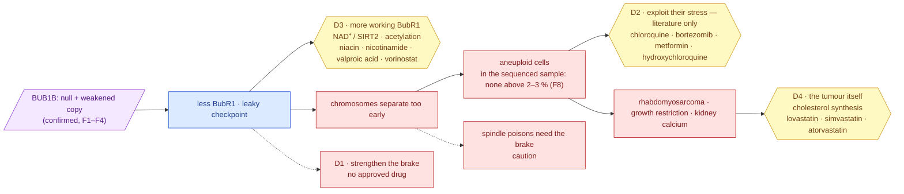

# Track 2 report — from a confirmed genotype to graded, approved medicines, with its own negative control

**Standing:** draft, written 2026-09-19 from executed runs. Iteration 2 of Track 2 supersedes
[iteration 1](../iteration-1/report.md) (never uploaded): the mechanism card is at **version 4**
with all nine measured facts filled — the last one, the aneuploid fraction in the sequenced
sample, by iteration 2's step 8 — and the report now tells the whole path, steps 1 to 8. Every
number is read from a table with a provenance manifest; every claim was registered before its
test; every cited paper was resolved against PubMed. **Not uploaded.** Track 2 accepts one
submission (due about 2026-10-20).

Written for a panel that includes clinicians and patient advocates as well as scientists.
Each technical term appears once with its meaning in brackets; the full dictionary is served
at `/learn` on the dashboard, and the same tables render on its `/track2` page.

> The challenge's own words, kept in view throughout: *submissions are hypotheses for
> follow-up, not evidence that a medicine works.* Nothing below is a recommendation to treat.

---

## 1. The answer in one page

**The child.** A boy with mosaic variegated aneuploidy (MVA: some of his cells carry a wrong
number of chromosomes, and different cells are wrong in different ways), short stature, failure
to thrive, calcium deposits in the kidneys, and a rhabdomyosarcoma (a childhood cancer of
muscle tissue). Eight clinical terms were delivered with the case; no karyotype was.

**The cause, found twice.** Track 1 found two different broken copies of one gene, `BUB1B` —
one from each parent (a *compound heterozygote*) — and the challenge's answer key confirmed the
pair with a full match at rank 1. Iteration 2 then rebuilt the answer **blind**, from the raw
reads and the eight clinical terms, by routes sharing no code with the first: the same pair
came out first. The gene makes BubR1, the **brake** on cell division that holds a dividing cell
until every chromosome is attached. One copy makes nothing (a *stop* change); the other makes a
weakened protein (a *missense* change in the protein's last stretch). Less brake, not no brake —
the only pattern compatible with life, and the pattern every published case shows.

**Nine measured facts** sit on the mechanism card so that no drug argument rests on the allele
labels alone. The one that matters most for this report: **no chromosome in the sequenced
sample carries a mosaic population above 2–3 % of cells** (step 8, at 80 % power), where the
statistic used earlier would have found nothing at any fraction. That is a statement about the
sequenced sample — its tissue is not named by the delivery, and a karyotype's fraction is
measured in cultured cells — not about the diagnosis.

**Four ways a drug could act, graded on a five-rung ladder written before the search**, then
run again with the gene swapped for two decoys as a control:

| Direction | The idea | What we found | Standing after step 8 |
|---|---|---|---|
| **D1** reinforce the brake | strengthen the remaining checkpoint | **no approved drug does this**; every checkpoint drug on the market or in trials *weakens* it | the do-not table |
| **D3** raise the amount of working BubR1 | the weakened copy still works — make more of it last longer | **niacin / nicotinamide** (vitamin B3 forms): boosting the NAD⁺ pathway raised BubR1 in mice bred with too little of it (rung 3, animal model, by proxy); valproic acid and vorinostat act on BubR1's acetylation switch (rung 2, class level) | **the deepest mechanistic lead** — acts on the constitutional genotype whatever the burden; thinnest automated support |
| **D4** the child's actual tumour | approved, non-chemotherapy drugs with a mechanism in rhabdomyosarcoma | **statins**: rhabdomyosarcoma cells depend on making their own cholesterol; lovastatin itself slowed them (rung 2, molecule level); simvastatin has been in a completed paediatric sarcoma trial (NCT02390843) | **the best-supported lead** — a molecule-level result and a paediatric trial agree |
| **D2** exploit the stress of aneuploid cells | aneuploid cells are already stressed; some approved drugs tip them over | **chloroquine** preferentially killed aneuploid cells in the reference screen (rung 2, molecule level); metformin, hydroxychloroquine, bortezomib inherit class results | **literature only** — the sequenced sample shows no aneuploid population ≥ 2–3 % for such a drug to act on; a tumour-context angle, not a treatment of the child's state |

**What not to do — the half a clinician may care about most.** Thirteen approved drugs are
*spindle poisons*: they jam cell division and rely on the checkpoint to hold the cell. In a
child whose checkpoint is the broken part, that reliance is a hypothesis worth weighing.
Vincristine and vinorelbine are standard rhabdomyosarcoma chemotherapy. **This report flags the
question for the treating team; it does not advise withholding standard care.** No approved drug
weakens the checkpoint further — that class exists only in trials, and it is the one to avoid.

**What we do not know.** Whether any drug on this page helps (rung 3 is one mouse paper).
Whether the weakened BubR1 copy is unstable or simply inactive. What tissue was sequenced.
Anything about the X and Y chromosomes, or about events smaller than a chromosome arm.

---

## 2. Two datasets, one line of evidence — the whole path

```mermaid
flowchart TB
  G[/"85 GB genomic data<br/>1.07 billion reads · 5 M variant calls"/]:::raw
  C[/"8 clinical terms (HPO)<br/>no karyotype delivered"/]:::raw
  S15["steps 1–5 · five blind instruments<br/>symptoms → 404 target genes + 396 decoys · alleles from the raw reads<br/>counting without an aligner · genome-wide likelihood ranking · public knowledge"]:::machine
  S6{{"step 6 · fusion, frozen by digest, then unblinded<br/>the same BUB1B pair at rank 1 — one route carried it"}}:::decide
  O[/"the oracle: full match at rank 1"/]:::raw
  S8["step 8 · the aneuploidy bound<br/>nothing above 2–3 % of cells, at 80 % power"]:::machine
  CARD["mechanism card v4<br/>gene · 2 allele classes · 9 measured facts F1–F9<br/>4 directions · 2 anti-directions · the 5-rung ladder"]:::machine
  SNAP["step 7 · 7 public drug sources<br/>359 approved drugs on 277 targets"]:::machine
  LAD{{"step 7 · the evidence ladder<br/>13 curated papers · 2 decoy genes as control"}}:::decide
  OUT["shortlist: 11 argued drugs<br/>+ 50 already in tumour trials, listed not claimed"]:::good
  NO["do-not table: 23 drugs"]:::bad
  G --> S15
  C --> S15
  S15 --> S6
  G --> S8
  S6 -->|"facts F2–F7, F9"| CARD
  O -->|"F1: trans confirmed"| CARD
  S8 -->|"F8: the burden"| CARD
  C -->|"disease · tumour context"| CARD
  CARD --> SNAP --> LAD
  LAD --> OUT
  LAD --> NO
  classDef raw fill:#f3e8ff,stroke:#7e22ce,color:#581c87
  classDef machine fill:#dbeafe,stroke:#1d4ed8,color:#1e3a8a
  classDef decide fill:#fef9c3,stroke:#ca8a04,color:#713f12
  classDef good fill:#dcfce7,stroke:#15803d,color:#14532d
  classDef bad fill:#fee2e2,stroke:#b91c1c,color:#7f1d1d
```



> **Legend** — **purple = raw inputs** (the child's DNA, the child's clinical terms, the
> oracle's reply); **blue = machinery** (every box is a tool with a manifest and a methodology
> entry); **yellow = decision points** (the fusion that was frozen before it was compared; the
> ladder whose rungs were written before the search); **green = the goal**; **red = what to
> avoid**. The labelled arrows are the measured facts each step contributed to the card.

Both datasets act at every stage: the genomic data fixed the gene, the alleles, their dosage
and the absence of aneuploidy in the sample; the clinical terms fixed the disease, the target
set of step 1, the tumour context and — through the tumour — direction D4 and the paediatric
questions. A result that uses only one says so.

---

## 3. How the genotype was established — steps 1 to 6 and 8, in the order they ran

Iteration 2 was designed as a **blind mirror** of the first answer: could the pair be found
again from the raw material, by instruments sharing no code with iteration 1, with no
iteration-1 table read until the last entry? It could — and the way it could is the finding.

| Step | Question | What it measured | What it gave the drug argument |
|---|---|---|---|
| **1** the blind target set | which genes do the eight symptoms alone nominate? | 404 genes tiered by symptom evidence, 396 size-matched **decoy genes** beside them; held-out recall@300 **0.335** — a third of known disease genes would be missed. 73.6 % of protein-coding genes have no symptom curation at all | the decoy set that later controls the drug pipeline; the lesson that symptom-only ranking is an *enrichment*, never coverage |
| **2** alleles from the raw reads | what do the reads carry in those genes, without the vendor's caller? | 14.7 M reads recovered from 1.07 billion by a k-mer bait; two independent callers agreed with the vendor at 99.6 % / 99.3 %; **1,199 alleles the vendor never reported**; 164 structural variants, **none in the gene**; 6,823 phased blocks, none reaching the gene | F4: no hidden deletion; phase unmeasured in the reads — *trans* is the oracle's statement |
| **3** counting, not aligning | are the alleles at one copy each, and every exon at two? | 164,044 alleles typed from k-mer counts with no aligner and no caller; **both lead alleles at one copy** (posterior 1.0); every exon region at **two copies** (median 2.00; the X at 0.95 in a male, found with nothing told to the method) | F2, F3: a *null + weakened* genotype — some BubR1 exists to stabilise, so D3 is live |
| **4** genome-wide likelihood ranking | with no hard filter, which pair has the highest posterior? | **51,920** biallelic hypotheses over 11,465 genes; `BUB1B` first at a ratio of 341,019; the missense's pathogenicity lane 4.33; targets separate from decoys at AUC 0.706; population phasing **undetermined** | F6, F7: "damaging" quantified; population data cannot corroborate *trans* |
| **5** public knowledge | does the literature nominate the pair? | 815 genes asked of LitVar, PubTator, UniProt/InterPro, AlphaFold and PubMed; the route separates from decoys (AUC 0.634) and is *not* citation volume; yet its top two genes are decoys and `BUB1B` sits at rank **293** of 815; the missense lies **outside every curated domain**, in a region the structure model is confident about (pLDDT 91) | F5: whether the weakened copy is unstable or inactive is **open**; D3 is argued as *more BubR1*, not *refold it*. The literature is searched per drug, never trusted as a ranker |
| **6** fusion, then unblinding | fused, does the mirror rediscover the pair? | the ranking frozen (sha256 recorded) *before* any iteration-1 table was read; **the same pair at rank 1** under both weightings — but silencing the likelihood route drops it to rank 62; the symptom route had it at rank 9; the literature route never listed it. A second oracle upload: **0.000 bits** of information — not made | F9: a rediscovered, confirmed answer; and the honesty rule the drug section inherits — *one route found it, two corroborated at a distance* |
| **8** the aneuploidy bound | is mosaic aneuploidy detectable in the sample, and at what limit? | 2,778,844 heterozygous calls reduced to 127,913 arm rows; a fold-over allele-balance statistic reaches 80 % power at **2 % of cells** (chr1–6) and **3 %** (chr7–22), where the statistic iteration 1 used had no power at any fraction; **no autosome above its own limit**; the model family for *which* trisomy does not fit and no mechanism is named; the divisor holds under three injected abnormal chromosomes | F8: **measured** — nothing above 2–3 % in the sequenced sample; D2 becomes literature-only |

Three things this path teaches that shape the drug section: the decoys were the most useful
thing built (they later exposed a non-specific drug direction); a "negative" result is only
one when it carries its detection limit (step 8 corrected step 0's flat karyogram on exactly
that point); and a rank-1 answer with one route carrying it is reported as such, not as a
consensus.

---

## 4. The mechanism (methods form Q14: loss- versus gain-of-function, pathway, consequence)

### 4.1 Loss of function, of a specific shape

| copy | what changed | what it does to the protein | evidence |
|---|---|---|---|
| one | a *stop* change in exon 17 of 23 | the protein ends early, before its last working part — **no functional protein** | ClinVar VCV000533901, pathogenic / likely pathogenic for MVA1 |
| the other | a *missense* change in exon 23 of 23 — one amino acid swapped | a **weakened** protein: never seen in 140,000 healthy genomes, predicted damaging by two independent predictors; outside every catalogued domain, in a region the structure model is confident about | iteration 1 entries 070–074; iteration 2 entries 099, 106 |

No gain-of-function or dominant-negative activity is reported for `BUB1B`; complete loss is
lethal before birth in mouse and human (Hanks 2004, PMID 15475955; Suijkerbuijk 2010, PMID
20516114), which is why "switch BubR1 off" is never a therapeutic direction.

### 4.2 The nine measured facts on the card (version 4)

| fact | measured | what it changes for a drug |
|---|---|---|
| F1 the two copies are on different chromosomes (*trans*) | **confirmed** by the answer key (full match, rank 1) | the argument stands on a confirmed genotype |
| F2 each copy present once in the raw reads | yes — both alleles at one-copy dosage, no aligner | a *null + weakened* genotype: some BubR1 exists (D3 live) |
| F3 no deleted or duplicated stretch in the gene | every exon at two copies | the two alleles are the whole story |
| F4 structural variants and read-backed phase | none in the gene; phase unmeasured in the reads | *trans* is the oracle's statement, and the report says so |
| F5 where the missense sits | outside every catalogued domain, pLDDT 91 | unstable or inactive: **open**; D3 is a dosage argument |
| F6 how damaging the missense is | AlphaMissense likely-pathogenic (lane 4.33); the pair leads 51,920 hypotheses | "damaging" quantified |
| F7 population phasing | undetermined — 5 of 50 leading alleles reach gnomAD | population data cannot corroborate F1 |
| **F8 aneuploid fraction in the sequenced sample** | **no autosome above its limit: 2 % (chr1–6), 3 % (chr7–22) at 80 % power**; X/Y and sub-arm events untestable by this route; tissue unnamed | **D2 cannot be argued from a burden in this child**; D3, D4 and the do-not table are untouched |
| F9 the blind mirror | found the same pair first | a rediscovered, confirmed answer |

### 4.3 The pathway, and where a drug could stand

BubR1 is a core part of the **spindle assembly checkpoint** (SAC — the wait-until-attached
brake) and of the complex that switches off the machinery pulling chromosomes apart. Less
BubR1 means a **leaky brake**: division can proceed with chromosomes still unattached.



> **Legend** — **purple** the genotype; **blue** the molecular consequence; **yellow** the
> three places an approved drug could stand, each a direction below; **red** what goes wrong,
> and the two dotted boxes are the direction with no drug and the class to be cautious with.

Downstream, in order: premature separation of chromosomes → the aneuploidy that names the
disease (not detectable above 2–3 % in the sample sequenced here) → in surviving aneuploid
cells a chronic stress from carrying the wrong number of copies of many proteins → a
predisposition to exactly the cancers this child has → growth restriction and
nephrocalcinosis, the delivered clinical terms.

---

## 5. How the candidates were found, graded and controlled

### 5.1 One card, seven public sources, no hand-typed query

The mechanism card drives every query. Reactome widens the card's 32 seed genes to 277
targets; Open Targets, ChEMBL and DGIdb return every drug known to act on them (3,859 rows,
**359 market-approved drugs**); openFDA confirms a US label and whether it has a *Pediatric
Use* section; ClinicalTrials.gov answers "in this tumour?" and "in children, anywhere?";
PubMed answers "how much has been written about this drug with this mechanism?" — per drug,
with the vocabulary read off the card. Every table carries a manifest with the retrieval time
and a digest of every reply; the same commands run another case by swapping the card.

### 5.2 The ladder, written before the search

| rung | meaning | how it is tested |
|---|---|---|
| **5** | approved for a related indication, with paediatric use | approved **and** a registered trial in the child's tumour **and** a paediatric pointer (label section 8.4, or a study admitting children) — **applied to the tumour direction only** |
| **4** | clinical trial in a related indication | a registered trial in the child's tumour — tumour direction only |
| **3** | animal model of the mechanism | a paper read by a person, with its PubMed id |
| **2** | cell model of the mechanism | a paper read by a person, with its PubMed id |
| **1** | mechanism only | acts on a target in the direction's set — *named, never submitted* |

Automated and curated tests print side by side. Inherited evidence is marked `proxy` with the
compound actually tested. **One rule was narrowed after the first run and the change is
recorded:** a rhabdomyosarcoma trial was lifting drugs onto rung 5 on the *mechanism*
directions (85 drugs, tetracycline among them); a trial in the tumour says nothing about a
checkpoint, so trial-based rungs now grade the tumour direction alone (entry 113). A second
pre-registered test (entry 120) then showed that adding the measured aneuploid fraction to the
card moved **no rung at all** — the ladder is independent of F8 by construction, and the test
caught a file-reading fault along the way that would otherwise have gone unnoticed.

### 5.3 The control: the same child, a different gene


> **Legend** — one bar per decoy gene; the dashed yellow line is the pre-registered 0.10
> threshold. **D4 is above it** against NTRK3 (Jaccard 0.25): the cancer pharmacopoeia comes out
> for any cancer-adjacent gene, and 64 of the decoy's drugs had a rhabdomyosarcoma trial with
> the gene never consulted. **D1–D3 are below it** against both decoys. Consequence: D4 is
> argued only from curated mechanism results, never from "this drug has a rhabdomyosarcoma
> trial".

The decoys were chosen before the run: NTRK3 by a seeded draw from step 1's 396 matched
decoys (a receptor kinase with approved inhibitors — a harder control than a random gene),
and XDH, a metabolic enzyme with nothing to do with cell division.

---

## 6. The candidates


> **Legend** — the number is the rung; **green** a curated result and rung 4–5; **yellow** a
> curated result at rung 2–3; **blue** the automated tests alone (already being tried in the
> tumour — not a finding of this work); **red** set aside; `*` inherited (proxy) evidence.

### 6.1 The eleven drugs with a cited mechanism result, ordered as this report argues them

| # | drug (approved for) | direction | rung | the cited result | inherited? | given to children? |
|---|---|---|---|---|---|---|
| 1 | **lovastatin** (cholesterol) | D4 tumour | 5 | lovastatin itself slowed rhabdomyosarcoma cells; the tumour cannot take up cholesterol instead of making it (Gizaw 2025, PMID 41249736); a completed phase-1 study gave a statin with chemotherapy to children with relapsed solid tumours including rhabdomyosarcoma (NCT02390843) | no | label 8.4; studies admitting children |
| 2 | **simvastatin** (cholesterol) | D4 | 5 | same class result; it is the statin in NCT02390843 | yes (lovastatin) | studies admitting children |
| 3 | **atorvastatin** (cholesterol) | D4 | 2 | same class result; carries a paediatric indication on its label | yes (lovastatin) | label 8.4; studies |
| 4 | **nicotinamide** (vitamin B3) | D3 more BubR1 | 3 | the NAD⁺ precursor NMN raised BubR1 in mice; more SIRT2 extended the life of BubR1-deficient mice (North 2014, PMID 24825348) | yes (NMN) | studies admitting children |
| 5 | **niacin** (cholesterol; vitamin B3) | D3 | 3 | same result; the prescription-strength NAD⁺ precursor | yes (NMN) | studies admitting children |
| 6 | **valproic acid** (epilepsy) | D3 | 2 | HDAC2/3 strip the acetyl mark that protects BubR1 from degradation (Park 2017, PMID 28985013; Choi 2009, PMID 19407811) — an HDAC inhibitor would be expected to slow that loss; inferred, not shown | yes (class) | label 8.4; studies |
| 7 | **vorinostat** (lymphoma) | D3 | 2 | same class mechanism | yes (class) | label 8.4; studies |
| 8 | **chloroquine** (malaria) | D2 stress — literature only | 2 | chloroquine itself preferentially killed cells with an extra chromosome (Tang & Amon 2011, PMID 21315436) | **no** | studies admitting children |
| 9 | **bortezomib** (myeloma) | D2 | 2 | aneuploid human cells depend on faster protein degradation and are more sensitive to proteasome inhibitors (Ippolito 2024, PMID 39247952; Chui 2019, PMID 31530568) | yes (class) | label 8.4; studies |
| 10 | **metformin** (diabetes) | D2 | 2 | the AMPK activator AICAR was aneuploidy-selective in the same screen | yes (AICAR) | label 8.4; studies |
| 11 | **hydroxychloroquine** (lupus) | D2 | 2 | chloroquine's result, inherited by its clinical analogue | yes (chloroquine) | label 8.4; studies |

Why this order and not the ladder's: the ladder ranks by rung, and by rung the statins lead.
The report then places D3 ahead of D2 because **D3 acts on the constitutional genotype the
child has whatever the burden**, while D2's whole rationale is a population of aneuploid cells
that step 8 could not find above 2–3 % in the sample sequenced. Within D2, chloroquine keeps
its molecule-level result; the direction as a whole is a tumour-context and chemoprevention
hypothesis argued from published biology, and the report says so wherever it is quoted.

Reading the table honestly: **no** drug has a molecule-level animal result on the checkpoint
itself. The deepest mechanistic lead rests on one mouse paper, inherited by two vitamin-B3
forms. The best-supported tumour lead has a completed paediatric trial and a molecule-level
cell result. The only molecule-level aneuploidy result is chloroquine's, and it now has no
measured target population in this sample.


> **Legend** — drugs counted once at their best rung; **green** rung 4–5 and the shortlist,
> **yellow** rungs 2–3, **grey** rung 1. Most of the 62 at rung 5 are there by the automated
> test alone: approved, trialled in rhabdomyosarcoma, used in children.

### 6.2 Fifty drugs already being tried in rhabdomyosarcoma — listed, not claimed

Fifty more approved drugs reach rung 5 automatically (dexamethasone, azacitidine,
methotrexate, bevacizumab, the CDK4/6 and mTOR inhibitors, the checkpoint antibodies…). They
are in `shortlist.tsv` with the verdict *context trial only – not a mechanism finding*, because
the decoy control showed the same list comes out for a gene unrelated to the checkpoint. They
are the tumour's trial landscape; a reader deserves to see them; they are not this work's
finding.

### 6.3 The do-not table

| verdict | drugs | why |
|---|---|---|
| **caution** — spindle poisons (13) | vincristine, vinorelbine, vinblastine, vinflunine, paclitaxel, docetaxel, cabazitaxel, eribulin, ixabepilone, epothilone D, colchicine, brentuximab vedotin, polatuzumab vedotin | these drugs *rely on the checkpoint to hold the cell*; MVA cells have a weakened checkpoint and slip through (Suijkerbuijk 2010, PMID 20516114; Sinha 2019, PMID 30601084). Vincristine and vinorelbine are standard rhabdomyosarcoma chemotherapy: **a hypothesis for the treating team to weigh, never advice to withhold treatment** — a regimen with survival data behind it outweighs a theoretical mechanism concern |
| **do not** — further checkpoint weakening (0 approved) | Mps1/TTK and Aurora inhibitors | aneuploid cancer cells are selectively killed by weakening the checkpoint further (Cohen-Sharir 2021, PMID 33505028) — the same logic makes a child whose checkpoint is constitutionally weak the worst candidate. None is approved; every one in the candidate table is phase 3 or earlier |
| **standard of care** (10) | vincristine, dactinomycin, cyclophosphamide, ifosfamide, doxorubicin, etoposide, irinotecan, temozolomide, carboplatin, cisplatin, topotecan | already the treatment for the tumour; giving them is not a repurposing. Named so a reader sees they were considered, not missed |

### 6.4 Has each candidate been given to children?


> **Legend** — **green** a US label with a *Pediatric Use* section (8.4); **blue** at least one
> registered study admitting children, in any indication; empty = neither. Every argued drug
> has at least one pointer. **A pointer is something to read, never a licence.**

---

## 7. What this report cannot tell you

1. **Whether any of these drugs helps this child.** Rung 3 is one mouse paper; rung 2 is a
   dish. Hypotheses for follow-up.
2. **What tissue was sequenced, and therefore what F8 means for the diagnosis.** The delivery
   does not name it; a karyotype's fraction is measured in cultured cells. F8 says the
   sequenced sample carries no mosaic population above 2–3 % on any autosome; it says nothing
   about X, Y, or events smaller than a chromosome arm, and the dosage route that could is not
   yet run (step 8, H054 open).
3. **Whether the weakened BubR1 copy is unstable or inactive.** Outside every catalogued
   domain; the structure model is confident about the region but silent on function.
4. **Anything about a drug the public sources never listed** beyond what a person put in the
   curated table — four of the eleven (chloroquine, hydroxychloroquine, niacin, nicotinamide)
   are there only because a person read the paper; their rows say `curated_only`.
5. **The curated rungs are one reader's**, thirteen abstracts on one day; every row carries its
   PubMed id so it can be checked.
6. **DrugBank was not queried** (licence); Open Targets, ChEMBL, DGIdb, openFDA, Reactome,
   ClinicalTrials.gov and PubMed were.

---

## 8. Reproducibility and cost

Every step is one command, case-agnostic, with a manifest and a lineage row; no patient data
appears in any Track 2 artefact (gene symbols, allele *classes*, drug names, trial ids, PubMed
ids only):

```bash
uv run mva-drugs snapshot                       # card → 5 tables, 7 public APIs, cached replies
uv run python tools/track2_decoys.py ...        # a decoy card and its snapshot (×2)
uv run python tools/track2_enrich.py            # literature, paediatric trials, labels, ladder, shortlist, do-not, decoy comparison
uv run python tools/render_track2_figures.py    # the figures in this report
uv run python tools/record_track2_lineage.py    # the lineage edges into the warehouse ledger
```

Two laptop runs of about ten minutes each against public APIs, seconds when cached; the
genotype steps 1–6 and 8 ran on a laptop and one Linux server over a fortnight (their
methodology entries state each cost). Code and tables: the public repository named in the
form; the dashboard's `/track2` page renders the same tables with the grading visible.

## 9. Where every claim lives

| claim | register id | verdict · confidence | entry |
|---|---|---|---|
| D1 yields no submittable drug and becomes the do-not table | H045 | supported · 0.80 | 113 |
| D2 holds an approved compound with a molecule-level cell result | H046 | supported · 0.70 | 113 |
| D3 has an approved route on the NAD⁺/SIRT2 axis with animal evidence, by proxy | H047 | supported · 0.60 | 113 |
| D4 holds a non-chemotherapy approved drug at rung ≥ 2 with paediatric data | H048 | supported · 0.80 | 113 |
| the automated stages are non-specific (D4 overlaps a decoy ≥ 0.10) | H049 | supported · 0.85 | 112 |
| every argued drug has a paediatric pointer | H050 | supported · 0.70 | 113 |
| the ladder is independent of the measured aneuploid fraction (card v4 moved no rung) | H061 | supported · 0.85 | 120 |
| no chromosome carries a mosaic aneuploidy above its own detection limit | H051 (step 8) | supported · 0.80 | 116 |
| the detection limit is ≤ 10 % of cells for every autosome (measured 2–3 %) | H052 (step 8) | supported · 0.85 | 116 |
| the blind fused ranking put the confirmed pair first | H041/H043 (step 6) | see entries | 108–109 |
| no approved drug acts directly on BubR1 | H011 (iteration 1) | supported · 0.80 | 078 |

Confidence is a transparent triage heuristic printed with its arithmetic, never a probability.
The register is append-only and shows every revision, including two committed too early and
corrected in the open (entries 113 and 120).
