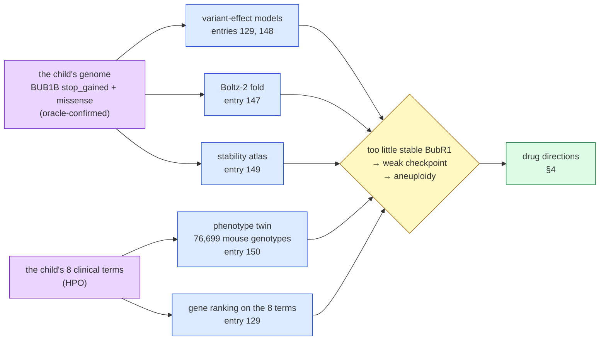

# Track 2 report — iteration 4: one mechanism read from many independent sources, and a drug list tested against chance

**Standing:** ready, written 2026-09-25 from executed runs of iteration 4 only (steps 1–11). It
does **not** use the results of any earlier iteration: the candidate list, the directions and
the checks were all rebuilt from iteration-4 evidence. The one input taken from outside
iteration 4 is the challenge's own answer: the oracle confirmed the causal pair (entry 083).
Every number cites the methodology entry that measured it. Every claim was registered before
its test. **Not uploaded.** Track 2 accepts one submission (due about 2026-10-20).

Written for a panel of clinicians, patient advocates and scientists. Each technical term
appears once with its meaning in brackets; the full dictionary is served at `/learn` on the
dashboard.

> The challenge's own words, kept in view throughout: *submissions are hypotheses for
> follow-up, not evidence that a medicine works.* Nothing below is a recommendation to treat.

---

## 1. How this report answers the panel's four questions

> **Rubric:** all four. This is the map; each row names the section that carries the work and
> the weakest point we know in it.

| criterion | weight | where | the evidence, in one line | the weakest point we know |
|---|---|---|---|---|
| **Scientific rigor** | 35 % | §3–§6 | the mechanism is read from **five instruments that share no data** (variant-effect models, a structure predictor, a stability atlas, 76,699 mouse genotypes, a gene ranking on the clinical terms); four point the same way and one is inconclusive; the drug list comes from **four generators fixed before any join**, and their agreement is **tested against a permutation null** instead of assumed; 12 claims filed before their runs; **5 came back refuted or uninterpretable** and are reported as such (§12) | the four generators agree on **one** drug, and chance gives one (p 0.263, H094 refuted). The survivor, dasatinib, was known before the join. Two of the four generators are weak: the screen sweep finds nothing past correction, and the expression-signature generator failed its own positive control |
| **Potential impact** | 25 % | §7 | three things a treating team can act on **for this child**: a named pharmacogenomic test (the delivered callset answers 1.6 % of the positions it needs); vincristine flagged by **both** safety sources; an incidental malignant-hyperthermia susceptibility call. Plus the mouse model any preclinical test should use | no candidate has been tested in this child or in any BubR1-deficient model with an approved drug; "unflagged" means two sources are silent, not that a drug is safe |
| **Innovation** | 25 % | §8 | convergence of independent drug generators **tested against chance**; a patient-to-mouse-**genotype** phenotype match over a whole database; a per-child safety check that reads the child's **genome and clinical terms side by side**; a stability atlas **calibrated on published alleles before** the child's allele is placed | every part uses public tools; what we claim is the assembly and the discipline, "to our knowledge". We ran no systematic survey of prior art |
| **Scalability** | 15 % | §9 | every stage writes one table contract with a provenance manifest; the whole chain **ran on a second disease** (Bloom syndrome), $0 in 53 minutes, and proposed a different drug set (10 of 105 drugs shared) | our own claim that it would move **by configuration alone** came back **refuted** (H096): four stages kept the case in code and seven wrote the first case's text into the second's outputs. A 378-line driver fixed both, and names exactly what to fold into the tools next |

---

## 2. The answer in one page

> **Rubric:** Impact and Rigor. What a reader who stops here should take away.

**The mechanism (methods form Q14).** Loss of function. The child carries two different broken
copies of `BUB1B` (a **compound heterozygote**): one `stop_gained` allele (the protein is cut
short) and one missense allele (one amino acid swapped). The missense is predicted to
**destabilise** BubR1, the protein `BUB1B` makes. The result is too little stable BubR1, a
weakened **spindle assembly checkpoint** (the cell's "all chromosomes attached?" check before
division), and so cells with the wrong number of chromosomes (**aneuploidy**). Four of five
independent instruments support this reading; the fifth, a structure prediction, is
inconclusive (§3).

**The drugs.**

| | drug | status | why | the caveat |
|---|---|---|---|---|
| the one survivor | **dasatinib** | approved (leukaemia) | named by two generators that share no data: the child's phenotype twin (a BubR1-deficient mouse whose ageing was delayed by clearing senescent cells) and a cancer-cell screen (99.4th percentile for killing aneuploid lines); passes every check | the two agree **at chance level** (p 0.263); it was known before the join; senolytic use is investigational; paediatric reports pair it with growth retardation |
| the single-source lead | **niacin** (vitamin B3) | approved | the twin's other rescue: raising NAD⁺/SIRT2 raised BubR1 and extended life in the hypomorph mouse | one generator only; never tested with an approved drug in a BubR1 model |
| **do not** | **Mps1/TTK and Aurora kinase inhibitors** | none approved | they weaken the same checkpoint further; in 919 cancer lines 33 of 34 are *less* effective in aneuploid lines | none is in any candidate list; stated so no one adds one |
| **flag** | **vincristine** | approved, a standard rhabdomyosarcoma drug | the one drug **both** safety sources flag for this child: an observed CYP3A5 poor-metaboliser call, and its label names the child's own skeletal muscle atrophy | a monitoring question for the treating team, not a removal |

**The one action.** Order a targeted pharmacogenomic panel (or re-call the reads) over SLCO1B1,
ABCG2, CYP2C9, G6PD and UGT1A1. The delivered callset cannot answer any of them (§7.1).

---

## 3. The mechanism (methods form Q14), from five instruments that share no data

> **Rubric:** Rigor (35 %). The mechanism is the basis of every drug argument, so it is read from
> as many independent instruments as iteration 4 could run.



> **Legend** purple = the raw inputs (the genome and the clinical terms) · blue = one
> independent instrument each · yellow = the conclusion they are weighed into · green = where
> it leads.

### 3.1 The genotype

| fact | value | source |
|---|---|---|
| the causal pair | `BUB1B` `stop_gained` + missense, in trans (one on each parental copy) | oracle reply, full match at rank 1 (entry 083) |
| the pair in iteration 4's normalised records | `BUB1B` carries exactly one `missense_variant` and one `stop_gained` | entry 114 |

### 3.2 What the variant-effect models say (steps 1–8, "the model zoo")

A **variant-effect model** scores how damaging one DNA change is. Iteration 4 ran every
credible open model it could license under one contract.

| model | what it scores | the child's alleles | source |
|---|---|---|---|
| AlphaMissense, ESM1b, REVEL | missense only | the missense allele in their top **0.47 %, 2.52 %, 2.59 %** of everything scored | entry 129 |
| GPN-MSA (a DNA-level model) | any single-letter change | the pair ranks **508th of 54,865** (0.93rd percentile); missense 1.38 %, stop-gained 4.09 % | entry 148 |
| Evo 2 (a DNA language model, GPU) | any change | the stop-gained half at 5.61 % | entry 148 |
| the child's 8 clinical terms alone | genes, not variants | `BUB1B` ranks **#14 of 5,267** genes | entry 129 |

Fusing all models into one ranking does **not** find the pair (rank 20,639 of 52,012 with four
models, 4,318 with nine; entries 130, 148): most models cannot score a nonsense allele, so they
abstain. The per-allele reading is still clear: both alleles are damaging.

### 3.3 Is the missense protein unstable or inactive? (structure, stability)

| instrument | result | what it supports | source |
|---|---|---|---|
| **Boltz-2** fold (a structure predictor), wild type vs mutant | a local confidence dip of ~3 pLDDT points (pLDDT: the predictor's own 0–100 confidence), the same size as a conservative swap at that residue | nothing either way; inconclusive (H081) | entry 147 |
| **stability atlas**: ΔΔG (the change in folding energy; + = destabilising) for all **19,950** possible BubR1 substitutions (ThermoMPNN) | the child's missense at the **87th percentile**, buried, confidently folded (pLDDT ≥ 90), inside the pseudokinase domain | "predicted destabilising" (H084 supported, 0.55) | entry 149 |
| calibration before placing the child's allele: can ΔΔG separate published abundance-lowering MVA alleles (5) from stable ones (3)? | AUROC **0.60** (95 % CI 0.13–1.00); no power at n = 8 | the class is a **prediction**, not a result (H083 refuted, 0.15) | entry 149 |


> **Legend** blue bars = every possible substitution (neutral machinery) · yellow dashed = the
> pre-registered top-20 % cut (a decision point) · purple = the child's allele (the raw input),
> value rounded to 0.1.

The `stop_gained` allele makes no full-length protein either way. So total stable BubR1 is low
under both readings of the missense.

### 3.4 Which mouse is this child? (the clinical terms, independent of the genome)

The child's 8 clinical terms were scored against **all 76,699** mouse genotypes in MGI (the
Mouse Genome Informatics database) through the mouse–human phenotype bridge (entry 150).

| result | value |
|---|---|
| best `Bub1b` genotype among 76,699 | top **1.0–1.4 %** (two scoring rules), ~10× better than random terms of equal specificity (p 0.026 and 0.060) |
| positive controls | Bloom syndrome → Blm mice passes; 6 of 7 calibration diseases in the top 5 % |
| which `Bub1b` mouse | the **hypomorph** (an allele that makes less working protein: BubR1 H/H, H/L1002P) on growth, muscle and perinatal terms; an acetylation-deficient knock-in on the tumour term |
| verdicts | H085 supported (0.70); H086 undecided (0.45): the two rules disagree on the single best mouse |


> **Legend** green = hypomorph (H086's prediction) · red = null / knockout · blue = knock-in ·
> grey band = context, not the subject: the central 90 % of the null · dashed red = 5 % (H085's
> prediction) · dotted red = 25 % (its refutation).

**The mechanism, stated for the form.** Loss of function, of the hypomorphic kind: too little
stable BubR1 (a truncating allele plus a predicted-destabilising missense); pathway disrupted:
the spindle assembly checkpoint (BubR1 is part of the mitotic checkpoint complex that holds
anaphase until every chromosome is attached); downstream consequence: chromosome
mis-segregation, mosaic aneuploidy, and in the mouse model early senescence, muscle wasting and
growth failure, which match the child's own terms. No source suggests gain of function or a
dominant-negative protein.

---

## 4. From mechanism to drug directions

> **Rubric:** Rigor. Each direction follows from the mechanism in §3, and each names the
> iteration-4 evidence that supports or weakens it.

| id | direction | the logic | iteration-4 evidence | standing |
|---|---|---|---|---|
| D3 | **raise stable BubR1** | a hypomorph makes some working protein; more of it helps | twin: SIRT2 overexpression / NAD⁺ raised BubR1 and extended life in the H/H mouse; SIRT2 does nothing on a normal background (entry 150). Missense predicted destabilising (entry 149) | supported by the twin; no approved drug tested |
| D5 | **clear senescent cells / damp mTOR** | low BubR1 drives early senescence; clearing p16⁺ cells delayed it in the twin | twin: genetic clearance of p16⁺ cells delayed sarcopenia and fat loss in H/H (entry 150); dasatinib is the approved senolytic analogue; the screen ranks dasatinib 99.4th percentile on aneuploid lines (entry 151) | two sources, one drug; pharmacological test in the twin never published |
| D2 | **exploit aneuploidy stress** | aneuploid cells carry protein and energy stress | no Launched drug selective for aneuploid lines past correction (best q 0.287, entry 154); the one aneuploidy-ranked survivor, dasatinib, is argued under D5 | not supported by iteration 4 |
| D4 | **the tumour context** (rhabdomyosarcoma) | the child's presenting tumour | no Launched drug selective for rhabdomyosarcoma lines past correction (best q 0.122; three lines carry most compounds, entry 154) | not supported; underpowered |
| A1 | **do not: weaken the checkpoint further** | the child's checkpoint is already weak | 33 of 34 Mps1/Aurora inhibitors are *less* effective in high-aneuploidy lines (median δ −0.139, entry 151), reproducing Cohen-Sharir 2021 (PMID 33505028) | measured; carried as check K1 |
| A2 | **caution: spindle poisons** (tubulin drugs) | they act through the checkpoint the child lacks | biology only in iteration 4; vincristine separately flagged by the safety check (§6.2) | a caution, not an exclusion |

---

## 5. How the candidates were found: four generators that share no data

> **Rubric:** Rigor and Innovation. A candidate list is only as good as the independence of the
> sources behind it, so iteration 4 made that independence testable.

A **generator** proposes drugs by a rule fixed before any join. A **check** can only filter.
The rules were committed before two of the four lists existed (commit `1b02e44`).

| id | generator | the rule | listed / approved universe | source |
|---|---|---|---|---|
| G1 | walk over PrimeKG (a biomedical knowledge graph) from the MVA disease node | top 50 labelled drugs by walk score | 50 / 188 | entry 142, 155 |
| G2 | the phenotype twin's published rescues | approved analogues of interventions that rescued the twin | 2 / 1,498 (dasatinib, niacin) | entry 150, 155 |
| G3 | screen-wide PRISM sweep (a pooled cancer-cell drug screen, 613 approved drugs) | top 0.5 % on each contrast | 8 / 613 | entry 154 |
| G4 | LINCS signature reversal (drugs whose gene-expression effect is the opposite of losing `BUB1B`) | approved drugs in both engines' top 100 | 3 / 1,157 | entry 153 |

**Two generators are weak, and the report says so.**

- **G3.** No drug passes multiple-testing correction in either contrast (H093 refuted, 0.10).
  The same code recovers the textbook melanoma drugs (dabrafenib at q 3.2 × 10⁻⁹), so the
  pipeline works; the biology is not there at this power (entry 154).
- **G4.** Its registered positive control failed: the `BUB1B`-loss signature did not resemble
  the loss of the other checkpoint genes (best, BUB1, at 5.6 % against a 5 % cut). It reads
  as a generic cell-cycle arrest, so H092 is **uninterpretable** and G4's three drugs carry a
  caution (entry 153).


> **Legend** green = q < 0.10 · yellow = G3-listed · blue = every other eligible drug · grey band
> = central 95 % of δ over 200 seeded unrelated drugs · dashed yellow = the p needed for q < 0.10
> (control: the largest passing p; real contrasts: 0.10 / 613, which no drug reaches) · purple
> label = dasatinib, marked only because entry 151 reported it.

### 5.1 Do the generators agree more than chance?

A **permutation null** replaces each list with a random draw of the same size from its own
universe, 10,000 times (seed 20260925), and counts how often ≥ 2 generators name the same drug.

| test | observed | null mean | null 95th pct | p | role |
|---|---|---|---|---|---|
| all four generators | **1** (dasatinib) | 0.30 | 1.0 | **0.263** | the registered test (H094) |
| without dasatinib (registered, it was known before) | 0 | — | — | 1 | sensitivity |
| without G4 (failed control) | 1 | — | — | 0.261 | sensitivity |

**H094 is refuted (0.15)**: the four sources agree on one drug, which is what chance gives
(entry 155).


> **Legend** green bar = a combination of ≥ 2 generators (a converging drug) · blue bar = one
> generator alone · dark dot = the generator is in the combination, grey = it is not · (n) =
> drugs the generator lists.


> **Legend** blue bars = the null distribution · yellow = null counts above its 95th percentile
> (the bar the observed count had to clear) · solid line = observed: green if it clears the bar,
> red if not · only the first panel is a verdict input.

---

## 6. The checks, and the candidates that survive them

> **Rubric:** Rigor and Impact. Every drug any generator named carries its check record.

| check | rule | result over 62 drugs | source |
|---|---|---|---|
| K1 direction | a Mps1/TTK or Aurora inhibitor fails (A1); a tubulin drug carries a caution (A2) | 32 pass · 30 caution (27 unannotated, 3 spindle poisons) · **0 fail** | entry 155 |
| K2 the child's safety | fails only if **both** sources flag it: the child's genome (PharmCAT + CPIC guidelines) and the child's clinical terms against drug labels (OnSIDES) | 51 pass (21 only because no label exists) · 10 caution · **1 fail: vincristine** | entry 155, method of entry 152 |
| K3 contrary screen | fails if PRISM measures it pointing against its own direction | 8 measured, all pass · 54 not applicable | entry 155 |

### 6.1 The survivor: dasatinib

| | result |
|---|---|
| generators | twin #1 (D5: senescent-cell clearance delayed ageing in the BubR1 hypomorph, PMIDs 18516091, 22048312) and PRISM #8 (D2: aneuploidy contrast) |
| K1 | pass: its mechanism (BCR-ABL, SRC, KIT, PDGFR, ephrin kinase inhibitor) is in no do-not class |
| K2 | pass: *neither source flags it, which is not evidence of safety*. No pharmacogene guideline; 5 of 34 labels name rhabdomyolysis or weight loss (0.15, below the comparison set's 0.225) |
| K3 | pass: aneuploidy Cliff's δ +0.135 (CI 0.024–0.243), one-sided p 0.0096 |
| paediatric reports (FAERS, counts, no denominator) | growth retardation 15, malnutrition 2 |
| H095 | **supported, weakly (0.40)**: met as registered, but the convergence is chance-level, the drug was known before the join, and K3 re-reads its own generator's contrast |


> **Legend** generator columns: blue = the generator names the drug (#rank) · K columns: green =
> pass, yellow = caution (kept, reason in the table), red = fail, grey = not run · survivor:
> green = converges and fails no check, red = does not.

### 6.2 The one drug both safety sources flag: vincristine

Vincristine is a standard rhabdomyosarcoma drug, so this is a monitoring question, not a
removal. The genome half: an observed **CYP3A5 poor-metaboliser** call (CYP3A5 clears
vincristine), read from 1 of its 7 positions in a region the callset barely covers. CEP72, the
other vincristine-toxicity gene, is not covered by any caller. The phenotype half: vincristine's
one label names **muscle atrophy**, an exact match to the child's own term, and paediatric FAERS
holds 57 reports of vincristine with muscular weakness (entries 152, 155).

### 6.3 Every other candidate

The 61 other drugs are named by one generator each and carry no convergence. They are listed
with their check record in [Appendix A](#appendix-a--every-drug-any-generator-named). The walk's
list is dominated by highly connected nodes (vitamins, metals, amino acids): graph proximity
without a mechanism argument. The screen's list sits at noise level (q ≥ 0.12). The
expression list is uninterpretable. None is argued here as a candidate.

---

## 7. What this could change: potential impact

> **Rubric:** Impact (25 %). What a treating team, other families and researchers could do next.

### 7.1 For this child: three questions for the treating team

1. **Order a targeted pharmacogenomic test.** The delivered callset lists variants only, so it
   answers **20 of 1,223** pharmacogene positions (**1.6 %**). Every gene with a prescribing
   guideline for a drug in this field is a **no call**: SLCO1B1 and ABCG2 (statins), CYP2C9,
   G6PD (chloroquine, hydroxychloroquine), UGT1A1 (irinotecan). A panel over those five, or a
   re-call of the sequencing reads at PharmCAT's positions, would answer it. The re-call needs
   the raw reads, not delivered as an alignment (≥ 1.7 h to stream 67.68 GB, entry 152).
2. **Vincristine**: the two-source flag in §6.2.
3. **Anaesthesia**: an incidental RYR1 call of *uncertain* malignant-hyperthermia
   susceptibility, in a child likely to face repeated anaesthesia (entry 152).


> **Legend** left: blue = positions PharmCAT needs · green = positions this callset genotyped ·
> right: green = region called at ≥ 0.5× the genome-wide rate · yellow = 0.2–0.5× (a decision
> point) · red = below 0.2×, where assuming "no variant = reference" is not supported.

### 7.2 For preclinical testing: which mouse to use

Any candidate here should be tested in the BubR1 **hypomorph** (H/H or H/L1002P), the
child's phenotype twin, not in a knockout or heterozygous null (entry 150). No approved drug
has been tested in that mouse. The twin has no kidney phenotype recorded, so the child's
nephrocalcinosis is unexplained by the model and is itself a readout worth measuring.

### 7.3 The experiment that settles the mechanism class

A BubR1 Western blot with a cycloheximide chase (the protein's decay rate) in the child's cells
against the parents' would settle "unstable or inactive?" directly and override every
prediction in §3.3. A positive answer (unstable) is also the biomarker for direction D3
(entry 149).

---

## 8. What is new here, against standard practice

> **Rubric:** Innovation (25 %).

| idea | standard practice | what iteration 4 did | source |
|---|---|---|---|
| convergence **tested** | "several sources agree" is asserted | independent generators, rules fixed before the join, a permutation null; the refutation is reported | entry 155 |
| generators vs checks | one pipeline both proposes and filters | a check can never vote for a drug it could have generated | step 10 README |
| patient → mouse **genotype** | disease → gene lists | the child's terms against all 76,699 MGI genotypes, with an information-matched null; the twin's **allele class** decides which rescues transfer | entry 150 |
| calibrate before placing | score the patient's variant | an all-substitution stability atlas, tested on published allele classes first; the negative calibration is the finding | entry 149 |
| per-child, two-source safety | label warnings for children in general | the child's **genome** and **clinical terms** side by side per drug; "unflagged" worded so it can never read as "safe"; a regional callability measure says where "no call = reference" is defensible | entries 152, 155 |
| pre-registration and an append-only register | results written after the fact | the 12 claims in §12 filed before their runs; every verdict a new revision, never an edit | `docs/science-register.json` |

---

## 9. Scalability: the same chain, a second disease

> **Rubric:** Scalability (15 %).

Every stage is a tool with one table contract and a provenance manifest. The inputs are meant
to be a gene, a disease node, a list of clinical terms and, for the safety check, a VCF. Step 11
measured how far that holds.

| stage | tool | what changes for another case |
|---|---|---|
| phenotype twin | `tools/phenotype_twin.py` | the HPO terms and the gene |
| PrimeKG walk | `mva.drugs.graph_walk` | the disease node |
| screen sweep | `tools/screen_sweep.py` | the lineage and covariate contrasts |
| signature reversal | `tools/signature_reversal.py` | the gene and its positive-control siblings |
| convergence + checks | `tools/converge.py` | generator ids and paths |
| per-child safety | `tools/patient_safety.py` | the VCF, the drug table, the HPO terms |

**The second case (step 11, Bloom syndrome, `BLM`).** Bloom syndrome swaps the gene (a DNA
helicase), the pathway (DNA repair, not the mitotic checkpoint) and the clinical terms (42, from
the public `phenotype.hpoa`), while asking the same kind of question (entry 156).

| stage | on Bloom syndrome | rows written | what it took |
|---|---|---|---|
| phenotype twin | best *Blm* mouse at 1.15 % of 76,699 (retrospective: entry 150 ran this control; *Recql4* ranks higher) | 13 genotypes | new code (its output directory was fixed) |
| G1 PrimeKG walk | 1,026 drugs reached, 239 labelled; KIT dominates Bloom's disease node | 50 | flags, but MVA text in its manifest |
| G2 twin rescues | no *Blm*-mouse rescue names an approved drug | 0 | flags, from a curated table |
| G3 PRISM sweep | only 14 Launched drugs are measured in blood-cancer lines | 28 | new code (lineage in constants) |
| G4 LINCS reversal | positive control (RMI1, RMI2, TOP3A) failed, as for MVA | 6,699 | new code (gene in constants) |
| convergence + checks | no drug named by ≥ 2 generators (p 1.0); K1 fails cisplatin | 53 | new code (K1 rule in constants) |

**H096 is refuted (0.15).** The chain runs on a second disease and proposes a different set
(Jaccard 0.095 against a 0.20 bar), but not by configuration alone. The driver
`tools/transfer_it4.py` (378 lines, no existing line edited) fills the four code gaps and
corrects 136 strings of first-case text by recorded substitutions, re-hashing every manifest. That
list is the work order for making the tools truly case-agnostic.


> **Legend** blue = the MVA run, built for that case · Bloom column: green = configuration alone,
> yellow = ran from flags but wrote MVA-case text that `relabel` had to correct, red = needed new
> code, grey = not written · "gap" = entry 156's static-survey row · seconds = wall time.

### 9.1 What it cost

| stage | compute | cost | source |
|---|---|---|---|
| GPU variant models (NT-v2, Evo 2, ESM-C, Boltz-2) | Modal | $14.57 | entry 148 |
| stability atlas (ThermoMPNN) | Modal T4, 16 GPU-s | $0.015 | entry 149 |
| phenotype twin | laptop, 53 s | $0 | entry 150 |
| PRISM replication and sweep | laptop, ~4 min | $0 | entries 151, 154 |
| per-child safety | laptop, < 1 min PharmCAT | $0 | entry 152 |
| LINCS reversal | public APIs | $0 | entry 153 |
| the second disease, all stages | laptop + public APIs, 53 min | $0 | entry 156 |
| convergence + checks | laptop, 27 s | $0 | entry 155 |

---

## 10. What this report cannot tell you

> **Rubric:** Rigor. The limits, next to the results they bound.

- **The drug list is thin.** Four generators agree on one drug, at chance level (H094 refuted).
  Dasatinib is a hypothesis with two independent routes, not a finding.
- **Two generators are weak.** The screen sweep's rhabdomyosarcoma arm rests on three cell
  lines for 619 of 633 compounds; its "approved" label covers only compounds the 2020 release
  classified (entry 154). The expression generator failed its positive control (entry 153).
- **The walk rewards connectivity.** Vitamins and metals rank high because they touch many
  proteins (entry 142).
- **The mechanism class is predicted, not measured.** ΔΔG cannot separate published allele
  classes at n = 8 (entry 149); the Boltz-2 fold is inconclusive (entry 147).
- **The twin's rescues are genetic**, not pharmacological; no approved drug was tested in a
  BubR1-deficient mouse (entry 150).
- **Safety sources are silent more often than they speak.** 22 of 62 candidates have no
  OnSIDES label; the genome answers 1.6 % of the positions (entries 152, 155).
- **The chain is not yet configuration-only.** A second disease needed a 378-line driver (entry 156).
- **Nothing here was tested in this child.**

---

## 11. Reproducibility

> **Rubric:** Rigor and Scalability.

Code: `https://github.com/agharsallah/mva-hackathon` (public; no patient data, no genomic
position in any tracked file). Every table under `ressources/track2/it4/` carries a
`.provenance.json` (inputs with URL, sha256 and licence; parameters; the entry that produced
it). The commands are in each entry's `## Commands` section. In order:

```bash
uv run python tools/phenotype_twin.py run --gene Bub1b          # entry 150
uv run python tools/screen_sweep.py run                         # entry 154
uv run python tools/signature_reversal.py run                   # entry 153
uv run python tools/converge.py twin ...                        # entry 155 (full flags there)
uv run python tools/converge.py run ...                         # entry 155
uv run python tools/render_step10_s2.py
```

---

## 12. Where every claim lives

| claim | test | verdict | entry |
|---|---|---|---|
| H074 | the walk's top 20 differs from a decoy gene's walk (overlap ≤ 5 of 20) | supported 0.75 (overlap 2 of 20) | 142 |
| H083 | stability separates published allele classes | refuted 0.15 | 149 |
| H084 | the child's missense is in the top 20 % of ΔΔG | supported 0.55 | 149 |
| H085 | the child's terms pick a Bub1b mouse in the top 5 % | supported 0.70 | 150 |
| H086 | the best Bub1b mouse is a hypomorph | testing 0.45 | 150 |
| H089 | the D5 drugs, reported whichever way they point | supported 0.80 | 151 |
| H090 | the child's genome carries an actionable pharmacogenomic result | supported 0.40 | 152 |
| H092 | a BUB1B-loss signature is specifically reversed by an approved drug | testing 0.50 (uninterpretable) | 153 |
| H093 | a Launched drug is selective for both aneuploid and RMS lines | refuted 0.10 | 154 |
| H094 | the four generators converge beyond chance | refuted 0.15 | 155 |
| H095 | a converging drug survives every check | supported 0.40 | 155 |
| H096 | the chain runs on a second disease by configuration | refuted 0.15 (it runs, with a 378-line driver) | 156 |

Entries are under `docs/iteration4/step-<n>/methodology/`. Three iteration-4 claims are left
out on purpose: H087, H088 and H091 tested drugs drawn from an earlier iteration's shortlist.
Their *methods* are reused here (entries 151, 152); their *candidate rows* are not. Entry 151's
screen-wide Mps1/Aurora measurement (§4, A1) is independent of any list and is kept.

---

## Appendix A — every drug any generator named

From entry 155 §5 (`ressources/track2/it4/candidates.tsv`). "no Hub MOA": the Drug Repurposing
Hub does not annotate the drug's mechanism. "no OnSIDES label": unflagged only because no label
exists. K3 `n/a`: no direction maps to a PRISM contrast.

| drug | generators (rank) | direction hint | K1 direction | K2 safety | K3 screen | survivor |
|---|---|---|---|---|---|---|
| Dasatinib | twin #1, prism #8 | D2, D5 | pass | pass | pass (aneuploidy δ +0.135) | **yes** |
| Acyclovir | walk #45 | none | pass | pass | n/a | no |
| Adenosine | walk #26 | none | pass | pass | n/a | no |
| Albendazole | lincs #2 | none | caution: spindle poison | caution (phenotype) | n/a | no |
| Aldesleukin | walk #36 | none | caution: no Hub MOA | pass | n/a | no |
| Basiliximab | walk #37 | none | caution: no Hub MOA | pass | n/a | no |
| Belinostat | walk #15 | none | pass | caution (genome) | n/a | no |
| Bleomycin | walk #40 | none | caution: no Hub MOA | pass | n/a | no |
| Brentuximab Vedotin | walk #8 | none | caution: no Hub MOA | caution (phenotype) | n/a | no |
| Cabazitaxel | walk #47 | none | caution: spindle poison | pass (no OnSIDES label) | n/a | no |
| Caffeine | walk #49 | none | pass | pass | n/a | no |
| Calcium | walk #39 | none | caution: no Hub MOA | pass (no OnSIDES label) | n/a | no |
| Cannabidiol | walk #6 | none | caution: no Hub MOA | caution (phenotype) | n/a | no |
| Carbamazepine | walk #29 | none | pass | caution (genome) | n/a | no |
| Cefpirome | prism #2 | D2 | pass | pass (no OnSIDES label) | pass (aneuploidy δ +0.188) | no |
| Citrulline | walk #43 | none | caution: no Hub MOA | pass (no OnSIDES label) | n/a | no |
| Cladribine | walk #32 | none | pass | pass | n/a | no |
| Copper | walk #5 | none | caution: no Hub MOA | pass | n/a | no |
| Cyclosporine | walk #9 | none | pass | pass | n/a | no |
| Delivert | prism #6 | D2 | pass | pass (no OnSIDES label) | pass (aneuploidy δ +0.142) | no |
| Denileukin Diftitox | walk #38 | none | caution: no Hub MOA | pass (no OnSIDES label) | n/a | no |
| Doxorubicin | walk #30 | none | pass | pass | n/a | no |
| Dronedarone | walk #22 | none | pass | pass | n/a | no |
| Fentiazac | prism #4 | D2 | pass | pass (no OnSIDES label) | pass (aneuploidy δ +0.143) | no |
| Fomepizole | prism #1 | D4 | pass | pass (no OnSIDES label) | pass (rms δ +0.925) | no |
| Fostamatinib | walk #1 | none | pass | pass | n/a | no |
| Glycine | walk #19 | none | caution: no Hub MOA | pass | n/a | no |
| Inositol Hexanicotinate | prism #5 | D4 | caution: no Hub MOA | pass (no OnSIDES label) | pass (rms δ +0.877) | no |
| Isoleucine | walk #27 | none | caution: no Hub MOA | pass | n/a | no |
| L-Glutamine | walk #7 | none | caution: no Hub MOA | pass (no OnSIDES label) | n/a | no |
| Lenalidomide | walk #25 | none | pass | caution (phenotype) | n/a | no |
| Levothyroxine | walk #16 | none | pass | pass | n/a | no |
| Liothyronine | walk #17 | none | pass | pass | n/a | no |
| Magnesium | walk #41 | none | caution: no Hub MOA | pass (no OnSIDES label) | n/a | no |
| Magnesium Carbonate | walk #42 | none | caution: no Hub MOA | pass | n/a | no |
| Mecasermin | walk #23 | none | caution: no Hub MOA | pass | n/a | no |
| Micafungin | walk #21 | none | pass | pass | n/a | no |
| NADH | walk #3 | none | caution: no Hub MOA | pass (no OnSIDES label) | n/a | no |
| Niacin | twin #2 | D3 | pass | pass | n/a | no |
| Perindopril | walk #33 | none | pass | pass | n/a | no |
| Phenytoin | lincs #1 | none | pass | caution (genome) | n/a | no |
| Pizotifen | prism #3 | D4 | pass | pass (no OnSIDES label) | pass (rms δ +0.915) | no |
| Podofilox | walk #48 | none | caution: no Hub MOA | pass | n/a | no |
| Pyridoxal | walk #4 | none | caution: no Hub MOA | pass (no OnSIDES label) | n/a | no |
| Pyruvic Acid | walk #46 | none | caution: no Hub MOA | pass (no OnSIDES label) | n/a | no |
| Quercetin | walk #20 | none | pass | pass (no OnSIDES label) | n/a | no |
| Romidepsin | walk #34 | none | pass | pass | n/a | no |
| Sacituzumab Govitecan | walk #50 | none | caution: no Hub MOA | caution (genome) | n/a | no |
| Serine | walk #28 | none | caution: no Hub MOA | pass | n/a | no |
| Sorafenib | walk #31 | none | pass | caution (phenotype) | n/a | no |
| Taurine | walk #24 | none | pass | pass | n/a | no |
| Tenecteplase | walk #44 | none | caution: no Hub MOA | pass | n/a | no |
| Terazosin | prism #7 | D4 | pass | pass | pass (rms δ +0.871) | no |
| Theophylline | walk #2 | none | pass | caution (phenotype) | n/a | no |
| Thyroid, Porcine | walk #18 | none | caution: no Hub MOA | pass (no OnSIDES label) | n/a | no |
| Tofacitinib | lincs #3 | none | pass | pass (no OnSIDES label) | n/a | no |
| Vincristine | walk #13 | none | caution: spindle poison | **fail** (both sources) | n/a | no |
| Vitamin A | walk #14 | none | caution: no Hub MOA | pass | n/a | no |
| Voclosporin | walk #10 | none | pass | pass | n/a | no |
| Vorinostat | walk #35 | none | pass | pass (no OnSIDES label) | n/a | no |
| Zinc | walk #11 | none | caution: no Hub MOA | pass (no OnSIDES label) | n/a | no |
| Zinc Sulfate, Unspecified Form | walk #12 | none | caution: no Hub MOA | pass (no OnSIDES label) | n/a | no |
