# Track 2 — iteration 5: start from the alleles, not from the drug databases

**Standing:** draft, 2026-09-25, from iteration 5 step 1 only (entries 158–162). **Not uploaded.** Track 2 accepts one submission per team; the user plans
to merge the Track 2 iterations into one upload, and this folder is an input to that.

**Case.** One child with mosaic variegated aneuploidy (MVA), carrying two different broken
copies of `BUB1B` — a *compound heterozygote*: one `stop_gained` allele (a premature stop
signal that cuts the protein short) and one missense allele (a single amino-acid change). The
pair was confirmed by the organisers' oracle in Track 1 ([entry 083](../../../docs/iteration1/step-6/methodology/083-oracle-reply-submission-1.md)).
`BUB1B` encodes **BubR1**, a component of the spindle assembly checkpoint (the brake that holds
cell division until every chromosome is correctly attached).

**Two data sources, everywhere.** The **genome** (the delivered variant callset and reads) fixed
the gene, the two alleles, their consequences and the child's pharmacogenome. The **clinical
dataset** (the proband's 8 HPO terms) disqualified drug classes on this child's own phenotype
axes and selected the mouse that matches him. Every section below says which of the two it used.

**This is a research exercise.** Nothing here is advice for or against giving any drug to any
patient, and no number here is a probability of benefit.

---

## 1. How this report answers the panel's four questions

| criterion | weight | where | what it rests on | the weakest point, stated by us |
|---|---|---|---|---|
| **Scientific rigor** | 35 % | §5–§8, §12 | four routes, **each with a positive control declared in writing before the child's data were touched**; two of those controls **failed and are reported as failed**; every table carries a `.provenance.json` with input sha256s | this iteration files **no pre-registered hypotheses** (§3). A route that passes its control is *a validated method applied once*, not a tested claim |
| **Potential impact** | 25 % | §9 | a named next measurement worth more than any drug choice on the table; an **avoid list** built from the child's own genome, his own HPO terms, and what MVA patients were actually given | the highest-ranked drug is a weak, mechanism-free hit (§6); the impact is in the *test*, not the prescription |
| **Innovation** | 25 % | §10 | readthrough priced **per allele** against a dosage arithmetic; **proliferation-corrected** protein-level drug screening for a cell-cycle gene; a **code-enforced quote gate** over model-read literature; a decision layer that reports **EVPI/EVSI** instead of a ranked list | the decision layer is a transparent heuristic, not a calibrated posterior |
| **Scalability** | 15 % | §11 | all three discovery routes re-run on **Bloom syndrome** from case cards; 587 configuration lines against entry 156's 378-line purpose-built driver; every first-case table byte-identical | "configuration only" was **false** as the routes stood: 271 lines of parameterisation were needed first, and we report that number, the 357 that includes the forced module splits, and the 491-line full diff |

---

## 2. The answer in one page

> **Rubric:** all four. The short version, with every number linked to the section that measured it.

**The question this iteration asked.** Iterations 2 and 4 asked drug databases what to give this
child, and the databases answered at chance level (§3). Iteration 5 asks a different question:
*given these two specific alleles and this protein, what could raise the amount of working
BubR1, and how much would each route actually be worth?*

**Four findings.**

1. **The stop allele is not the lever.** It is NMD-competent (its message is destroyed by the
   cell's quality-control system) and it deletes the entire kinase domain. A readthrough drug —
   one that makes the ribosome read past a premature stop — is worth **at most +1.4 percentage
   points** of working BubR1 against a gap of about **6.5 points**, even with every assumption
   at its most generous. Doubling the missense protein's abundance is worth **+12.5 points** on
   the same arithmetic (§5).
2. **The amount-raising branch is nearly empty of approved drugs.** With proliferation removed
   (BubR1 rises and falls with the cell cycle, so uncorrected readouts measure growth, not
   BubR1), only 18 of 875 compounds raise BUB1B protein; the 5 approved ones raise it by
   **+14–16 %**. The strongest raisers are a CDK1 inhibitor (+88 %) and a proteasome inhibitor
   (+45 %) — unapproved and non-specific, but they name the lever: **degradation** (§6).
3. **The literature holds what no database encodes**, and every row is machine-verified against
   its source text. 30 intervention rows and 12 patient-exposure rows kept, 0 rejected, gate
   mutation-tested; NAD⁺/NMN, HDAC
   inhibitors, proteasome inhibitors and senolytics. It also yields something no drug database
   has: **what MVA patients were actually given** — a severe dactinomycin reaction in a
   biallelic-`BUB1B` case, published advice to avoid vincristine or taxol, growth hormone
   ineffective across four reports (§7).
4. **The decision is dominated by one unmeasured fact, and we can price it.** Everything turns
   on whether the missense protein is *unstable* (too little of it) or *inactive* (enough, but
   broken). **EVPI is 0.180, all of it on that one variable**; the readthrough question is worth
   **0**. A cycloheximide-chase Western blot (a bench test that measures how fast the protein
   decays) captures **0.106**, about **59 %** of that ceiling. The best action flips at
   P(unstable) = **0.414**, and our prior sits at 0.55 — only 0.14 above the flip (§8).

**What we would say to a treating team.** Not "give drug X". The ranked list's top entry
(gliclazide, a diabetes drug, tied with migalastat) rests on a 14–16 % protein rise in one
cancer cell line with no mechanism argument, and we say so rather than dressing it up. The
defensible output is the **avoid list** (§9.2) and the **one measurement** that would change
what anyone should do next (§9.1).


> **Legend** yellow = the first uncertain fact · purple = further facts about the child's alleles ·
> each edge = a value with its prior weight · green = the best drug in that state · red = a state
> in which only the baseline (defer, run the test first) is best.

---

## 3. Why this iteration is shaped differently — and what it gives up

> **Rubric:** Rigor and Innovation. A method change has to be argued from the previous method's
> failures.

**What iterations 2 and 4 measured.**

| earlier route | outcome | the lesson taken |
|---|---|---|
| PrimeKG knowledge-graph walk (G1, [entry 142](../../../docs/iteration4/step-7/methodology/142-a-graph-walk-from-the-disease-node.md)) | vitamins and metals rank top | the walk scores **connectivity**, not mechanism |
| screen-wide PRISM sweep (G3, [entry 154](../../../docs/iteration4/step-10/methodology/154-screen-wide-prism-sweep.md)) | nothing survives multiple-testing correction (best q 0.122) | cancer cell lines are a poor proxy for a constitutional hypomorph |
| LINCS signature reversal (G4, [entry 153](../../../docs/iteration4/step-9/methodology/153-lincs-signature-reversal-of-bub1b-loss.md)) | **positive control failed** | an mRNA signature of a cell-cycle gene reads as generic arrest |
| convergence of all four (H094, [entry 155](../../../docs/iteration4/step-10/methodology/155-convergence-and-checks.md)) | one shared drug, p 0.263 = chance | weak independent sources do not add up |
| the phenotype twin ([entry 150](../../../docs/iteration4/step-9/methodology/150-the-childs-phenotype-twin-among-mgi-mice.md)) | NAD⁺/SIRT2 and senolysis, with real rescue data | **the mechanism-first route is the one that found something** |

**The design that follows.** Start at the two alleles and the protein; let each route be a
*measurement* about this genotype rather than a vote from a database; and make every route prove
itself on a case it cannot get wrong before it is pointed at the child.

**What this iteration gives up, explicitly.** It files **no hypotheses** in the science register
(the user's decision, recorded in
[`notes/exploratory-no-hypotheses.md`](../../../docs/iteration5/notes/exploratory-no-hypotheses.md)).
Instead, **each route declares a positive control in writing before it runs**. That is weaker
than pre-registration in one specific way — the analysis could have been steered after seeing
the data — and stronger in another: a route whose control fails is reported as uninterpretable
rather than argued around. **Two of the six controls in this report failed** (§6.3, §11), which
is the only evidence we can offer that the discipline was applied rather than announced.

---

## 4. The genotype and the mechanism it implies

> **Rubric:** Rigor. What the two data sources fixed before any drug was considered.

| fact | value | source |
|---|---|---|
| gene | `BUB1B`, transcript `ENST00000287598` (Ensembl 116), 23 exons, 1,050 residues | genome |
| allele A | `stop_gained`, **UGA**, exon **17 of 23**, **746 nt** upstream of the last exon–exon junction with 6 junctions after it ⇒ **NMD-competent** | genome, entry 158 |
| allele B | missense, predicted destabilising; ΔΔG cannot separate published allele classes at n = 8, so the class is **predicted, not measured** | genome, [entry 149](../../../docs/iteration4/step-9/methodology/149-the-stability-atlas-and-the-childs-missense.md) |
| protein lost by allele A | **736 of 1,050 residues kept (29.9 % lost)**; the **entire protein-kinase domain** (UniProt 766–1050) is gone | entry 158 |
| mechanism class | **loss of function, hypomorphic** (some working protein, too little of it) — four of five independent instruments agree | [iteration 4 §3](../iteration-4/report.md) |
| the matching mouse | the BubR1 **hypomorph** (H/H, H/L1002P), selected from all 76,699 MGI genotypes by the child's 8 HPO terms | clinical, entry 150 |

**Why the mouse matters here.** The hypomorph is the genotype in which NAD⁺/SIRT2 and
senescent-cell clearance were shown to work. A knockout mouse would have answered a different
question. That selection came from the **clinical** dataset alone, independent of the genome.

---

## 5. Route R1 — can the stop allele be read through, and is it worth reading through?

> **Rubric:** Rigor and Innovation. The first route prices a therapy class against this child's
> exact allele rather than against his gene.
> **Entry:** [158](../../../docs/iteration5/step-1/methodology/158-the-stop-allele-can-be-read-through-and-it-is-not-the-lever.md).
> **Sources:** genome (the allele), clinical (which drug classes are disqualified).

**The idea.** Some drugs make the ribosome insert an amino acid at a premature stop instead of
halting — *nonsense readthrough*. How well that works is not a property of the gene but of the
**stop codon and the few bases around it**, and it competes with NMD, which destroys the message
before it can be translated at all.

### 5.1 The allele's anatomy

| fact | value | why it matters |
|---|---|---|
| stop codon | **UGA** | the most readthrough-permissive of the three stops, and the only one DAP acts on |
| **+4 base** (immediately after the stop) | **A** | the single strongest context feature; `C` is best, `A` is second for DAP and near-worst for aminoglycosides |
| −1 base | **G** | a weaker modifier |
| NMD | **competent** (746 nt upstream of the last junction; the 50–55 nt rule) | the message is destroyed, so there is little substrate to read through |
| domains lost | the **whole kinase domain** | the domain the child's *other* allele also sits in |

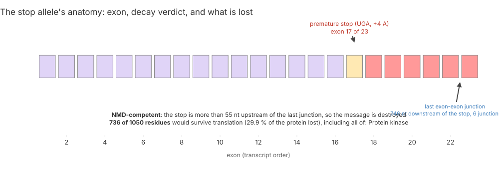

> **Legend** purple = coding exons before the stop · yellow = the exon carrying the stop (the
> decision point for the 50–55 nt rule) · red = the exons the truncated protein never reaches ·
> blue text = the junction the rule is measured against.

### 5.2 The positive control, declared before any prediction

The model is a context model fitted to **Toledano, Supek & Lehner, *Nat Genet* 2024
(PMID 39174735)** — 5,837 **measured** premature stops × 8 compounds. The child's stop is **not**
in that dataset, so every number for him is a prediction. The control was two held-out sets: 14
literature benchmark stops, and a random 20 %.

| compound | ρ (14 held out) | ρ (random 20 %) | verdict |
|---|---|---|---|
| **DAP** (2,6-diaminopurine) | **0.83** | **0.81** | **passes both** |
| **G418** | **0.78** | **0.78** | **passes both** |
| **SRI-41315** | **0.65** | **0.64** | **passes both** |
| Gentamicin | 0.75 | 0.52 | fails on ordering |
| Clitocine · SJ6986 · CC90009 · 5-fluorouridine | 0.25–0.77 | 0.33–0.77 | fail one arm each |
| **Untreated** (negative control) | **0.02** | **0.12** | **fails, as it must** |

The untreated column is the load-bearing part: run through the identical code path, it orders at
chance. A pipeline that "predicted" readthrough from untreated data would have been detected here.

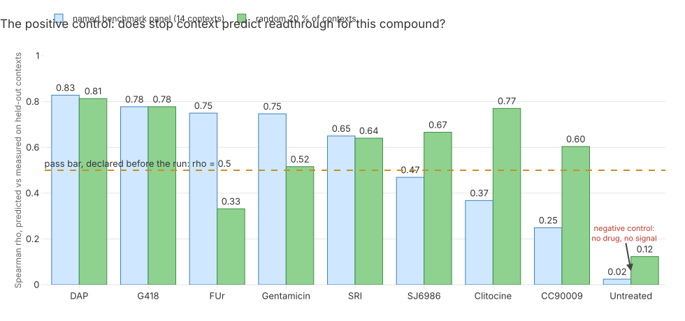

> **Legend** blue = the named benchmark panel, the declared primary control · green = the random
> held-out fifth · yellow dashed = the pass bar fixed before the run · the red note marks the
> dataset's own no-drug column, which must fail and does.

### 5.3 What the child's stop would do, and what it would be worth

Predicted readthrough, as a percentage of a no-stop control (no-drug floor 0.18 %): **DAP 2.85**,
SRI-41315 2.34, G418 0.58, gentamicin 0.21. The **+4 A** context costs G418 a factor of 3.6 but
DAP only 1.3 — an allele-level reason the aminoglycosides are the wrong class here, quite apart
from the clinical one below.

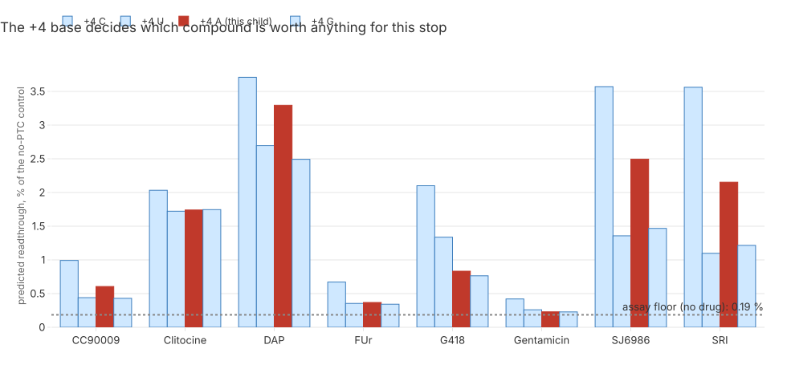

> **Legend** red = the +4 base this child's stop actually has · blue = the three bases it does
> not · grey dotted = the assay's no-drug floor, below which a prediction is noise.

The dosage arithmetic converts that into working protein:

| scenario | working BubR1 (% of wild type) | drug adds |
|---|---|---|
| one healthy copy (a parent) | 50.00 | — |
| **child now (base case)** | **12.50** | — |
| child + DAP | 12.57 | **+0.07 pt** |
| child + DAP **and a complete NMD blockade** (a ceiling, not a dose) | 13.21 | +0.71 pt |
| **a perfect readthrough agent** (full transcript rescued, best measured readthrough, wild-type product) | 13.92 | **+1.42 pt** |
| **a 2-fold stabilisation of the missense protein** | **25.00** | **+12.5 pt** |

**External check:** the base case lands between the mouse hypomorph H/H (~10 %) and the ~13 %
level at which human cells segregate chromosomes near-normally (PMID 20516114) — which is where
a viable MVA child should land.

**Conclusion.** Closing the gap needs about 6.5 points, i.e. ~25 % readthrough; no compound in
the dataset exceeds about 5 % on any context. **The stop allele is not the lever. The missense
allele is.** That conclusion is what makes §6 and §8 the centre of this report.

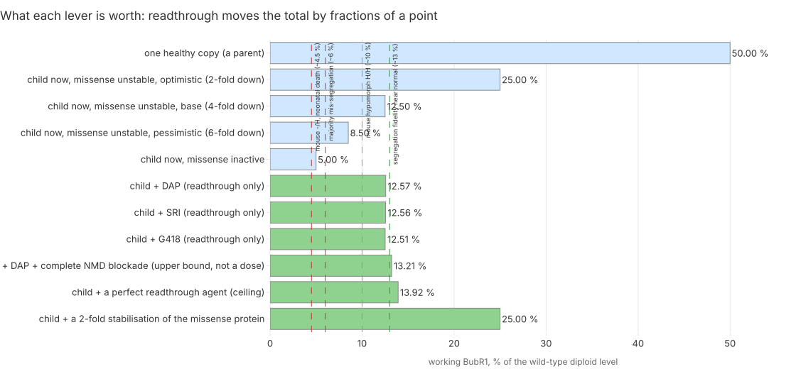

> **Legend** blue = untreated states · green = scenarios with a treatment · dashed = published
> genotypes as yardsticks (green safe, yellow the viable hypomorph, red the failing side).

**Both datasets.** The genome supplied the allele and its context; the **clinical** terms
disqualified the aminoglycoside class independently, because gentamicin is nephrotoxic and the
child carries **nephrocalcinosis (HP:0000121)**. Ataluren scores **0**: its EU authorisation was
not renewed (EC decision 28 Mar 2025), and its original signal has a documented luciferase
artefact (PMID 19208811).

---

## 6. Route R2 — which drugs raise BubR1 *protein*, once growth is taken out?

> **Rubric:** Rigor and Innovation. Direction D3 ("raise stable BubR1") is about protein amount,
> so it should be measured on protein, not mRNA.
> **Entry:** [159](../../../docs/iteration5/step-1/methodology/159-which-drugs-raise-bubr1-protein-once-proliferation-is-removed.md).
> **Source:** genome (the gene); this route does not use the clinical terms, and says so.

**The confound, stated first.** BubR1 is a mitotic protein: anything that slows or speeds
division moves it. In CCLE, BUB1B protein correlates with a proliferation score at **r 0.704**
across 378 cell lines; in the drug-perturbation data, **r 0.925 (r² 0.855)**. BUB1B sits in the
**99.7th percentile** of proliferation-bound proteins. Any uncorrected "BUB1B raiser" is a
growth artefact. We therefore score each compound on the **residual** after regressing out a
proliferation score defined in advance from a published G2/M gene set.


> **Legend** left: each dot is one compound, the dashed line the fitted proliferation dependence ·
> right: the same compounds by corrected rank, dashed line = the z ≥ 3 cut · green = a corrected
> riser, grey = context, not the subject.

### 6.1 The positive control, declared before BUB1B was looked at

In the primary dataset (Mitchell 2023, PMID 36593396 — 9,714 proteins × 875 compounds),
HSP90 inhibition must raise the heat-shock protein HSPA1A. It ranks **1st (z 46.7) and 2nd
(z 39.4) of 875**, against a "top 2 %" cut: **passed**. In the deep sets, bortezomib → HSPA1A
ranks 1st in all three cell lines; the nutlin → MDM2 control **failed in A549 and RKO**, so
those two datasets are marked uninterpretable and the rows they contribute are capped at
strength 0.10.


> **Legend** (a) the proteome control: green = the inducer ranks inside the gating cut, red =
> outside it · (b) the LINCS control: purple = uncorrected, blue = cell-cycle corrected; BUB3,
> MAD1L1 and MAD2L1 have no knockout row and are not drawn · dashed = the 5 % cut.

### 6.2 The result, and why it is thin

18 of 875 compounds raise BUB1B protein after correction. **Five are approved**, and all five
raise it by only **+14–16 %** (log2FC ≈ 0.2, robust z 3.4–4.3):

| drug | usual indication | robust z | rank of 875 |
|---|---|---|---|
| testolactone | breast cancer (withdrawn in several markets) | 4.33 | 12 |
| nisoldipine | hypertension | 3.85 | 14 |
| gliclazide | type 2 diabetes | 3.59 | 20 |
| ethoxzolamide | glaucoma | 3.44 | 22 |
| migalastat | Fabry disease (a pharmacological chaperone) | 3.42 | 23 |

**None of these has a mechanism argument for BubR1.** They are the approved tail of a
correlation-corrected screen in one colorectal cancer line. The largest raisers are unapproved
and non-specific — **Ro-3306** (a CDK1 inhibitor, +88 %) and **epoxomicin** (a proteasome
inhibitor, +45 %) — and their value is not as candidates but as a pointer: **the lever is
degradation**, which is exactly the branch §8 says is worth measuring.

Of the five, **migalastat** is the only one whose mechanism class (a chaperone that stabilises a
misfolded protein) is even conceptually aligned with the missense-unstable branch. We note that
as a hypothesis for a later iteration, not as evidence here: its target is an unrelated enzyme.


> **Legend** green = an approved corrected riser · blue = a corrected riser that is not approved ·
> red = z ≥ 3 but the protein *fell* (arrest, not a raise) · grey = every other compound ·
> marker size = breadth (the share of all proteins that compound raises) · dashed horizontal =
> z ≥ 3, dashed vertical = +25 % protein, dotted = no change.

### 6.3 The second part: a corrected LINCS signature — control **failed**

Entry 153's mRNA route failed its control because losing `BUB1B` looked like generic arrest. We
re-ran it with the proliferation component removed, then re-ran **its own** control: does the
`BUB1B`-loss signature resemble the loss of the other checkpoint genes?

**It does not.** Mean sibling percentile 44.23, permutation **p 0.390** (the PC1/PC3/PC10
variants also fail). Reversal was therefore **not run**, and this route contributes **zero**
candidate rows.

Two honest observations come out of the failure:

- The **uncorrected** baseline *passes* by the same rule (4.53 %, p 0.0041). So entry 153's
  failure was partly a query-formulation problem, not only biology — and our correction, which
  is the more defensible analysis, makes the result *worse*. We report the harder number.
- **TTK ranks 1st of 7,233 knockouts in every variant** (r 0.42 → 0.257 after correction) — the
  single checkpoint relationship that survives. TTK inhibitors are on the **avoid** list (§9.2),
  because weakening this child's checkpoint further is the one direction the mechanism forbids.

---

## 7. Route R3 — every intervention the literature reports, each backed by a verified quote

> **Rubric:** Rigor and Innovation. The strongest lead of iteration 4 came from a paper, not a
> database; this route makes that repeatable and auditable.
> **Entry:** [160](../../../docs/iteration5/step-1/methodology/160-every-bubr1-intervention-in-the-literature-with-a-verified-quote.md).
> **Sources:** both — the genome names the gene, the clinical terms filter the exposures.

**Why it exists.** No database has an edge saying "compound X raises BubR1 levels". That fact
lives in sentences. The risk of having a model read those sentences is fabrication, so the
**reproducible gate is code, not trust**: a verifier normalises whitespace and Unicode and
rejects any row whose quote is not a **verbatim substring** of the cached source text.

| stage | count |
|---|---|
| Europe PMC queries (no PMID, author or title seeded) | 6 |
| papers retrieved | 767 (760 with text; 1,065 cached texts, 307 open-access full texts) |
| sentences screened | 79,435 |
| sentences kept by the lexical screen | 1,109 (1.4 %) in 283 papers |
| rows written | **30** intervention + **12** patient-exposure = 42 |
| **rows surviving the quote gate** | **42 kept, 0 rejected** |

**Zero rejections is not proof that a gate works**, so the gate is **mutation-tested**: flipping
`increases` → `decreases` inside a true quote makes the row fail with `quote_not_in_source`, as
do too-short quotes, unknown PMIDs and out-of-vocabulary terms.

**Positive control, declared before the run:** queries written without seeding them must recover
North 2014 (NMN/SIRT2, PMID 24825348) and the two senescent-cell-clearance papers (18516091,
22048312), and produce a row for each. **Retrieval 3/3, extraction 3/3 — passed.**

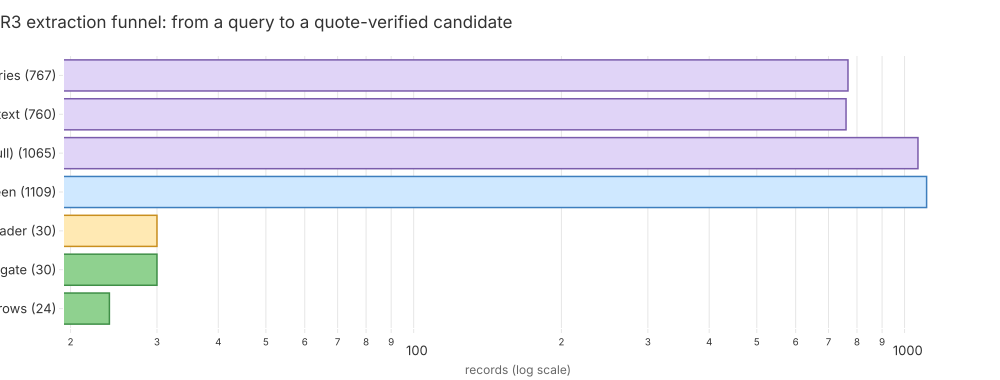

> **Legend** purple = the raw corpus · blue = each machine stage · yellow = the quote gate, the
> decision point · green = the rows that survive it. Log x-axis, so a short bar is still hundreds.

### 7.1 What it found

| intervention (as reported) | effect | approved class analogue | strength |
|---|---|---|---|
| NMN / NAD⁺ precursor | raises BubR1, extends life in the hypomorph | nicotinamide, niacin | 0.192 |
| MG132 (proteasome inhibition) | raises BubR1 | bortezomib, carfilzomib | 0.192 |
| TSA (HDAC inhibition) | BubR1 acetylation axis | vorinostat, romidepsin, belinostat, panobinostat, valproic acid | 0.144 |
| demethylation | BubR1 expression | decitabine, azacitidine | 0.144 |
| FTI-277 | BubR1 axis | lonafarnib | 0.144 |
| senescent-cell clearance | delays the hypomorph's ageing phenotypes | dasatinib (0.134), quercetin, fisetin, navitoclax (0.067) | |

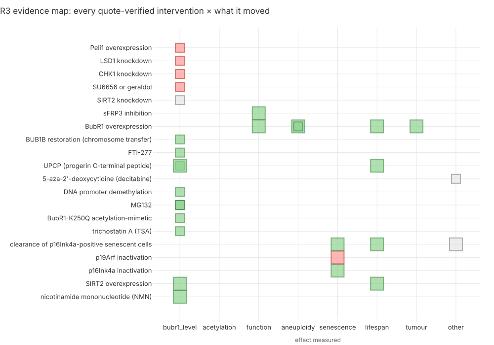

> **Legend** green = the direction a hypomorph wants · red = the wrong direction · grey = no
> agreed good direction. A big square is an animal or a patient, a small one is cells.

**The direction check matters more than the hits.** Every approved row above is a *declared class
analogue*: the gene → drug path returned **zero** mechanism molecules for SIRT2, CDKN2A, PELI1
and `BUB1B` itself. It did map `CHEK1` (9 inhibitors) and `KDM1A` (bomedemstat) to **harm** rows
— knockdowns that *lower* BubR1 — and the polarity filter kept them out of the candidate list
and onto the avoid list. A route that only collected "related drugs" would have proposed them.

### 7.2 What MVA patients were actually given — the finding no drug database holds

12 quote-verified exposure rows:

| finding | PMID | relevance to this child |
|---|---|---|
| a biallelic-`BUB1B` Wilms tumour case had a **severe adverse reaction to dactinomycin**; chemotherapy was abandoned | 31081598 | **the same gene** |
| a `BUB1B` PCS/MVA report advises **avoiding vincristine or taxol** | 28611924 | vincristine is standard in rhabdomyosarcoma — this child's **HP:0002859** |
| the only MVA1 stem-cell transplant: reduced-intensity treosulfan tolerated, then graft rejection, sepsis, death day +156 | 31053147 | a whole modality's record in this disease |
| **growth hormone ineffective** across 4 reports | — | against the child's short stature **HP:0004322** |

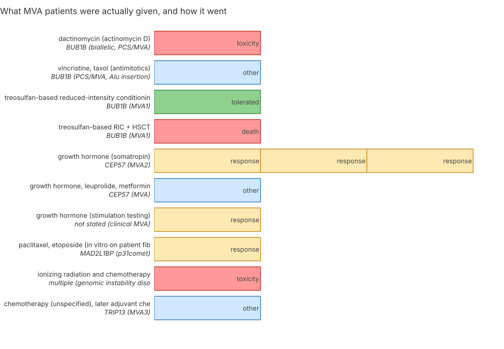

> **Legend** green = tolerated · yellow = a response question · red = toxicity or death · blue = an
> advisory statement.

---

## 8. Route R4 — which branch, and what is the next measurement worth?

> **Rubric:** Innovation and Impact. A ranked list answers "what would you give?". A clinician's
> real question is "what should we do next?", and those have different answers here.
> **Entry:** [161](../../../docs/iteration5/step-1/methodology/161-the-decision-and-what-the-next-measurement-is-worth.md).
> **Sources:** both — R1–R3's candidate rows (genome-derived) and the per-child safety table
> (genome + clinical).

**The model, stated plainly.** Two unmeasured state variables split the world:

- **`missense_class`** — is the missense protein *unstable* or *inactive*? Prior **0.55 / 0.45**,
  carried over from entry 149's stability work. No table in this iteration measures it.
- **`readthrough_feasible`** — **derived, not typed**: "feasible" means a readthrough dose lifts
  an untreated scenario past R1's 13.0 % fidelity cliff. Read from `allele_dosage.tsv`,
  **0 of 9 real dose pairs cross it → P(yes) = 0**; with R1's two upper bounds included,
  2 of 15 → 0.133, used as the top of the tornado range.

Each candidate's utility is a product of stated weights: evidence strength × applicability to the
state × a safety factor × a control factor (a route whose control failed is penalised). **This is
a transparent triage heuristic, not a calibrated posterior**, and the summary file says so in its
first line.

### 8.1 The decision

| state | prior | best action | utility |
|---|---|---|---|
| missense **unstable** | 0.55 | **gliclazide**, tied with **migalastat** | 0.70 |
| missense **inactive** | 0.45 | **dasatinib** | 0.40 |
| either, readthrough feasible | **0.00** | unchanged | — |

Overall best: **gliclazide, tied with migalastat, EU 0.385**. Ties are reported, never broken
silently.

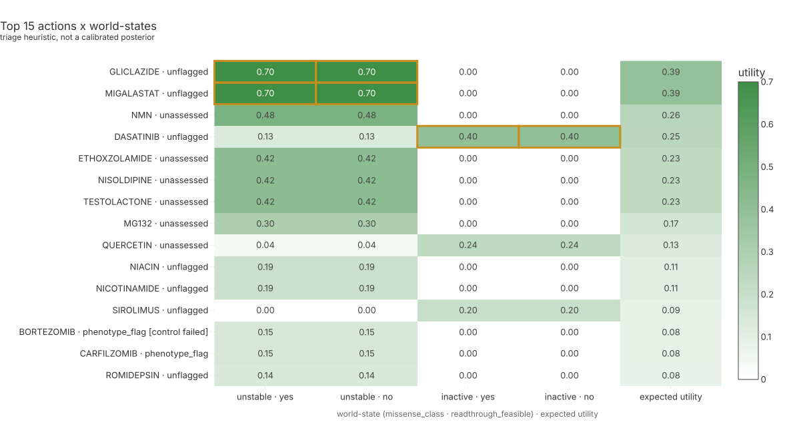

> **Legend** white → green = heuristic utility, 0 to the maximum · yellow outline = the best
> action in that state, with every tied action outlined · row label = the action and its
> per-child safety class.

### 8.2 The part that matters: value of information

| quantity | value | reading |
|---|---|---|
| **EVPI** (perfect knowledge of everything) | **0.180** | the whole ceiling |
| EVPPI on `missense_class` | **0.180** | **all** of it |
| EVPPI on `readthrough_feasible` | **0.000** | consistent with §5 |
| **EVSI, cycloheximide-chase blot** (sens/spec 0.85/0.85, a stated assumption) | **0.106** | **59 %** of the ceiling, positive across the whole tornado range (0.005–0.150) |
| EVSI, readthrough reporter assay | 0.000 | not worth running |

**The flip point.** The best action changes at **P(unstable) = 0.414** — dasatinib below,
gliclazide/migalastat above. Our prior of 0.55 sits only **0.14** above that line.

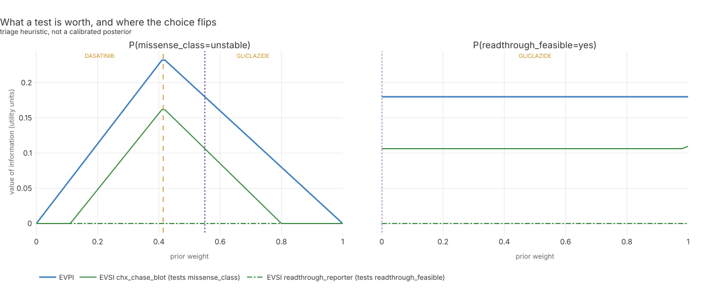

> **Legend** blue = EVPI, the upper bound · green = EVSI of a named test, one dash style per test,
> the legend naming the variable it measures · yellow dashed = the exact flip point, with each
> segment labelled by its best action · purple dotted = the configured prior (0.55).

### 8.3 What is *not* robust, said before anyone asks

The tornado flips the recommended drug in three places: at P(unstable) 0.2 (→ dasatinib), at R2
route weight 0.25 (→ NMN), and when unassessed drugs are given full weight (→ NMN).

**So the drug at the top is not robust; the value of the blot is.** The blot's EVSI stays
positive over every range we swept. That asymmetry is the single most useful output of this
iteration, and it is why §9 leads with a measurement rather than a molecule.

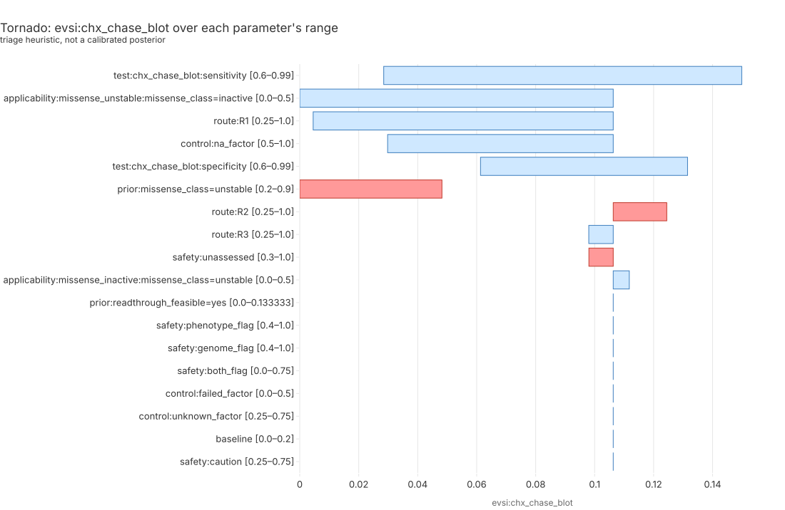

> **Legend** blue bar = the metric's range as one parameter moves low → high with the rest held ·
> red = the best action changes somewhere within that range.

---

## 9. Potential impact

> **Rubric:** Impact (25 %). What a treating team or a lab could do with this, and what they
> should not do.

### 9.1 One measurement, ahead of any prescription

**A cycloheximide-chase Western blot on the child's cells against his parents'** — block new
protein synthesis, then measure how fast BubR1 disappears. It answers *unstable vs inactive*
directly, overriding every prediction in this report, and §8 prices it at **59 % of everything
perfect knowledge could buy**. No drug on our list is worth anything close to that.

A second, cheaper experiment worth naming: **allele-specific expression** measurement on the
child's transcripts, to confirm how much of the stop allele's message survives NMD. No such
measurement exists for `BUB1B` in any MVA patient (§12), which is a gap this case could close.

### 9.2 The avoid list — the part we are most confident in

35 rows, each tied to its source. Unlike the candidates, these rest on converging evidence:

| avoid | why | source |
|---|---|---|
| Mps1/TTK and Aurora inhibitors | weakening a checkpoint that is already weak; 33 of 34 are *less* effective in high-aneuploidy lines | entry 151, reproducing PMID 33505028 |
| 9 CHEK1 inhibitors, bomedemstat (KDM1A) | knockdowns of these targets **lower** BubR1 — the wrong direction | entry 160, PMID 19778378 |
| geldanamycin / HSP90 inhibitors | same, wrong direction | entries 159, 160 |
| gentamicin, amikacin, G418 | nephrotoxic against the child's **nephrocalcinosis (HP:0000121)**, and the +4 A context makes them the weakest readthrough class for *this* stop | entries 158, 161 |
| dactinomycin | severe reaction in a **biallelic-`BUB1B`** patient | entry 160, PMID 31081598 |
| vincristine, paclitaxel | advised against in a `BUB1B` MVA report; vincristine separately flagged by the child's own CYP3A5 call and by muscle-atrophy label matching to his **HP:0003701** | entries 152, 155, 160 |
| 13 spindle poisons (caution, not exclusion) | they act through the checkpoint the child lacks | iteration 4 §4 (A2) |
| somatropin (caution) | ineffective across 4 MVA reports | entry 160 |

Three of these classes are also on the candidate list from other routes, and are driven to
utility **0** by the avoid layer: G418, gentamicin, geldanamycin. A pipeline without a
direction-aware avoid layer would have proposed all three.

### 9.3 Safety coverage, stated as coverage and not as safety

Entry 152's per-child method was re-run on the 47 iteration-5 names with no new downloads. Of 45
drugs: **9 unflagged, 7 phenotype-flagged, 2 genome-flagged, 24 unassessed** (no OnSIDES label),
3 avoid. The furosemide and calcitriol controls both reproduced.

**"Unflagged" never means safe** — it means two specific sources were silent. 24 of 45 drugs were
not assessable at all, and the delivered callset answers only **1.6 %** of pharmacogene positions
([entry 152](../../../docs/iteration4/step-9/methodology/152-is-each-candidate-safe-for-this-child.md)).

---

## 10. What is new here, against standard practice

> **Rubric:** Innovation (25 %).

| idea | standard practice | what iteration 5 did |
|---|---|---|
| therapy priced **per allele** | a gene gets a drug list | the stop codon's own context predicts readthrough, and a dosage arithmetic converts it into percentage points of working protein — which is what ruled the class out |
| **the confound is the analysis** | screen for "drugs that raise gene X" | BUB1B is 99.7th-percentile proliferation-bound, so the score *is* the residual after removing growth; the uncorrected version would have produced a longer, wronger list |
| a **code-enforced quote gate** on model-read literature | an LLM summarises papers | every row's quote must be a verbatim substring of the cached source, and the gate is mutation-tested |
| **direction checks and an avoid layer** | related drugs are proposed | knockdowns that lower the protein produce *avoid* rows, not candidates; three proposed drugs are driven to zero |
| **decide, then price the next measurement** | a ranked list | EVPI/EVSI: the bench test is worth 59 % of perfect knowledge, and the top-ranked drug is not robust — both stated |
| a **failed control ends a route** | a weak result is reported anyway | two of six controls failed; both routes are reported as uninterpretable and contribute nothing |

---

## 11. Scalability: the same three routes on a second disease

> **Rubric:** Scalability (15 %). **Entry:** [162](../../../docs/iteration5/step-1/methodology/162-the-three-routes-on-bloom-syndrome.md).

All three discovery routes were re-run on **Bloom syndrome (`BLM`)** — the same second disease
iteration 4 used, so the costs are directly comparable.

| route | new card | config lines | code ± | control | wall clock |
|---|---|---|---|---|---|
| R1 readthrough + dosage | 2 files | 311 | +330 / −135 | **passed**, plus an external check | 6.1 s |
| R2 proteomics | **none** | **0** | +47 / −59 | **passed** (dataset-level, reused) | 12.5 s |
| R3 literature mining | 1 file | 276 | +114 / −41 | **FAILED** (extraction 0/3) | 738 s |
| total | 3 | **587** | +491 / −235 | | ~12.6 min |

**The yardstick:** entry 156's transfer of the iteration-4 chain to the same disease needed a
**378-line purpose-built driver plus a 24-rule relabelling pass**. Here it is 587 lines of
*configuration* (case cards, no logic) plus **271 lines of one-time parameterisation** that every
future case inherits. R2 transferred with **no card at all**.

**Three things we report against ourselves.**

1. **"Configuration only" was false as the routes stood.** Each of the three had a constant
   hiding in a shared module (the effect vocabulary, the directness scale, the target gene, the
   case name, the manifest prose). All are now parameters, guarded by
   `tests/test_drugs_case_cards.py`. We report both **271** (the parameterisation) and **357**
   (that plus the five module splits the repo's own 400-line size gate then forced). Neither
   counts the 134 lines of *new capability* the transfer added, which are not a transfer cost;
   the full added diff is 491 lines.
2. **R3's declared control failed: retrieval 3/3, extraction 0/3.** The diagnosis is that two of
   the three famous Bloom papers we named in advance are genotype–phenotype *observations*, not
   interventions, so the screen correctly dropped them — **the control was mis-specified, not
   the code**. All 5 BLM candidate rows carry `positive_control_passed = false` and are reported
   as uninterpretable. A corrected control is named in the entry and marked **post-hoc**, so it
   is not a validation.
3. **A residual case-shaped leak, found by the transfer and left standing.**
   `readthrough_tables.write_dosage` hard-codes the labels `stop`/`missense` as column names; for
   the BLM homozygote both alleles are stops, so the per-allele columns are wrong (totals are
   right). Fixing it would rename a column in the first case's frozen table and break the
   byte-identity check, so it is recorded as a known defect for the next iteration.

**Every one of the nine first-case tables is byte-identical** after the parameterisation and
again after the module split — checked twice, digests in the entry.

**A real finding came out of the transfer.** Toledano 2024 measured a `BLM` premature stop
directly, so its context was deleted from the fit and predicted blind: **Spearman 0.70 across 9
compounds (p 0.036), MAE 0.41 pp** — the first time any readthrough number in this iteration met
a measurement of the same allele. But the model **over-predicts by 3–4× for the two compounds it
ranks highest** (SJ6986, SRI: predicted ~1.2 %, measured ~0.28 %). §5's conclusion does not flip
— the error runs optimistic and the number was already far too small to matter — but any future
quotation of those values needs this error bar.

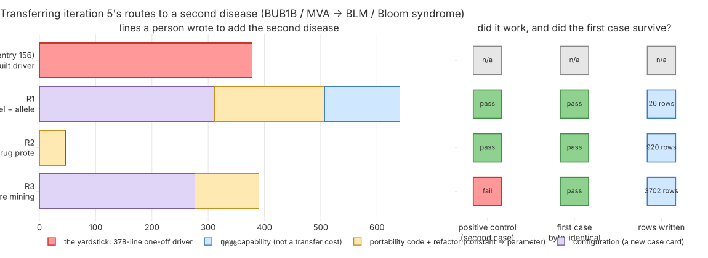

> **Legend** purple = configuration (a case card) · yellow = code that turned a constant into a
> parameter · blue = a new capability, which is not a transfer cost · green = a check that passed ·
> red = the one-off driver this replaces.

---

## 12. What this report cannot tell you

> **Rubric:** Rigor. The limits, next to the results they bound.

- **No pre-registered claims.** This iteration files none (§3). Positive controls are a weaker
  guard against steering than pre-registration, and we say so rather than implying otherwise.
- **The top-ranked drug has no mechanism argument.** Gliclazide and migalastat rest on a 14–16 %
  protein rise in one colorectal cancer line. Three separate assumptions flip the top of the list.
- **Two of six controls failed** (corrected LINCS; R3 on Bloom). Those routes contribute nothing.
- **The mechanism class is predicted, not measured.** Everything in §8 turns on a variable no
  experiment in this repo has measured — which is exactly why §9.1 leads with the blot.
- **The readthrough model over-predicts its own top compounds by 3–4×** (§11).
- **Nothing was measured in this child's cells.** Every protein number comes from cancer cell
  lines or mice; no ASE or NMD-rescue measurement exists for `BUB1B` in any MVA patient.
- **A known defect is open** in the dosage table's per-allele columns for homozygous cases (§11).
- **Safety sources are silent more often than they speak**: 24 of 45 drugs unassessed; the
  callset answers 1.6 % of pharmacogene positions.
- **One route could not be run at all**: decryptE (MassIVE MSV000093659) was unreachable from
  this machine. It is stated, not substituted.

---

## 13. Reproducibility

> **Rubric:** Rigor. Every table in this report regenerates from committed code.

```bash
# R1 — readthrough context model, held-out control, allele dosage
uv run python tools/it5_readthrough.py run
uv run python tools/render_it5_r1.py

# R2 — proliferation-corrected proteomics; the corrected LINCS control
uv run python tools/it5_proteome.py run
uv run python tools/it5_lincs_cc.py run
uv run python tools/render_it5_r2.py

# R3 — corpus, quote gate, translation to approved analogues
uv run python tools/it5_litmine.py run
uv run python tools/render_it5_r3.py

# R4 — decision, VOI, avoid list
uv run python tools/it5_decision.py run \
  --candidates 'ressources/track2/it5/*_candidates.tsv' \
  --safety ressources/track2/it4/candidate_safety.tsv \
  --out ressources/track2/it5
uv run python tools/render_it5_r4.py --work ressources/track2/it5 --out figures/it5

# The second disease
uv run python tools/it5_transfer_summary.py
uv run python tools/render_it5_s1.py

# This report
uv run python tools/md_to_html.py submissions/track2/iteration-5/report.md \
  build/track2-it5-report.html --repo-url https://github.com/agharsallah/mva-hackathon/blob/main
node tools/md_to_pdf.mjs build/track2-it5-report.html \
  submissions/track2/iteration-5/agharsallah_track2_report.pdf
```

**Provenance.** Every `.tsv` in `ressources/track2/it5/` has a `.provenance.json` naming its
inputs with sha256, its parameters, its assumptions, its limitations and the methodology entry
that produced it. Lineage edges are in `warehouse.data_lineage` under `track2.it5.*`.

**Data used.** Toledano 2024 (PMID 39174735); Mitchell 2023 (PMID 36593396); Saei 2019
(PMID 31844049); Nusinow 2020; Mathieson 2018; LINCS L1000 2021; ChEMBL 37; openFDA; OnSIDES
v3.1.1; Europe PMC; Ensembl 116; UniProt O60566; MGI; PharmCAT.

---

## 14. Where every claim lives

| what | where |
|---|---|
| the stop allele's anatomy, the readthrough control, the dosage arithmetic | [entry 158](../../../docs/iteration5/step-1/methodology/158-the-stop-allele-can-be-read-through-and-it-is-not-the-lever.md) |
| proliferation correction, the HSPA1A control, the corrected LINCS failure | [entry 159](../../../docs/iteration5/step-1/methodology/159-which-drugs-raise-bubr1-protein-once-proliferation-is-removed.md) |
| the corpus, the quote gate, the direction check, MVA exposures | [entry 160](../../../docs/iteration5/step-1/methodology/160-every-bubr1-intervention-in-the-literature-with-a-verified-quote.md) |
| the decision, EVPI/EVSI, the flip points, the avoid list | [entry 161](../../../docs/iteration5/step-1/methodology/161-the-decision-and-what-the-next-measurement-is-worth.md) |
| the second disease and what the transfer cost | [entry 162](../../../docs/iteration5/step-1/methodology/162-the-three-routes-on-bloom-syndrome.md) |
| why no hypotheses were filed | [the note](../../../docs/iteration5/notes/exploratory-no-hypotheses.md) |
| the step's written summary and one caption per figure | [`narrative.json`](../../../docs/iteration5/step-1/narrative.json) |
| every term used here, defined for a beginner | [`docs/dictionary.md`](../../../docs/dictionary.md), chapters 30 (the routes) and 31 (deciding, and proving it transfers) |

---

## Appendix A — every drug any route named

The full candidate set, with route, branch, evidence kind, strength, whether its route's control
passed, and its safety class, is
[`ressources/track2/it5/decision_utilities.tsv`](../../../ressources/track2/it5/decision_utilities.tsv);
the avoid rows with their sources are
[`decision_avoid.tsv`](../../../ressources/track2/it5/decision_avoid.tsv). Top of the ranking:

| rank | drug | routes | EU |
|---|---|---|---|
| 1 | **gliclazide** (tied) | R2 | 0.385 |
| 1 | **migalastat** (tied) | R2 | 0.385 |
| 3 | NMN | R1, R3 | 0.264 |
| 4 | dasatinib | R1, R3 | 0.254 |
| 5 | ethoxzolamide · nisoldipine · testolactone (tied) | R2 | 0.231 |
| 8 | MG132 *(not approved)* | R1, R3 | 0.165 |
| 9 | quercetin | R1, R3 | 0.130 |
| 10 | niacin | R3 | 0.106 |

**Read this table with §8.3 and §12 in hand:** the ordering is a triage heuristic, three
assumptions flip its top, and the report's actual recommendation is the measurement in §9.1.
